<!-- README.md is generated from README.Rmd by the last line of analysis/10_figures.R
     (knitr::knit). Edit README.Rmd, never README.md. Every number below is computed
     from data/derived/ when the file is knitted. -->

```{r setup, include = FALSE}
knitr::opts_chunk$set(echo = FALSE, eval = TRUE, comment = "")
source("R/md_table.R")
rd  <- function(p) utils::read.csv(file.path("data/derived", p))
med <- function(x) stats::median(x, na.rm = TRUE)
f2  <- function(x) sprintf("%.2f", x)
pct <- function(x) sprintf("%.0f%%", 100 * x)
n   <- function(x) format(x, big.mark = ",")

flow    <- rd("01_relative_cover/flow_counts.csv")
res     <- readRDS("data/derived/03b_strength_y3/strength_df.rds")
res_all <- readRDS("data/derived/02_strength/strength_df.rds")
exps    <- readRDS("data/derived/prep/experiments.rds")
exps    <- exps[exps$experiment_id %in% res$experiment_id, ]
years   <- range(exps$last_year - exps$first_year + 1)
stab    <- rd("03_temporal/stability.csv")
s04     <- rd("04_classification/species_summary.csv")
het05   <- rd("05_ladder_fit/heterogeneity.csv"); het05 <- het05[het05$rowset == "all", ]
fit06   <- rd("06_ladder_predict/fit_metrics.csv")
pred06  <- rd("06_ladder_predict/pred_metrics.csv")
fvm     <- rd("06b_forest/forest_vs_metafor.csv"); fvm <- fvm[fvm$metric == "r2", ]
col     <- readRDS("data/derived/07a_colonizers/strength_df_y3.rds")
stab07  <- rd("07a_colonizers/stability.csv")
never   <- rd("07a_colonizers/never_present.csv")
s07b    <- rd("07b_classification/species_summary.csv")
lad07   <- readRDS("data/derived/07c_ladder_fit/ladder_rows.rds")
pred07  <- rd("07d_ladder_predict/pred_metrics.csv"); pred07$r2[pred07$r2 < -100] <- NA
cover   <- rd("10_figures/fig4_pie_cover.csv")
ladder_rows <- het05[het05$model == "Null", ]
pm  <- function(d, lv, k = "r2") med(d[d$level == lv, k])
tau <- function(m) het05$tau2[het05$model == m]
# forest against meta-regression as in the 06b report: per level, the median over gradients of
# the per-gradient difference; the Null level is left out (the forest's Null is the training mean)
fvm_lv  <- fvm[fvm$level != "null", ]
fl      <- sapply(split(fvm_lv, fvm_lv$level), function(x) c(metafor = med(x$metafor), forest = med(x$forest), diff = med(x$forest - x$metafor)))
lv_name <- c(start = "Start", climate = "Climate", climate_start = "Climate + start", species = "Species-dependent",
             ldmc = "LDMC", lma = "LMA", height = "Height", graminoid = "Graminoid", woody = "Woody", phylogeny = "Phylogeny", niche = "Niche")
for_better <- colnames(fl)[fl["diff", ] > 0]
for_better_name <- unname(ifelse(for_better %in% names(lv_name), lv_name[for_better], sub("^(.*)\\+species$", "\\1 + species", for_better)))
fvc     <- rd("07e_forest/forest_vs_metafor.csv"); fvc <- fvc[fvc$metric == "r2", ]
col_null_forest <- med(fvc$forest[fvc$level == "null"])
cor_y3 <- with(merge(res_all[c("effect_id", "strength")], res[c("effect_id", "strength")], by = "effect_id"), cor(strength.x, strength.y))
```

# TransPlant winners and losers

The analysis for the TransPlant "winners and losers" manuscript: which plant species gain and which lose when whole turfs are moved down an elevation gradient, and where the variation in their responses among experiments comes from. Every number and figure here is produced by the code in this repository; this page is the realized version of the analysis plan, step by step, with the decisions taken along the way, the modelling code and the figures in the order the analysis produces them.

## Contents

- [Motivation](#motivation)
- [The analysis at a glance](#the-analysis-at-a-glance)
- [Data and selection](#data-and-selection)
- [Q1. Time: is a species' response stable from year to year?](#q1-time)
- [Q2. Consistency: which species win or lose everywhere?](#q2-consistency)
- [The experiments in climate space](#the-experiments-in-climate-space)
- [Q3 and Q4. The ladder: what explains and what predicts the response?](#q3-and-q4-the-ladder)
- [Colonizers: the second way of winning](#colonizers)
- [Pathways: who wins, who loses, who arrives](#pathways)
- [The coefficients, residents beside colonizers](#the-coefficients)
- [Repository structure](#repository-structure)
- [Running the analysis](#running-the-analysis)
- [Data and citation](#data-and-citation)

## Motivation

Predicting which plant species will gain and which will lose under climate change is complicated by the variability of species responses: the same species increases in abundance at one site and decreases at another. This variation is commonly described as context dependency. As long as its sources remain unidentified, it limits our ability both to understand species responses to climate change and to predict them for sites that have not been studied. Ideally, the response of a species at a new site would be predictable from attributes that are commonly known, the environment of the site and the characteristics of the species, without the species having been observed under warming there. Whether this is possible depends on where the variation comes from. Four sources may contribute to this variation, and the order in which they are considered matters. The first is time, which can be confounded with context: because species respond to climate change along transient trajectories, the same species observed at different moments along its trajectory may appear to respond differently while following a single curve. The second source is the starting condition of a species, its abundance in the community: a species that holds two percent of the cover cannot lose more than two percent, and a species abundant in the surrounding vegetation colonizes more rapidly than a rare one, so that starting abundance bounds the response before any climatic effect has acted. The third source is the environment, the warming itself and the background temperature and precipitation under which it occurs: a species that responds consistently, for example losing more cover the drier the site, will nonetheless appear as a winner at a wet site and as a loser at a dry one, so that apparent inconsistency may reflect a consistent response observed in different contexts. The fourth source is the species itself. Species may differ in their response to a given environment and starting condition, and these differences may or may not be captured by measurable species properties such as functional traits, growth form, evolutionary relatedness or climatic niche.

Here, we use a network of `r length(unique(res$experiment_id))` whole-community downslope transplant experiments along `r length(unique(res$gradient_id))` elevation gradients across the Northern Hemisphere, with vegetation surveys spanning `r years[1]` to `r years[2]` years after transplantation [P1], to quantify the response of every species to warming in every experiment and to ask where the variation in this response among experiments comes from. The quantity we examine is the response of a species to warming in a given experiment, and context dependency is the variation of this quantity among experiments beyond sampling error. For winning we define two pathways, resident species that increase their relative abundance in the warmed community and species of the destination vegetation that colonize it, and we analyse the two pathways separately for each of the questions below. Specifically, we ask: (1) Are warming winners and losers within experiments consistent over time since warming began? (2) Across experiments, are some species consistent winners or consistent losers, and how much does a species' response vary among experiments beyond sampling error? (3) How much of this variation is explained, within the experiments studied, by the environment, that is the warming applied and the background climate of the destination, how much by species' starting conditions, and how much by species' properties, their functional traits, growth form, phylogenetic position or climatic niche? (4) How well do the same three sources predict the responses of species in a gradient where no experiment has been done? Question 3 thus asks for explanatory power and question 4 for predictive power, which is what is available for a mountain not yet studied.

## The analysis at a glance

| Step | What it does | Result |
|---|---|---|
| [P1–P7](#data-and-selection) | Community, taxonomy, traits, phylogeny, climate and niche prepared once, every join on the TNRS-resolved name | `r flow$n_experiments[2]` experiments kept from `r flow$n_experiments[1]` |
| [01](#data-and-selection) | Relative cover; pool rule (who is a resident, who a potential colonizer); pool-size rule | `r flow$n_experiments[6]` experiments, `r n(flow$n_combinations[6])` resident and `r n(flow$n_combinations[7])` colonizer species × experiment |
| [02](#q1-time) | One `glmmTMB` per experiment; warmed − origin-control contrast per species, per year and over years | `r n(nrow(res_all))` resident strengths |
| [03](#q1-time) | Year-specific classes at years 2, 3, 4, 6; sign agreement and concordance between adjacent years | concordance `r f2(stab$ccc[1])` (years 2 to 3), `r f2(stab$ccc[2])` (3 to 4) |
| [03b](#q1-time) | Strength re-averaged over years 3 and later, the strength used downstream | correlation with the all-years strength `r f2(cor_y3)` |
| [04](#q2-consistency) | Per species pooled strength and among-experiment variance; prediction interval against zero | `r sum(s04$class == "Consistent winner")` consistent winners, `r sum(s04$class == "Consistent loser")` consistent losers, `r sum(s04$class == "Context-dependent")` context-dependent of `r nrow(s04)` species |
| [05](#q3-and-q4-the-ladder) | Twelve meta-regressions, Null to Species-dependent to one property at a time | τ² from `r signif(tau("Null"), 2)` (Null) to `r signif(tau("Species-dependent"), 2)` (Species-dependent) |
| [06](#q3-and-q4-the-ladder) | Leave one gradient out; R² against the Null, Spearman and loser/winner skill per gradient | median held-out R²: initial abundances `r f2(pm(pred06, "start"))`, Species-dependent `r f2(pm(pred06, "species"))` |
| [06b](#q3-and-q4-the-ladder) | Random forest on the same rows and folds | higher than the meta-regression at `r length(for_better)` of `r ncol(fl)` levels, by at most `r f2(max(fl["diff", ]))` |
| [07a](#colonizers) | Colonizer strength: warmed cover, one `glmmTMB` per experiment; year-specific presence classes | `r n(nrow(col))` colonizer strengths in `r length(unique(col$experiment_id))` experiments |
| [07b](#colonizers) | Step C for colonizers | `r sum(s07b$class == "Consistent colonizer")` consistent colonizer`r if (sum(s07b$class == "Consistent colonizer") != 1) "s"` among `r nrow(s07b)` species |
| [07c–07e](#colonizers) | The ladder, its predictions and the forest for colonizers | only destination abundance transfers (median held-out R² `r f2(pm(pred07, "start"))`) |
| [07f](#pathways) | Traits of losers, winners and colonizers | Fig 5 |
| [10](#the-experiments-in-climate-space) | Synthesis figures, appendix and this page | Figs 4, 7, S1–S19 |
| [12](reports/12_final_review.md) | Final review: reruns, code, documentation, open issues, statistical weak points | no result changed; decisions listed |

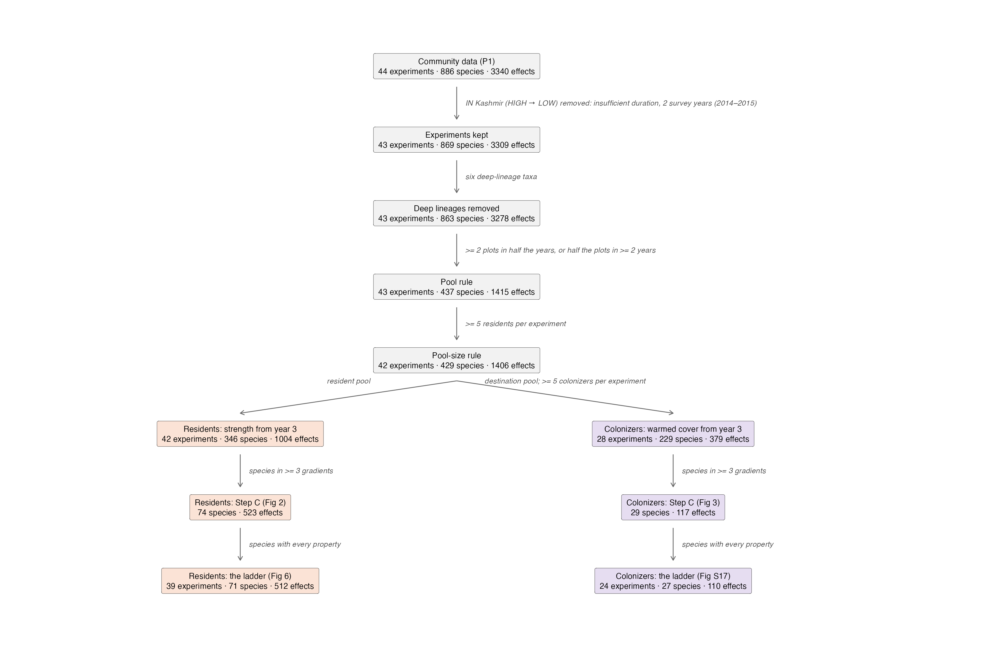

**Figure S1.** Data flow from the network database to each analysis. Each box gives the number of experiments, species and species × experiment effects that remain after the rule written on the arrow above it. The shared steps (grey) split into the resident branch (orange, left), which leads to the classification (Figure 2) and the model ladder (Figure 6), and the colonizer branch (purple, right), which leads to the colonizer classification (Figure 3) and the colonizer ladder (Figure S17). The classification boxes count species and their effects.

**What each selection removes.** Each row is one rule, in the order the analysis applies it, with what it removes and what is left. Residents and colonizers split after the pool rule; their later rows count from the row above on their own branch.

```{r selection, results = "asis"}
f_ <- function(d) c(n_distinct(d$experiment_id), n_distinct(d$species), nrow(d))
n_distinct <- function(x) length(unique(x))
st_res <- res[res$species %in% s04$species, ]; st_col <- col[col$species %in% s07b$species, ]
sel <- data.frame(
  step = c("P1", "P1", "01", "01", "01", "01", "01", "07a", "04", "07b", "05", "07c"),
  code = c("[community.R](prep/R/community.R)", "[community.R](prep/R/community.R)", rep("[01_relative_cover.R](analysis/01_relative_cover.R)", 5),
           "[07a_colonizers.R](analysis/07a_colonizers.R)", "[04_classification.R](analysis/04_classification.R)",
           "[07b_classification.R](analysis/07b_classification.R)", "[05_ladder_fit.R](analysis/05_ladder_fit.R)", "[07c_ladder_fit.R](analysis/07c_ladder_fit.R)"),
  rule = c("Network data, species identified to species level",
           "Experiments with too short a record are left out (IN_Kashmir, two survey years)",
           "Ferns, horsetails, clubmosses and juniper are left out: lineages far from the flowering plants the questions concern (their cover still counts in the relative-cover denominator)",
           "A species must be established in the controls: recorded in at least two plots in half of the years, or in half of the plots in at least two years",
           "An experiment needs at least 5 residents for a species to be compared within it (US_Arizona has 4)",
           "Residents: established in the origin controls",
           "Destination pool: established in the destination controls, never recorded in the origin controls",
           "Colonizers: an experiment needs at least 5 destination-pool species, as for residents",
           "Residents in at least 3 gradients, so that their variation among experiments can be estimated",
           "Colonizers in at least 3 gradients, as for residents",
           "Residents with every property (traits, growth form, phylogeny, niche), so all twelve models use the same rows",
           "Colonizers with every property, as for residents"),
  parent = c(NA, 1, 2, 3, 4, 5, 5, 7, 6, 8, 9, 10),
  split = c(rep(FALSE, 5), TRUE, TRUE, rep(FALSE, 5))) # the pools divide the rows: nothing is removed there
counts <- rbind(as.matrix(flow[1:7, c("n_experiments", "n_species", "n_combinations")]), f_(col), f_(st_res), f_(st_col),
                c(ladder_rows$n_experiments, ladder_rows$n_species, ladder_rows$n_effects), f_(lad07))
lost <- function(k) ifelse(is.na(sel$parent) | sel$split, "", paste0("−", counts[sel$parent, k] - counts[, k], " → "))
sel_tab <- data.frame(Step = sel$step, Code = sel$code, `Rule and why` = sel$rule,
                      Experiments = paste0(lost(1), counts[, 1]), Species = paste0(lost(2), counts[, 2]),
                      `Species × experiment` = paste0(lost(3), counts[, 3]), check.names = FALSE)
cat(md_table(sel_tab), sep = "\n")
removed <- function(k) ifelse(is.na(sel$parent) | sel$split, NA, counts[sel$parent, k] - counts[, k])
write.csv(data.frame(step = sel$step, code = sub("^\\[(.*)\\]\\(.*\\)$", "\\1", sel$code), rule = sel$rule,
                     experiments_removed = removed(1), experiments_left = counts[, 1],
                     species_removed = removed(2), species_left = counts[, 2],
                     effects_removed = removed(3), effects_left = counts[, 3]),
          "tables/selection_table.csv", row.names = FALSE, fileEncoding = "UTF-8")
```

The same table, with the removed and remaining counts as separate columns, is in [`tables/selection_table.csv`](tables/selection_table.csv).

## Data and selection

The community data are the TransPlant network database (`data/transplant_network_clean.sqlite`). Its taxonomy columns are never used: every name is resolved once with `tidyTRY::resolve_species()` (TNRS, WCVP), and decisions on names that TNRS cannot settle sit in reviewed ledgers under `prep/config/`. The preparation is a `targets` pipeline in [`prep/`](prep/) with one target per preparation step (P1 community and taxonomy, P2 TRY traits, P3 growth form and phylogeny, P4 climate, P6 niche from our own GBIF download, P7 trait checks).

- **Experiments.** IN_Kashmir is excluded at P1 (two survey years). The pool-size rule below then removes US_Arizona (four residents), which leaves `r length(unique(res$experiment_id))` experiments in `r length(unique(res$gradient_id))` gradients.
- **Pools** (step 01, decided 2 Nov). A species is a *resident* of an experiment if it is recorded in the origin controls in at least two plots in half of the years, or in half of the plots in at least two years; a *colonizer* if it meets the same rule in the destination controls and was never recorded in the origin controls. An experiment needs at least 5 residents (5 colonizers for the colonizer analyses).
- **Species across experiments.** The classification (Q2) and the ladder (Q3, Q4) use species found in at least 3 gradients; the ladder further keeps only species that carry every property, so that all twelve models are fitted to the same rows (`r n(ladder_rows$n_effects)` resident effects of `r ladder_rows$n_species` species in `r ladder_rows$n_experiments` experiments).
- **Relative cover** is computed over all vascular cover of a plot-year, unidentified and genus-level records included (decided 28 Oct).

Properties: LDMC, LMA and vegetative height from TRY, screened for outliers and unit slips (Fig S2); graminoid and woody growth form; the first three phylogenetic eigenvectors (PEV1–3, Fig S3, Table S3); the thermal and precipitation optima from GBIF occurrences and CHELSA (bio10, bio18). Their distributions and the check of the niche climatology against the experiments' own climate are in Fig S4.

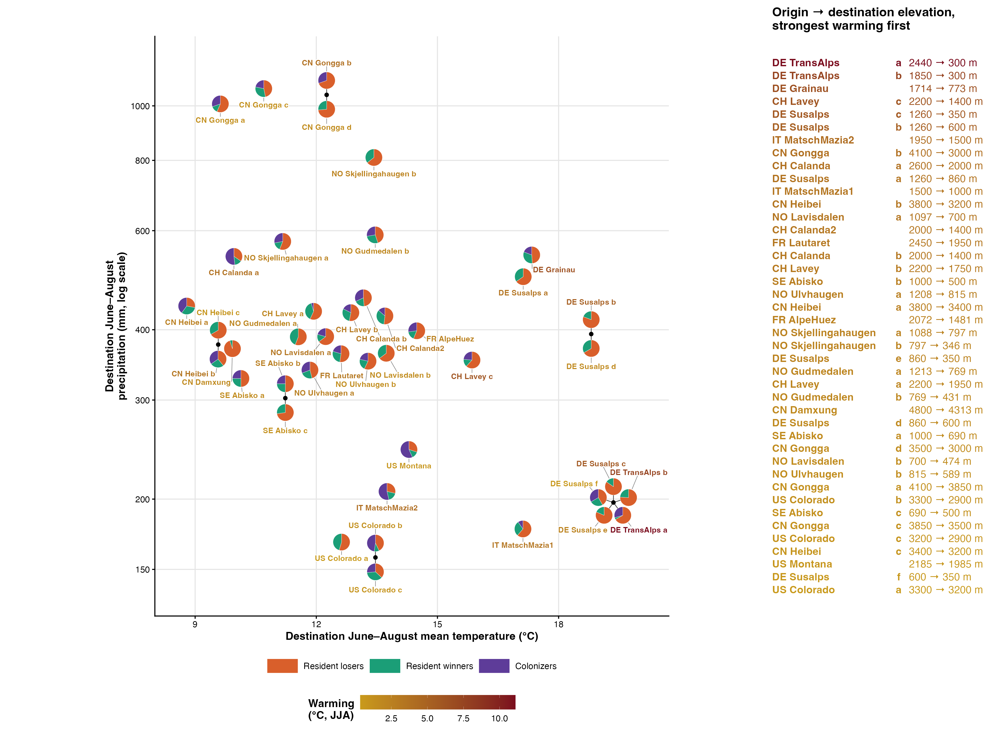

**Figure S2.** Screening of the TRY trait records. Every record of leaf dry matter content (LDMC, g g⁻¹), leaf mass per area (LMA, mg mm⁻²) and vegetative height (m), in its natural units on a log-spaced axis; the number of records is on a square-root scale. Grey records were kept. Coloured records were removed: outliers more than 3.5 robust standard deviations from their species' median on the log scale (yellow), unit slips of about 10, 100 or 1000 times their species' median (orange), records that are both (pink), all records of the seven tree species (green), and species × trait values set to missing after review (blue).

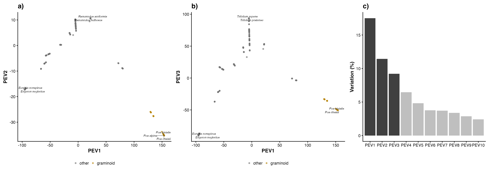

**Figure S3.** Phylogenetic axes of the analysed species. Phylogenetic eigenvector 1 (PEV1) against (a) PEV2 and (b) PEV3, one point per species, graminoids in gold and other species in grey; the species at the extremes of each axis are named. (c) Share of the positive variation in phylogenetic distances captured by each of the first ten eigenvectors; the three axes used as the phylogeny property are dark. Table S3 lists the families at each end of each axis.

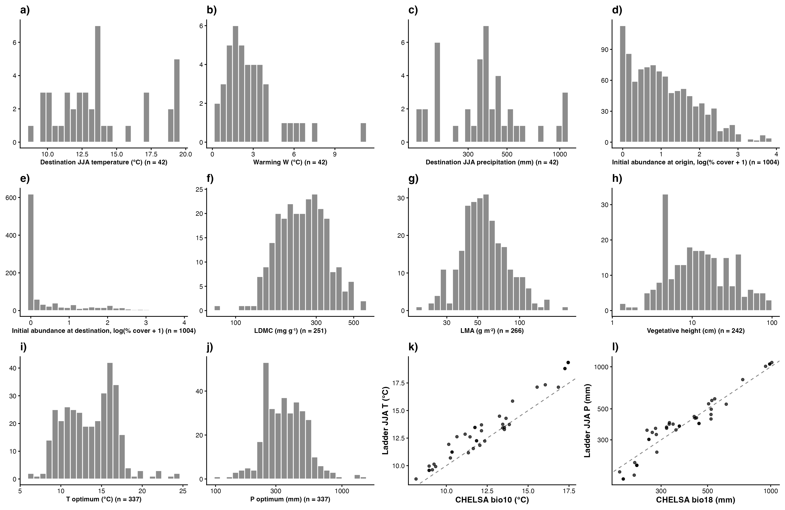

**Figure S4.** Distributions of the predictors before standardization, and checks of the niche climatology. Across the `r length(unique(res$experiment_id))` experiments: (a) destination June–August mean temperature, (b) experimental warming, the difference in June–August temperature between destination and origin, and (c) destination June–August precipitation. Across the `r n(nrow(res))` resident species × experiment: initial abundance, log(% cover + 1) at the first survey, in (d) origin and (e) destination controls. Across resident species: (f) LDMC, (g) LMA, (h) vegetative height, (i) thermal optimum and (j) precipitation optimum. Panels c, f–h and j have log axes; the number of values is given in each axis label. (k) CHELSA bio10 against the destination June–August temperature used in the models and (l) CHELSA bio18 against the destination June–August precipitation; dashed lines are 1:1.

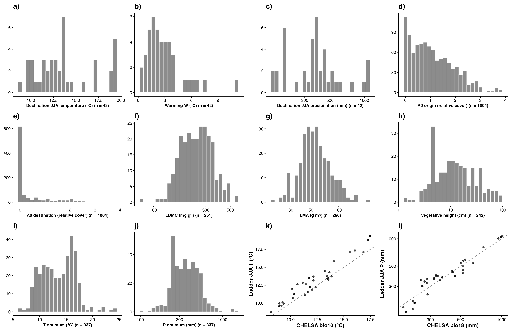

**Figure S5.** Assignment of species to the resident and colonizer pools. A species is kept in an experiment's pool if it is recorded in the control group in at least two plots in half of the years, or in half of the plots in at least two years: in the origin controls for residents, in the destination controls for colonizers, which must also be absent from the origin controls. (a) Each species × experiment recorded in the control group, by its number of plot-year records there (40 or more in the last bar): kept (green), failing the pool rule (grey), destination species recorded in the origin controls (orange), and in an experiment with fewer than five residents (red). (b) The same categories counted. (c) Species recorded in each experiment's origin controls, kept (green) and left behind; the dashed line marks the five residents an experiment needs. (d) Kept species by the number of gradients in which they occur, residents (green) and colonizers (purple); the dashed line marks the three gradients required by the classification and the model ladder, and pale bars are species left out of them.

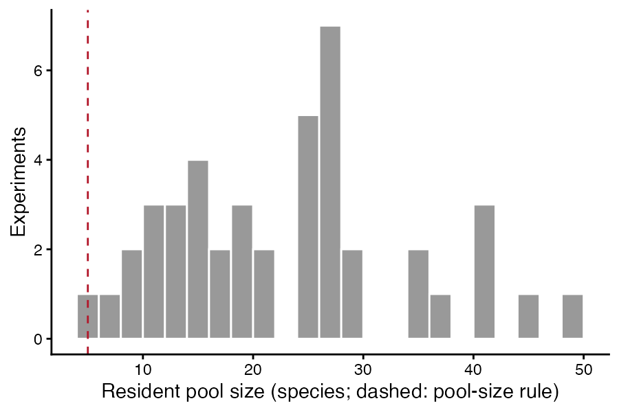

**Figure S6.** Number of resident species per experiment. The dashed line marks the pool-size rule of five residents; the one experiment below it, US_Arizona, is excluded.

Code: [`prep/`](prep/) · [`analysis/01_relative_cover.R`](analysis/01_relative_cover.R) · report [`reports/01_relative_cover.md`](reports/01_relative_cover.md)

## Q1. Time

**What and why.** A species' response to warming in one experiment is the difference in relative cover between warmed turfs and turfs replanted at their origin. One mixed model per experiment gives this difference per species and per year (for Q1) and averaged over years (the *losing-winning strength*, for everything after). If those differences still move from year to year, comparing experiments would compare moments of a trajectory, so time is settled first.

**Decisions.**
- One model per experiment, not one across experiments: every contrast is identified within an experiment anyway, and the error variance differs between them (23 Oct).
- One residual variance per species (`dispformula = ~ species`, 30 Oct): with one per experiment every species of an experiment got the same SE.
- Degrees of freedom are the plots (control + warmed − 2), because warming is applied to whole plots (30 Oct).
- Year-specific classes at years 2, 3, 4 and 6; year 1 left out as transplant shock (30 Oct).
- Agreement between adjacent years rises from year 3, so the strength used downstream averages years 3 and later (step 03b, 30 Oct); the all-years strength is kept as a sensitivity (Figs S7, S9).

**Model code** ([`R/fit_experiment.R`](R/fit_experiment.R)):

```r
m <- glmmTMB::glmmTMB(relative_cover ~ treatment * year * species + (1 | plot_id:species),
                      dispformula = ~ species, data = d, REML = TRUE)
# year-specific contrast (Step B) and the contrast averaged over years (strength)
em      <- emmeans::emmeans(m, ~ treatment | species * year, df = df_plots)
by_year <- emmeans::contrast(em, method = "revpairwise")          # warmed - origin_control
em_mean <- emmeans::emmeans(m, ~ treatment | species, df = df_plots)
strength <- emmeans::contrast(em_mean, method = "revpairwise")
# step 03b: the same fits, averaged over years 3 and later
em_y3 <- emmeans::emmeans(m, ~ treatment | species, at = list(year = years_3_on), df = df_plots)
strength_y3 <- emmeans::contrast(em_y3, method = "revpairwise")
# agreement between adjacent years (step 03)
DescTools::CCC(contrast_year_a, contrast_year_b)$rho.c$est
```

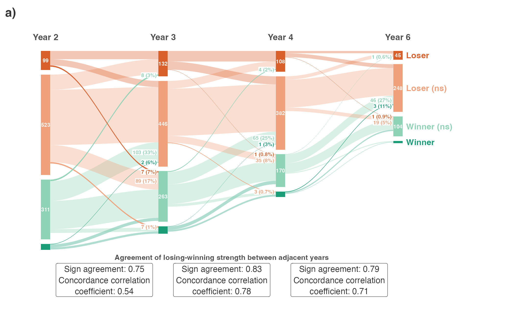

**Figure 1.** Temporal consistency of winners, losers and colonizers. (a) Resident species: each species × experiment is classified at years 2, 3, 4 and 6 after transplantation from its year-specific difference in relative cover between warmed and origin-control turfs, as a significant loser (dark orange), non-significant loser (light orange), non-significant winner (light green) or significant winner (dark green). Stratum height is the number of species × experiment in each class, drawn to one scale across years, so that columns shrink as shorter experiments drop out. Ribbons follow the same species × experiment between years; ribbons that change sign are labelled with their count and the share of their starting class. Below each gap: the share of species × experiment whose difference kept its sign, and Lin's concordance correlation coefficient between the two years' differences, which is 1 only if every species × experiment had the same strength in both years. (b) Colonizing species, the species of the destination vegetation, classified from their year-specific relative cover in warmed turfs as absent, present but not significantly above zero, or present (purple); the numbers below each gap are the share whose presence agreed and the concordance correlation of warmed cover. Year 1 is omitted as transplant shock.

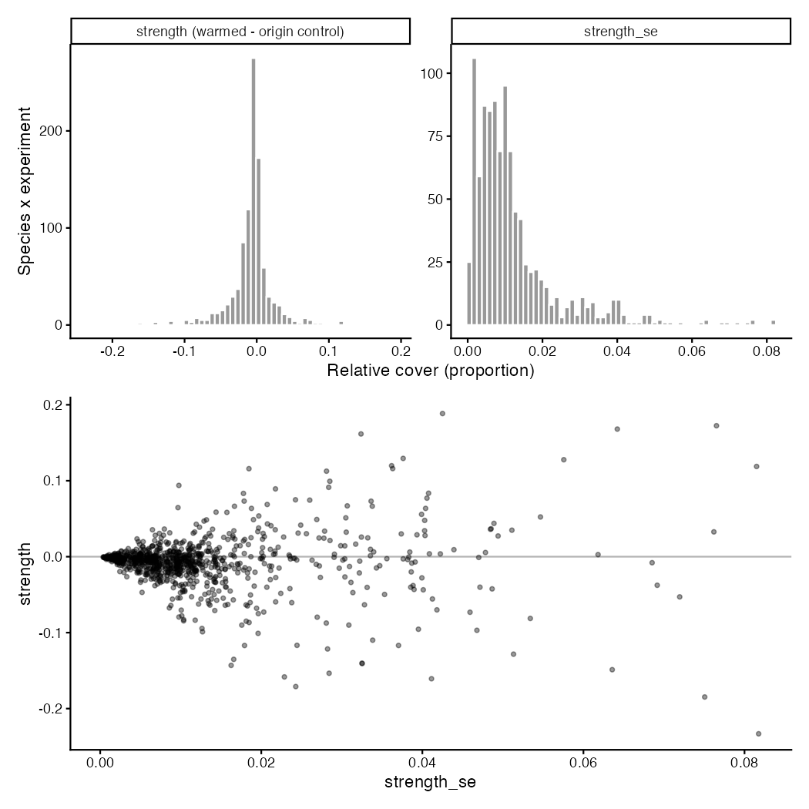

**Figure S7.** Losing-winning strength averaged over all survey years. Top: distributions of strength, the difference in relative cover between warmed and origin-control turfs estimated by one mixed model per experiment, and of its standard error, across the `r n(nrow(res_all))` resident species × experiment. Bottom: strength against its standard error. Positive values indicate higher relative cover in warmed than in origin-control turfs.

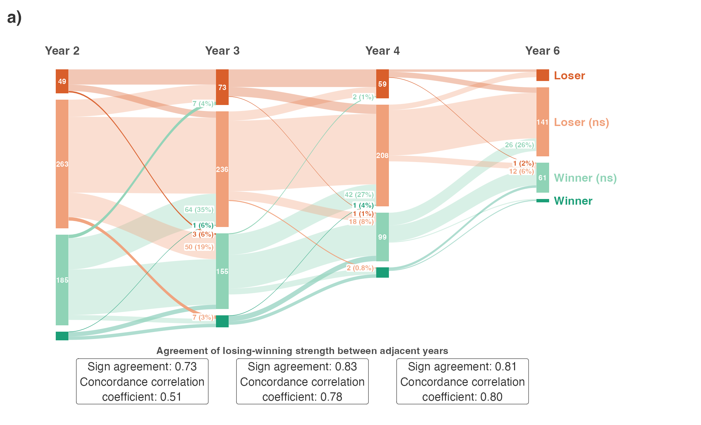

**Figure S8.** Temporal consistency of the residents occurring in at least three gradients, the species of the classification (Figure 2) and the model ladder (Figure 6). As Figure 1a: each species × experiment is classified at years 2, 3, 4 and 6 as a significant or non-significant loser or winner; ribbons follow the same species × experiment between years, and the boxes give the sign agreement and Lin's concordance correlation coefficient between adjacent years.

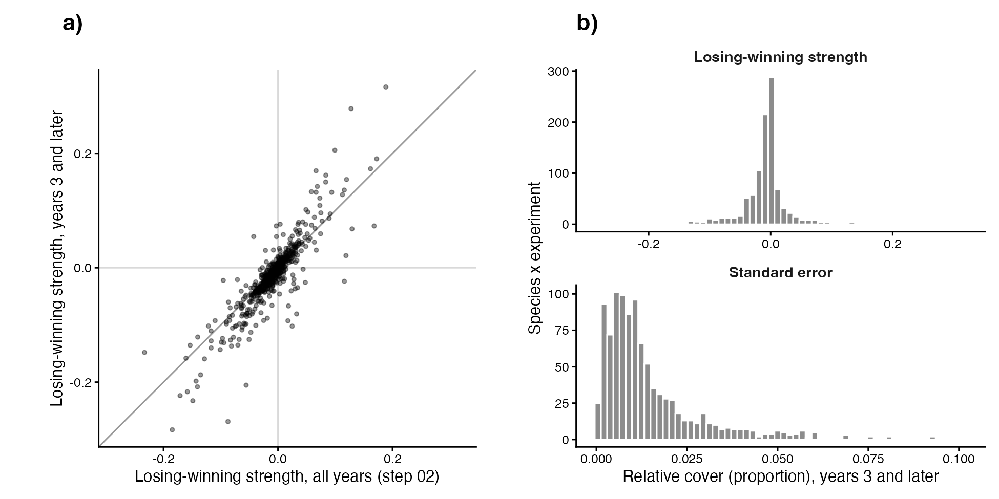

**Figure S9.** Losing-winning strength averaged over years 3 and later, the strength used in all downstream analyses. (a) Strength from year 3 against strength over all years (Figure S7), one point per resident species × experiment; the line is 1:1. (b) Distributions of strength from year 3 and of its standard error, in relative cover (proportion).

Code: [`02_strength.R`](analysis/02_strength.R) · [`03_temporal.R`](analysis/03_temporal.R) · [`03b_strength_y3.R`](analysis/03b_strength_y3.R) · reports [02](reports/02_strength.md), [03](reports/03_temporal.md), [03b](reports/03b_strength_y3.md)

## Q2. Consistency

**What and why.** For each species in at least 3 gradients, its strengths across experiments are pooled into one mean with its own among-experiment variance τ²<sub>s</sub>, the species' context dependency beyond sampling error. A species whose prediction interval for a new experiment lies wholly below zero is a consistent loser, wholly above zero a consistent winner, otherwise context-dependent.

**Decisions.**
- Fixed species means with one τ² per species, which equals one model per species (30 Oct): the planned joint model with a species random intercept collapsed every mean to the grand mean.
- The prediction interval carries both τ²<sub>s</sub> and the uncertainty of the mean: μ<sub>s</sub> ± 1.96 √(τ²<sub>s</sub> + SE(μ<sub>s</sub>)²).
- Eligibility by gradients (≥ 3), residents and colonizers alike (2 Nov).

**Model code** ([`04_classification.R`](analysis/04_classification.R)):

```r
# one model per species: intercept = pooled strength mu_s, ~ 1 | effect_id = tau2_s
m <- metafor::rma.mv(yi = strength, V = strength_se^2, random = ~ 1 | effect_id,
                     data = d_species, method = "REML")
predict(m)   # pi.lb, pi.ub: the prediction interval against zero
```

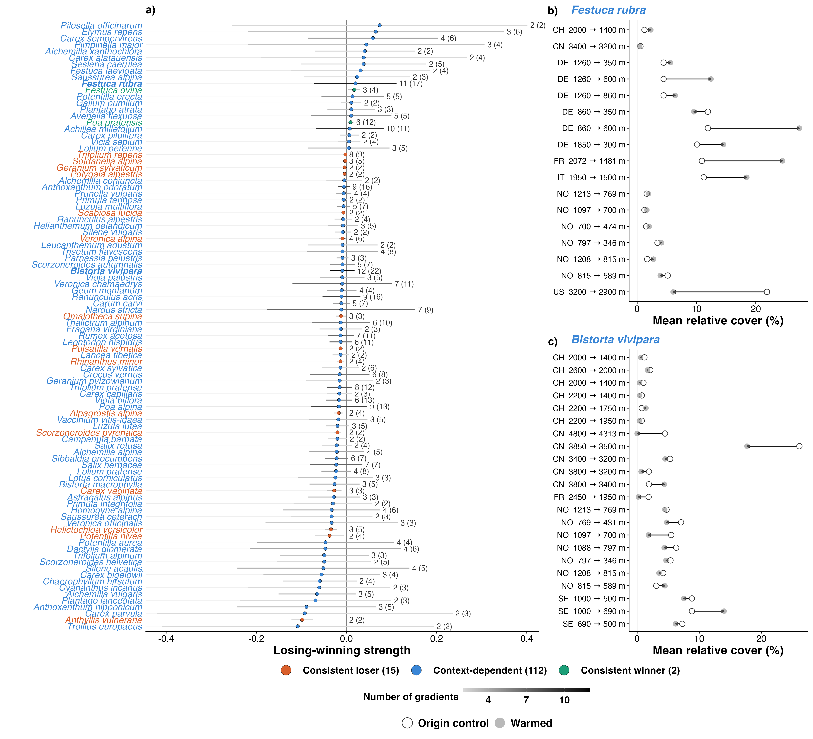

**Figure 2.** Consistent winners, consistent losers and context-dependent species among residents. (a) Each row is a resident species occurring in at least three gradients: the point is its pooled losing-winning strength across experiments, coloured by class, and the line its prediction interval for a new experiment, μ ± 1.96 √(τ² + SE²), which carries both the species' variance among experiments (τ²) and the uncertainty of its pooled strength. A species whose interval lies entirely below zero is a consistent loser, entirely above zero a consistent winner, and otherwise context-dependent. Lines are shaded by the number of gradients the species occurs in, and the numbers give gradients (experiments). Context-dependent species with a pooled strength between −0.005 and 0.005 are omitted, and their number is given. (b, c) The species with the highest and the lowest pooled strength among those found in the most gradients: one row per experiment, labelled by country and the elevation of origin and destination, with an arrow from the species' mean relative cover in origin-control turfs (hollow) to its cover in warmed turfs (filled), years 3 and later.

Code: [`04_classification.R`](analysis/04_classification.R) · report [04](reports/04_classification.md)

## The experiments in climate space

**What and why.** Before the models ask why, the outcomes are laid over the experiments' climate. Each experiment sits at its destination's summer temperature and precipitation; its pie splits the warmed turf's relative cover (years 3 and later) among resident losers and resident winners (the sign of each species' strength in that experiment) and colonizers (net warmed cover above zero), with what was not analysed in grey. Averaged over experiments, resident losers hold `r pct(mean(cover$Resident.losers))` of the warmed turf, resident winners `r pct(mean(cover$Resident.winners))`, colonizers `r pct(mean(cover$Colonizers))` and the rest `r pct(mean(cover$Not.analysed))`.

**Decisions.** Cover, not counts, in the main figure; the counts are Fig S10 (2 Nov). Pies at their true climate; experiments sharing a destination fan out around a black dot. No purple where an experiment has fewer than 5 colonizers.

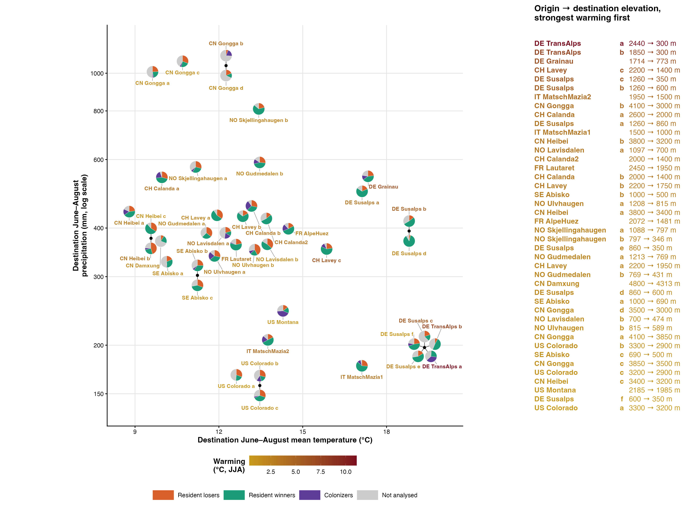

**Figure 4.** The experiments in climate space, and the share of the warmed turf held by losers, winners and colonizers. Each pie is one experiment, placed at its destination's June–August mean temperature and June–August precipitation (log scale), both from monthly CHELSA data averaged over the experiment's years. Slices give the share of relative cover in warmed turfs from year 3 on held by resident losers (orange) and resident winners (green), classified by the sign of their losing-winning strength in that experiment, by colonizers with warmed cover above zero (purple), and by species not analysed (grey: species outside the resident and colonizer pools, and records identified only to genus or not at all). Experiments with fewer than five colonizing species have no colonizer slice. Experiments that share a destination fan out around a black dot at the shared climate. Labels name the gradient, with a letter where a gradient holds several experiments, and are coloured by the experimental warming, the difference in June–August temperature between destination and origin; the key on the right gives the origin and destination elevations, from the strongest to the weakest warming. The same map with species counts is Figure S10.


**Figure S10.** The experiments in climate space with species counts. As Figure 4, but each pie counts species: resident species with a negative (losers) or positive (winners) losing-winning strength from year 3 on in that experiment, and colonizers with warmed cover above zero (`r n(sum(res$strength < 0))`, `r n(sum(res$strength > 0))` and `r n(sum(col$strength > 0))` species × experiment in total).

Code: [`10_figures.R`](analysis/10_figures.R) · report [10](reports/10_figures.md)

## Q3 and Q4. The ladder

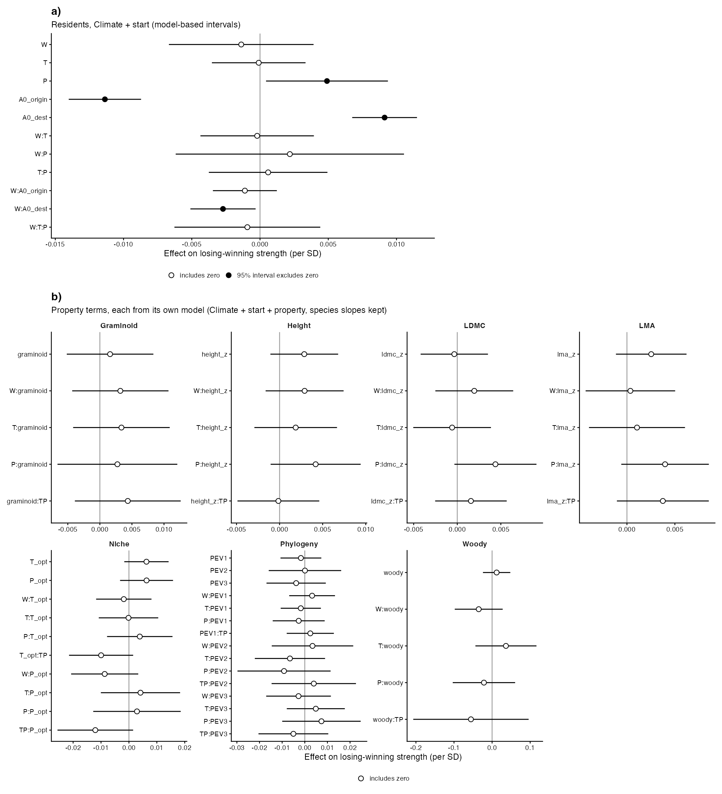

**Figure S11.** Where each variance component of the ladder comes from, on a toy table of three species in two experiments. (1) The six strengths, one bar per species in one experiment. (2) Each strength taken apart as the grand mean plus a species piece (gold, the same for a species in every experiment), an experiment piece (light grey, the same for every species of an experiment) and a leftover (dark grey); the whisker is the sampling error of the strength (blue), known and accounted for before anything counts as leftover. (3) The variance of each kind of piece is one bar of Figure 6a: adding the species and then the experiment random intercept moves their pieces out of the leftover into bars of their own, and the total stays the same; what is left is the species × experiment component τ². (4) Which information can shrink which component: a property's main effect the intercept piece of H<sub>species</sub>, its interactions with climate the slope piece, initial abundance and species-specific climate slopes the species × experiment component, and warming and destination climate, one value per experiment, only the experiment component σ²<sub>experiment</sub>. Toy numbers, with the sampling error set to zero in (3) so that the pieces add up exactly.

**What and why.** The strengths of the ladder species are explained by a fixed sequence of meta-regressions, each read against the one before:

| Model | Fixed part | Random part | Question |
|---|---|---|---|
| Null | intercept | species, experiment, effect | |
| Start | initial abundance at origin and destination, each × W | as Null | Q3a, starting condition |
| Climate | W × T × P | as Null | Q3b, environment |
| Climate + start | both | as Null | Q3b |
| Species-dependent | as Climate + start | + species slopes on W and on T, P, TP | Q3c, the ceiling |
| LDMC, LMA, Height, Graminoid, Woody, Phylogeny, Niche | Climate + start + property × (1, W, T, P, TP) | as Species-dependent | Q3d, the properties |

The heterogeneity of each model is split into the experiment component σ²<sub>experiment</sub>, the species × experiment component τ² and the species variance H<sub>species</sub> (intercept and slope pieces). For Q4 every gradient with at least 5 effects is held out in turn, the model refitted on the others, and its held-out strengths predicted from the fixed effects plus, from Species-dependent on, each species' deviation learned in the other gradients. Each level is scored per gradient by R² against the Null model on that gradient, Spearman's ρ and loser/winner skill, and summarised by medians.

**Decisions.**
- W, T, P are the warming (destination − origin summer temperature), destination summer temperature and summer precipitation; A0 is log(% cover + 1) in the first survey of the origin and destination controls.
- The T, P, TP slope block is diagonal in every slope model (1 Nov): the general structure did not converge.
- One set of rows for the whole ladder, the species with every property (2 Nov).
- R² against the Null on the same gradient, medians over the `r length(unique(pred06$gradient_id))` scored gradients (2 Nov), instead of one shared yardstick.
- Species deviations are computed by hand from the fitted variance components (metafor gives no BLUPs for a diagonal slope block, 2 Nov).
- Model-based (REML Wald) intervals for the coefficients (2 Nov).
- Random forest as a check on shape: the same rows, predictors and folds, no case weights, one setting chosen by out-of-bag R², held-out values only (2 Nov).

**Model code** ([`R/fit_model.R`](R/fit_model.R), [`05_ladder_fit.R`](analysis/05_ladder_fit.R), [`R/species_deviation.R`](R/species_deviation.R), [`06b_forest.R`](analysis/06b_forest.R)):

```r
re_base   <- list(~ 1 | species, ~ 1 | experiment_id, ~ 1 | effect_id)
re_slopes <- c(re_base, list(~ 0 + W | species, ~ 0 + T + P + TP | species))
f_both    <- ~ W * T * P + A0_origin + A0_dest + A0_origin:W + A0_dest:W
f_height  <- update(f_both, ~ . + height_z + height_z:W + height_z:T + height_z:P + height_z:TP)

m <- metafor::rma.mv(yi = strength, V = strength_se^2, mods = f_height, random = re_slopes,
                     struct = c("GEN", "GDIAG"), data = rows, method = "REML", sparse = TRUE)

# held out: fixed part + the species' deviation learned in the other gradients
b   <- D %*% t(Z) %*% solve(M, y - X %*% beta)            # BLUPs, by hand (blup())
r2  <- 1 - mean((predicted - observed)^2) / mean((null_predicted - observed)^2)

# random forest, the same rows and folds
rf <- ranger::ranger(x = train[vars], y = train$strength, num.trees = 3000,
                     mtry = mtry, min.node.size = node, replace = TRUE,
                     respect.unordered.factors = "order")  # no case weights
```

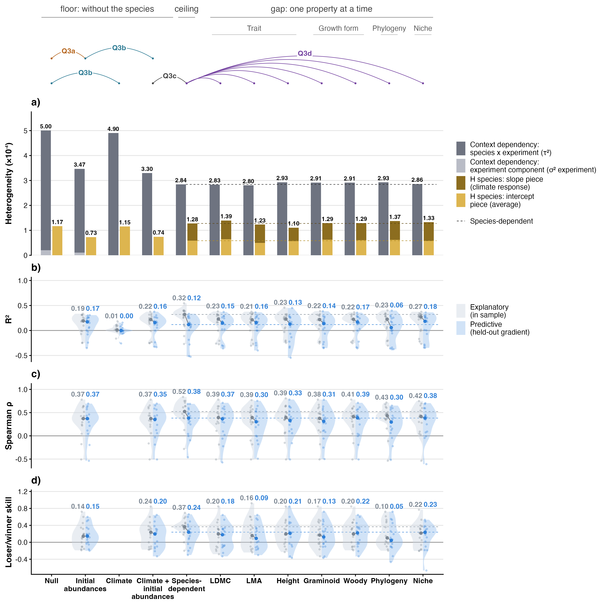

**Figure 6.** How much of the variation in losing-winning strength is explained, and how much is predicted for an unseen gradient. Models from left to right: Null; initial abundances at origin and destination (Q3a); warming and background climate (Climate, Q3b); both (Q3b); species-specific intercepts and climate slopes (Species-dependent, the ceiling, Q3c); and one model per species property added to the climate and initial-abundance model with the species terms kept (Q3d): leaf dry matter content (LDMC), leaf mass per area (LMA), vegetative height, graminoid and woody growth form, phylogenetic position (eigenvectors 1–3) and climatic niche (thermal and precipitation optima). Arcs mark the pairs of models that answer each question. (a) Heterogeneity left after each model (×10⁻⁴): context dependency (grey), stacked as the experiment component, the shift common to all species of an experiment (σ²_experiment, light), under the species × experiment component (τ², dark), and the variance among species in their fitted response (H_species, gold), stacked as the intercept piece (average differences among species) and the slope piece (differences in climate response). (b) R² against the Null model on the same gradient, (c) Spearman's rank correlation within the gradient and (d) loser/winner skill, loser recall plus winner recall minus one, on the `r length(unique(pred06$gradient_id))` gradients with at least five effects: half violins of the gradient values in sample (grey, model fitted to all gradients) and for the gradient held out of the fit (blue), with medians as large points and numbers. Dashed lines are the Species-dependent values. The Null is zero by construction and not drawn; Climate predicts one value per gradient and has no Spearman or skill.


**Figure S12.** Fixed effects of the resident models. (a) Standardized effects of the climate and initial-abundance model on losing-winning strength: warming (W), destination temperature (T) and precipitation (P), their interactions, and initial abundance at origin (A0_origin) and at destination (A0_dest), each with its interaction with warming. (b) Property terms, each from its own model fitted on top of the model in (a) with species-specific intercepts and climate slopes: the property and its interactions with W, T, P and T × P. Phylogenetic eigenvectors 1–3 and the thermal and precipitation optima are fitted together and shown in one panel each. Points are estimates and lines model-based (REML Wald) 95% intervals; filled points indicate intervals that exclude zero. Effects are per standard deviation of the predictor.

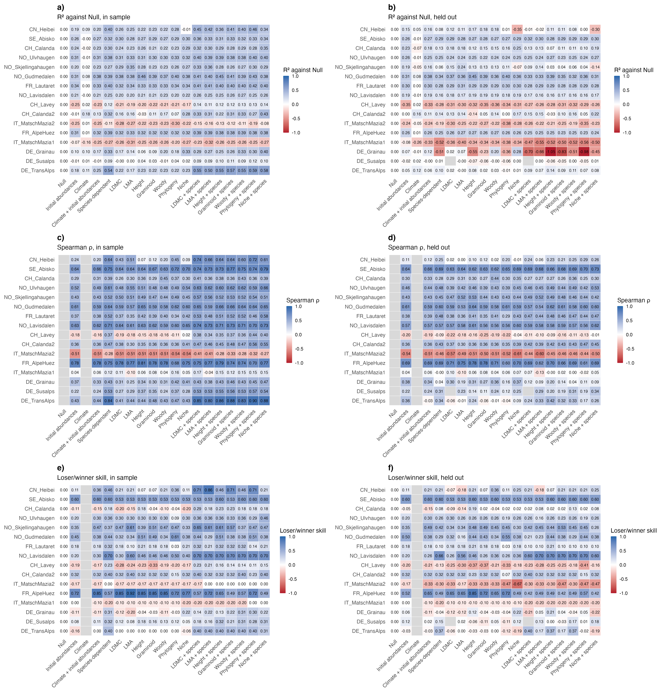

**Figure S13.** Fit and prediction of every resident model, gradient by gradient. Rows are the `r length(unique(pred06$gradient_id))` gradients with at least five effects, ordered by destination temperature (coldest at the top); columns are the models, followed by each property model with species-specific deviations (+ species). (a, b) R² against the Null model on the same gradient, (c, d) Spearman's rank correlation between observed and predicted strength within the gradient, and (e, f) loser/winner skill, loser recall plus winner recall minus one; (a, c, e) in sample and (b, d, f) for the gradient held out of the fit. Blue cells are better and red cells worse than zero; colours are capped at ±1, and grey cells are undefined because the model predicts one value per gradient (Spearman for the Null and Climate, skill for Climate).

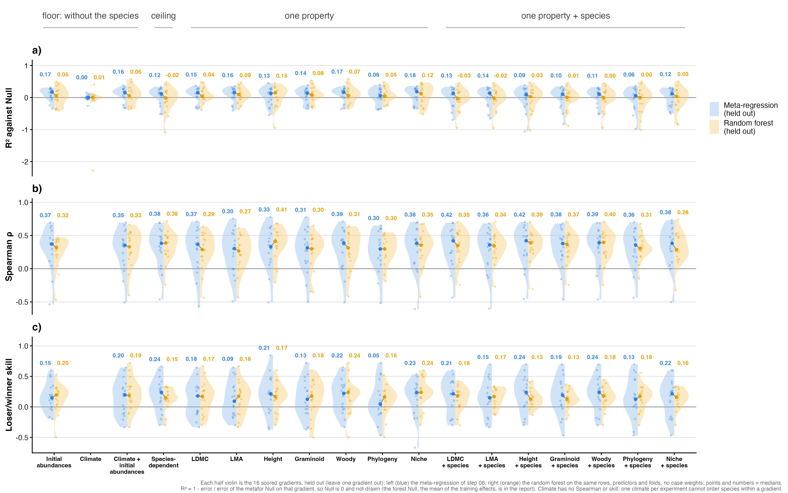

**Figure S14.** Random forests beside the meta-regressions, residents. For each model of the ladder, (a) R² against the Null meta-regression on the same gradient, (b) Spearman's rank correlation and (c) loser/winner skill on each of the `r length(unique(pred06$gradient_id))` gradients held out of the fit, for the meta-regression (blue, left) and a random forest on the same rows, predictors and folds (orange, right). Half violins show the distribution over gradients, small points the gradients, and large points and numbers the medians. The forests use no case weights and one setting of minimum node size and number of candidate predictors, chosen by out-of-bag R² over all models. The Null is not drawn; Climate has no Spearman or skill because it predicts one value per gradient.

In sample the Species-dependent model reaches a median R² of `r f2(pm(fit06, "species"))`; held out it drops to `r f2(pm(pred06, "species"))`, below initial abundances alone (`r f2(pm(pred06, "start"))`). No property level beats the Climate + start floor held out by much (`r f2(pm(pred06, "climate_start"))`; Niche `r f2(pm(pred06, "niche"))`, LDMC `r f2(pm(pred06, "ldmc"))`, Height `r f2(pm(pred06, "height"))`), and the forest is higher than the meta-regression only at `r paste(for_better_name, collapse = ", ")` (median of the per-gradient differences; at most `r f2(max(fl["diff", ]))`): the weak relationships are weak, not misspecified.

Code: [`05_ladder_fit.R`](analysis/05_ladder_fit.R) · [`06_ladder_predict.R`](analysis/06_ladder_predict.R) · [`06b_forest.R`](analysis/06b_forest.R) · reports [05](reports/05_ladder_fit.md), [06](reports/06_ladder_predict.md), [06b](reports/06b_forest.md)

## Colonizers

**What and why.** The second way of winning is arriving. A colonizer's strength in an experiment is its relative cover in the warmed turfs, years 3 and later, estimated with the residents' model terms on the warmed plots alone. The colonizers then run through the same steps as the residents: year-specific presence classes (Fig 1b), Step C (Fig 3), the ladder fitted and predicted (Figs S16–S18) and the forest (Fig S19).

**Decisions.**
- Warmed plots only (2 Nov): a contrast against the destination controls measures the lag, not arrival.
- A species never recorded in an experiment's warmed plots is a measured absence: strength 0, SE 0 (2 Nov); `r nrow(never)` species were never present in any warmed plot.
- Where the per-species residual variance cannot be estimated, the experiment's error is used (2 Nov).
- At least 5 colonizers per experiment (`r length(unique(col$experiment_id))` of `r length(unique(res$experiment_id))` experiments).
- The propagule pressure A0 is the species' mean destination-control relative cover over every plot and year (2 Nov), log(100 × cover + 1) as the residents' A0 (3 Nov), standardised across all `r nrow(col)` colonizer effects; there is no origin abundance.
- Properties on the residents' scale, so both pools share one standardisation (2 Nov).
- No loser/winner skill (no loser class); an R² below −100 is taken out and listed (2 Nov).

**Model code** ([`07a_colonizers.R`](analysis/07a_colonizers.R)):

```r
m <- glmmTMB::glmmTMB(relative_cover ~ year * species + (1 | plot_id:species),
                      dispformula = ~ species, data = warmed_plots, REML = TRUE)
strength <- emmeans::emmeans(m, ~ species, at = list(year = years_3_on), df = df_plots)
# the ladder as for residents, with A0_dest only
f_both_col <- ~ W * T * P + A0_dest + A0_dest:W
```

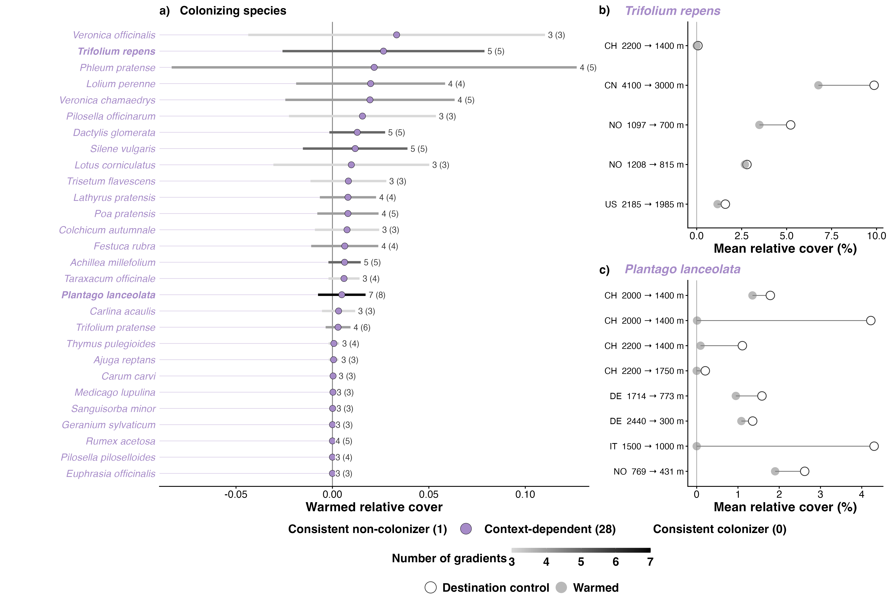

**Figure 3.** Consistent colonizers, context-dependent colonizers and consistent non-colonizers. (a) Each row is a colonizing species occurring in at least three gradients: the point is its pooled relative cover in warmed turfs from year 3 on, across experiments, and the line its prediction interval for a new experiment. A species whose interval lies entirely above zero arrived in every experiment (consistent colonizer); one whose interval reaches zero arrived in some experiments and not in others (context-dependent). Species never present in warmed turfs from year 3 on are consistent non-colonizers, given as a count. Lines are shaded by the number of gradients, and the numbers give gradients (experiments). (b, c) The colonizers with the highest and the lowest pooled warmed cover among those in the most gradients: one row per experiment, with the species' mean relative cover in destination-control turfs (hollow) joined by a line to its cover in warmed turfs (filled).


**Figure S15.** Colonizer strength, the relative cover of a colonizing species in warmed turfs. (a) Warmed cover from year 3 against warmed cover over all years, one point per colonizer species × experiment; the line is 1:1. (b) Distributions of warmed cover from year 3 and of its standard error. Species never recorded in an experiment's warmed turfs are measured absences, with strength and standard error of zero.

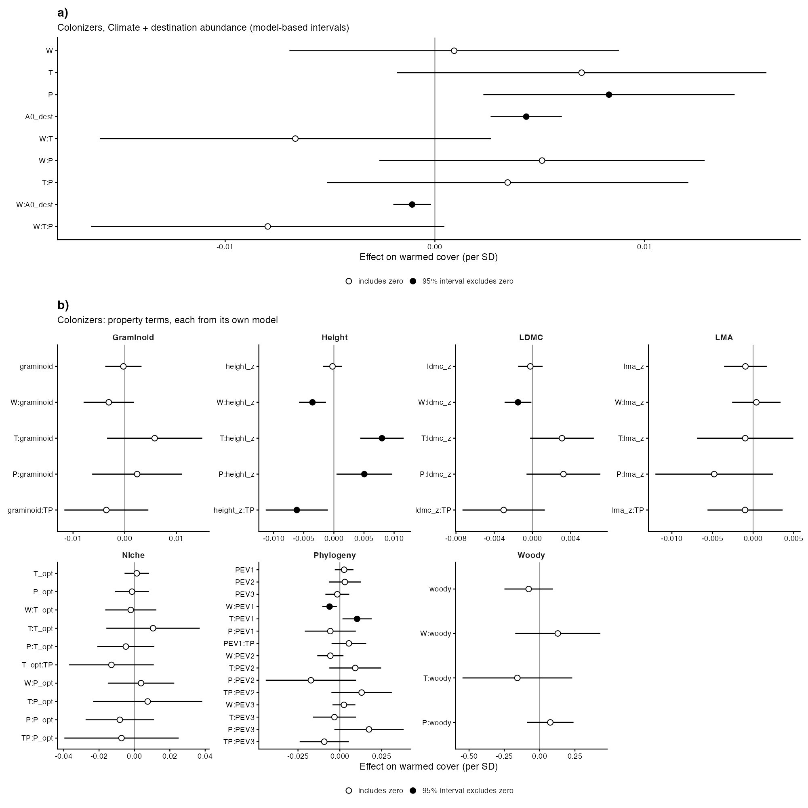

**Figure S16.** Fixed effects of the colonizer models. (a) Standardized effects of the climate and destination-abundance model on relative cover in warmed turfs: warming (W), destination temperature (T) and precipitation (P), their interactions, and the mean abundance in the destination controls (A0_dest) with its interaction with warming. (b) Property terms, each from its own model fitted on top of the model in (a) with species-specific intercepts and climate slopes. Points are estimates and lines model-based (REML Wald) 95% intervals; filled points indicate intervals that exclude zero. Effects are per standard deviation of the predictor, on the residents' scale for the climate and property terms.


**Figure S17.** How much of the variation in colonizer strength is explained, and how much is predicted for an unseen gradient. As Figure 6, for the `r nrow(lad07)` colonizer effects of `r length(unique(lad07$species))` species: (a) heterogeneity left after each model, (b) R² against the Null model on the same gradient and (c) Spearman's rank correlation, on the `r length(unique(pred07$gradient_id))` gradients with at least five effects, in sample (grey) and held out (blue). The start model holds destination abundance only, since colonizers have no abundance at origin. There is no loser/winner skill, since colonizers have no losers. An R² below −100 (Woody at CH_Lavey) is left out of the R² row.

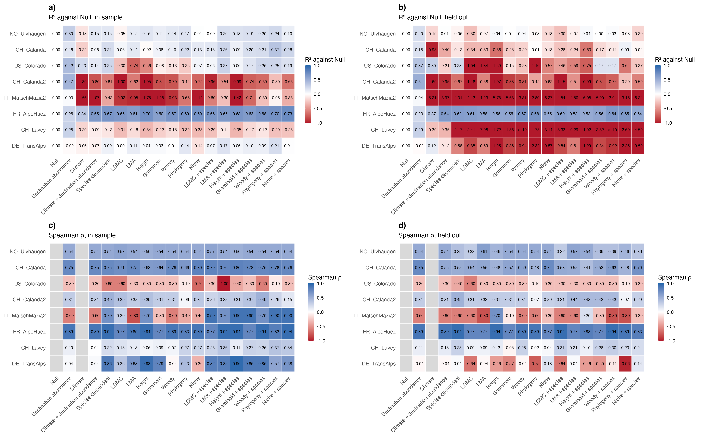

**Figure S18.** Fit and prediction of every colonizer model, gradient by gradient. As Figure S13, for the `r length(unique(pred07$gradient_id))` colonizer gradients with at least five effects: (a, b) R² against the Null model and (c, d) Spearman's rank correlation, (a, c) in sample and (b, d) held out. Values below −10 are printed as "< −10".

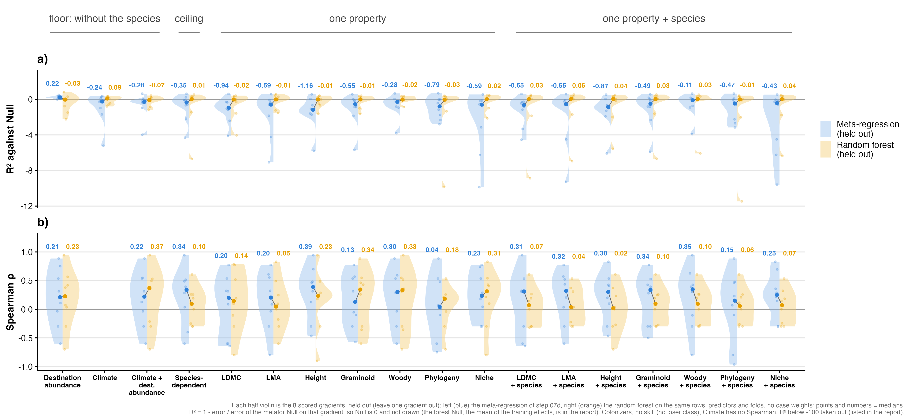

**Figure S19.** Random forests beside the meta-regressions, colonizers. As Figure S14, for the `r length(unique(pred07$gradient_id))` colonizer gradients held out of the fit: (a) R² against the Null meta-regression and (b) Spearman's rank correlation, meta-regression (blue, left) and random forest (orange, right).

The ladder rows are `r nrow(lad07)` colonizer effects of `r length(unique(lad07$species))` species. Only destination abundance transfers to a held-out gradient (median R² `r f2(pm(pred07, "start"))`); climate, species identity and every property predict worse than the Null held out (Species-dependent `r f2(pm(pred07, "species"))`). The colonizer Null is itself a weak reference: the plain mean of the training effects, the forest's Null, reaches a median R² of `r f2(col_null_forest)` against it, because the many measured absences (strength and SE 0) pull the meta-regression's weighted intercept towards zero (Figure S19).

Code: [`07a_colonizers.R`](analysis/07a_colonizers.R) · [`07b_classification.R`](analysis/07b_classification.R) · [`07c_ladder_fit.R`](analysis/07c_ladder_fit.R) · [`07d_ladder_predict.R`](analysis/07d_ladder_predict.R) · [`07e_forest.R`](analysis/07e_forest.R) · reports [07a](reports/07a_colonizers.md), [07b](reports/07b_classification.md), [07c](reports/07c_ladder_fit.md), [07d](reports/07d_ladder_predict.md), [07e](reports/07e_forest.md)

## Pathways

**What and why.** Do resident winners and colonizers draw on different kinds of species? Step C found too few consistent species for the planned groups, so the figure takes the plan's fallback, with losers added: residents by the sign of their pooled strength (Fig 2), colonizers with pooled warmed cover above zero (Fig 3), one point per species. Descriptive, no model.

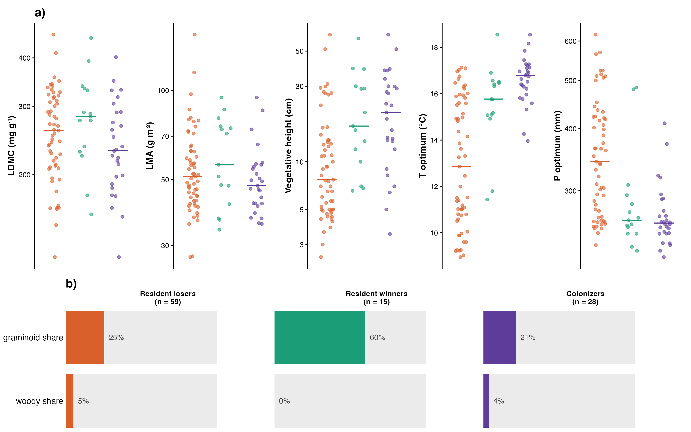

**Figure 5.** Species properties of resident losers, resident winners and colonizers. Residents are grouped by the sign of their pooled losing-winning strength across experiments (Figure 2), and colonizers are those with a pooled warmed cover above zero (Figure 3); one point per species. (a) Leaf dry matter content (LDMC), leaf mass per area (LMA), vegetative height, thermal optimum and precipitation optimum, with the group median as a horizontal bar; log axes except for the thermal optimum. Climatic optima are shown only for species with at least 30 occurrence records. (b) Share of graminoids and of woody species in each group; group sizes are given above. A species that is a resident in some experiments and a colonizer in others appears in both groups.

Code: [`07f_pathways.R`](analysis/07f_pathways.R) · report [07f](reports/07f_pathways.md)

## The coefficients

The climate + abundance model for each pool, and the trait terms of the Height and LDMC models with residents beside colonizers. Climate and trait terms share one axis; the abundance terms are scaled within each pool and are compared only within a panel.

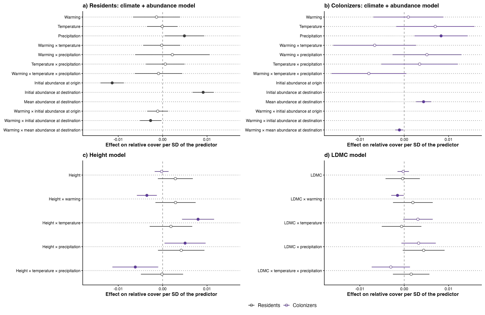

**Figure 7.** Effects of climate, abundance and traits on the response of residents and colonizers. Standardized effects, per standard deviation of the predictor, on losing-winning strength for residents (grey) and on relative cover in warmed turfs for colonizers (purple). (a) Residents and (b) colonizers: the model with warming, destination temperature and precipitation, their interactions, and abundance, for residents the initial abundance at origin and at destination at the first survey, for colonizers the mean abundance in the destination controls, each with its interaction with warming; empty rows are terms absent from that pool's model. (c) Vegetative height and (d) leaf dry matter content (LDMC): the trait and its interactions with warming, temperature, precipitation and temperature × precipitation, each from a model that also includes the terms of (a) or (b) and species-specific intercepts and climate slopes. Points are estimates and lines model-based (REML Wald) 95% intervals; filled points indicate intervals that exclude zero. Climate and trait terms are on one scale across pools; abundance terms are standardized within each pool and are not comparable between (a) and (b).

Code: [`10_figures.R`](analysis/10_figures.R) · tables [`tables/`](tables/) (S1 experiments, S2 species, S3 phylogenetic axes, S4 variance components, S5 coefficients)

## Repository structure

```
PLAN.md, MILESTONES.md, CLAUDE.md   the plan, the steps and their review status, the working rules
                                    (local files, not in git)
prep/                               data preparation, a targets pipeline
  _targets.R                          one target per preparation step (P1 to P7)
  R/                                  its functions: community, taxonomy, traits, functional groups,
                                      phylogeny, climate, niche, report
  config/                             reviewed ledgers: name decisions, renames, trait review, trees,
                                      woodiness, phylogeny placements, GBIF keys
  tnrs/                               TNRS cache, so names resolve the same way offline
  provenance/                         checksums and receipts of the external inputs and of the backups made
                                      before the rebuild
  gbif_niche.R, update_tnrs_cache.R   run by hand outside the pipeline: the GBIF download (P6) and
                                      the TNRS cache
analysis/                           one script per step, run in order, each reading only data/derived/
  01_relative_cover.R ... 07f_pathways.R, 10_figures.R
  additional_checks/                  side checks that feed no step (the paused GEN slope check)
R/                                  functions used by two or more scripts: fit_experiment, fit_model,
                                    h_species, species_deviation, metrics_gradient, fig4_ladder, md_table
data/                               raw inputs, read only (SQLite network database, TRY export, CHELSA)
  derived/prep/                       the prepared tables
  derived/NN_<step>/                  each step's outputs: tables, fitted models (.rds), fold caches
figures/
  main/                               Figs 1 to 7, each written by the step that makes it
  appendix/                           Figs S1 to S19, in the order of the analysis, each written by
                                      the step that makes it (S11, the variance box, drawn by hand)
tables/                             Tables S1 to S5; the selection table (written by the README)
reports/                            one review report per step; REPORT.qmd collects them
plan_figures/                       the mock figures agreed while planning (local, not in git)
renv.lock                           the locked package environment
```

Each step was planned, run and reviewed on its own branch (`step-NN-<name>`), with a report under `reports/` that lists its counts, its key table, its figures, the warnings captured and its deviations from the plan. Fitted models are cached under `data/derived/`, so a rerun skips what exists.

## Running the analysis

```sh
Rscript -e 'renv::restore()'
Rscript -e 'targets::tar_make(script = "prep/_targets.R", store = "prep/_targets")'
LANG=en_US.UTF-8 Rscript analysis/01_relative_cover.R   # then 02, 03, 03b, 04, 05, 06, 06b, 07a-07f, 10, 12
```

Run from the repository root. A UTF-8 locale keeps the figure labels (τ², ×10⁻⁴) intact. `analysis/10_figures.R` writes this README from `README.Rmd` as its last step.

## Data and citation

- Community data: the TransPlant network database (`data/transplant_network_clean.sqlite`, from TransPlantNetwork/transplant_network_data_cleaning).
- Species occurrences for the climatic niche: GBIF.org (28 October 2026) GBIF Occurrence Download https://doi.org/10.15468/dl.7p28y9 (download key 0011587-261023074918325). This DOI must be cited in the methods and the data availability statement; GBIF deletes downloads that are not cited after 28 April 2027.
- Climate: CHELSA V2.1. Traits: the TRY database export.
