<!-- README.md is generated from README.Rmd by the last line of analysis/10_figures.R
     (knitr::knit). Edit README.Rmd, never README.md. Every number below is computed
     from data/derived/ when the file is knitted. -->


# TransPlant winners and losers

The analysis for the TransPlant "winners and losers" manuscript: which plant species gain and which lose when whole turfs are moved down an elevation gradient, and where the variation in their responses among experiments comes from. Every number and figure here is produced by the code in this repository; this page is the realized version of the analysis plan, step by step, with the decisions taken along the way, the modelling code and the figures in the order the analysis produces them.

## Contents

- [Motivation](#motivation)
- [The analysis at a glance](#the-analysis-at-a-glance)
- [Data and selection](#data-and-selection)
- [Q1. Time: is a species' response stable from year to year?](#q1-time)
- [Q2. Consistency: which species win or lose everywhere?](#q2-consistency)
- [The experiments in climate space](#the-experiments-in-climate-space)
- [Q3 and Q4. The ladder: what explains and what predicts the response?](#q3-and-q4-the-ladder)
- [Colonizers: the second way of winning](#colonizers)
- [Pathways: who wins, who loses, who arrives](#pathways)
- [The coefficients, residents beside colonizers](#the-coefficients)
- [Repository structure](#repository-structure)
- [Running the analysis](#running-the-analysis)
- [Data and citation](#data-and-citation)

## Motivation

Predicting which plant species will gain and which will lose under climate change is complicated by the variability of species responses: the same species increases in abundance at one site and decreases at another. This variation is commonly described as context dependency. As long as its sources remain unidentified, it limits our ability both to understand species responses to climate change and to predict them for sites that have not been studied. Ideally, the response of a species at a new site would be predictable from attributes that are commonly known, the environment of the site and the characteristics of the species, without the species having been observed under warming there. Whether this is possible depends on where the variation comes from. Four sources may contribute to this variation, and the order in which they are considered matters. The first is time, which can be confounded with context: because species respond to climate change along transient trajectories, the same species observed at different moments along its trajectory may appear to respond differently while following a single curve. The second source is the starting condition of a species, its abundance in the community: a species that holds two percent of the cover cannot lose more than two percent, and a species abundant in the surrounding vegetation colonizes more rapidly than a rare one, so that starting abundance bounds the response before any climatic effect has acted. The third source is the environment, the warming itself and the background temperature and precipitation under which it occurs: a species that responds consistently, for example losing more cover the drier the site, will nonetheless appear as a winner at a wet site and as a loser at a dry one, so that apparent inconsistency may reflect a consistent response observed in different contexts. The fourth source is the species itself. Species may differ in their response to a given environment and starting condition, and these differences may or may not be captured by measurable species properties such as functional traits, growth form, evolutionary relatedness or climatic niche.

Here, we use a network of 42 whole-community downslope transplant experiments along 20 elevation gradients across the Northern Hemisphere, with vegetation surveys spanning 3 to 9 years after transplantation [P1], to quantify the response of every species to warming in every experiment and to ask where the variation in this response among experiments comes from. The quantity we examine is the response of a species to warming in a given experiment, and context dependency is the variation of this quantity among experiments beyond sampling error. For winning we define two pathways, resident species that increase their relative abundance in the warmed community and species of the destination vegetation that colonize it, and we analyse the two pathways separately for each of the questions below. Specifically, we ask: (1) Are warming winners and losers within experiments consistent over time since warming began? (2) Across experiments, are some species consistent winners or consistent losers, and how much does a species' response vary among experiments beyond sampling error? (3) How much of this variation is explained, within the experiments studied, by the environment, that is the warming applied and the background climate of the destination, how much by species' starting conditions, and how much by species' properties, their functional traits, growth form, phylogenetic position or climatic niche? (4) How well do the same three sources predict the responses of species in a gradient where no experiment has been done? Question 3 thus asks for explanatory power and question 4 for predictive power, which is what is available for a mountain not yet studied.

## The analysis at a glance

| Step | What it does | Result |
|---|---|---|
| [P1–P7](#data-and-selection) | Community, taxonomy, traits, phylogeny, climate and niche prepared once, every join on the TNRS-resolved name | 43 experiments kept from 44 |
| [01](#data-and-selection) | Relative cover; pool rule (who is a resident, who a potential colonizer); pool-size rule | 42 experiments, 1,004 resident and 402 colonizer species × experiment |
| [02](#q1-time) | One `glmmTMB` per experiment; warmed − origin-control contrast per species, per year and over years | 1,004 resident strengths |
| [03](#q1-time) | Year-specific classes at years 2, 3, 4, 6; sign agreement and concordance between adjacent years | concordance 0.54 (years 2 to 3), 0.78 (3 to 4) |
| [03b](#q1-time) | Strength re-averaged over years 3 and later, the strength used downstream | correlation with the all-years strength 0.88 |
| [04](#q2-consistency) | Per species pooled strength and among-experiment variance; prediction interval against zero | 2 consistent winners, 6 consistent losers, 66 context-dependent of 74 species |
| [05](#q3-and-q4-the-ladder) | Twelve meta-regressions, Null to Species-dependent to one property at a time | τ² from 4.8 &times; 10<sup>-4</sup> (Null) to 2.8 &times; 10<sup>-4</sup> (Species-dependent) |
| [06](#q3-and-q4-the-ladder) | Leave one gradient out; R² against the Null, Spearman and loser/winner skill per gradient | median held-out R²: initial abundances 0.17, Species-dependent 0.12 |
| [06b](#q3-and-q4-the-ladder) | Random forest on the same rows and folds | better than the meta-regression at 3 of 19 levels, all near zero |
| [07a](#colonizers) | Colonizer strength: warmed cover, one `glmmTMB` per experiment; year-specific presence classes | 379 colonizer strengths in 28 experiments |
| [07b](#colonizers) | Step C for colonizers | 0 consistent colonizers among 29 species |
| [07c–07e](#colonizers) | The ladder, its predictions and the forest for colonizers | only destination abundance transfers (median held-out R² 0.11) |
| [07f](#pathways) | Traits of losers, winners and colonizers | Fig 5 |
| [10](#the-experiments-in-climate-space) | Synthesis figures, appendix and this page | Figs 4, 7, S1–S18 |

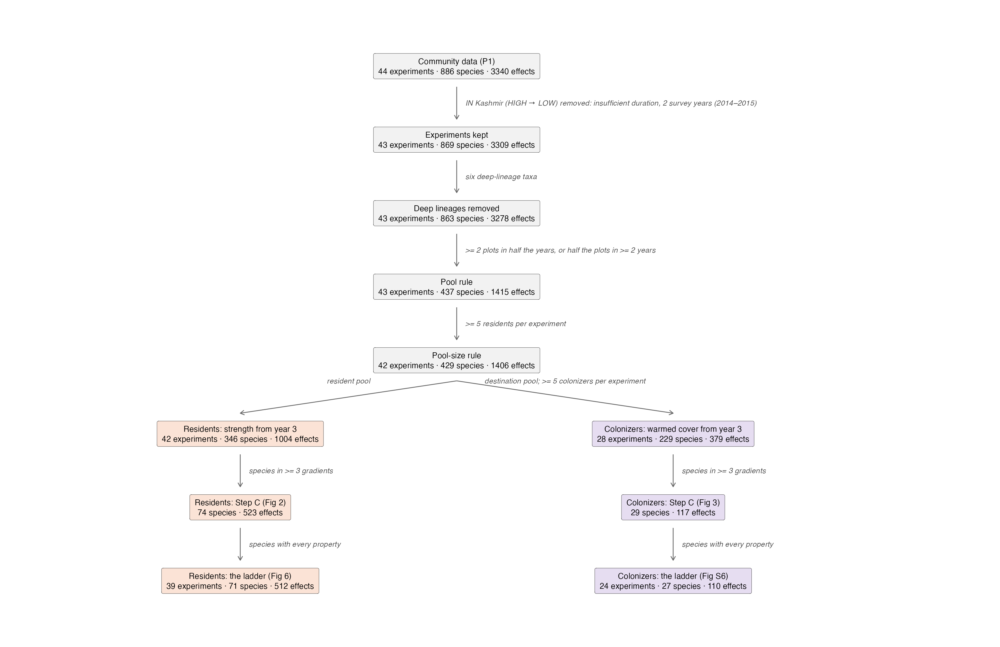

## Data and selection

The community data are the TransPlant network database (`data/transplant_network_clean.sqlite`). Its taxonomy columns are never used: every name is resolved once with `tidyTRY::resolve_species()` (TNRS, WCVP), and decisions on names that TNRS cannot settle sit in reviewed ledgers under `prep/config/`. The preparation is a `targets` pipeline in [`prep/`](prep/) with one target per preparation step (P1 community and taxonomy, P2 TRY traits, P3 growth form and phylogeny, P4 climate, P6 niche from our own GBIF download, P7 trait checks).

- **Experiments.** IN_Kashmir is excluded at P1 (two survey years). The pool-size rule below then removes US_Arizona (four residents), which leaves 42 experiments in 20 gradients.
- **Pools** (step 01, decided 2 Nov). A species is a *resident* of an experiment if it is recorded in the origin controls in at least two plots in half of the years, or in half of the plots in at least two years; a *colonizer* if it meets the same rule in the destination controls and was never recorded in the origin controls. An experiment needs at least 5 residents (5 colonizers for the colonizer analyses).
- **Species across experiments.** The classification (Q2) and the ladder (Q3, Q4) use species found in at least 3 gradients; the ladder further keeps only species that carry every property, so that all twelve models are fitted to the same rows (512 resident effects of 71 species in 39 experiments).
- **Relative cover** is computed over all vascular cover of a plot-year, unidentified and genus-level records included (decided 28 Oct).

Properties: LDMC, LMA and vegetative height from TRY, screened for outliers and unit slips (Fig S2); graminoid and woody growth form; the first three phylogenetic eigenvectors (PEV1–3, Fig S3, Table S3); the thermal and precipitation optima from GBIF occurrences and CHELSA (bio10, bio18). Their distributions and the check of the niche climatology against the experiments' own climate are in Fig S4.

| | |
|---|---|
| 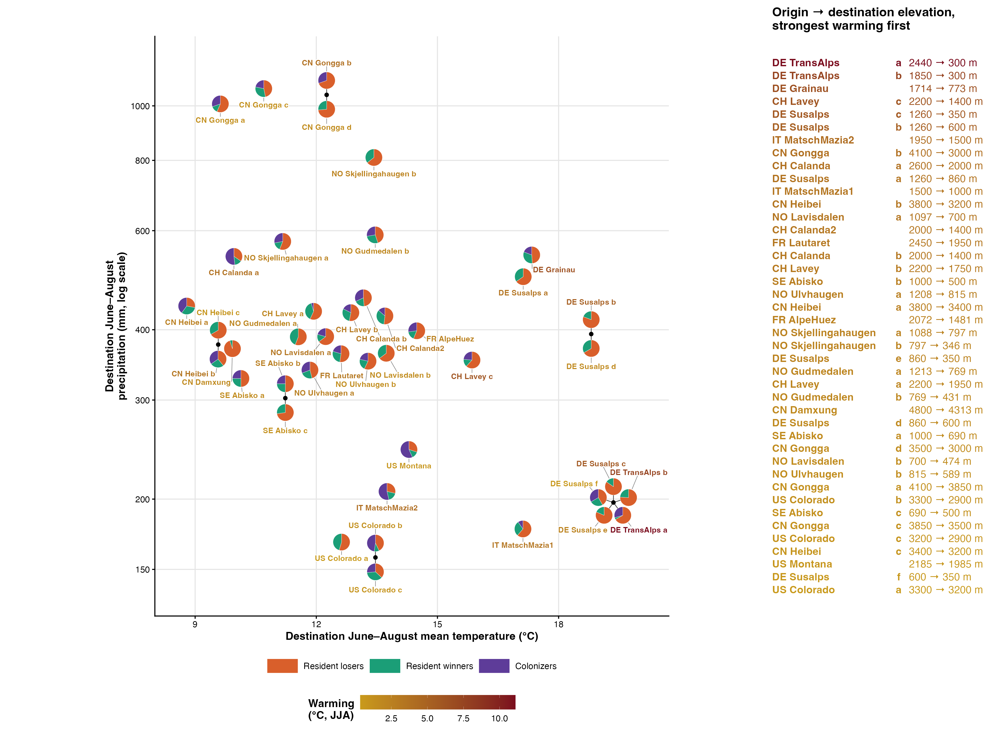 | 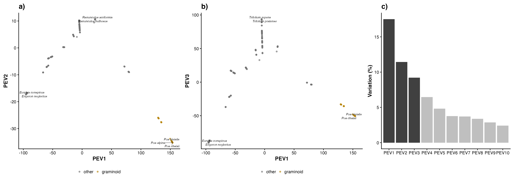 |
| **Fig S2.** TRY records kept and removed by the screening. | **Fig S3.** Phylogenetic axes of the analysed species; Table S3 names the families at each end. |
| 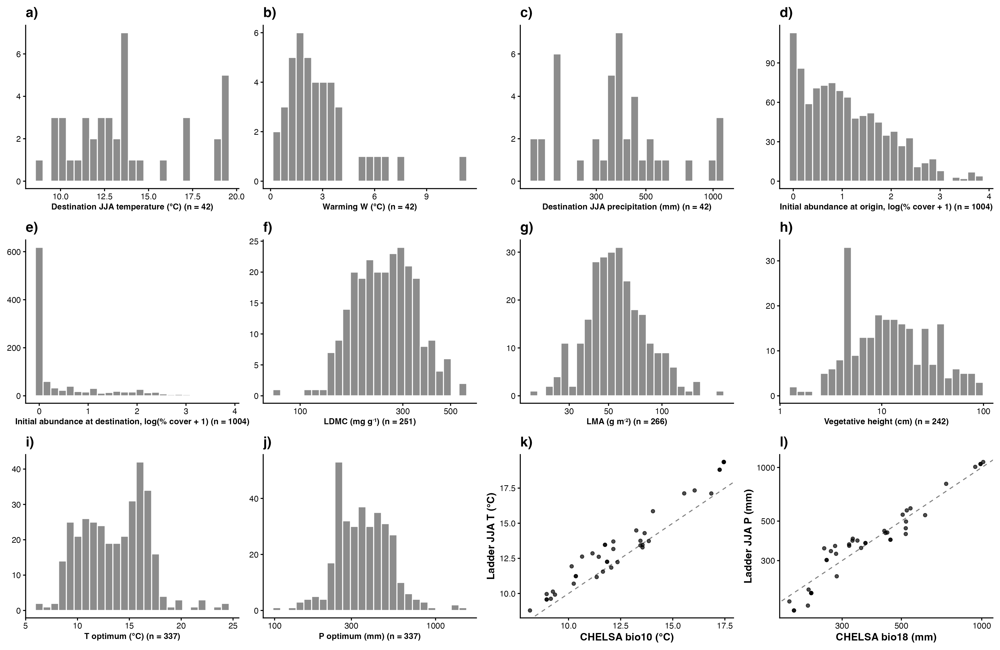 | 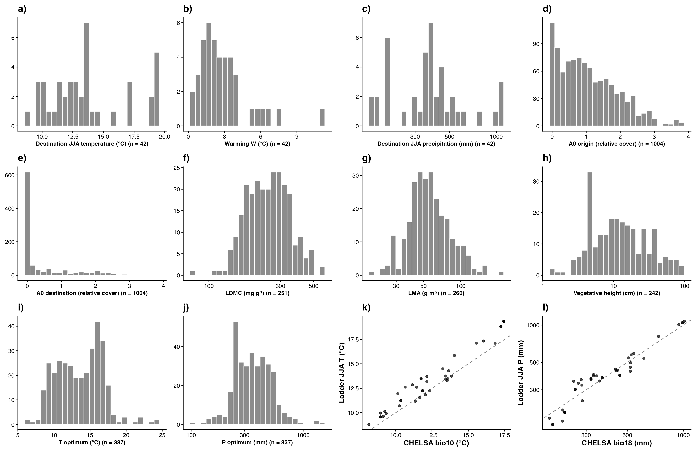 |
| **Fig S4.** Predictors before standardisation and the niche checks. | **Fig S5.** The pool rule: who is kept, who left behind and why. |

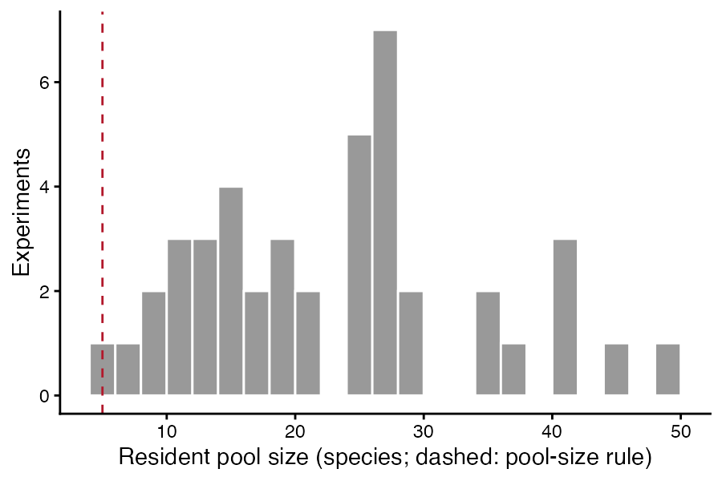

Code: [`prep/`](prep/) · [`analysis/01_relative_cover.R`](analysis/01_relative_cover.R) · report [`reports/01_relative_cover.md`](reports/01_relative_cover.md)

## Q1. Time

**What and why.** A species' response to warming in one experiment is the difference in relative cover between warmed turfs and turfs replanted at their origin. One mixed model per experiment gives this difference per species and per year (for Q1) and averaged over years (the *losing-winning strength*, for everything after). If those differences still move from year to year, comparing experiments would compare moments of a trajectory, so time is settled first.

**Decisions.**
- One model per experiment, not one across experiments: every contrast is identified within an experiment anyway, and the error variance differs between them (23 Oct).
- One residual variance per species (`dispformula = ~ species`, 30 Oct): with one per experiment every species of an experiment got the same SE.
- Degrees of freedom are the plots (control + warmed − 2), because warming is applied to whole plots (30 Oct).
- Year-specific classes at years 2, 3, 4 and 6; year 1 left out as transplant shock (30 Oct).
- Agreement between adjacent years rises from year 3, so the strength used downstream averages years 3 and later (step 03b, 30 Oct); the all-years strength is kept as a sensitivity (Figs S7, S9).

**Model code** ([`R/fit_experiment.R`](R/fit_experiment.R)):

```r
m <- glmmTMB::glmmTMB(relative_cover ~ treatment * year * species + (1 | plot_id:species),
                      dispformula = ~ species, data = d, REML = TRUE)
# year-specific contrast (Step B) and the contrast averaged over years (strength)
em      <- emmeans::emmeans(m, ~ treatment | species * year, df = df_plots)
by_year <- emmeans::contrast(em, method = "revpairwise")          # warmed - origin_control
em_mean <- emmeans::emmeans(m, ~ treatment | species, df = df_plots)
strength <- emmeans::contrast(em_mean, method = "revpairwise")
# step 03b: the same fits, averaged over years 3 and later
em_y3 <- emmeans::emmeans(m, ~ treatment | species, at = list(year = years_3_on), df = df_plots)
strength_y3 <- emmeans::contrast(em_y3, method = "revpairwise")
# agreement between adjacent years (step 03)
DescTools::CCC(contrast_year_a, contrast_year_b)$rho.c$est
```

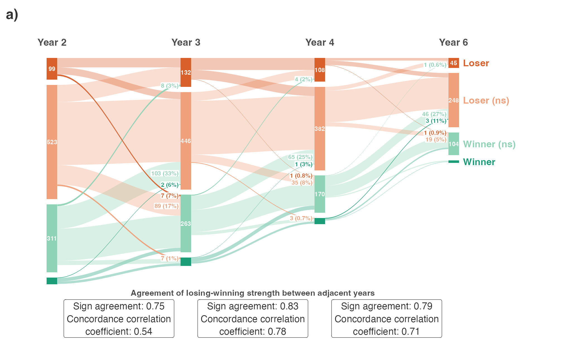

| | |
|---|---|
| 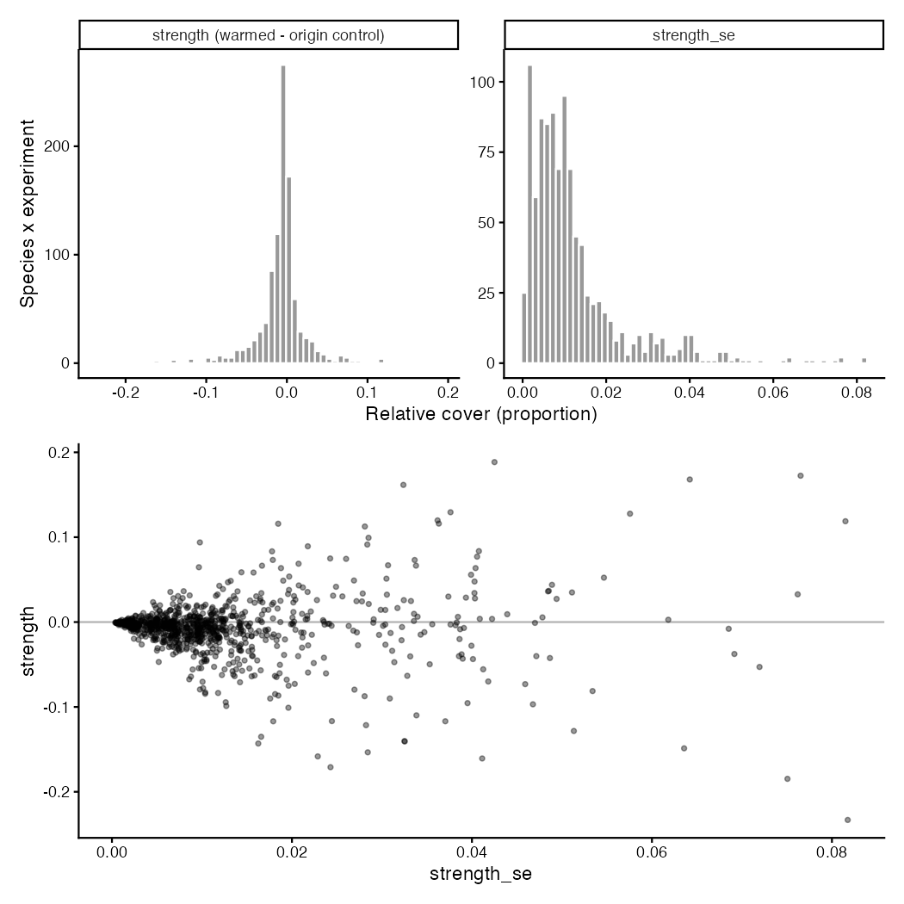 | 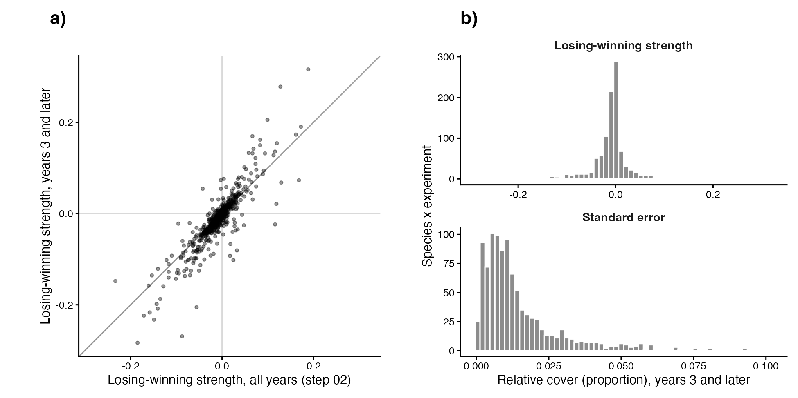 |
| **Fig S7.** Strength and its SE, all years (step 02). | **Fig S9.** Strength from year 3 against all years (step 03b). |

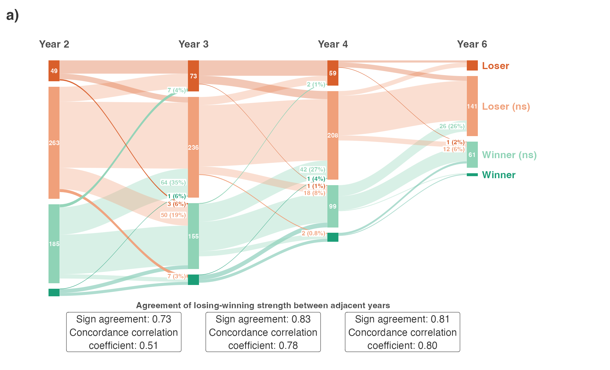

Code: [`02_strength.R`](analysis/02_strength.R) · [`03_temporal.R`](analysis/03_temporal.R) · [`03b_strength_y3.R`](analysis/03b_strength_y3.R) · reports [02](reports/02_strength.md), [03](reports/03_temporal.md), [03b](reports/03b_strength_y3.md)

## Q2. Consistency

**What and why.** For each species in at least 3 gradients, its strengths across experiments are pooled into one mean with its own among-experiment variance τ²<sub>s</sub>, the species' context dependency beyond sampling error. A species whose prediction interval for a new experiment lies wholly below zero is a consistent loser, wholly above zero a consistent winner, otherwise context-dependent.

**Decisions.**
- Fixed species means with one τ² per species, which equals one model per species (30 Oct): the planned joint model with a species random intercept collapsed every mean to the grand mean.
- The prediction interval carries both τ²<sub>s</sub> and the uncertainty of the mean: μ<sub>s</sub> ± 1.96 √(τ²<sub>s</sub> + SE(μ<sub>s</sub>)²).
- Eligibility by gradients (≥ 3), residents and colonizers alike (2 Nov).

**Model code** ([`04_classification.R`](analysis/04_classification.R)):

```r
# one model per species: intercept = pooled strength mu_s, ~ 1 | effect_id = tau2_s
m <- metafor::rma.mv(yi = strength, V = strength_se^2, random = ~ 1 | effect_id,
                     data = d_species, method = "REML")
predict(m)   # pi.lb, pi.ub: the prediction interval against zero
```

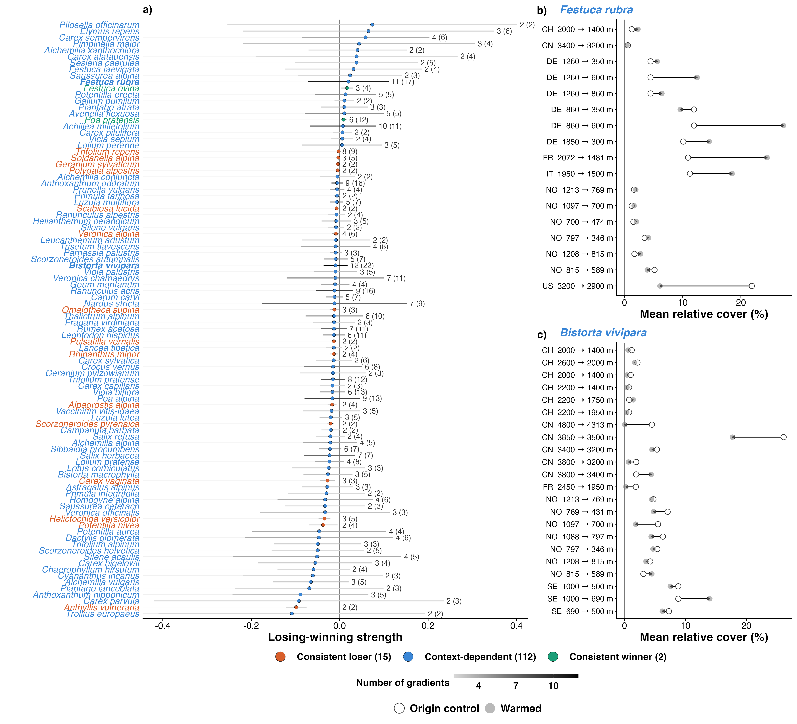

Code: [`04_classification.R`](analysis/04_classification.R) · report [04](reports/04_classification.md)

## The experiments in climate space

**What and why.** Before the models ask why, the outcomes are laid over the experiments' climate. Each experiment sits at its destination's summer temperature and precipitation; its pie splits the warmed turf's relative cover (years 3 and later) among resident losers and resident winners (the sign of each species' strength in that experiment) and colonizers (net warmed cover above zero), with what was not analysed in grey. Averaged over experiments, resident losers hold 23% of the warmed turf, resident winners 39%, colonizers 8% and the rest 29%.

**Decisions.** Cover, not counts, in the main figure; the counts are Fig S10 (2 Nov). Pies at their true climate; experiments sharing a destination fan out around a black dot. No purple where an experiment has fewer than 5 colonizers.

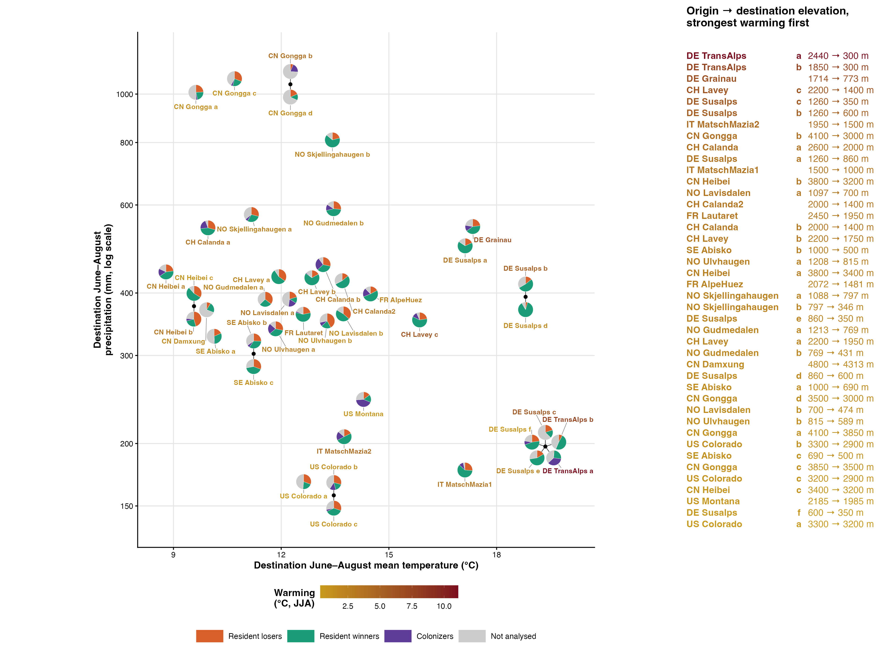


Code: [`10_figures.R`](analysis/10_figures.R) · report [10](reports/10_figures.md)

## Q3 and Q4. The ladder

**What and why.** The strengths of the ladder species are explained by a fixed sequence of meta-regressions, each read against the one before:

| Model | Fixed part | Random part | Question |
|---|---|---|---|
| Null | intercept | species, experiment, effect | |
| Start | initial abundance at origin and destination, each × W | as Null | Q3a, starting condition |
| Climate | W × T × P | as Null | Q3b, environment |
| Climate + start | both | as Null | Q3b |
| Species-dependent | as Climate + start | + species slopes on W and on T, P, TP | Q3c, the ceiling |
| LDMC, LMA, Height, Graminoid, Woody, Phylogeny, Niche | Climate + start + property × (1, W, T, P, TP) | as Species-dependent | Q3d, the properties |

The heterogeneity of each model is split into the shared site shift σ²<sub>experiment</sub>, the species × site piece τ² and the species variance H<sub>species</sub> (intercept and slope pieces). For Q4 every gradient with at least 5 effects is held out in turn, the model refitted on the others, and its held-out strengths predicted from the fixed effects plus, from Species-dependent on, each species' deviation learned in the other gradients. Each level is scored per gradient by R² against the Null model on that gradient, Spearman's ρ and loser/winner skill, and summarised by medians.

**Decisions.**
- W, T, P are the warming (destination − origin summer temperature), destination summer temperature and summer precipitation; A0 is log(% cover + 1) in the first survey of the origin and destination controls.
- The T, P, TP slope block is diagonal in every slope model (1 Nov): the general structure did not converge.
- One set of rows for the whole ladder, the species with every property (2 Nov).
- R² against the Null on the same gradient, medians over the 16 scored gradients (2 Nov), instead of one shared yardstick.
- Species deviations are computed by hand from the fitted variance components (metafor gives no BLUPs for a diagonal slope block, 2 Nov).
- Model-based (REML Wald) intervals for the coefficients (2 Nov).
- Random forest as a check on shape: the same rows, predictors and folds, no case weights, one setting chosen by out-of-bag R², held-out values only (2 Nov).

**Model code** ([`R/fit_model.R`](R/fit_model.R), [`05_ladder_fit.R`](analysis/05_ladder_fit.R), [`R/species_deviation.R`](R/species_deviation.R), [`06b_forest.R`](analysis/06b_forest.R)):

```r
re_base   <- list(~ 1 | species, ~ 1 | experiment_id, ~ 1 | effect_id)
re_slopes <- c(re_base, list(~ 0 + W | species, ~ 0 + T + P + TP | species))
f_both    <- ~ W * T * P + A0_origin + A0_dest + A0_origin:W + A0_dest:W
f_height  <- update(f_both, ~ . + height_z + height_z:W + height_z:T + height_z:P + height_z:TP)

m <- metafor::rma.mv(yi = strength, V = strength_se^2, mods = f_height, random = re_slopes,
                     struct = c("GEN", "GDIAG"), data = rows, method = "REML", sparse = TRUE)

# held out: fixed part + the species' deviation learned in the other gradients
b   <- D %*% t(Z) %*% solve(M, y - X %*% beta)            # BLUPs, by hand (blup())
r2  <- 1 - mean((predicted - observed)^2) / mean((null_predicted - observed)^2)

# random forest, the same rows and folds
rf <- ranger::ranger(x = train[vars], y = train$strength, num.trees = 3000,
                     mtry = mtry, min.node.size = node)      # no case weights
```

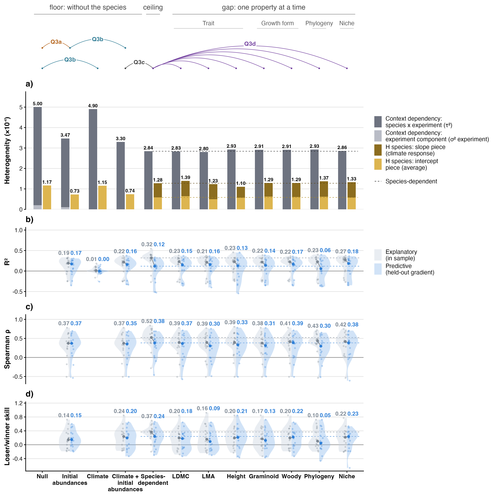

| | |
|---|---|
| 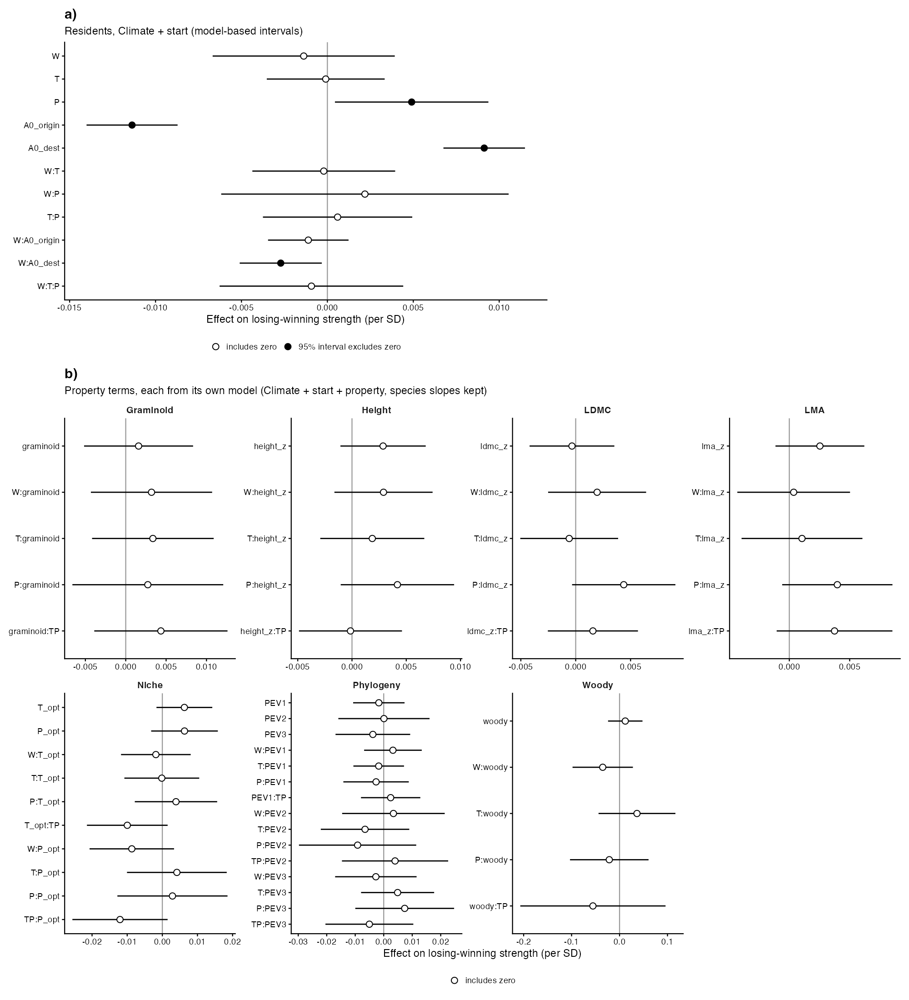 | 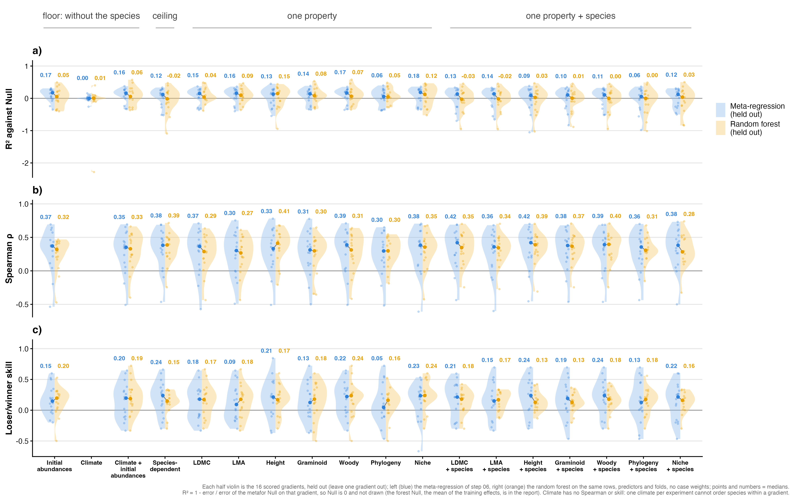 |
| **Fig S11.** Coefficients of every resident model, model-based 95% intervals. | **Fig S13.** Random forest beside the meta-regression, held out. |


In sample the Species-dependent model reaches a median R² of 0.32; held out it drops to 0.12, below initial abundances alone (0.17). No property level beats the Climate + start floor held out by much (0.16; Niche 0.18, LDMC 0.14, Height 0.13), and the forest beats the meta-regression only at Climate, Height, Null (median over levels 0.03 against 0.12): the weak relationships are weak, not misspecified.

Code: [`05_ladder_fit.R`](analysis/05_ladder_fit.R) · [`06_ladder_predict.R`](analysis/06_ladder_predict.R) · [`06b_forest.R`](analysis/06b_forest.R) · reports [05](reports/05_ladder_fit.md), [06](reports/06_ladder_predict.md), [06b](reports/06b_forest.md)

## Colonizers

**What and why.** The second way of winning is arriving. A colonizer's strength in an experiment is its relative cover in the warmed turfs, years 3 and later, estimated with the residents' model terms on the warmed plots alone. The colonizers then run through the same steps as the residents: year-specific presence classes (Fig 1b), Step C (Fig 3), the ladder fitted and predicted (Figs S15–S17) and the forest (Fig S18).

**Decisions.**
- Warmed plots only (2 Nov): a contrast against the destination controls measures the lag, not arrival.
- A species never recorded in an experiment's warmed plots is a measured absence: strength 0, SE 0 (2 Nov); 46 species were never present in any warmed plot.
- Where the per-species residual variance cannot be estimated, the experiment's error is used (2 Nov).
- At least 5 colonizers per experiment (28 of 42 experiments).
- The propagule pressure A0 is the species' mean destination-control relative cover over every plot and year (2 Nov); there is no origin abundance.
- Properties on the residents' scale, so both pools share one standardisation (2 Nov).
- No loser/winner skill (no loser class); an R² below −100 is taken out and listed (2 Nov).

**Model code** ([`07a_colonizers.R`](analysis/07a_colonizers.R)):

```r
m <- glmmTMB::glmmTMB(relative_cover ~ year * species + (1 | plot_id:species),
                      dispformula = ~ species, data = warmed_plots, REML = TRUE)
strength <- emmeans::emmeans(m, ~ species, at = list(year = years_3_on), df = df_plots)
# the ladder as for residents, with A0_dest only
f_both_col <- ~ W * T * P + A0_dest + A0_dest:W
```

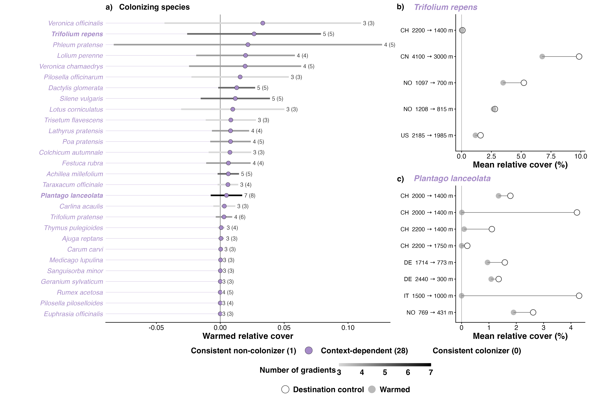

| | |
|---|---|
| 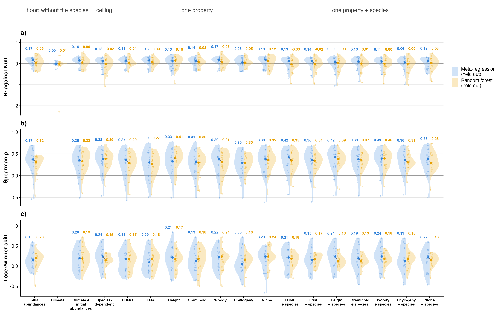 | 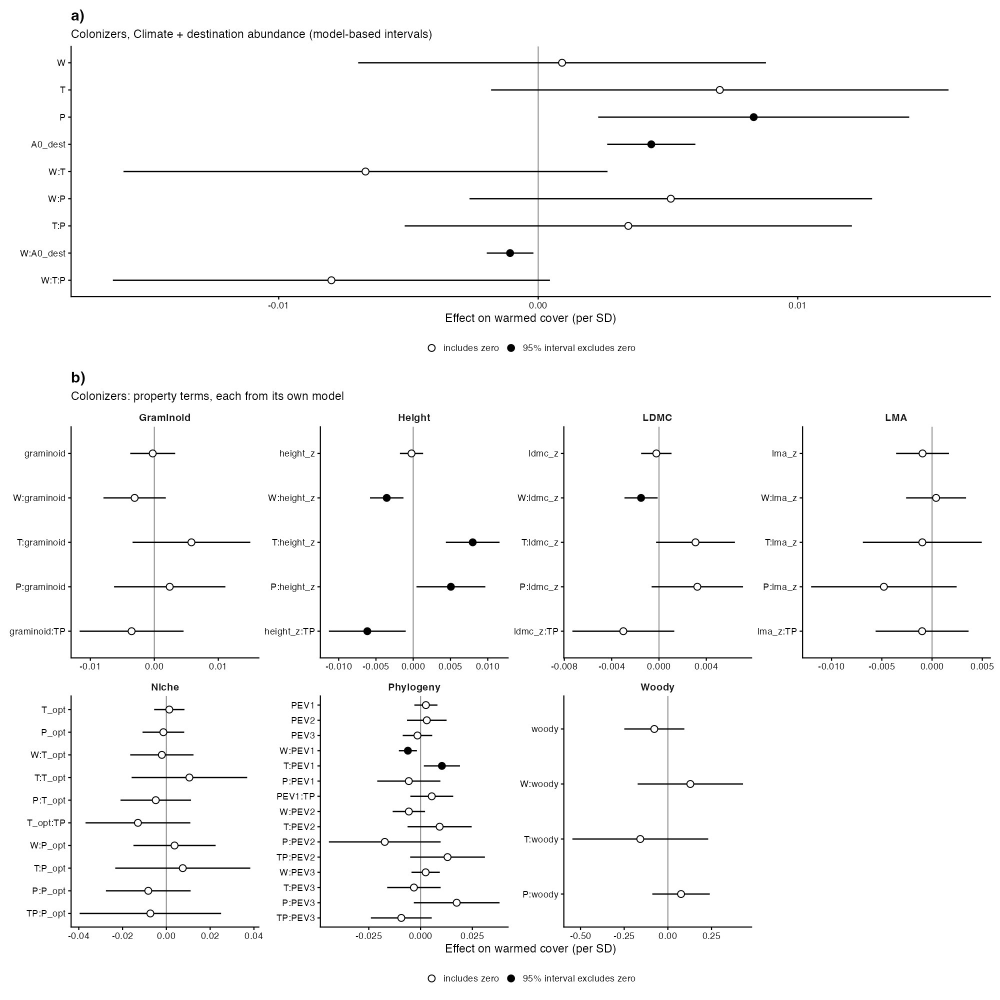 |
| **Fig S14.** Colonizer strength, years 3 and later against all years, and its distribution. | **Fig S15.** Coefficients of every colonizer model. |
|  | 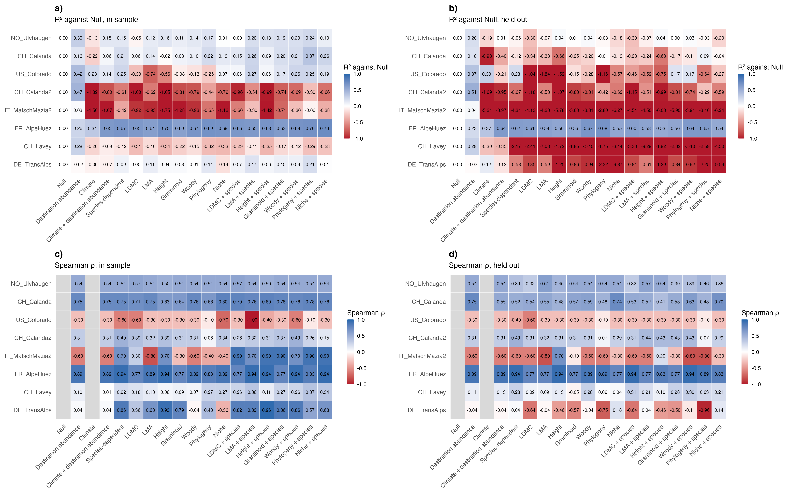 |
| **Fig S16.** The colonizers' ladder. | **Fig S18.** Random forest beside the meta-regression, colonizers. |


The ladder rows are 110 colonizer effects of 27 species. Only destination abundance transfers to a held-out gradient (median R² 0.11); climate, species identity and every property predict worse than the Null held out (Species-dependent -0.40).

Code: [`07a_colonizers.R`](analysis/07a_colonizers.R) · [`07b_classification.R`](analysis/07b_classification.R) · [`07c_ladder_fit.R`](analysis/07c_ladder_fit.R) · [`07d_ladder_predict.R`](analysis/07d_ladder_predict.R) · [`07e_forest.R`](analysis/07e_forest.R) · reports [07a](reports/07a_colonizers.md), [07b](reports/07b_classification.md), [07c](reports/07c_ladder_fit.md), [07d](reports/07d_ladder_predict.md), [07e](reports/07e_forest.md)

## Pathways

**What and why.** Do resident winners and colonizers draw on different kinds of species? Step C found too few consistent species for the planned groups, so the figure takes the plan's fallback, with losers added: residents by the sign of their pooled strength (Fig 2), colonizers with pooled warmed cover above zero (Fig 3), one point per species. Descriptive, no model.

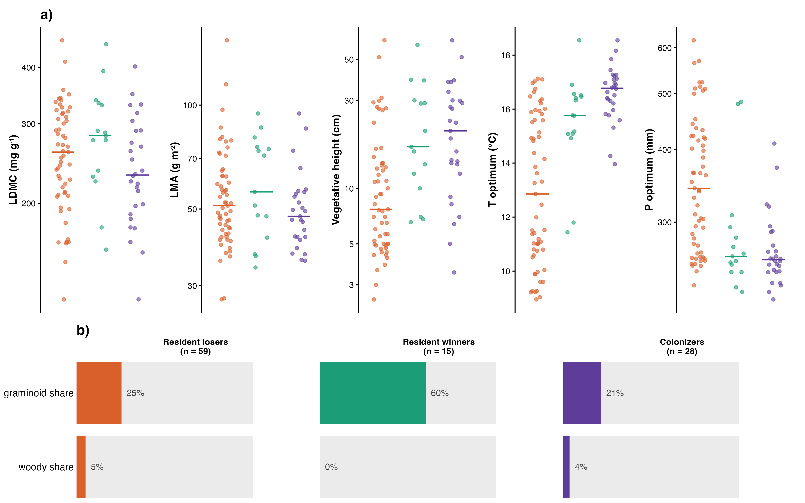

Code: [`07f_pathways.R`](analysis/07f_pathways.R) · report [07f](reports/07f_pathways.md)

## The coefficients

The climate + abundance model for each pool, and the trait terms of the Height and LDMC models with residents beside colonizers. Climate and trait terms share one axis; the abundance terms are scaled within each pool and are compared only within a panel.

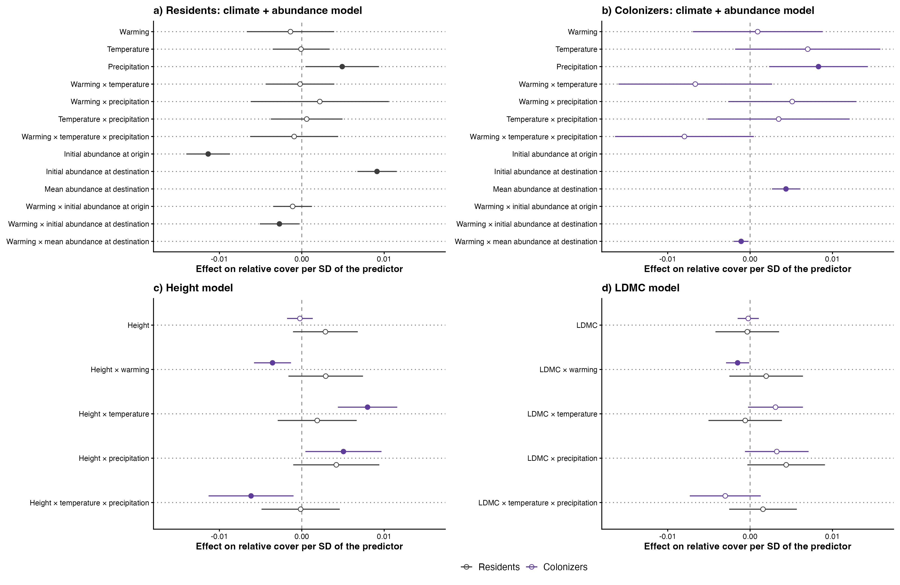

Code: [`10_figures.R`](analysis/10_figures.R) · tables [`tables/`](tables/) (S1 experiments, S2 species, S3 phylogenetic axes, S4 variance components, S5 coefficients)

## Repository structure

```
PLAN.md, MILESTONES.md, CLAUDE.md   the plan, the steps and their review status, the working rules
                                    (local files, not in git)
prep/                               data preparation, a targets pipeline
  _targets.R                          one target per preparation step (P1 to P7)
  R/                                  its functions: community, taxonomy, traits, functional groups,
                                      phylogeny, climate, niche, report
  config/                             reviewed ledgers: name decisions, renames, trait review, trees,
                                      woodiness, phylogeny placements, GBIF keys
  tnrs/                               TNRS cache, so names resolve the same way offline
analysis/                           one script per step, run in order, each reading only data/derived/
  01_relative_cover.R ... 07f_pathways.R, 10_figures.R
  additional_checks/                  side checks that feed no step (the paused GEN slope check)
R/                                  functions used by two or more scripts: fit_experiment, fit_model,
                                    h_species, species_deviation, metrics_gradient, fig4_ladder, md_table
data/                               raw inputs, read only (SQLite network database, TRY export, CHELSA)
  derived/prep/                       the prepared tables
  derived/NN_<step>/                  each step's outputs: tables, fitted models (.rds), fold caches
figures/
  main/                               Figs 1 to 7, each written by the step that makes it
  appendix/                           Figs S1 to S18, in the order of the analysis
  diagnostics/                        the steps' review figures, copied into the appendix
tables/                             Tables S1 to S5
reports/                            one review report per step; REPORT.qmd collects them
plan_figures/                       the mock figures agreed while planning
legacy/                             the earlier targets pipeline, read only, for reference
renv.lock                           the locked package environment
```

Each step was planned, run and reviewed on its own branch (`step-NN-<name>`), with a report under `reports/` that lists its counts, its key table, its figures, the warnings captured and its deviations from the plan. Fitted models are cached under `data/derived/`, so a rerun skips what exists.

## Running the analysis

```sh
Rscript -e 'renv::restore()'
Rscript -e 'targets::tar_make(script = "prep/_targets.R", store = "prep/_targets")'
LANG=en_US.UTF-8 Rscript analysis/01_relative_cover.R   # then 02, 03, 03b, 04, 05, 06, 06b, 07a-07f, 10
```

Run from the repository root. A UTF-8 locale keeps the figure labels (τ², ×10⁻⁴) intact. `analysis/10_figures.R` writes this README from `README.Rmd` as its last step.

## Data and citation

- Community data: the TransPlant network database (`data/transplant_network_clean.sqlite`, from TransPlantNetwork/transplant_network_data_cleaning).
- Species occurrences for the climatic niche: GBIF.org (28 October 2026) GBIF Occurrence Download https://doi.org/10.15468/dl.7p28y9 (download key 0011587-261023074918325). This DOI must be cited in the methods and the data availability statement; GBIF deletes downloads that are not cited after 28 April 2027.
- Climate: CHELSA V2.1. Traits: the TRY database export.
