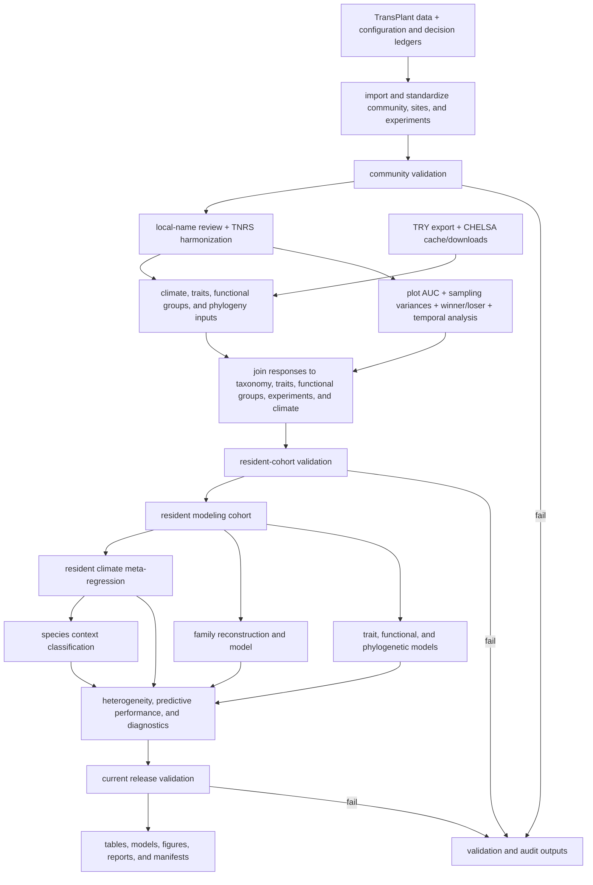

# TransPlant winners–losers workflow

Open [`analysis_workflow.qmd`](analysis_workflow.qmd) first to review the
analysis in scientific order. Its top-level analytical assignments become
targets through `tarchetypes::tar_tangle()`. `_targets.R` sources supporting
functions and combines those QMD targets with three direct groups of supporting
targets for data, models, and publication files.

This guide describes execution, naming, failure behavior, and the historical
retirement record.

## Analysis flow



Historical comparison targets, source files, and fixtures have been removed
from the active workflow. Generated results remain until the clean rebuild.

## Stages

| # | Stage | Review section | Target definition | Principal targets | Main outputs | Check |
|---:|---|---|---|---|---|---|
| 1 | Raw data | [Raw data](analysis_workflow.qmd#raw-data) | tangled QMD targets plus file inputs | `current_input`, `community`, `sites`, `experiments` | imported and standardised source tables | `community_validation` |
| 2 | Data preparation | [Data preparation](analysis_workflow.qmd#data-preparation) | tangled QMD targets plus external-data support | `analysis_community`, taxonomy, climate, and trait targets | reviewed community, taxonomy, TRY, CHELSA, and functional groups | range, coordinate, join, and missing-data checks |
| 3 | Responses and final analysis data | [Response calculation](analysis_workflow.qmd#response-calculation) | tangled QMD targets | `auc_inputs`, `auc_contrasts`, `winner_loser`, `analysis_data`, `resident_auc_data`, `resident_sampling_variance_matrix` | Delta AUC, joined analysis data, classifications, diagonal sampling variances | response, join, cohort, and sampling-variance validation |
| 4 | Models | [Model specifications](analysis_workflow.qmd#model-specifications) | tangled QMD targets with literal formulas and random structures | resident, family, trait, functional, and phylogenetic fits | ML comparisons, REML fits, CR1 tables | rank, ordering, convergence, and matched-data checks |
| 5 | Inference and diagnostics | [Inference and diagnostics](analysis_workflow.qmd#inference-and-diagnostics) | tangled QMD targets plus repeated-fit support | classifications, heterogeneity, `model_fit_r2`, cross-validation | heterogeneity and the four Appendix Figure S7 measures | evaluation validations |
| 6 | Figures, tables, and release | [Figures and tables](analysis_workflow.qmd#figures-and-tables) | supporting publication/release targets | registered figures, tables, `release_validation` | PDF/PNG, CSV/RDS, HTML, provenance | figure and current-release checks |

The QMD holds the central calculations. Supporting targets are listed directly
in `R/targets/definitions/` rather than routed by target-name patterns.
Each removed one-hop target is recorded in
[`docs/workflow_migration_map.csv`](docs/workflow_migration_map.csv).

## Code layout

```text
R/
  infrastructure/   configuration support, I/O, provenance, artifact handling
  data/             community, taxonomy, climate, traits, analysis dataset
  responses/        AUC, sampling variances, winner/loser, temporal analysis
  models/           meta-regression, species, family, predictors, phylogeny
  evaluation/       heterogeneity, cross-validation, diagnostics
  figures/          shared styles, figure builders, export renderers
  validation/       current resident-cohort and release checks
  targets/          supporting data, model, and publication target definitions
```

Every active R module starts with its responsibility, inputs, outputs, and
permitted side effects. Every top-level function has a Roxygen-style purpose,
parameter contract, and return contract. Functions that write files are kept in
infrastructure or explicit renderer modules; analytical functions return
in-memory objects.

## Naming policy

- Names describe scientific domains (`resident`, `community`, `phylogeny`,
  `predictor`) rather than their old position in the graph.
- Sample sizes such as 526 species, 1,604 effects, and 42 experiments appear as
  validated results, never as identifiers.
- Historical names remain only in the migration and retirement records.
- There are no compatibility aliases. Renames are recorded in
  [`docs/name_migration.csv`](docs/name_migration.csv).
- Generated model, table, audit, and figure names contain their subject and
  purpose, not a historical step number or dataset size.

## Command-line interface

Restore the locked R environment first:

```sh
Rscript -e 'renv::restore()'
```

Run the complete graph:

```sh
Rscript scripts/run_pipeline.R
```

The run commands above are for the post-approval rebuild. During the present
migration-review stage, use `tar_manifest()`, `tar_glimpse()`,
`tar_visnetwork()`, and `tar_outdated()` only.

Set `TRANSPLANT_WORKERS` to control local parallelism (the default is 2), for
example `TRANSPLANT_WORKERS=5 Rscript scripts/run_pipeline.R`.

List or render a registered export-based figure:

```sh
Rscript scripts/render_figure.R --list
Rscript scripts/render_figure.R climate-response
```

Refresh only explicitly managed dependencies:

```sh
Rscript scripts/refresh_dependencies.R
```

For development, a target can be built directly without changing the public
CLI, for example:

```sh
Rscript -e 'targets::tar_make(names = release_validation)'
```

## Failure behavior

Validation is fail-closed. Missing columns, duplicate identifiers, invalid
sampling-variance ordering, non-finite model results, failed classifications, or a
failed release check stop the affected branch. Per-stage audit tables remain in
`output/audits/` when they were successfully written before the failure.

The historical validation modules and targets are retired. Dependency
inspection must show that current science, figures, and release targets have no
historical input.

## Review document and figures

`analysis_workflow.qmd` is the active reviewer-facing report and target source.
Analytical chunks inherit `eval = FALSE` from the opening setup chunk, as
recommended by `tar_tangle()`; assignment-free display chunks explicitly use
`eval: true` and `tar_read()` only after results exist. The seven former QMD
reports and their old HTML renders have been removed; their scientific content
is mapped to this document in the migration record.

Figures are built by functions in `R/figures/`; export-based figures are
dispatched through the registry in `R/figures/registry.R`. Paired PDF/PNG files
share one scientific figure object or one renderer invocation.

## Release and certification

The tracked historical state is tagged
`pre-reviewable-workflow-with-history-2026-09-30`. The retirement manifest
records checksums. Git-ignored files from `archive/` were deleted with the
user's approval and are not recoverable from the tag. Current generated
results and target stores are preserved in the verified ZIP recorded in
[`docs/pre_rebuild_output_snapshot.csv`](docs/pre_rebuild_output_snapshot.csv).

Before any rebuild, the regrouped QMD, `tar_manifest()`, dependency graphs,
[`docs/workflow_migration_map.csv`](docs/workflow_migration_map.csv), and focused
synthetic tests must be reviewed. After the rebuilt outputs are accepted, the
sole current baseline will be written to
`output/reference/release_reference_results.rds` and registered in
`config/release_reference.csv`.
