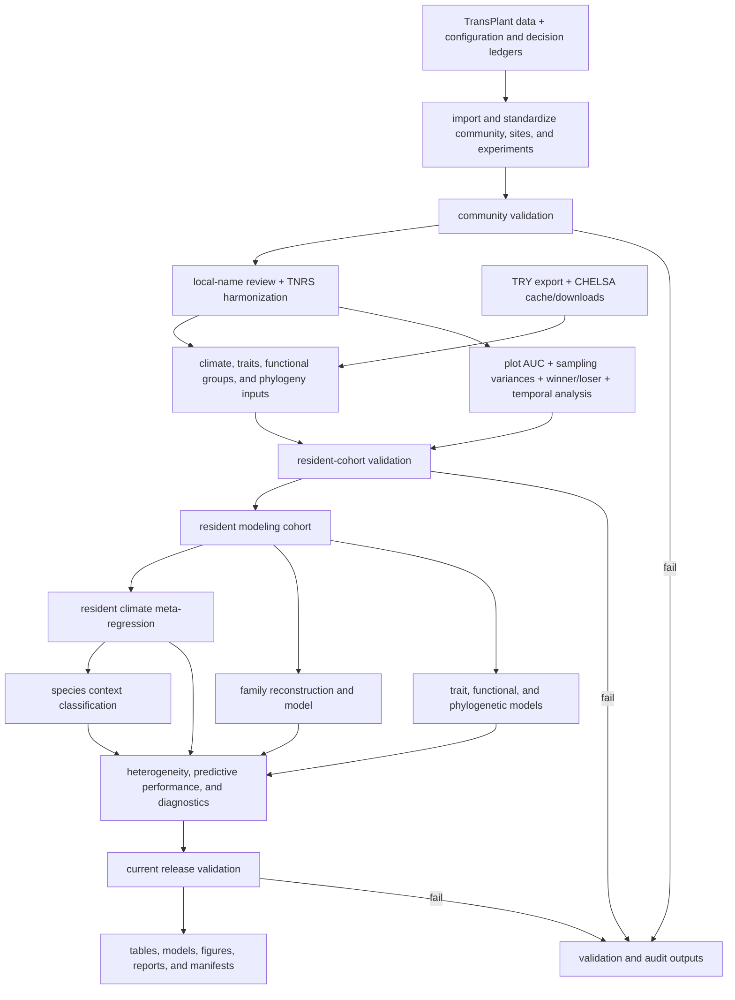

# TransPlant winners–losers workflow

This is the authoritative guide to the analysis. The workflow is organized by
scientific stage, and `_targets.R` is the executable definition of the graph.
The workflow documents formulas, exclusions, sampling-variance assumptions,
classification rules, and other scientific decisions explicitly.

## Analysis flow



During Phase 1, a separate `legacy_certification_targets()` branch compares the
rebuilt results with frozen historical references. It is deliberately absent
from the diagram because it is not part of the scientific or release flow and
will be deleted after explicit acceptance.

## Stages

| # | Stage | Report | Target factory | Principal targets | Main outputs | Gate |
|---:|---|---|---|---|---|---|
| 1 | Sources and configuration | [data foundation](reports/data_foundation.qmd) | `source_targets()` | `config`, input files, decision ledgers, `active_source_inventory` | source inventory and checksums | required files and configuration parse |
| 2 | Community and taxonomy | [data foundation](reports/data_foundation.qmd) | `community_targets()` | `community`, `sites`, `experiments`, taxonomy review | standardized community/site/experiment tables | `community_validation` |
| 3 | Covariates | [data foundation](reports/data_foundation.qmd) | `covariate_targets()` | CHELSA summaries, TRY summaries, functional groups, analysis data | climate, trait, taxonomy, and analysis tables | coordinate, unit, range, and join validation |
| 4 | Responses | [response estimation](reports/response_estimation.qmd) | `response_targets()` | `auc_inputs`, `winner_loser`, temporal transitions | plot AUC, effect SEs, response classifications | contrast and flow checks |
| 5 | Resident climate and family models | [resident climate model](reports/resident_climate_model.qmd), [family context model](reports/family_context_model.qmd) | `resident_model_targets()` | `resident_model_data`, `resident_sampling_variance_matrix`, `resident_climate_model`, `species_classification`, `family_model_bundle` | resident effects and diagonal sampling variances, climate model, species/family classifications | resident scope, sampling-variance order, and model diagnostics |
| 6 | Predictor models | [predictor models](reports/predictor_models.qmd) | `predictor_model_targets()` | trait, functional, and phylogenetic model pairs | climate-only/full model objects, robust inference, phylogeny and PEV tables | matched-row/sampling-variance and fit diagnostics |
| 7 | Evaluation | [model synthesis](reports/model_synthesis.qmd) | `evaluation_targets()` | `heterogeneity_synthesis`, cross-validation, model-effect profiles | heterogeneity, predictive performance, and diagnostic tables | evaluation release validations |
| 8 | Publication | all seven reports | `publication_targets()` | figure objects, renderer targets, Quarto targets | registered PDF/PNG figures and rendered reports | figure registry and retained-copy audit |
| 9 | Release | [release validation](reports/release_validation.qmd) | `release_targets()` | `current_scientific_release_validation`, `release_validation`, manifests | release tables, provenance, checksums | current release gate |
| 10 | Temporary historical certification | none | `legacy_certification_targets()` | equivalence checks and `refactor_certification` | Phase 1-only audit tables | historical equivalence plus current release gate |

The code-level assignment of every target to one factory is implemented in
[`R/targets/stages.R`](R/targets/stages.R). It intentionally avoids documenting
a target total because the graph can grow without changing this interface.

## Code layout

```text
R/
  infrastructure/   configuration support, I/O, provenance, artifact handling
  data/             community, taxonomy, climate, traits, analysis dataset
  responses/        AUC, sampling variances, winner/loser, temporal analysis
  models/           meta-regression, species, family, predictors, phylogeny
  evaluation/       heterogeneity, cross-validation, diagnostics
  figures/          shared styles, figure builders, export renderers
  validation/       current release checks and temporary legacy certification
  targets/          stage registry and target definitions
```

Every active R module starts with its responsibility, inputs, outputs, and
permitted side effects. Every top-level function has a Roxygen-style purpose,
parameter contract, and return contract. Functions that write files are kept in
infrastructure or explicit renderer modules; analytical functions return
in-memory objects.

## Naming policy

- Names describe scientific domains (`resident`, `community`, `phylogeny`,
  `predictor`) rather than their old position in the graph.
- Sample sizes such as 526 species, 1,604 effects, and 42 experiments appear as
  validated results, never as identifiers.
- `legacy_*` is reserved for the temporary Phase 1 certification branch.
- There are no compatibility aliases. Renames are recorded in
  [`docs/name_migration.csv`](docs/name_migration.csv).
- Generated model, table, audit, and figure names contain their subject and
  purpose, not a historical step number or dataset size.

## Command-line interface

Restore the locked R environment first:

```sh
Rscript -e 'renv::restore()'
```

Run the complete graph:

```sh
Rscript scripts/run_pipeline.R
```

Set `TRANSPLANT_WORKERS` to control local parallelism (the default is 2), for
example `TRANSPLANT_WORKERS=5 Rscript scripts/run_pipeline.R`.

List or render a registered export-based figure:

```sh
Rscript scripts/render_figure.R --list
Rscript scripts/render_figure.R climate-response
```

Refresh only explicitly managed dependencies:

```sh
Rscript scripts/refresh_dependencies.R
```

For development, a target can be built directly without changing the public
CLI, for example:

```sh
Rscript -e 'targets::tar_make(names = release_validation)'
```

## Failure behavior

Validation is fail-closed. Missing columns, duplicate identifiers, invalid
sampling-variance ordering, non-finite model results, failed classifications, or a
failed release check stop the affected branch. Per-stage audit tables remain in
`output/audits/` when they were successfully written before the failure.

Historical fixtures are read only in `legacy_certification_targets()`. The
automated ancestry audit fails if a current scientific, figure, report, or
release target acquires a historical ancestor.

## Reports and figures

The seven Quarto sources are the only active reports:

1. `data_foundation.qmd`
2. `response_estimation.qmd`
3. `resident_climate_model.qmd`
4. `family_context_model.qmd`
5. `predictor_models.qmd`
6. `model_synthesis.qmd`
7. `release_validation.qmd`

Reports read completed targets and never fit models. Figures are built by
functions in `R/figures/`; export-based figures are dispatched through the
registry in `R/figures/registry.R`. Paired PDF/PNG files share one scientific
figure object or one renderer invocation.

## Release and certification

Phase 1 is complete only when all source files parse, the unit suite passes, a
fresh-store build succeeds, all reports and registered figures render, current
outputs pass the release gate, historical equivalence passes, and the dependency
and migration manifests pass. Automated success does not authorize deletion.

Phase 2 requires explicit user acceptance. Only then will the accepted state be
committed, tagged as `validated-refactor-with-history-YYYY-MM-DD`, recorded in
`docs/history_retirement_manifest.csv`, and used to create
`output/reference/release_reference_results.rds` plus
`config/release_reference.csv`. The archive, old fixtures, adapters, reports,
tests, and `legacy_certification_targets()` will then be removed. A second clean
build with those files physically absent is mandatory.

At present the project is in Phase 1, so the archive and historical fixtures
remain recoverable in the active tree and no retirement tag has been created.
