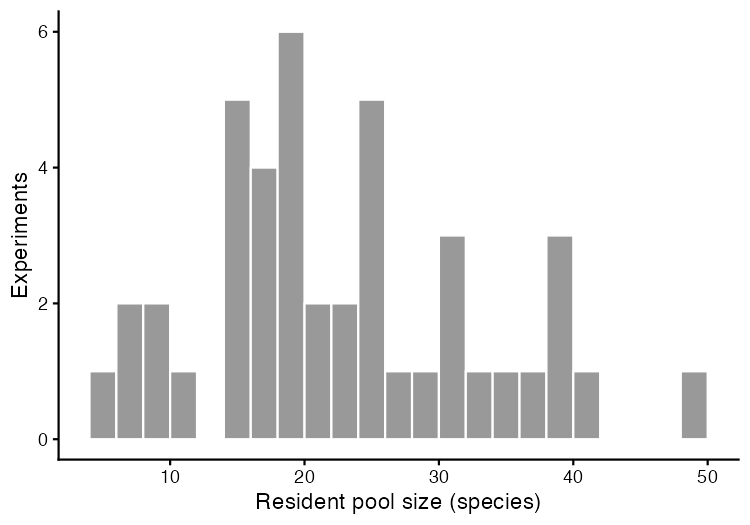

# Step 01: Relative cover table and pools

Relative cover was computed per plot-year over all 58,803 vascular records (identified, genus-level and unidentified, the six deep-lineage taxa included), so it sums to 1 in every one of 3,210 plot-years. The analysis keeps identified species without a `drop_reason` and removes the deep-lineage taxa afterwards. Each of the 43 included experiments gets its warmed turfs, origin controls and destination controls; a species is resident if recorded in at least half of the origin-control plots and in at least 2 years of origin controls, and in the destination pool if recorded likewise in the destination controls and never in the origin controls, whether or not it was ever found in warmed turfs. Every included experiment goes forward (no pool-size rule), all observed cover is kept, and every pool species gets a row, zero where unrecorded, in every surveyed plot-year of its pool's two groups.

## Counts at every rule (`flow_counts.csv`, Fig S1)

| rule | branch | n_experiments | n_species | n_combinations |
| --- | --- | --- | --- | --- |
| input (P1 community, identified species) | all | 44 | 886 | 3340 |
| experiment exclusions (P1) | all | 43 | 869 | 3309 |
| deep-lineage taxa removed | all | 43 | 863 | 3278 |
| pool rule (>= half of a control group's plots and >= 2 years; destination pool: no origin-control record) | all | 43 | 435 | 1405 |
| pool assignment | resident | 43 | 348 | 995 |
| pool assignment | destination_pool | 41 | 237 | 410 |

Species x experiment combinations in neither pool:

| reason | species_x_experiment |
| --- | --- |
| in destination controls only, below the destination-pool rule | 589 |
| in origin controls, below the resident rule | 1028 |
| warmed only | 256 |

## Relative cover

Sum of relative cover per plot-year: min 1.000000000000, max 1.000000000000. Share of plot-year cover in rows not analysed (dropped or deep-lineage): min 0.000, median 0.005, 90% 0.241, max 0.891.

Share of plot-year cover in rows not analysed, by region:

| region | plot_years | median_share | max_share | plot_years_over_25pct |
| --- | --- | --- | --- | --- |
| CH_Calanda2 | 110 | 0.309 | 0.536 | 74 |
| CN_Gongga | 218 | 0.277 | 0.891 | 125 |
| CN_Damxung | 120 | 0.157 | 0.85 | 45 |
| SE_Abisko | 90 | 0.12 | 0.706 | 18 |
| NO_Skjellingahaugen | 124 | 0.051 | 0.276 | 1 |
| NO_Gudmedalen | 125 | 0.048 | 0.231 | 0 |
| NO_Ulvhaugen | 124 | 0.033 | 0.374 | 3 |
| FR_AlpeHuez | 269 | 0.032 | 0.52 | 7 |
| FR_Lautaret | 120 | 0.02 | 0.382 | 4 |
| CN_Heibei | 124 | 0.005 | 0.106 | 0 |
| CH_Lavey | 209 | 0.003 | 0.224 | 0 |
| CH_Calanda | 284 | 0.002 | 0.072 | 0 |
| DE_Grainau | 120 | 0 | 0.058 | 0 |
| DE_Susalps | 360 | 0 | 0.407 | 4 |
| DE_TransAlps | 180 | 0 | 0 | 0 |
| IN_Kashmir | 60 | 0 | 0.636 | 2 |
| IT_MatschMazia1 | 42 | 0 | 0 | 0 |
| IT_MatschMazia2 | 54 | 0 | 0 | 0 |
| NO_Lavisdalen | 125 | 0 | 0.459 | 8 |
| US_Arizona | 84 | 0 | 0.75 | 6 |
| US_Colorado | 184 | 0 | 0.336 | 2 |
| US_Montana | 84 | 0 | 0.217 | 0 |

## Pool sizes (`pool_sizes.csv`)

No pool-size rule (dropped 29 Oct): all 43 included experiments go forward. Smallest resident pools: US_Arizona::MC::PP 4; DE_Susalps::FE::BT 7; US_Montana::High::Low 7. US_Arizona, which PLAN.md expected to leave with about four residents in the legacy relative cover, has 4 on the SQLite's absolute cover (kept, decided 28 Oct).
Gradients (`gradient_id` = region): 21.

| experiment_id | region | resident | destination_pool |
| --- | --- | --- | --- |
| US_Arizona::MC::PP | US_Arizona | 4 | 4 |
| DE_Susalps::FE::BT | DE_Susalps | 7 | 6 |
| US_Montana::High::Low | US_Montana | 7 | 14 |
| SE_Abisko::High::Low | SE_Abisko | 9 | 5 |
| SE_Abisko::High::Mid | SE_Abisko | 9 | 5 |
| SE_Abisko::Mid::Low | SE_Abisko | 11 | 2 |
| CN_Gongga::H::A | CN_Gongga | 16 | 12 |
| CN_Gongga::H::L | CN_Gongga | 16 | 7 |
| US_Colorado::mo::pf | US_Colorado | 16 | 5 |
| US_Colorado::mo::um | US_Colorado | 16 | 14 |

## Survey years failing the both-groups rule (1 experiment-years)

A year enters a pool's table only if both of that pool's groups were surveyed in it.

| experiment_id | species_pool | year | n_groups | groups |
| --- | --- | --- | --- | --- |
| CH_Calanda2::Cal::Nes | destination_pool | 4 | 1 | warmed |

## A0 from the first available control survey

A0 = log(100 x mean relative cover over the control plots of the group's first surveyed year + 1). Experiments whose first control survey is not year 1:

| experiment_id | origin_control | destination_control |
| --- | --- | --- |
| NO_Gudmedalen::Gudmedalen::Rambera | 2 | 2 |
| NO_Gudmedalen::Rambera::Arhelleren | 2 | 2 |
| NO_Lavisdalen::Hogsete::Vikesland | 2 | 2 |
| NO_Lavisdalen::Lavisdalen::Hogsete | 2 | 2 |
| NO_Skjellingahaugen::Skjellingahaugen::Veskre | 2 | 2 |
| NO_Skjellingahaugen::Veskre::Ovstedal | 2 | 2 |
| NO_Ulvhaugen::Alrust::Fauske | 2 | 2 |
| NO_Ulvhaugen::Ulvhaugen::Alrust | 2 | 2 |

## Table and spot check

`cover_long`: 94,705 rows, 43 experiments, 21 gradients, 1,405 species x experiment combinations (995 resident, 410 destination pool); 45,795 rows observed, 48,910 zeros.
Spot check, US_Arizona::MC::PP: pool species x surveyed plot-years of their groups = 448, rows written = 448 (286 zeros + 162 observed records).

## Warnings captured

None.

## Deviations from PLAN.md

Relative cover includes the six deep-lineage taxa in its denominator and removes them afterwards (decided 28 Oct; PLAN.md Data rules updated). The pool rule decides pool membership only; observed cover of pool species is kept whatever its count (decided 28 Oct; legacy removed it per treatment).
