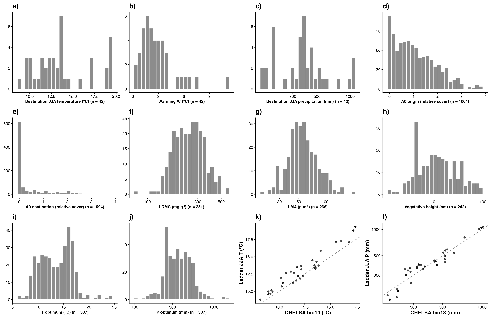
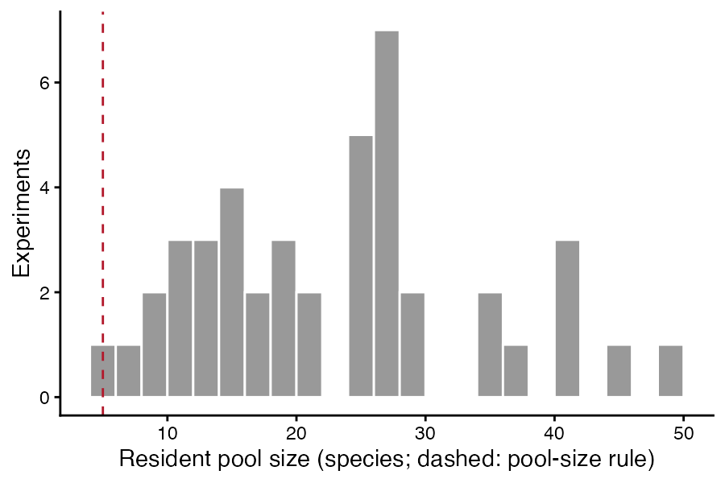

# Step 01: Relative cover table and pools

Relative cover was computed per plot-year over all 58,803 vascular records (identified, genus-level and unidentified, the six deep-lineage taxa included), so it sums to 1 in every one of 3,210 plot-years. The analysis keeps identified species without a `drop_reason` and removes the deep-lineage taxa afterwards. Each of the 43 included experiments gets its warmed turfs, origin controls and destination controls. Pool rule (2 Nov): a species is resident if, in the origin controls, it was recorded in at least two plots in at least half of the survey years, or in at least half of the plots in at least two survey years (halves rounded up; plots surveyed that year; years the group was surveyed); it is in the destination pool if it meets the same rule in the destination controls and has no record in the origin controls, whether or not it was ever found in warmed turfs. Pool-size rule (reinstated 2 Nov): an experiment needs at least 5 residents. All observed cover of pool species is kept, and every pool species gets a row, zero where unrecorded, in every surveyed plot-year of its pool's two groups.

## Counts at every rule (`flow_counts.csv`, Fig S1)

| rule | branch | n_experiments | n_species | n_combinations |
| --- | --- | --- | --- | --- |
| input (P1 community, identified species) | all | 44 | 886 | 3340 |
| experiment exclusions (P1) | all | 43 | 869 | 3309 |
| deep-lineage taxa removed | all | 43 | 863 | 3278 |
| pool rule (2 Nov: >= 2 plots in half the years, or half the plots in >= 2 years) | all | 43 | 437 | 1415 |
| pool-size rule (at least 5 residents per experiment) | all | 42 | 429 | 1406 |
| pool assignment | resident | 42 | 346 | 1004 |
| pool assignment | destination_pool | 39 | 236 | 402 |

Species x experiment combinations in neither pool (before the pool-size rule):

| reason | species_x_experiment |
| --- | --- |
| below the pool rule in both control groups | 1407 |
| destination rule met, but recorded in origin controls | 200 |
| warmed only | 256 |

## What the pool rule keeps and leaves behind

Every species x experiment recorded in a control group, by its plot-year records there and by what the rule did with it (a); totals (b); per experiment, the species recorded in the origin controls (c); kept species by the number of gradients they occur in, with the cut-off applied downstream, at least 3 gradients for the classification (step 04) and the ladder (step 05) (d). The rule is not a cut-off on records: combinations with many records but in few plots or few years are left behind, and some with few records are kept where the plots are few.

| pool | kept | left behind: fails the pool rule | left behind: experiment under 5 residents | left behind: recorded in origin controls |
| --- | --- | --- | --- | --- |
| Residents (origin controls) | 1004 | 1015 | 4 | 0 |
| Colonizers (destination controls) | 402 | 788 | 5 | 200 |

Kept effects by criterion (A: at least 2 plots in at least half of the survey years; B: at least half of the plots in at least 2 survey years):

| pool | A only | B only | A and B |
| --- | --- | --- | --- |
| residents | 291 | 33 | 680 |
| destination pool | 118 | 10 | 274 |

## Relative cover

Sum of relative cover per plot-year: min 1.000000000000, max 1.000000000000. Share of plot-year cover in rows not analysed (dropped or deep-lineage): min 0.000, median 0.005, 90% 0.241, max 0.891.

Share of plot-year cover in rows not analysed, by region:

| region | plot_years | median_share | max_share | plot_years_over_25pct |
| --- | --- | --- | --- | --- |
| CH_Calanda2 | 110 | 0.309 | 0.536 | 74 |
| CN_Gongga | 218 | 0.277 | 0.891 | 125 |
| CN_Damxung | 120 | 0.157 | 0.85 | 45 |
| SE_Abisko | 90 | 0.12 | 0.706 | 18 |
| NO_Skjellingahaugen | 124 | 0.051 | 0.276 | 1 |
| NO_Gudmedalen | 125 | 0.048 | 0.231 | 0 |
| NO_Ulvhaugen | 124 | 0.033 | 0.374 | 3 |
| FR_AlpeHuez | 269 | 0.032 | 0.52 | 7 |
| FR_Lautaret | 120 | 0.02 | 0.382 | 4 |
| CN_Heibei | 124 | 0.005 | 0.106 | 0 |
| CH_Lavey | 209 | 0.003 | 0.224 | 0 |
| CH_Calanda | 284 | 0.002 | 0.072 | 0 |
| DE_Grainau | 120 | 0 | 0.058 | 0 |
| DE_Susalps | 360 | 0 | 0.407 | 4 |
| DE_TransAlps | 180 | 0 | 0 | 0 |
| IN_Kashmir | 60 | 0 | 0.636 | 2 |
| IT_MatschMazia1 | 42 | 0 | 0 | 0 |
| IT_MatschMazia2 | 54 | 0 | 0 | 0 |
| NO_Lavisdalen | 125 | 0 | 0.459 | 8 |
| US_Arizona | 84 | 0 | 0.75 | 6 |
| US_Colorado | 184 | 0 | 0.336 | 2 |
| US_Montana | 84 | 0 | 0.217 | 0 |

## Pool sizes (`pool_sizes.csv`)

Pool-size rule: 42 of 43 experiments have at least 5 residents. Left out: US_Arizona::MC::PP, with 4 residents: 9 species were ever recorded in its origin controls, a median of 2.5 per plot-year. Smallest kept pools: DE_Susalps::FE::BT 8; SE_Abisko::High::Low 9; SE_Abisko::High::Mid 9.
Gradients (`gradient_id` = region) after the rule: 20.

| experiment_id | region | resident | destination_pool | kept |
| --- | --- | --- | --- | --- |
| US_Arizona::MC::PP | US_Arizona | 4 | 5 | FALSE |
| DE_Susalps::FE::BT | DE_Susalps | 8 | 6 | TRUE |
| SE_Abisko::High::Low | SE_Abisko | 9 | 6 | TRUE |
| SE_Abisko::High::Mid | SE_Abisko | 9 | 5 | TRUE |
| SE_Abisko::Mid::Low | SE_Abisko | 11 | 3 | TRUE |
| US_Colorado::mo::pf | US_Colorado | 11 | 4 | TRUE |
| US_Colorado::mo::um | US_Colorado | 11 | 10 | TRUE |
| IT_MatschMazia2::High::Low | IT_MatschMazia2 | 13 | 16 | TRUE |
| US_Montana::High::Low | US_Montana | 13 | 17 | TRUE |
| US_Colorado::pf::um | US_Colorado | 14 | 5 | TRUE |

## Survey years left out by the year rule (0 experiment-years)

A year enters the residents' table only if both origin controls and warmed plots were surveyed in it, and the destination pool's table if the warmed plots were (Bills, 3 Nov: the colonizer model uses the warmed plots only).

| experiment_id | species_pool | year | n_groups | groups |
| --- | --- | --- | --- | --- |

Warmed years regained for the destination pool by the 3 Nov rule (1): CH_Calanda2::Cal::Nes year 4.

## A0 from the first available control survey

A0 = log(100 x mean relative cover over the control plots of the group's first surveyed year + 1). Experiments whose first control survey is not year 1:

| experiment_id | origin_control | destination_control |
| --- | --- | --- |
| NO_Gudmedalen::Gudmedalen::Rambera | 2 | 2 |
| NO_Gudmedalen::Rambera::Arhelleren | 2 | 2 |
| NO_Lavisdalen::Hogsete::Vikesland | 2 | 2 |
| NO_Lavisdalen::Lavisdalen::Hogsete | 2 | 2 |
| NO_Skjellingahaugen::Skjellingahaugen::Veskre | 2 | 2 |
| NO_Skjellingahaugen::Veskre::Ovstedal | 2 | 2 |
| NO_Ulvhaugen::Alrust::Fauske | 2 | 2 |
| NO_Ulvhaugen::Ulvhaugen::Alrust | 2 | 2 |

## Table and spot check

`cover_long`: 96,121 rows, 42 experiments, 20 gradients, 1,406 species x experiment combinations (1,004 resident, 402 destination pool); 45,824 rows observed, 50,297 zeros.
Spot check, DE_Susalps::FE::BT: pool species x surveyed plot-years of their groups = 1,008, rows written = 1,008 (627 zeros + 381 observed records).

## Warnings captured

None.

## Deviations from PLAN.md

Relative cover includes the six deep-lineage taxa in its denominator and removes them afterwards (decided 28 Oct; PLAN.md Data rules updated). The pool rule decides pool membership only; observed cover of pool species is kept whatever its count (decided 28 Oct; legacy removed it per treatment).
