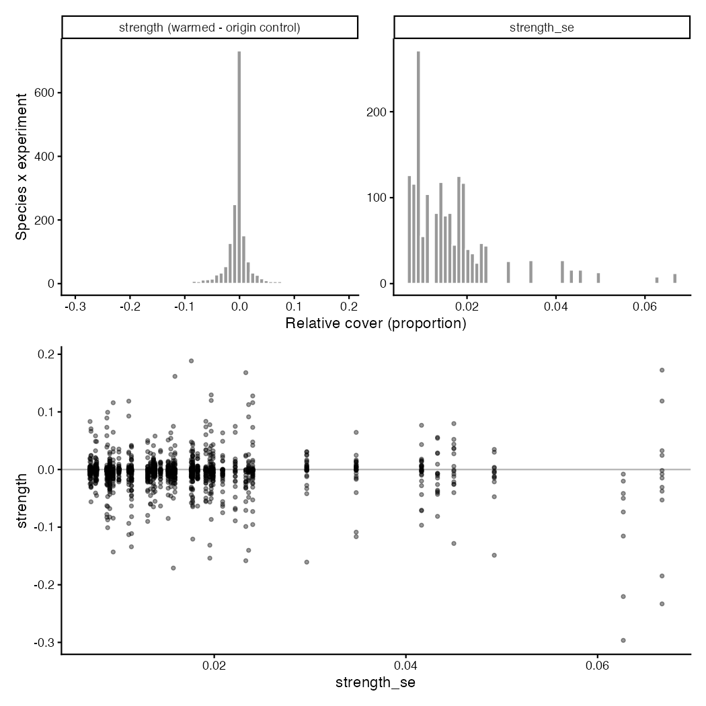

# Step 02: Strength (Step A, residents)

One Gaussian `glmmTMB(relative_cover ~ treatment * year * species + (1 | plot_id:species), dispformula = ~ species, REML = TRUE)` (one residual variance per species) was fitted per experiment on the resident species' rows in origin controls and warmed plots (108,884 rows, 43 experiments), year as a factor. `emmeans` gave the warmed minus origin-control contrast per species and survey year (`by_year`, for step 03) and averaged over each experiment's years (`strength`), with degrees of freedom = origin-control plots + warmed plots - 2 of the experiment. Each effect carries the experiment's W, T and P (summer, log) standardised across the 43 experiments, TP = T x P, A0 at origin and destination standardised across the 1,655 effects, and the species properties standardised across the residents that have them. Strength is in relative-cover units (proportion of plot cover).

## Model as fitted (for reviewers)

The call, as stored in the fitted model objects, and the contrasts (`R/fit_experiment.R`), run once per experiment:

```r
m <- glmmTMB::glmmTMB(formula = relative_cover ~ treatment * year * species + (1 | plot_id:species), data = d, dispformula = ~species, REML = TRUE, ziformula = ~0)
# d: one experiment's resident rows in origin controls and warmed plots;
# treatment (origin_control, warmed), year (factor), species (factor), plot_id
df_plots <- n_distinct(plot_id[origin_control]) + n_distinct(plot_id[warmed]) - 2
by_year  <- contrast(emmeans(m, ~ treatment | species * year, df = df_plots), method = "revpairwise")
strength <- contrast(emmeans(m, ~ treatment | species, df = df_plots), method = "revpairwise")
# keep "warmed - origin_control"; emmeans averages the years with equal weights
```

- Fixed part: one mean per treatment x year x species cell. Residual variance: one per species (`dispformula = ~ species`, decided 30 Oct). REML; Gaussian on relative cover (bounded, zero-heavy: accepted approximation, PLAN.md Known weaknesses).
- Degrees of freedom: origin-control plots + warmed plots - 2 of the experiment (decided 30 Oct), because treatment is applied to whole plots and the yearly surveys of a plot are repeated measures; 4 to 18 (median 12), so the two-sided 5% cut-off is t = 2.10 to 2.78 instead of z = 1.96. They change p-values only, not `strength` or `strength_se`.
- Random part, a known limitation kept by decision (30 Oct): `(1 | plot_id:species)` has one plot x species variance shared by all species of an experiment, while the residual variance is per species. This shared term is more than half of the SE variance in 635 of 1655 effects (median share 0.21), and a species' own plot-to-plot spread grows with its residual SD (Spearman 0.94): the shared term overstates the SE of rare species and understates that of dominant ones. The species-specific alternative is `diag(0 + species | plot_id)` in place of `(1 | plot_id:species)`.

## Counts

| rule | n |
| --- | --- |
| resident rows, origin controls and warmed plots (step 01) | 108,884 |
| experiments fitted | 43 |
| gradients | 21 |
| species | 528 |
| species x experiment (effects) | 1,655 |
| by_year contrasts (species x survey year) | 7,571 |
| strength_df rows | 1,655 |

## Strength

Quantiles (min / 25% / median / 75% / max). strength: -0.2965 / -0.0091 / -0.0016 / 0.0019 / 0.1885; strength_se: 0.0001 / 0.0027 / 0.0061 / 0.0106 / 0.0730. Effects significant at p < 0.05 (|strength| / SE above the experiment's t cut-off): 420 of 1,655.



With one residual variance per species, the SE follows each species' own scatter: within an experiment the largest SE is a median of 8 times the smallest (range 1 to 389), and the Spearman correlation of SE with the species' mean relative cover in the experiment is 0.79. Rare species therefore get the smallest SEs on the absolute cover scale, and the largest weights in the later `rma.mv` calls.

Against the lmer fit with one residual variance per experiment (step 02 before 30 Oct, commit 912bc69): strength moved by more than 1e-6 in 385 of 1655 effects (largest change 0.0114, in experiments with unequal plot numbers across years); effects significant at p < 0.05 went from 232 (lmer, z) to 491 (per-species variance, z) and 420 (per-species variance, plot df, as used now). Step 03 classifies the yearly contrasts by p < 0.05.

## Fits per experiment

| experiment_id | rows | species | years | df | convergence | pdHess | sd_plot_species | se_min | se_median | se_max | warnings |
| --- | --- | --- | --- | --- | --- | --- | --- | --- | --- | --- | --- |
| CH_Calanda::Cal::Nes | 7739 | 71 | 6 | 18 | 0 | TRUE | 0.00247 | 0.00111 | 0.00158 | 0.0274 | 1 |
| CH_Calanda::Pea::Cal | 4080 | 34 | 6 | 18 | 0 | TRUE | 0.00666 | 0.00298 | 0.00343 | 0.0243 | 1 |
| CH_Calanda2::Cal::Nes | 4240 | 53 | 4 | 18 | 0 | TRUE | 0.00812 | 0.00363 | 0.00371 | 0.0149 | 1 |
| CH_Lavey::RIO::CRE | 3780 | 63 | 3 | 18 | 0 | TRUE | 0.000379 | 0.000239 | 0.00222 | 0.0178 | 1 |
| CH_Lavey::RIO::MAR | 3780 | 63 | 3 | 18 | 0 | TRUE | 0.000634 | 0.000359 | 0.00256 | 0.019 | 1 |
| CH_Lavey::RIO::PRA | 3717 | 63 | 3 | 18 | 0 | TRUE | 0.000373 | 0.000239 | 0.00222 | 0.0207 | 1 |
| CN_Damxung::HIGH::LOW | 2560 | 32 | 4 | 18 | 0 | TRUE | 3.71e-07 | 0.000243 | 0.00328 | 0.0285 | 1 |
| CN_Gongga::A::M | 1848 | 33 | 4 | 12 | 0 | TRUE | 0.00924 | 0.00495 | 0.00562 | 0.0328 | 1 |
| CN_Gongga::H::A | 1800 | 36 | 4 | 12 | 0 | TRUE | 0.00931 | 0.00498 | 0.00626 | 0.0308 | 1 |
| CN_Gongga::H::L | 1800 | 36 | 4 | 12 | 0 | TRUE | 0.00771 | 0.00413 | 0.00527 | 0.0245 | 1 |
| CN_Gongga::M::L | 1568 | 28 | 4 | 12 | 0 | TRUE | 4.11e-07 | 0.000402 | 0.0068 | 0.0212 | 1 |
| CN_Heibei::3400::3200 | 2310 | 55 | 7 | 4 | 0 | TRUE | 0.000319 | 0.000455 | 0.00254 | 0.0178 | 1 |
| CN_Heibei::3800::3200 | 1360 | 34 | 7 | 4 | 0 | TRUE | 0.000397 | 0.000552 | 0.00254 | 0.0235 | 1 |
| CN_Heibei::3800::3400 | 1360 | 34 | 7 | 4 | 0 | TRUE | 0.000839 | 0.000962 | 0.00308 | 0.0227 | 1 |
| DE_Grainau::HIGH::LOW | 4160 | 52 | 4 | 18 | 0 | TRUE | 0.00411 | 0.00184 | 0.00317 | 0.0196 | 1 |
| DE_Susalps::EB::BT | 3240 | 45 | 4 | 16 | 0 | TRUE | 0.000298 | 0.000177 | 0.00767 | 0.0353 | 1 |
| DE_Susalps::EB::FE | 3240 | 45 | 4 | 16 | 0 | TRUE | 0.000756 | 0.000431 | 0.00543 | 0.0408 | 1 |
| DE_Susalps::EB::GW | 3240 | 45 | 4 | 16 | 0 | TRUE | 0.000902 | 0.000544 | 0.00566 | 0.0425 | 1 |
| DE_Susalps::FE::BT | 864 | 12 | 4 | 16 | 0 | TRUE | 0.000784 | 0.00159 | 0.0293 | 0.073 | 1 |
| DE_Susalps::GW::BT | 3168 | 44 | 4 | 16 | 0 | TRUE | 0.000596 | 0.000362 | 0.00507 | 0.0576 | 1 |
| DE_Susalps::GW::FE | 3168 | 44 | 4 | 16 | 0 | TRUE | 0.000501 | 0.000331 | 0.00202 | 0.0487 | 1 |
| DE_TransAlps::FP::BT | 1512 | 21 | 4 | 16 | 0 | TRUE | 0.0138 | 0.00653 | 0.00773 | 0.0642 | 1 |
| DE_TransAlps::SP::BT | 2520 | 35 | 4 | 16 | 0 | TRUE | 0.000126 | 0.000106 | 0.00446 | 0.0412 | 1 |
| FR_AlpeHuez::HIGH::LOW | 9720 | 54 | 9 | 18 | 0 | TRUE | 0.00775 | 0.00347 | 0.00413 | 0.0179 | 1 |
| FR_Lautaret::G::L | 4960 | 62 | 4 | 18 | 0 | TRUE | 9.06e-05 | 9.38e-05 | 0.000831 | 0.0218 | 1 |
| IT_MatschMazia1::High::Low | 1122 | 34 | 3 | 10 | 0 | TRUE | 0.0075 | 0.00515 | 0.00937 | 0.0204 | 1 |
| IT_MatschMazia2::High::Low | 720 | 24 | 3 | 10 | 0 | TRUE | 0.00201 | 0.00162 | 0.00818 | 0.0376 | 1 |
| NO_Gudmedalen::Gudmedalen::Rambera | 2450 | 49 | 5 | 8 | 0 | TRUE | 0.0134 | 0.00851 | 0.00894 | 0.018 | 1 |
| NO_Gudmedalen::Rambera::Arhelleren | 2000 | 40 | 5 | 8 | 0 | TRUE | 0.0117 | 0.00741 | 0.00808 | 0.0308 | 1 |
| NO_Lavisdalen::Hogsete::Vikesland | 1300 | 26 | 5 | 8 | 0 | TRUE | 0.0226 | 0.0144 | 0.0153 | 0.0319 | 1 |
| NO_Lavisdalen::Lavisdalen::Hogsete | 2700 | 54 | 5 | 8 | 0 | TRUE | 0.0107 | 0.00679 | 0.007 | 0.0274 | 1 |
| NO_Skjellingahaugen::Skjellingahaugen::Veskre | 2050 | 41 | 5 | 8 | 0 | TRUE | 0.0119 | 0.00757 | 0.00799 | 0.0425 | 1 |
| NO_Skjellingahaugen::Veskre::Ovstedal | 2400 | 48 | 5 | 8 | 0 | TRUE | 0.00658 | 0.00419 | 0.00497 | 0.0324 | 1 |
| NO_Ulvhaugen::Alrust::Fauske | 1911 | 39 | 5 | 8 | 0 | TRUE | 0.0101 | 0.00639 | 0.00738 | 0.0283 | 1 |
| NO_Ulvhaugen::Ulvhaugen::Alrust | 2250 | 45 | 5 | 8 | 0 | TRUE | 0.00648 | 0.00412 | 0.00493 | 0.0309 | 1 |
| SE_Abisko::High::Low | 480 | 16 | 3 | 8 | 0 | TRUE | 0.0628 | 0.0398 | 0.0416 | 0.0503 | 1 |
| SE_Abisko::High::Mid | 480 | 16 | 3 | 8 | 0 | TRUE | 0.053 | 0.0337 | 0.0356 | 0.0542 | 1 |
| SE_Abisko::Mid::Low | 390 | 13 | 3 | 8 | 0 | TRUE | 0.0334 | 0.0212 | 0.028 | 0.0634 | 1 |
| US_Arizona::MC::PP | 448 | 8 | 4 | 12 | 0 | TRUE | 0.049 | 0.0281 | 0.0368 | 0.0639 | 1 |
| US_Colorado::mo::pf | 1593 | 27 | 5 | 10 | 0 | TRUE | 0.0145 | 0.00871 | 0.0103 | 0.056 | 1 |
| US_Colorado::mo::um | 1728 | 27 | 5 | 11 | 0 | TRUE | 0.0645 | 0.0368 | 0.0371 | 0.0457 | 1 |
| US_Colorado::pf::um | 1560 | 26 | 5 | 10 | 0 | TRUE | 0.0318 | 0.0187 | 0.0195 | 0.0411 | 1 |
| US_Montana::High::Low | 1568 | 28 | 3 | 18 | 0 | TRUE | 0.000698 | 0.000897 | 0.00896 | 0.0324 | 1 |

## Property coverage on the residents (added 26 Oct)

Species and effects with each property, after steps 01 and 02:

| property | species | effects |
| --- | --- | --- |
| LDMC | 352 | 1350 |
| LMA | 380 | 1386 |
| height | 334 | 1308 |
| any of the three traits | 397 | 1420 |
| growth form (graminoid, woody) | 528 | 1655 |
| PEV1 to PEV3 | 528 | 1655 |
| niche optima (any GBIF cell) | 527 | 1652 |
| niche optima (n_obs_sub >= 30, used) | 508 | 1618 |

Residents without any of the three traits (131): Agrostis nervosa, Alchemilla conjuncta, Alchemilla flabellata, Aletris pauciflora, Allium beesianum, Allium prattii, Alopecurus aequalis, Anaphalis aureopunctata, Anaphalis flavescens, Androsace minor, Androsace tapete, Anemonastrum demissum, Antennaria racemosa, Argentina leuconota, Argentina stenophylla, Arisaema parvum, Artemisia fulgens, Aster asteroides, Aster diplostephioides, Astragalus mongholicus, Berberis jamesiana, Betula pubescens, Boechera stricta, Calamagrostis rubescens, Calamagrostis tripilifera, Cardamine tangutorum, Carex cercostachys, Carex flava, Carex kansuensis, Carex sargentiana, Carex scabrirostris, Carpesium humile, Cerastium szechuense, Chamaesium viridiflorum, Chrysosplenium pilosum, Clinopodium polycephalum, Codonopsis foetens, Comastoma pulmonarium, Comastoma tenellum, Cyananthus hookeri, Cyananthus incanus, Elymus bakeri, Epilobium fangii, Eremogone roborowskii, Erigeron coulteri, Erigeron neglectus, Euphorbia stracheyi, Euphrasia regelii, Eurybia conspicua, Fargesia spathacea, Galearis spathulata, Gentiana crassuloides, Gentiana grumii, Gentiana prostrata, Gentiana squarrosa, Geranium pylzowianum, Halenia corniculata, Halerpestes tricuspis, Hansenia forbesii, Hansenia weberbaueriana, Hedysarum algidum, Helictotrichon parlatorei, Helictotrichon tibeticum, Hemiphragma heterophyllum, Heterotheca pumila, Hypericum wightianum, Iris potaninii, Juncus allioides, Juncus himalensis, Juncus leucanthus, Koenigia cyanandra, Ligularia sagitta, Ligusticopsis scapiformis, Lomatogonium macranthum, Lomatogonium rotatum, Lycoris radiata, Maianthemum japonicum, Melica spectabilis, Micranthes atrata, Microula sikkimensis, Morina chinensis, Myosotis decumbens, Osmorhiza berteroi, Oxytropis deflexa, Oxytropis densa, Oxytropis humifusa, Oxytropis yunnanensis, Packera cymbalaria, Parasenecio latipes, Pedicularis davidii, Pedicularis mussotii, Pedicularis rhynchodonta, Pedicularis sima, Persicaria runcinata, Poa interior, Poa reflexa, Polygonatum cirrhifolium, Polypogon viridis, Potentilla clandestina, Potentilla pulcherrima, Primula malacoides, Primula serratifolia, Ranunculus inamoenus, Rheum pumilum, Rhodiola fastigiata, Rhodiola yunnanensis, Rhododendron websterianum, Sagina glabra, Sagina japonica, Salix serpillifolia, Saussurea ceterach, Saussurea globosa, Saussurea graminea, Saussurea katochaete, Saussurea pachyneura, Saussurea pulchra, Solidago multiradiata, Sorbus aucuparia, Soroseris hookeriana, Swertia macrosperma, Symphyotrichum campestre, Tanacetum tatsienense, Thalictrum occidentale, Thesium alpinum, Vaccinium membranaceum, Veronica allionii, Veronica szechuanica, Viola nuttallii, Viola orbiculata, Viola szetschwanensis, Youngia racemifera.

## Covariates

Raw values before standardisation:

| variable | range |
| --- | --- |
| W (destination - origin JJA T, degC) | 0.3571 / 1.5285 / 2.3140 / 3.3592 / 11.0886 |
| T (destination JJA T, degC) | 8.7911 / 11.3936 / 13.2811 / 16.4864 / 21.0185 |
| P (log destination JJA precipitation, mm) | 5.0594 / 5.5447 / 5.9308 / 6.1053 / 6.9784 |
| A0_origin (log(% + 1)) | 0.0000 / 0.0998 / 0.5494 / 1.2698 / 3.8012 |
| A0_dest (log(% + 1)) | 0.0000 / 0.0000 / 0.0000 / 0.4121 / 3.8040 |

## Warnings captured

- CH_Calanda::Cal::Nes: NOTE: Results may be misleading due to involvement in interactions
- CH_Calanda::Pea::Cal: NOTE: Results may be misleading due to involvement in interactions
- CH_Calanda2::Cal::Nes: NOTE: Results may be misleading due to involvement in interactions
- CH_Lavey::RIO::CRE: NOTE: Results may be misleading due to involvement in interactions
- CH_Lavey::RIO::MAR: NOTE: Results may be misleading due to involvement in interactions
- CH_Lavey::RIO::PRA: NOTE: Results may be misleading due to involvement in interactions
- CN_Damxung::HIGH::LOW: NOTE: Results may be misleading due to involvement in interactions
- CN_Gongga::A::M: NOTE: Results may be misleading due to involvement in interactions
- CN_Gongga::H::A: NOTE: Results may be misleading due to involvement in interactions
- CN_Gongga::H::L: NOTE: Results may be misleading due to involvement in interactions
- CN_Gongga::M::L: NOTE: Results may be misleading due to involvement in interactions
- CN_Heibei::3400::3200: NOTE: Results may be misleading due to involvement in interactions
- CN_Heibei::3800::3200: NOTE: Results may be misleading due to involvement in interactions
- CN_Heibei::3800::3400: NOTE: Results may be misleading due to involvement in interactions
- DE_Grainau::HIGH::LOW: NOTE: Results may be misleading due to involvement in interactions
- DE_Susalps::EB::BT: NOTE: Results may be misleading due to involvement in interactions
- DE_Susalps::EB::FE: NOTE: Results may be misleading due to involvement in interactions
- DE_Susalps::EB::GW: NOTE: Results may be misleading due to involvement in interactions
- DE_Susalps::FE::BT: NOTE: Results may be misleading due to involvement in interactions
- DE_Susalps::GW::BT: NOTE: Results may be misleading due to involvement in interactions
- DE_Susalps::GW::FE: NOTE: Results may be misleading due to involvement in interactions
- DE_TransAlps::FP::BT: NOTE: Results may be misleading due to involvement in interactions
- DE_TransAlps::SP::BT: NOTE: Results may be misleading due to involvement in interactions
- FR_AlpeHuez::HIGH::LOW: NOTE: Results may be misleading due to involvement in interactions
- FR_Lautaret::G::L: NOTE: Results may be misleading due to involvement in interactions
- IT_MatschMazia1::High::Low: NOTE: Results may be misleading due to involvement in interactions
- IT_MatschMazia2::High::Low: NOTE: Results may be misleading due to involvement in interactions
- NO_Gudmedalen::Gudmedalen::Rambera: NOTE: Results may be misleading due to involvement in interactions
- NO_Gudmedalen::Rambera::Arhelleren: NOTE: Results may be misleading due to involvement in interactions
- NO_Lavisdalen::Hogsete::Vikesland: NOTE: Results may be misleading due to involvement in interactions
- NO_Lavisdalen::Lavisdalen::Hogsete: NOTE: Results may be misleading due to involvement in interactions
- NO_Skjellingahaugen::Skjellingahaugen::Veskre: NOTE: Results may be misleading due to involvement in interactions
- NO_Skjellingahaugen::Veskre::Ovstedal: NOTE: Results may be misleading due to involvement in interactions
- NO_Ulvhaugen::Alrust::Fauske: NOTE: Results may be misleading due to involvement in interactions
- NO_Ulvhaugen::Ulvhaugen::Alrust: NOTE: Results may be misleading due to involvement in interactions
- SE_Abisko::High::Low: NOTE: Results may be misleading due to involvement in interactions
- SE_Abisko::High::Mid: NOTE: Results may be misleading due to involvement in interactions
- SE_Abisko::Mid::Low: NOTE: Results may be misleading due to involvement in interactions
- US_Arizona::MC::PP: NOTE: Results may be misleading due to involvement in interactions
- US_Colorado::mo::pf: NOTE: Results may be misleading due to involvement in interactions
- US_Colorado::mo::um: NOTE: Results may be misleading due to involvement in interactions
- US_Colorado::pf::um: NOTE: Results may be misleading due to involvement in interactions
- US_Montana::High::Low: NOTE: Results may be misleading due to involvement in interactions

## Deviations from PLAN.md

The residual variance is one per species (`glmmTMB`, `dispformula = ~ species`) instead of PLAN.md's `lmer` with one per experiment (decided 30 Oct, Bills; PLAN.md Step A updated): with one variance per experiment every species of an experiment got the same SE. Decisions taken where PLAN.md is silent (30 Oct, Bills): degrees of freedom = origin-control plots + warmed plots - 2 per experiment; the plot x species variance kept shared (see Model as fitted); PEV1 to PEV3 carried; properties standardised across the residents that have them, traits logged first; graminoid and woody as 0/1. MILESTONES' expected count (about 1,596 effects in 41 experiments) is 1,655 in 43, after FR_AlpeHuez (26 Oct) and US_Arizona (28 Oct) were included.
