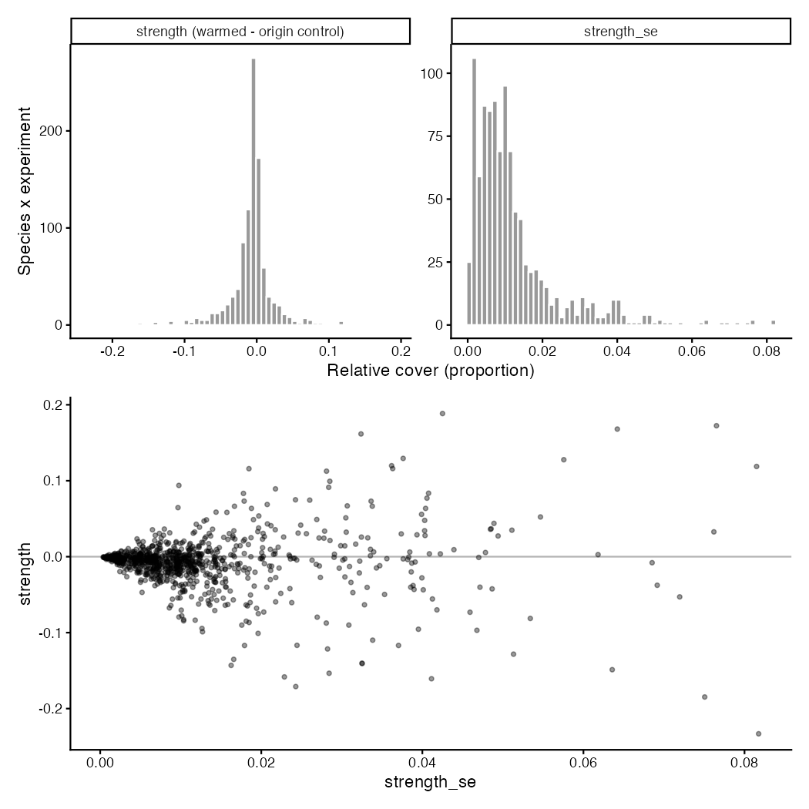

# Step 02: Strength (Step A, residents)

One Gaussian `glmmTMB(relative_cover ~ treatment * year * species + (1 | plot_id:species), dispformula = ~ species, REML = TRUE)` (one residual variance per species) was fitted per experiment on the resident species' rows in origin controls and warmed plots (67,952 rows, 42 experiments), year as a factor. `emmeans` gave the warmed minus origin-control contrast per species and survey year (`by_year`, for step 03) and averaged over each experiment's years (`strength`), with degrees of freedom = origin-control plots + warmed plots - 2 of the experiment. Each effect carries the experiment's W, T and P (summer, log) standardised across the 42 experiments, TP = T x P, A0 at origin and destination standardised across the 1,004 effects, and the species properties standardised across the residents that have them. Strength is in relative-cover units (proportion of plot cover).

## Model as fitted (for reviewers)

The call, as stored in the fitted model objects, and the contrasts (`R/fit_experiment.R`), run once per experiment:

```r
m <- glmmTMB::glmmTMB(formula = relative_cover ~ treatment * year * species + (1 | plot_id:species), data = d, dispformula = ~species, REML = TRUE, ziformula = ~0)
# d: one experiment's resident rows in origin controls and warmed plots;
# treatment (origin_control, warmed), year (factor), species (factor), plot_id
df_plots <- n_distinct(plot_id[origin_control]) + n_distinct(plot_id[warmed]) - 2
by_year  <- contrast(emmeans(m, ~ treatment | species * year, df = df_plots), method = "revpairwise")
strength <- contrast(emmeans(m, ~ treatment | species, df = df_plots), method = "revpairwise")
# keep "warmed - origin_control"; emmeans averages the years with equal weights
```

- Fixed part: one mean per treatment x year x species cell. Residual variance: one per species (`dispformula = ~ species`, decided 30 Oct). REML; Gaussian on relative cover (bounded, zero-heavy: accepted approximation, PLAN.md Known weaknesses).
- Degrees of freedom: origin-control plots + warmed plots - 2 of the experiment (decided 30 Oct), because treatment is applied to whole plots and the yearly surveys of a plot are repeated measures; 4 to 18 (median 12), so the two-sided 5% cut-off is t = 2.10 to 2.78 instead of z = 1.96. They change p-values only, not `strength` or `strength_se`.
- Random part, a known limitation kept by decision (30 Oct): `(1 | plot_id:species)` has one plot x species variance shared by all species of an experiment, while the residual variance is per species. This shared term is more than half of the SE variance in 523 of 1004 effects (median share 0.55), and a species' own plot-to-plot spread grows with its residual SD (Spearman 0.92): the shared term overstates the SE of rare species and understates that of dominant ones.

## Counts

| rule | n |
| --- | --- |
| resident rows, origin controls and warmed plots (step 01) | 67,952 |
| experiments fitted | 42 |
| gradients | 20 |
| species | 346 |
| species x experiment (effects) | 1,004 |
| by_year contrasts (species x survey year) | 4,537 |
| strength_df rows | 1,004 |

## Strength

Quantiles (min / 25% / median / 75% / max). strength: -0.2332 / -0.0153 / -0.0040 / 0.0021 / 0.1885; strength_se: 0.0004 / 0.0049 / 0.0090 / 0.0142 / 0.0818. Effects significant at p < 0.05 (|strength| / SE above the experiment's t cut-off): 289 of 1,004.



With one residual variance per species, the SE follows each species' own scatter: within an experiment the largest SE is a median of 4 times the smallest (range 1 to 103), and the Spearman correlation of SE with the species' mean relative cover in the experiment is 0.80. Rare species therefore get the smallest SEs on the absolute cover scale, and the largest weights in the later `rma.mv` calls.

## Fits per experiment

| experiment_id | rows | species | years | df | convergence | pdHess | sd_plot_species | se_min | se_median | se_max | warnings |
| --- | --- | --- | --- | --- | --- | --- | --- | --- | --- | --- | --- |
| CH_Calanda::Cal::Nes | 5341 | 49 | 6 | 18 | 0 | TRUE | 0.00387 | 0.00179 | 0.00241 | 0.0273 | 1 |
| CH_Calanda::Pea::Cal | 3360 | 28 | 6 | 18 | 0 | TRUE | 0.00944 | 0.00424 | 0.005 | 0.0243 | 1 |
| CH_Calanda2::Cal::Nes | 3600 | 45 | 4 | 18 | 0 | TRUE | 0.0109 | 0.00486 | 0.00492 | 0.0147 | 1 |
| CH_Lavey::RIO::CRE | 2520 | 42 | 3 | 18 | 0 | TRUE | 0.00221 | 0.00105 | 0.00303 | 0.0178 | 1 |
| CH_Lavey::RIO::MAR | 2520 | 42 | 3 | 18 | 0 | TRUE | 0.00342 | 0.00155 | 0.00374 | 0.019 | 1 |
| CH_Lavey::RIO::PRA | 2478 | 42 | 3 | 18 | 0 | TRUE | 0.00236 | 0.00109 | 0.00332 | 0.0207 | 1 |
| CN_Damxung::HIGH::LOW | 1600 | 20 | 4 | 18 | 0 | TRUE | 2.91e-07 | 0.000372 | 0.00422 | 0.0285 | 1 |
| CN_Gongga::A::M | 1400 | 25 | 4 | 12 | 0 | TRUE | 0.0112 | 0.00605 | 0.00659 | 0.0328 | 1 |
| CN_Gongga::H::A | 800 | 16 | 4 | 12 | 0 | TRUE | 0.0166 | 0.00904 | 0.0113 | 0.0304 | 1 |
| CN_Gongga::H::L | 800 | 16 | 4 | 12 | 0 | TRUE | 0.0152 | 0.00818 | 0.00967 | 0.0244 | 1 |
| CN_Gongga::M::L | 1064 | 19 | 4 | 12 | 0 | TRUE | 0.0165 | 0.00905 | 0.0116 | 0.0218 | 1 |
| CN_Heibei::3400::3200 | 1260 | 30 | 7 | 4 | 0 | TRUE | 0.00276 | 0.00233 | 0.00578 | 0.0178 | 1 |
| CN_Heibei::3800::3200 | 600 | 15 | 7 | 4 | 0 | TRUE | 0.000644 | 0.00132 | 0.00873 | 0.0179 | 1 |
| CN_Heibei::3800::3400 | 600 | 15 | 7 | 4 | 0 | TRUE | 0.00421 | 0.00362 | 0.00757 | 0.0197 | 1 |
| DE_Grainau::HIGH::LOW | 3040 | 38 | 4 | 18 | 0 | TRUE | 0.0126 | 0.00572 | 0.0065 | 0.0194 | 1 |
| DE_Susalps::EB::BT | 1872 | 26 | 4 | 16 | 0 | TRUE | 0.00288 | 0.00155 | 0.011 | 0.0353 | 1 |
| DE_Susalps::EB::FE | 1872 | 26 | 4 | 16 | 0 | TRUE | 0.0115 | 0.00548 | 0.00854 | 0.0408 | 1 |
| DE_Susalps::EB::GW | 1872 | 26 | 4 | 16 | 0 | TRUE | 0.0144 | 0.00684 | 0.00893 | 0.0425 | 1 |
| DE_Susalps::FE::BT | 576 | 8 | 4 | 16 | 0 | TRUE | 0.145 | 0.0685 | 0.0756 | 0.0818 | 1 |
| DE_Susalps::GW::BT | 1944 | 27 | 4 | 16 | 0 | TRUE | 0.00123 | 0.000741 | 0.00741 | 0.0576 | 1 |
| DE_Susalps::GW::FE | 1944 | 27 | 4 | 16 | 0 | TRUE | 0.000762 | 0.000474 | 0.005 | 0.0487 | 1 |
| DE_TransAlps::FP::BT | 1368 | 19 | 4 | 16 | 0 | TRUE | 0.0136 | 0.0064 | 0.00795 | 0.0642 | 1 |
| DE_TransAlps::SP::BT | 2088 | 29 | 4 | 16 | 0 | TRUE | 0.00083 | 0.000401 | 0.00505 | 0.0413 | 1 |
| FR_AlpeHuez::HIGH::LOW | 6300 | 35 | 9 | 18 | 0 | TRUE | 0.0146 | 0.00657 | 0.00704 | 0.0185 | 1 |
| FR_Lautaret::G::L | 2800 | 35 | 4 | 18 | 0 | TRUE | 0.00152 | 0.000786 | 0.00231 | 0.0218 | 1 |
| IT_MatschMazia1::High::Low | 924 | 28 | 3 | 10 | 0 | TRUE | 0.00824 | 0.00573 | 0.0111 | 0.0204 | 1 |
| IT_MatschMazia2::High::Low | 390 | 13 | 3 | 10 | 0 | TRUE | 0.00894 | 0.00633 | 0.0122 | 0.0376 | 1 |
| NO_Gudmedalen::Gudmedalen::Rambera | 1250 | 25 | 5 | 8 | 0 | TRUE | 0.0191 | 0.0122 | 0.0131 | 0.0183 | 1 |
| NO_Gudmedalen::Rambera::Arhelleren | 1050 | 21 | 5 | 8 | 0 | TRUE | 0.0167 | 0.0107 | 0.0117 | 0.0305 | 1 |
| NO_Lavisdalen::Hogsete::Vikesland | 850 | 17 | 5 | 8 | 0 | TRUE | 0.0312 | 0.0199 | 0.0222 | 0.0325 | 1 |
| NO_Lavisdalen::Lavisdalen::Hogsete | 1350 | 27 | 5 | 8 | 0 | TRUE | 0.0148 | 0.00945 | 0.00982 | 0.0269 | 1 |
| NO_Skjellingahaugen::Skjellingahaugen::Veskre | 900 | 18 | 5 | 8 | 0 | TRUE | 0.0223 | 0.0142 | 0.0152 | 0.0422 | 1 |
| NO_Skjellingahaugen::Veskre::Ovstedal | 1400 | 28 | 5 | 8 | 0 | TRUE | 0.0149 | 0.00948 | 0.0108 | 0.0324 | 1 |
| NO_Ulvhaugen::Alrust::Fauske | 1078 | 22 | 5 | 8 | 0 | TRUE | 0.0164 | 0.0105 | 0.0119 | 0.0282 | 1 |
| NO_Ulvhaugen::Ulvhaugen::Alrust | 1350 | 27 | 5 | 8 | 0 | TRUE | 0.013 | 0.00829 | 0.00914 | 0.0305 | 1 |
| SE_Abisko::High::Low | 270 | 9 | 3 | 8 | 0 | TRUE | 0.0725 | 0.047 | 0.0485 | 0.0547 | 1 |
| SE_Abisko::High::Mid | 270 | 9 | 3 | 8 | 0 | TRUE | 0.0584 | 0.0386 | 0.0393 | 0.0534 | 1 |
| SE_Abisko::Mid::Low | 330 | 11 | 3 | 8 | 0 | TRUE | 0.0484 | 0.031 | 0.0356 | 0.0636 | 1 |
| US_Colorado::mo::pf | 649 | 11 | 5 | 10 | 0 | TRUE | 0.0493 | 0.029 | 0.0322 | 0.037 | 1 |
| US_Colorado::mo::um | 704 | 11 | 5 | 11 | 0 | TRUE | 0.0669 | 0.0382 | 0.0399 | 0.0468 | 1 |
| US_Colorado::pf::um | 840 | 14 | 5 | 10 | 0 | TRUE | 0.0361 | 0.0213 | 0.0238 | 0.0411 | 1 |
| US_Montana::High::Low | 728 | 13 | 3 | 18 | 0 | TRUE | 0.0157 | 0.00797 | 0.0126 | 0.0325 | 1 |

## Property coverage on the residents (added 26 Oct)

Species and effects with each property, after steps 01 and 02:

| property | species | effects |
| --- | --- | --- |
| LDMC | 251 | 855 |
| LMA | 266 | 875 |
| height | 242 | 831 |
| any of the three traits | 276 | 893 |
| growth form (graminoid, woody) | 346 | 1004 |
| PEV1 to PEV3 | 346 | 1004 |
| niche optima (any GBIF cell) | 346 | 1004 |
| niche optima (n_obs_sub >= 30, used) | 337 | 988 |

Residents without any of the three traits (70): Agrostis nervosa, Alchemilla conjuncta, Allium prattii, Androsace minor, Androsace tapete, Anemonastrum demissum, Argentina leuconota, Argentina stenophylla, Artemisia fulgens, Aster asteroides, Aster diplostephioides, Berberis jamesiana, Calamagrostis rubescens, Calamagrostis tripilifera, Carex cercostachys, Carex sargentiana, Carex scabrirostris, Carpesium humile, Cerastium szechuense, Chrysosplenium pilosum, Clinopodium polycephalum, Comastoma tenellum, Cyananthus incanus, Epilobium fangii, Erigeron neglectus, Eurybia conspicua, Fargesia spathacea, Galearis spathulata, Gentiana crassuloides, Gentiana prostrata, Gentiana squarrosa, Geranium pylzowianum, Hansenia weberbaueriana, Hedysarum algidum, Helictotrichon parlatorei, Helictotrichon tibeticum, Hemiphragma heterophyllum, Hypericum wightianum, Juncus himalensis, Juncus leucanthus, Ligusticopsis scapiformis, Melica spectabilis, Osmorhiza berteroi, Oxytropis densa, Oxytropis humifusa, Parasenecio latipes, Pedicularis davidii, Pedicularis sima, Persicaria runcinata, Poa reflexa, Polygonatum cirrhifolium, Potentilla pulcherrima, Rheum pumilum, Rhodiola yunnanensis, Rhododendron websterianum, Sagina glabra, Salix serpillifolia, Saussurea ceterach, Saussurea globosa, Saussurea pulchra, Soroseris hookeriana, Swertia macrosperma, Tanacetum tatsienense, Thesium alpinum, Vaccinium membranaceum, Veronica allionii, Veronica szechuanica, Viola nuttallii, Viola szetschwanensis, Youngia racemifera.

## Covariates

Raw values before standardisation:

| variable | range |
| --- | --- |
| W (destination - origin JJA T, degC) | 0.3571 / 1.5141 / 2.3474 / 3.3626 / 11.0886 |
| T (destination JJA T, degC) | 8.7911 / 11.3133 / 13.2236 / 15.5133 / 19.3579 |
| P (log destination JJA precipitation, mm) | 5.0594 / 5.5538 / 5.9308 / 6.1137 / 6.9784 |
| A0_origin (log(% + 1)) | 0.0000 / 0.3753 / 0.9220 / 1.6293 / 3.8012 |
| A0_dest (log(% + 1)) | 0.0000 / 0.0000 / 0.0000 / 0.6225 / 3.8040 |

## Warnings captured

- CH_Calanda::Cal::Nes: NOTE: Results may be misleading due to involvement in interactions
- CH_Calanda::Pea::Cal: NOTE: Results may be misleading due to involvement in interactions
- CH_Calanda2::Cal::Nes: NOTE: Results may be misleading due to involvement in interactions
- CH_Lavey::RIO::CRE: NOTE: Results may be misleading due to involvement in interactions
- CH_Lavey::RIO::MAR: NOTE: Results may be misleading due to involvement in interactions
- CH_Lavey::RIO::PRA: NOTE: Results may be misleading due to involvement in interactions
- CN_Damxung::HIGH::LOW: NOTE: Results may be misleading due to involvement in interactions
- CN_Gongga::A::M: NOTE: Results may be misleading due to involvement in interactions
- CN_Gongga::H::A: NOTE: Results may be misleading due to involvement in interactions
- CN_Gongga::H::L: NOTE: Results may be misleading due to involvement in interactions
- CN_Gongga::M::L: NOTE: Results may be misleading due to involvement in interactions
- CN_Heibei::3400::3200: NOTE: Results may be misleading due to involvement in interactions
- CN_Heibei::3800::3200: NOTE: Results may be misleading due to involvement in interactions
- CN_Heibei::3800::3400: NOTE: Results may be misleading due to involvement in interactions
- DE_Grainau::HIGH::LOW: NOTE: Results may be misleading due to involvement in interactions
- DE_Susalps::EB::BT: NOTE: Results may be misleading due to involvement in interactions
- DE_Susalps::EB::FE: NOTE: Results may be misleading due to involvement in interactions
- DE_Susalps::EB::GW: NOTE: Results may be misleading due to involvement in interactions
- DE_Susalps::FE::BT: NOTE: Results may be misleading due to involvement in interactions
- DE_Susalps::GW::BT: NOTE: Results may be misleading due to involvement in interactions
- DE_Susalps::GW::FE: NOTE: Results may be misleading due to involvement in interactions
- DE_TransAlps::FP::BT: NOTE: Results may be misleading due to involvement in interactions
- DE_TransAlps::SP::BT: NOTE: Results may be misleading due to involvement in interactions
- FR_AlpeHuez::HIGH::LOW: NOTE: Results may be misleading due to involvement in interactions
- FR_Lautaret::G::L: NOTE: Results may be misleading due to involvement in interactions
- IT_MatschMazia1::High::Low: NOTE: Results may be misleading due to involvement in interactions
- IT_MatschMazia2::High::Low: NOTE: Results may be misleading due to involvement in interactions
- NO_Gudmedalen::Gudmedalen::Rambera: NOTE: Results may be misleading due to involvement in interactions
- NO_Gudmedalen::Rambera::Arhelleren: NOTE: Results may be misleading due to involvement in interactions
- NO_Lavisdalen::Hogsete::Vikesland: NOTE: Results may be misleading due to involvement in interactions
- NO_Lavisdalen::Lavisdalen::Hogsete: NOTE: Results may be misleading due to involvement in interactions
- NO_Skjellingahaugen::Skjellingahaugen::Veskre: NOTE: Results may be misleading due to involvement in interactions
- NO_Skjellingahaugen::Veskre::Ovstedal: NOTE: Results may be misleading due to involvement in interactions
- NO_Ulvhaugen::Alrust::Fauske: NOTE: Results may be misleading due to involvement in interactions
- NO_Ulvhaugen::Ulvhaugen::Alrust: NOTE: Results may be misleading due to involvement in interactions
- SE_Abisko::High::Low: NOTE: Results may be misleading due to involvement in interactions
- SE_Abisko::High::Mid: NOTE: Results may be misleading due to involvement in interactions
- SE_Abisko::Mid::Low: NOTE: Results may be misleading due to involvement in interactions
- US_Colorado::mo::pf: NOTE: Results may be misleading due to involvement in interactions
- US_Colorado::mo::um: NOTE: Results may be misleading due to involvement in interactions
- US_Colorado::pf::um: NOTE: Results may be misleading due to involvement in interactions
- US_Montana::High::Low: NOTE: Results may be misleading due to involvement in interactions

## Deviations from PLAN.md

None in the model: PLAN.md Step A was revised on 30 Oct (Bills) to one residual variance per species (`glmmTMB`, `dispformula = ~ species`). Decisions taken where PLAN.md is silent (30 Oct, Bills): degrees of freedom = origin-control plots + warmed plots - 2 per experiment; the plot x species variance kept shared (see Model as fitted); PEV1 to PEV3 carried; properties standardised across the residents that have them, traits logged first; graminoid and woody as 0/1. Pools from step 01 under the 2 Nov pool rule, with US_Arizona out by the pool-size rule: 1,004 effects in 42 experiments and 20 gradients, as MILESTONES expects.
