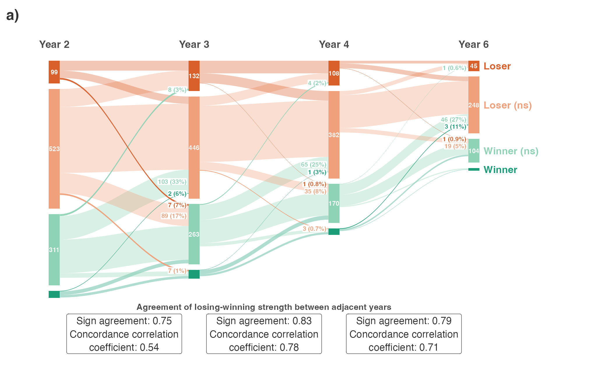
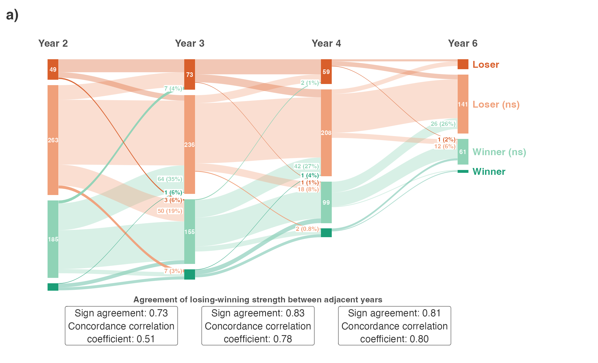

# Step 03: Temporal consistency (Step B, residents)

Each resident species x experiment was classified at years 2, 3, 4 and 6 after transplanting from its year-specific warmed minus origin-control contrast (step 02, p-values with the plot-based df): Winner or Loser at p < 0.05 by the sign of the estimate, otherwise Winner (ns) or Loser (ns). A combination with no cover in any origin-control or warmed plot in that year was not classified there (decided 30 Oct). Between adjacent anchors, for the combinations present at both, the share keeping its sign and Lin's concordance correlation of the two contrasts were computed, with the 4 x 4 flow counts that draw Fig 1a. Year 1 is excluded.

## Counts per anchor

| year | combinations | absent_both_groups | classified | Loser | Loser (ns) | Winner (ns) | Winner |
| --- | --- | --- | --- | --- | --- | --- | --- |
| 2 | 1004 | 40 | 964 | 99 | 523 | 311 | 31 |
| 3 | 900 | 21 | 879 | 132 | 446 | 263 | 38 |
| 4 | 700 | 12 | 688 | 108 | 382 | 170 | 28 |
| 6 | 428 | 20 | 408 | 45 | 248 | 104 | 11 |

## Stability between anchors (`stability.csv`)

| pair | n | sign_agreement | ccc |
| --- | --- | --- | --- |
| 2 to 3 | 852 | 0.746 | 0.544 |
| 3 to 4 | 635 | 0.828 | 0.775 |
| 4 to 6 | 327 | 0.786 | 0.713 |

## Flows (`flows.rds`)

**Year 2 to year 3** (rows: class at the first anchor; columns: class at the second)

| from | Loser | Loser (ns) | Winner (ns) | Winner |
| --- | --- | --- | --- | --- |
| Loser | 43 | 32 | 7 | 0 |
| Loser (ns) | 79 | 288 | 89 | 7 |
| Winner (ns) | 8 | 103 | 147 | 20 |
| Winner | 0 | 2 | 16 | 11 |

**Year 3 to year 4** (rows: class at the first anchor; columns: class at the second)

| from | Loser | Loser (ns) | Winner (ns) | Winner |
| --- | --- | --- | --- | --- |
| Loser | 55 | 42 | 1 | 0 |
| Loser (ns) | 40 | 246 | 35 | 3 |
| Winner (ns) | 4 | 65 | 102 | 14 |
| Winner | 0 | 1 | 18 | 9 |

**Year 4 to year 6** (rows: class at the first anchor; columns: class at the second)

| from | Loser | Loser (ns) | Winner (ns) | Winner |
| --- | --- | --- | --- | --- |
| Loser | 12 | 20 | 1 | 0 |
| Loser (ns) | 18 | 144 | 19 | 0 |
| Winner (ns) | 1 | 46 | 49 | 5 |
| Winner | 0 | 3 | 7 | 2 |

## Fig 1 panel a (main figure)

Strata are drawn to one absolute scale, so columns shrink as experiments end and as species are absent from both groups. The final figure, with panel b (colonizers, step 07), is drawn in step 10. Columns are evenly spaced: the gap from year 4 to year 6 spans two years, the others one.

Switches between a significant winner and a significant loser, in either direction: 2 to 3: 0; 3 to 4: 0; 4 to 6: 0. Ribbons that cross zero with a significant class at either end are drawn darker; every ribbon that crosses zero is labelled where it enters the next anchor with its count and its share of the class it started from.

## Appendix: residents in at least 3 gradients

The same classes and flows, restricted to the 74 resident species found in at least 3 gradients, the species on which the classification (step 04) and the ladder (step 05) rest (decided 2 Nov). Classified combinations per anchor: year 2: 515, year 3: 488, year 4: 387, year 6: 233.

| pair | n | sign_agreement | ccc |
| --- | --- | --- | --- |
| 2 to 3 | 485 | 0.728 | 0.510 |
| 3 to 4 | 383 | 0.828 | 0.784 |
| 4 to 6 | 201 | 0.806 | 0.799 |

## Warnings captured

- The `label.size` argument of `geom_label()` is deprecated as of ggplot2 3.5.0.
ℹ Please use the `linewidth` argument instead.

## Deviations from PLAN.md

Combinations absent from both groups in an anchor year ( 93  of  3,032  anchor contrasts) are not classified there, where PLAN.md's rule would have put their zero contrast in Loser (ns) (decided 30 Oct). Anchors are years 2, 3, 4 and 6 rather than 2, 4 and 6 (decided 30 Oct: agreement between consecutive years rises from year 3 on; PLAN.md updated), labelled Year 2, 3, 4, 6 rather than the mock's First 2, 4, 6 years. Fig 1a is written to figures/main/fig1.png (anchored 2 Nov, Bills) and the appendix version to figures/diagnostics/, not to data/derived/03_temporal/, so that they are committed with the report.
