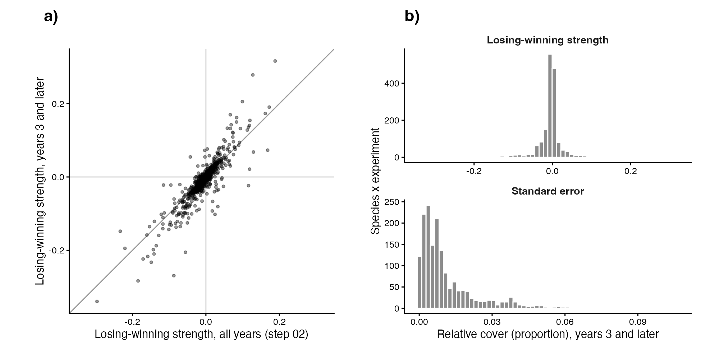

# Step 03b: Strength from year 3 (residents)

Losing-winning strength was recomputed from the 43 fits of step 02, without refitting, as the warmed minus origin-control contrast averaged over each experiment's years 3 and later (`emmeans(m, ~ treatment | species, at = list(year = years >= 3), df = df_plots)`), because step 03 found that the yearly contrasts settle from year 3 (decided 30 Oct). The degrees of freedom, the residual variance per species and the all-zero years are as in step 02. The covariates and species properties of step 02's `strength_df` are carried over unchanged; only `strength` and `strength_se` differ. This is the main strength of steps 04 to 09; step 02's all-years strength is the sensitivity run.

## Counts

| rule | n |
| --- | --- |
| effects (species x experiment) | 1,655 |
| experiments | 43 |
| gradients | 21 |
| species | 528 |
| effects resting on a single year >= 3 | 320 |
| experiments with a single year >= 3 | 9 |

Each matches the expectation checked in the script (1,655 effects, 43 experiments, 21 gradients).

## Years averaged per experiment

| experiment_id | years | n_years |
| --- | --- | --- |
| CH_Calanda::Cal::Nes | 3, 4, 5, 6 | 4 |
| CH_Calanda::Pea::Cal | 3, 4, 5, 6 | 4 |
| CH_Calanda2::Cal::Nes | 3, 4 | 2 |
| CH_Lavey::RIO::CRE | 3 | 1 |
| CH_Lavey::RIO::MAR | 3 | 1 |
| CH_Lavey::RIO::PRA | 3 | 1 |
| CN_Damxung::HIGH::LOW | 4, 5 | 2 |
| CN_Gongga::A::M | 3, 4 | 2 |
| CN_Gongga::H::A | 3, 4 | 2 |
| CN_Gongga::H::L | 3, 4 | 2 |
| CN_Gongga::M::L | 3, 4 | 2 |
| CN_Heibei::3400::3200 | 3, 6, 7, 8, 9 | 5 |
| CN_Heibei::3800::3200 | 3, 6, 7, 8, 9 | 5 |
| CN_Heibei::3800::3400 | 3, 6, 7, 8, 9 | 5 |
| DE_Grainau::HIGH::LOW | 3, 4 | 2 |
| DE_Susalps::EB::BT | 3, 4 | 2 |
| DE_Susalps::EB::FE | 3, 4 | 2 |
| DE_Susalps::EB::GW | 3, 4 | 2 |
| DE_Susalps::FE::BT | 3, 4 | 2 |
| DE_Susalps::GW::BT | 3, 4 | 2 |
| DE_Susalps::GW::FE | 3, 4 | 2 |
| DE_TransAlps::FP::BT | 3, 4 | 2 |
| DE_TransAlps::SP::BT | 3, 4 | 2 |
| FR_AlpeHuez::HIGH::LOW | 3, 4, 5, 6, 7, 8, 9 | 7 |
| FR_Lautaret::G::L | 5, 6 | 2 |
| IT_MatschMazia1::High::Low | 3 | 1 |
| IT_MatschMazia2::High::Low | 3 | 1 |
| NO_Gudmedalen::Gudmedalen::Rambera | 3, 4, 6, 8 | 4 |
| NO_Gudmedalen::Rambera::Arhelleren | 3, 4, 6, 8 | 4 |
| NO_Lavisdalen::Hogsete::Vikesland | 3, 4, 6, 8 | 4 |
| NO_Lavisdalen::Lavisdalen::Hogsete | 3, 4, 6, 8 | 4 |
| NO_Skjellingahaugen::Skjellingahaugen::Veskre | 3, 4, 6, 8 | 4 |
| NO_Skjellingahaugen::Veskre::Ovstedal | 3, 4, 6, 8 | 4 |
| NO_Ulvhaugen::Alrust::Fauske | 3, 4, 6, 8 | 4 |
| NO_Ulvhaugen::Ulvhaugen::Alrust | 3, 4, 6, 8 | 4 |
| SE_Abisko::High::Low | 3 | 1 |
| SE_Abisko::High::Mid | 3 | 1 |
| SE_Abisko::Mid::Low | 3 | 1 |
| US_Arizona::MC::PP | 3, 4 | 2 |
| US_Colorado::mo::pf | 4, 5, 6 | 3 |
| US_Colorado::mo::um | 4, 5, 6 | 3 |
| US_Colorado::pf::um | 4, 5, 6 | 3 |
| US_Montana::High::Low | 5 | 1 |

## Against the all-years strength of step 02

| measure | value |
| --- | --- |
| Pearson correlation | 0.889 |
| Concordance correlation coefficient | 0.862 |
| Sign agreement | 0.858 |
| Median SE, years >= 3 / all years | 1.20 |
| Significant at p < 0.05, all years (step 02) | 420 |
| Significant at p < 0.05, years 3 and later | 369 |

Quantiles (min / 25% / median / 75% / max). Strength from year 3: -0.3393 / -0.0106 / -0.0015 / 0.0014 / 0.3161; its SE: 0.0001 / 0.0035 / 0.0072 / 0.0145 / 0.1057. Significance uses each experiment's t cut-off (origin-control plots + warmed plots - 2 df), as in step 02.

## Warnings captured

- CH_Calanda::Cal::Nes: NOTE: Results may be misleading due to involvement in interactions
- CH_Calanda::Pea::Cal: NOTE: Results may be misleading due to involvement in interactions
- CH_Calanda2::Cal::Nes: NOTE: Results may be misleading due to involvement in interactions
- CH_Lavey::RIO::CRE: NOTE: Results may be misleading due to involvement in interactions
- CH_Lavey::RIO::MAR: NOTE: Results may be misleading due to involvement in interactions
- CH_Lavey::RIO::PRA: NOTE: Results may be misleading due to involvement in interactions
- CN_Damxung::HIGH::LOW: NOTE: Results may be misleading due to involvement in interactions
- CN_Gongga::A::M: NOTE: Results may be misleading due to involvement in interactions
- CN_Gongga::H::A: NOTE: Results may be misleading due to involvement in interactions
- CN_Gongga::H::L: NOTE: Results may be misleading due to involvement in interactions
- CN_Gongga::M::L: NOTE: Results may be misleading due to involvement in interactions
- CN_Heibei::3400::3200: NOTE: Results may be misleading due to involvement in interactions
- CN_Heibei::3800::3200: NOTE: Results may be misleading due to involvement in interactions
- CN_Heibei::3800::3400: NOTE: Results may be misleading due to involvement in interactions
- DE_Grainau::HIGH::LOW: NOTE: Results may be misleading due to involvement in interactions
- DE_Susalps::EB::BT: NOTE: Results may be misleading due to involvement in interactions
- DE_Susalps::EB::FE: NOTE: Results may be misleading due to involvement in interactions
- DE_Susalps::EB::GW: NOTE: Results may be misleading due to involvement in interactions
- DE_Susalps::FE::BT: NOTE: Results may be misleading due to involvement in interactions
- DE_Susalps::GW::BT: NOTE: Results may be misleading due to involvement in interactions
- DE_Susalps::GW::FE: NOTE: Results may be misleading due to involvement in interactions
- DE_TransAlps::FP::BT: NOTE: Results may be misleading due to involvement in interactions
- DE_TransAlps::SP::BT: NOTE: Results may be misleading due to involvement in interactions
- FR_AlpeHuez::HIGH::LOW: NOTE: Results may be misleading due to involvement in interactions
- FR_Lautaret::G::L: NOTE: Results may be misleading due to involvement in interactions
- IT_MatschMazia1::High::Low: NOTE: Results may be misleading due to involvement in interactions
- IT_MatschMazia2::High::Low: NOTE: Results may be misleading due to involvement in interactions
- NO_Gudmedalen::Gudmedalen::Rambera: NOTE: Results may be misleading due to involvement in interactions
- NO_Gudmedalen::Rambera::Arhelleren: NOTE: Results may be misleading due to involvement in interactions
- NO_Lavisdalen::Hogsete::Vikesland: NOTE: Results may be misleading due to involvement in interactions
- NO_Lavisdalen::Lavisdalen::Hogsete: NOTE: Results may be misleading due to involvement in interactions
- NO_Skjellingahaugen::Skjellingahaugen::Veskre: NOTE: Results may be misleading due to involvement in interactions
- NO_Skjellingahaugen::Veskre::Ovstedal: NOTE: Results may be misleading due to involvement in interactions
- NO_Ulvhaugen::Alrust::Fauske: NOTE: Results may be misleading due to involvement in interactions
- NO_Ulvhaugen::Ulvhaugen::Alrust: NOTE: Results may be misleading due to involvement in interactions
- SE_Abisko::High::Low: NOTE: Results may be misleading due to involvement in interactions
- SE_Abisko::High::Mid: NOTE: Results may be misleading due to involvement in interactions
- SE_Abisko::Mid::Low: NOTE: Results may be misleading due to involvement in interactions
- US_Arizona::MC::PP: NOTE: Results may be misleading due to involvement in interactions
- US_Colorado::mo::pf: NOTE: Results may be misleading due to involvement in interactions
- US_Colorado::mo::um: NOTE: Results may be misleading due to involvement in interactions
- US_Colorado::pf::um: NOTE: Results may be misleading due to involvement in interactions
- US_Montana::High::Low: NOTE: Results may be misleading due to involvement in interactions

## Deviations from PLAN.md

None.
