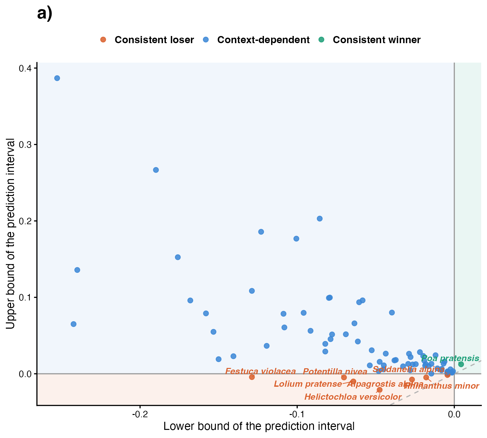
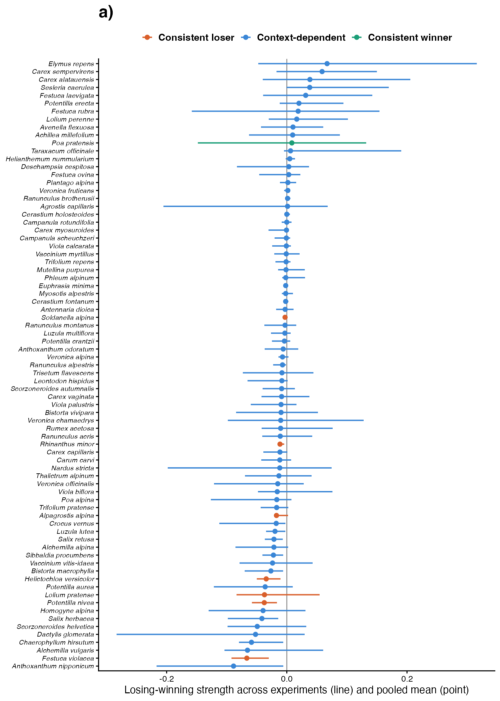

# Step 04: Consistency across experiments (Step C, residents)

For the 77 resident species found in at least four experiments (552 effects in 39 experiments), one `rma.mv` estimated a pooled losing-winning strength per species and a species-specific among-experiment variance, on the strength from year 3 (step 03b). Each species' prediction interval for a new experiment, which carries both its among-experiment variance and the uncertainty of its pooled strength, places it as a consistent winner (interval above zero), a consistent loser (below zero) or context-dependent (spanning zero). The same model on step 02's all-years strength is the sensitivity run.

## Model as fitted (for reviewers)

```r
m_C <- rma.mv(yi = strength, V = strength_se^2, mods = ~0 + species, data = d, random = ~species | effect_id, struct = "DIAG", method = "REML", sparse = TRUE)
# d: eligible species (>= 4 experiments); mods = ~ 0 + species, random = ~ species | effect_id, struct = "DIAG"
p <- predict(m_C, newmods = diag(n_species), tau2.levels = species)
# lower, upper = p$pi.lb, p$pi.ub = mu_s -/+ 1.96 * sqrt(tau2_s + se(mu_s)^2)
```

## Counts

| rule | n |
| --- | --- |
| effects (step 03b) | 995 |
| species with >= 4 experiments | 77 |
| their effects | 552 |
| experiments they occur in | 39 |
| species with tau2_s estimated at about 0 (< 1e-8) | 12 |

## Classes

| class | species |
| --- | --- |
| Consistent loser | 7 |
| Context-dependent | 69 |
| Consistent winner | 1 |

Consistent winners and losers:

| species | class | n_experiments | mu | se_mu | tau | lower | upper |
| --- | --- | --- | --- | --- | --- | --- | --- |
| Festuca violacea | Consistent loser | 4 | -0.0666 | 0.0164 | 0.0272 | -0.1288 | -0.0043 |
| Potentilla nivea | Consistent loser | 4 | -0.0375 | 0.0094 | 0.0138 | -0.0702 | -0.0048 |
| Lolium pratense | Consistent loser | 7 | -0.0372 | 0.0138 | 0.0000 | -0.0643 | -0.0101 |
| Helictochloa versicolor | Consistent loser | 5 | -0.0343 | 0.0058 | 0.0034 | -0.0475 | -0.0210 |
| Alpagrostis alpina | Consistent loser | 4 | -0.0172 | 0.0042 | 0.0027 | -0.0269 | -0.0075 |
| Rhinanthus minor | Consistent loser | 6 | -0.0113 | 0.0033 | 0.0000 | -0.0179 | -0.0048 |
| Soldanella alpina | Consistent loser | 5 | -0.0029 | 0.0007 | 0.0000 | -0.0044 | -0.0015 |
| Poa pratensis | Consistent winner | 15 | 0.0084 | 0.0021 | 0.0000 | 0.0043 | 0.0124 |

Species with tau2_s at about zero (their interval is the uncertainty of the mean alone): Campanula rotundifolia, Carex myosuroides, Cerastium fontanum, Deschampsia cespitosa, Euphrasia minima, Lolium pratense, Poa pratensis, Ranunculus brotherusii, Rhinanthus minor, Soldanella alpina, Veronica alpina, Veronica fruticans.

## Sensitivity: all-years strength (step 02)

Rows: class on the strength from year 3 (main); columns: class on the all-years strength.

| years >= 3 (main) | Consistent loser | Context-dependent | Consistent winner |
| --- | --- | --- | --- |
| Consistent loser | 5 | 2 | 0 |
| Context-dependent | 3 | 66 | 0 |
| Consistent winner | 0 | 0 | 1 |

## Figures (drafts)



Fig 2 corner panels follow once four species are named (MILESTONES).



## Warnings captured

None.

## Deviations from PLAN.md

None: PLAN.md Step C was revised on 30 Oct (Bills) to fixed species means with predict() intervals. Decisions approved with the plan: se_mu added to species_summary; the all-years sensitivity run here; draft figures in figures/diagnostics/ rather than data/derived/04_classification/.
