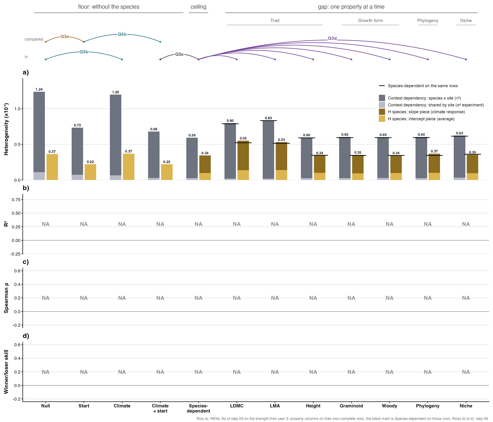
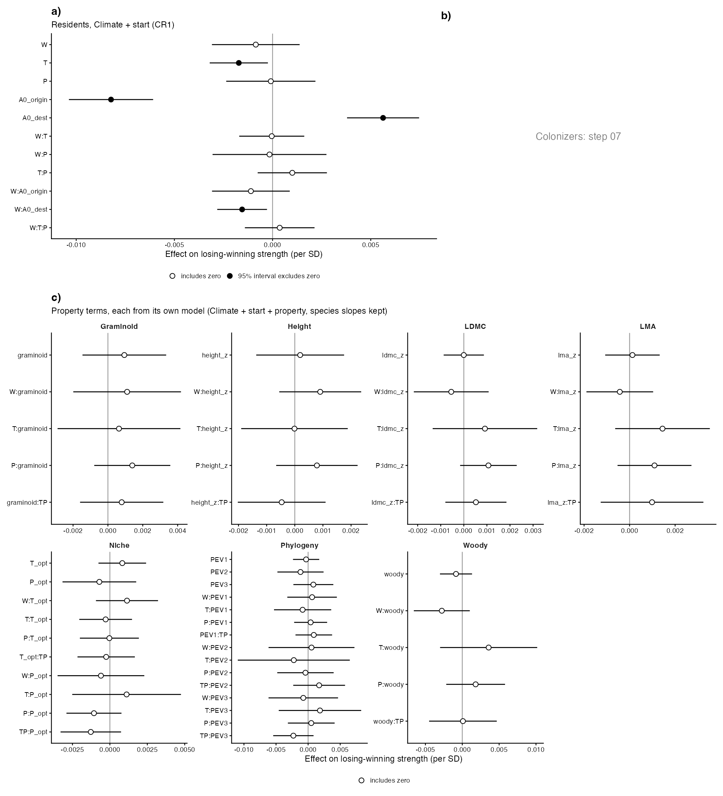
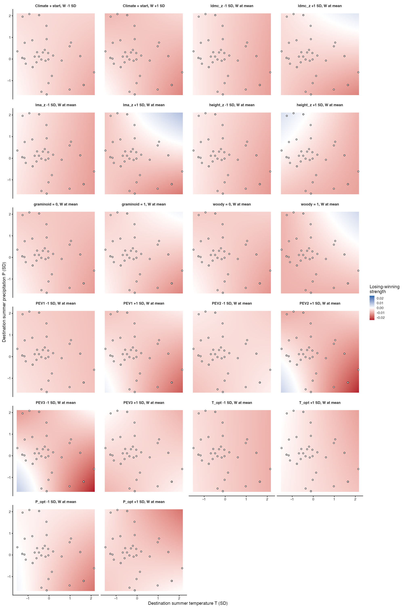

# Step 05: The ladder, fitted (Step D, route 1, residents)

The model ladder was fitted on the strength from year 3 (step 03b): Null, Start, Climate, Climate + start and Species-dependent on all 1,655 effects and again on each property's complete rows, plus one property model per property (LDMC, LMA, height, graminoid, woody, phylogeny as PEV1 to PEV3, niche as T_opt and P_opt) with the species slopes kept, 32 REML fits in all. Each model reports τ² (species × site), σ²_experiment (shared site shift) and the two H_species pieces as raw values. The step opened with a timing run of Species-dependent under GEN from the gate fit's variance components (Bills, 1 Nov); it did not converge, so the T, P, TP slope block is diagonal in every slope fit (Bills, 1 Nov). Fixed effects carry CR1 standard errors clustered on experiment. Fits ran in parallel on 8 cores, 314 fit-minutes in all (each fit's own time in the heterogeneity table; this run, reusing cached fits, took 1 min).

## Stability across refits: the timing run

Species-dependent on all rows, GEN, `sparse = TRUE`, started from `gate_start_values.csv` (the variance components of the 1 Nov gate fit of the same model on the same rows, ρ(T, P) = 0.989, fitted from metafor's default start in 54 min, scratchpad run before this step): did not converge, stopping after 2.6 min with "Optimizer (nlminb) did not achieve convergence (convergence = 1).". A fit that converges from metafor's default start but not from its own optimum sits on a flat ridge: with the experiments' T and P correlated at r = -0.44, the T and P slope correlation is not identified. Decided 1 Nov (Bills): the T, P, TP slope block is diagonal in all 12 slope fits (the 25 Oct fallback, applied ladder-wide so that one structure runs through the ladder). The variance components of the all-rows Species-dependent fit, diagonal, against the gate fit:

| component | gate fit, GEN | step 05, diagonal |
| --- | --- | --- |
| sigma2_species | 8.489e-06 | 9.724e-06 |
| sigma2_experiment_id | 2.583e-06 | 2.635e-06 |
| sigma2_effect_id | 5.621e-05 | 5.68e-05 |
| tau2_W | 6.066e-06 | 5.48e-06 |
| gamma2_T | 2.742e-05 | 1.985e-05 |
| gamma2_P | 3.265e-06 | 3.038e-13 |
| gamma2_TP | 6.382e-08 | 2.437e-13 |

## Model as fitted (for reviewers)

```r
re_base   <- list(~ 1 | species, ~ 1 | experiment_id, ~ 1 | effect_id)
re_slopes <- c(re_base, list(~ 0 + W | species, ~ 0 + T + P + TP | species))
rma.mv(yi = strength, V = strength_se^2, mods = <formula>, random = <re_base or re_slopes>,
       struct = c("GEN", "GDIAG"), data = <rowset>, method = "REML", sparse = TRUE)
# struct only acts on re_slopes: W slope; T, P, TP slopes diagonal. No starting values: metafor's default for every fit
# Null ~ 1; Start ~A0_origin + A0_dest + A0_origin:W + A0_dest:W; Climate ~W * T * P
# Climate + start and Species-dependent ~W * T * P + A0_origin + A0_dest + A0_origin:W + A0_dest:W
# property models: Climate + start + X + X:W + X:T + X:P + X:TP per variable, with re_slopes
robust(m, cluster = experiment_id, adjust = TRUE)   # CR1 for Table S5
```

## Counts per rowset

| rowset | effects | species | experiments |
| --- | --- | --- | --- |
| all | 1,655 | 528 | 43 |
| ldmc | 1,350 | 352 | 43 |
| lma | 1,386 | 380 | 43 |
| height | 1,308 | 334 | 43 |
| growth_form | 1,655 | 528 | 43 |
| phylogeny | 1,655 | 528 | 43 |
| niche | 1,618 | 508 | 43 |

Each matches the expectation checked in the script. growth_form and phylogeny have the same rows as all, so their Null to Species-dependent are the all-rows fits (marked `reused`).

## Heterogeneity per model (×10⁻⁴)

| rowset | model | fitted_on | effects | species | τ² | σ²_experiment | H intercept | H slope | struct | minutes |
| --- | --- | --- | --- | --- | --- | --- | --- | --- | --- | --- |
| all | Null | all | 1,655 | 528 | 1.127 | 0.111 | 0.366 | 0.000 | none (no slopes) | 4.5 |
| all | Start | all | 1,655 | 528 | 0.660 | 0.074 | 0.220 | 0.000 | none (no slopes) | 4.6 |
| all | Climate | all | 1,655 | 528 | 1.132 | 0.066 | 0.369 | 0.000 | none (no slopes) | 4.6 |
| all | Climate + start | all | 1,655 | 528 | 0.652 | 0.028 | 0.221 | 0.000 | none (no slopes) | 4.7 |
| all | Species-dependent | all | 1,655 | 528 | 0.568 | 0.026 | 0.097 | 0.247 | DIAG | 26.7 |
| ldmc | Null | ldmc | 1,350 | 352 | 1.625 | 0.124 | 0.541 | 0.000 | none (no slopes) | 3.0 |
| ldmc | Start | ldmc | 1,350 | 352 | 0.906 | 0.070 | 0.327 | 0.000 | none (no slopes) | 2.7 |
| ldmc | Climate | ldmc | 1,350 | 352 | 1.650 | 0.051 | 0.536 | 0.000 | none (no slopes) | 2.9 |
| ldmc | Climate + start | ldmc | 1,350 | 352 | 0.902 | 0.015 | 0.320 | 0.000 | none (no slopes) | 3.1 |
| ldmc | Species-dependent | ldmc | 1,350 | 352 | 0.771 | 0.018 | 0.137 | 0.385 | DIAG | 16.9 |
| ldmc | LDMC | ldmc | 1,350 | 352 | 0.780 | 0.018 | 0.136 | 0.414 | DIAG | 18.0 |
| lma | Null | lma | 1,386 | 380 | 1.677 | 0.098 | 0.545 | 0.000 | none (no slopes) | 3.4 |
| lma | Start | lma | 1,386 | 380 | 0.945 | 0.059 | 0.330 | 0.000 | none (no slopes) | 2.8 |
| lma | Climate | lma | 1,386 | 380 | 1.693 | 0.042 | 0.539 | 0.000 | none (no slopes) | 3.7 |
| lma | Climate + start | lma | 1,386 | 380 | 0.933 | 0.018 | 0.323 | 0.000 | none (no slopes) | 3.0 |
| lma | Species-dependent | lma | 1,386 | 380 | 0.813 | 0.021 | 0.149 | 0.365 | DIAG | 17.8 |
| lma | LMA | lma | 1,386 | 380 | 0.816 | 0.018 | 0.141 | 0.391 | DIAG | 18.6 |
| height | Null | height | 1,308 | 334 | 1.279 | 0.124 | 0.377 | 0.000 | none (no slopes) | 2.7 |
| height | Start | height | 1,308 | 334 | 0.655 | 0.111 | 0.196 | 0.000 | none (no slopes) | 2.4 |
| height | Climate | height | 1,308 | 334 | 1.302 | 0.043 | 0.380 | 0.000 | none (no slopes) | 2.6 |
| height | Climate + start | height | 1,308 | 334 | 0.660 | 0.032 | 0.199 | 0.000 | none (no slopes) | 2.3 |
| height | Species-dependent | height | 1,308 | 334 | 0.562 | 0.029 | 0.103 | 0.244 | DIAG | 15.0 |
| height | Height | height | 1,308 | 334 | 0.571 | 0.027 | 0.101 | 0.243 | DIAG | 15.2 |
| growth_form | Null | all | 1,655 | 528 | 1.127 | 0.111 | 0.366 | 0.000 | none (no slopes) | reused |
| growth_form | Start | all | 1,655 | 528 | 0.660 | 0.074 | 0.220 | 0.000 | none (no slopes) | reused |
| growth_form | Climate | all | 1,655 | 528 | 1.132 | 0.066 | 0.369 | 0.000 | none (no slopes) | reused |
| growth_form | Climate + start | all | 1,655 | 528 | 0.652 | 0.028 | 0.221 | 0.000 | none (no slopes) | reused |
| growth_form | Species-dependent | all | 1,655 | 528 | 0.568 | 0.026 | 0.097 | 0.247 | DIAG | reused |
| growth_form | Graminoid | growth_form | 1,655 | 528 | 0.577 | 0.027 | 0.094 | 0.259 | DIAG | 24.7 |
| growth_form | Woody | growth_form | 1,655 | 528 | 0.573 | 0.028 | 0.099 | 0.246 | DIAG | 23.3 |
| phylogeny | Null | all | 1,655 | 528 | 1.127 | 0.111 | 0.366 | 0.000 | none (no slopes) | reused |
| phylogeny | Start | all | 1,655 | 528 | 0.660 | 0.074 | 0.220 | 0.000 | none (no slopes) | reused |
| phylogeny | Climate | all | 1,655 | 528 | 1.132 | 0.066 | 0.369 | 0.000 | none (no slopes) | reused |
| phylogeny | Climate + start | all | 1,655 | 528 | 0.652 | 0.028 | 0.221 | 0.000 | none (no slopes) | reused |
| phylogeny | Species-dependent | all | 1,655 | 528 | 0.568 | 0.026 | 0.097 | 0.247 | DIAG | reused |
| phylogeny | Phylogeny | phylogeny | 1,655 | 528 | 0.577 | 0.027 | 0.100 | 0.270 | DIAG | 22.8 |
| niche | Null | niche | 1,618 | 508 | 1.208 | 0.106 | 0.387 | 0.000 | none (no slopes) | 3.7 |
| niche | Start | niche | 1,618 | 508 | 0.687 | 0.072 | 0.230 | 0.000 | none (no slopes) | 3.7 |
| niche | Climate | niche | 1,618 | 508 | 1.213 | 0.060 | 0.390 | 0.000 | none (no slopes) | 3.8 |
| niche | Climate + start | niche | 1,618 | 508 | 0.678 | 0.025 | 0.229 | 0.000 | none (no slopes) | 3.6 |
| niche | Species-dependent | niche | 1,618 | 508 | 0.591 | 0.024 | 0.101 | 0.260 | DIAG | 26.0 |
| niche | Niche | niche | 1,618 | 508 | 0.590 | 0.033 | 0.095 | 0.259 | DIAG | 21.5 |

All 12 slope fits converged with the diagonal T, P, TP block, each from metafor's default start. Started instead from the all-rows fit's variance components, Species-dependent on the niche rows and the Woody model did not converge (nlminb): the P and TP slope variances, at the boundary, started at 1e-10, where the optimiser stalled. So no fit carries starting values from another (Bills, 1 Nov). Across the 12 fits the T slope variance ranges 0.164 to 0.317 ×10⁻⁴; the P and TP slope variances are at most 1.4e-11, at the boundary.

## Checks

τ² at Climate against Null (climate's main effects cannot reach the species × site piece; stop beyond 5%):

| rowset | τ² Null | τ² Climate | change |
| --- | --- | --- | --- |
| all | 1.127 | 1.132 | +0.5% |
| ldmc | 1.625 | 1.650 | +1.5% |
| lma | 1.677 | 1.693 | +1.0% |
| height | 1.279 | 1.302 | +1.8% |
| niche | 1.208 | 1.213 | +0.5% |

Each property model against Species-dependent on the same rows, as a share of that model's τ² + σ²_experiment (a property reaches only H_species; stop beyond 5%, Bills 1 Nov):

| property | rowset | τ² + σ²_experiment (×10⁻⁴) | τ² move | σ²_experiment move |
| --- | --- | --- | --- | --- |
| LDMC | ldmc | 0.789 | +1.19% | +0.06% |
| LMA | lma | 0.833 | +0.41% | -0.30% |
| Height | height | 0.591 | +1.52% | -0.43% |
| Graminoid | growth_form | 0.594 | +1.45% | +0.05% |
| Woody | growth_form | 0.594 | +0.82% | +0.26% |
| Phylogeny | phylogeny | 0.594 | +1.58% | +0.10% |
| Niche | niche | 0.615 | -0.18% | +1.47% |

σ²_species at Null on all rows is 0.366 ×10⁻⁴, off the boundary; the Step C spread of μ_s (step 04, 137 species) is 3.110 ×10⁻⁴. Random structure, property terms (X, X:W, X:T, X:P, X:TP) and A0 interactions (A0:W only) are as PLAN.md writes them. Subspecies niche check (26 Oct): neither Solidago virgaurea nor Ranunculus acris is a resident at CH_Lavey under the original pools, so there is nothing to refit.

## Effective weights (all rows)

| weights | max/min within experiment (median) | share, low-A0_origin half | share, top 10% of effects |
| --- | --- | --- | --- |
| raw 1/V | 98.9 | 0.95 | 0.89 |
| Null | 7.6 | 0.61 | 0.15 |
| Start | 11.4 | 0.63 | 0.17 |
| Climate | 7.8 | 0.61 | 0.15 |
| Climate + start | 12.0 | 0.63 | 0.17 |
| Species-dependent | 14.2 | 0.64 | 0.20 |

The low-A0_origin half is the effects at or below the median A0_origin. Species-dependent weights include the slope variance at each effect's climate.

## Figures







## Warnings captured

- all / Null: Model does not contain an '~ inner | outer' term, so 'struct' argument is disregaded.
- all / Start: Model does not contain an '~ inner | outer' term, so 'struct' argument is disregaded.
- all / Climate: Model does not contain an '~ inner | outer' term, so 'struct' argument is disregaded.
- all / Climate + start: Model does not contain an '~ inner | outer' term, so 'struct' argument is disregaded.
- ldmc / Null: Model does not contain an '~ inner | outer' term, so 'struct' argument is disregaded.
- ldmc / Start: Model does not contain an '~ inner | outer' term, so 'struct' argument is disregaded.
- ldmc / Climate: Model does not contain an '~ inner | outer' term, so 'struct' argument is disregaded.
- ldmc / Climate + start: Model does not contain an '~ inner | outer' term, so 'struct' argument is disregaded.
- lma / Null: Model does not contain an '~ inner | outer' term, so 'struct' argument is disregaded.
- lma / Start: Model does not contain an '~ inner | outer' term, so 'struct' argument is disregaded.
- lma / Climate: Model does not contain an '~ inner | outer' term, so 'struct' argument is disregaded.
- lma / Climate + start: Model does not contain an '~ inner | outer' term, so 'struct' argument is disregaded.
- height / Null: Model does not contain an '~ inner | outer' term, so 'struct' argument is disregaded.
- height / Start: Model does not contain an '~ inner | outer' term, so 'struct' argument is disregaded.
- height / Climate: Model does not contain an '~ inner | outer' term, so 'struct' argument is disregaded.
- height / Climate + start: Model does not contain an '~ inner | outer' term, so 'struct' argument is disregaded.
- niche / Null: Model does not contain an '~ inner | outer' term, so 'struct' argument is disregaded.
- niche / Start: Model does not contain an '~ inner | outer' term, so 'struct' argument is disregaded.
- niche / Climate: Model does not contain an '~ inner | outer' term, so 'struct' argument is disregaded.
- niche / Climate + start: Model does not contain an '~ inner | outer' term, so 'struct' argument is disregaded.
- `geom_errorbarh()` was deprecated in ggplot2 4.0.0.
ℹ Please use the `orientation` argument of `geom_errorbar()` instead.

## Deviations from PLAN.md

- H_species tests `m$withG` where PLAN.md tests `is.null(m$tau2)`: rma.mv returns tau2 = 0, not NULL, for a model without slopes. Same quantity.
- Fig S4 and Fig S8 are written to `figures/diagnostics/` (05_figS4.png, 05_figS8.png), not to `data/derived/05_ladder_fit/`, so that the report can link them; Fig S8's property surfaces are at W = its mean.
- The T, P, TP slope block is diagonal (GDIAG) in every slope fit, where PLAN.md writes GEN with DIAG as the fallback if the correlations are unidentified (decision 25 Oct); applied ladder-wide after the GEN timing run did not converge (Bills, 1 Nov).
- Decided 1 Nov (Bills), not deviations: no ML refits and no AICc column; no profile CIs; the 5% property check is measured against τ² + σ²_experiment; Fig 4 drawn here with twelve columns.
