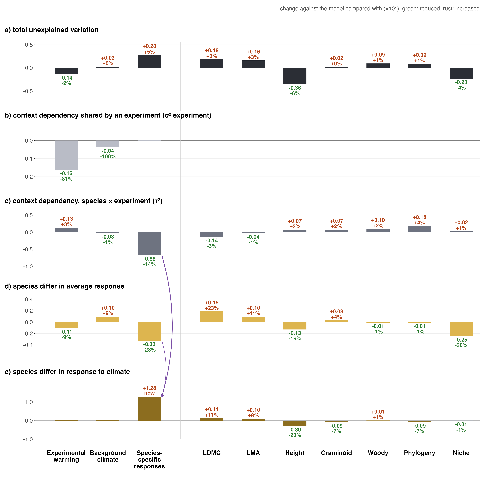
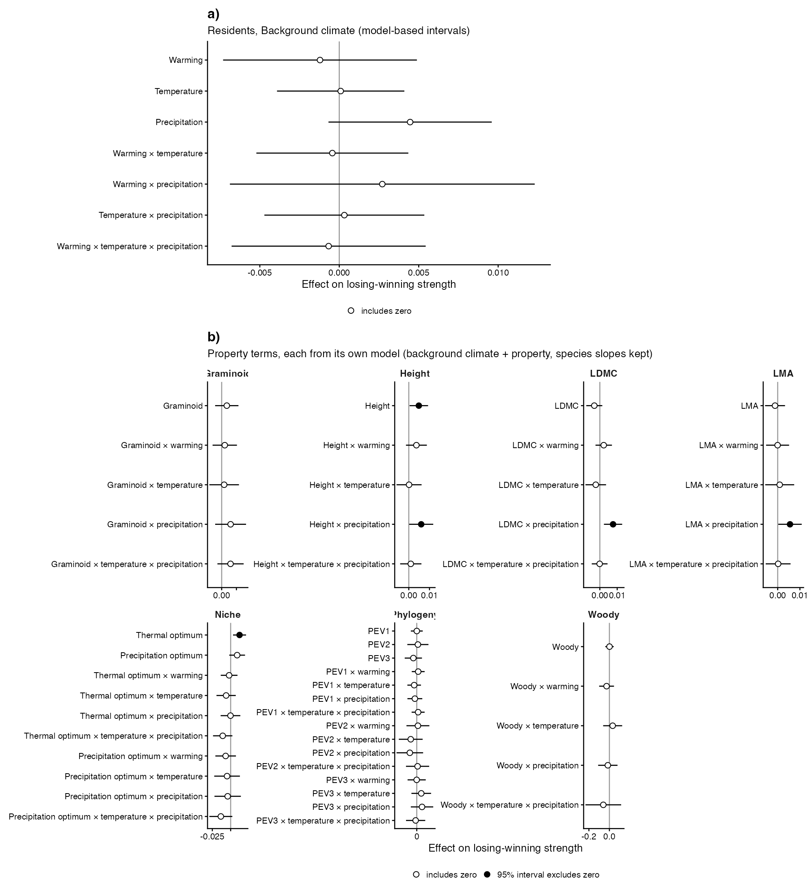

# Step 05: The ladder, fitted (Step D, route 1, residents)

The model ladder was fitted on the strength from year 3 (step 03b), on one set of rows (2 Nov): the 512 effects of the 71 residents found in at least 3 gradients that carry every property (39 experiments, 20 gradients). Without abundance (decided 7 Nov): Null, Experimental warming, Background climate, Species-specific responses and one property model per property on Background climate (LDMC, LMA, height, graminoid, woody, phylogeny as PEV1 to PEV3, niche as T_opt and P_opt) with the species slopes kept, 11 REML fits, all on the same rows. Each model reports τ² (species × experiment), σ²_experiment (experiment component) and the two H_species pieces as raw values. The T, P, TP slope block is diagonal in every slope fit (decided 1 Nov). Fixed effects carry model-based (REML Wald) standard errors (decided 2 Nov; CR1 before). Fits ran in parallel on 4 cores, 5.7 fit-minutes in all; this run took 0 min.

## Slope structure

The 1 Nov GEN timing run (Species-dependent, as Species-specific responses was then called, on the 1,655 rows of the 28 Oct pools, started from the gate fit's own optimum) did not converge, so the T, P, TP slope block is diagonal in every slope fit; the case is in MILESTONES step 05 notes. It is not repeated on the new rows (decided 2 Nov). The experiments' T and P are correlated at r = -0.49 on the ladder rows.

## Model as fitted (for reviewers)

```r
re_base   <- list(~ 1 | species, ~ 1 | experiment_id, ~ 1 | effect_id)
re_slopes <- c(re_base, list(~ 0 + W | species, ~ 0 + T + P + TP | species))
rma.mv(yi = strength, V = strength_se^2, mods = <formula>, random = <re_base or re_slopes>,
       struct = c("GEN", "GDIAG"), data = <rowset>, method = "REML", sparse = TRUE)
# struct only acts on re_slopes: W slope; T, P, TP slopes diagonal. No starting values: metafor's default for every fit
# Null ~ 1; Experimental warming ~W; Background climate ~W * T * P
# Species-specific responses ~W * T * P, with re_slopes
# property models: Background climate + X + X:W + X:T + X:P + X:TP per variable, with re_slopes
coef(summary(m))   # model-based (REML Wald) intervals for Table S6 and Fig S14
```

## Counts per rowset

| rowset | effects | species | experiments |
| --- | --- | --- | --- |
| all | 512 | 71 | 39 |
| ldmc | 512 | 71 | 39 |
| lma | 512 | 71 | 39 |
| height | 512 | 71 | 39 |
| growth_form | 512 | 71 | 39 |
| phylogeny | 512 | 71 | 39 |
| niche | 512 | 71 | 39 |

Each matches the expectation checked in the script. Every property rowset equals the ladder rows, so Null to Species-specific responses are fitted once, on `all` (marked `reused` elsewhere).

Step 02's standardisation, kept (decided 2 Nov), read on the ladder rows:

| variable | across | mean | sd |
| --- | --- | --- | --- |
| W | the 39 experiments | 0.07 | 1.00 |
| T | the 39 experiments | 0.02 | 1.03 |
| P | the 39 experiments | 0.03 | 0.92 |
| A0_origin | the 512 effects | 0.13 | 1.03 |
| A0_dest | the 512 effects | 0.15 | 1.10 |
| ldmc_z | the 71 species | 0.13 | 0.84 |
| lma_z | the 71 species | -0.08 | 0.84 |
| height_z | the 71 species | -0.16 | 0.86 |
| PEV1 | the 71 species | 0.22 | 1.06 |
| PEV2 | the 71 species | -0.12 | 1.13 |
| PEV3 | the 71 species | 0.02 | 1.04 |
| T_opt | the 71 species | -0.02 | 0.86 |
| P_opt | the 71 species | -0.16 | 0.70 |

## Heterogeneity per model (×10⁻⁴)

| rowset | model | fitted_on | effects | species | τ² | σ²_experiment | H intercept | H slope | struct | minutes |
| --- | --- | --- | --- | --- | --- | --- | --- | --- | --- | --- |
| all | Null | all | 512 | 71 | 4.802 | 0.201 | 1.165 | 0.000 | none (no slopes) | 0.2 |
| all | Experimental warming | all | 512 | 71 | 4.935 | 0.038 | 1.058 | 0.000 | none (no slopes) | 0.2 |
| all | Background climate | all | 512 | 71 | 4.902 | 0.000 | 1.154 | 0.000 | none (no slopes) | 0.4 |
| all | Species-specific responses | all | 512 | 71 | 4.227 | 0.000 | 0.827 | 1.279 | DIAG | 1.3 |
| ldmc | Null | all | 512 | 71 | 4.802 | 0.201 | 1.165 | 0.000 | none (no slopes) | reused |
| ldmc | Experimental warming | all | 512 | 71 | 4.935 | 0.038 | 1.058 | 0.000 | none (no slopes) | reused |
| ldmc | Background climate | all | 512 | 71 | 4.902 | 0.000 | 1.154 | 0.000 | none (no slopes) | reused |
| ldmc | Species-specific responses | all | 512 | 71 | 4.227 | 0.000 | 0.827 | 1.279 | DIAG | reused |
| ldmc | LDMC | ldmc | 512 | 71 | 4.085 | 0.000 | 1.016 | 1.418 | DIAG | 0.8 |
| lma | Null | all | 512 | 71 | 4.802 | 0.201 | 1.165 | 0.000 | none (no slopes) | reused |
| lma | Experimental warming | all | 512 | 71 | 4.935 | 0.038 | 1.058 | 0.000 | none (no slopes) | reused |
| lma | Background climate | all | 512 | 71 | 4.902 | 0.000 | 1.154 | 0.000 | none (no slopes) | reused |
| lma | Species-specific responses | all | 512 | 71 | 4.227 | 0.000 | 0.827 | 1.279 | DIAG | reused |
| lma | LMA | lma | 512 | 71 | 4.189 | 0.000 | 0.922 | 1.381 | DIAG | 0.4 |
| height | Null | all | 512 | 71 | 4.802 | 0.201 | 1.165 | 0.000 | none (no slopes) | reused |
| height | Experimental warming | all | 512 | 71 | 4.935 | 0.038 | 1.058 | 0.000 | none (no slopes) | reused |
| height | Background climate | all | 512 | 71 | 4.902 | 0.000 | 1.154 | 0.000 | none (no slopes) | reused |
| height | Species-specific responses | all | 512 | 71 | 4.227 | 0.000 | 0.827 | 1.279 | DIAG | reused |
| height | Height | height | 512 | 71 | 4.298 | 0.000 | 0.696 | 0.982 | DIAG | 0.8 |
| growth_form | Null | all | 512 | 71 | 4.802 | 0.201 | 1.165 | 0.000 | none (no slopes) | reused |
| growth_form | Experimental warming | all | 512 | 71 | 4.935 | 0.038 | 1.058 | 0.000 | none (no slopes) | reused |
| growth_form | Background climate | all | 512 | 71 | 4.902 | 0.000 | 1.154 | 0.000 | none (no slopes) | reused |
| growth_form | Species-specific responses | all | 512 | 71 | 4.227 | 0.000 | 0.827 | 1.279 | DIAG | reused |
| growth_form | Graminoid | growth_form | 512 | 71 | 4.301 | 0.000 | 0.859 | 1.194 | DIAG | 0.7 |
| growth_form | Woody | growth_form | 512 | 71 | 4.322 | 0.000 | 0.818 | 1.287 | DIAG | 0.3 |
| phylogeny | Null | all | 512 | 71 | 4.802 | 0.201 | 1.165 | 0.000 | none (no slopes) | reused |
| phylogeny | Experimental warming | all | 512 | 71 | 4.935 | 0.038 | 1.058 | 0.000 | none (no slopes) | reused |
| phylogeny | Background climate | all | 512 | 71 | 4.902 | 0.000 | 1.154 | 0.000 | none (no slopes) | reused |
| phylogeny | Species-specific responses | all | 512 | 71 | 4.227 | 0.000 | 0.827 | 1.279 | DIAG | reused |
| phylogeny | Phylogeny | phylogeny | 512 | 71 | 4.410 | 0.000 | 0.818 | 1.192 | DIAG | 0.3 |
| niche | Null | all | 512 | 71 | 4.802 | 0.201 | 1.165 | 0.000 | none (no slopes) | reused |
| niche | Experimental warming | all | 512 | 71 | 4.935 | 0.038 | 1.058 | 0.000 | none (no slopes) | reused |
| niche | Background climate | all | 512 | 71 | 4.902 | 0.000 | 1.154 | 0.000 | none (no slopes) | reused |
| niche | Species-specific responses | all | 512 | 71 | 4.227 | 0.000 | 0.827 | 1.279 | DIAG | reused |
| niche | Niche | niche | 512 | 71 | 4.250 | 0.000 | 0.579 | 1.270 | DIAG | 0.4 |

All 8 slope fits converged with the diagonal T, P, TP block: Species-specific responses from metafor's default start (decided 1 Nov), the seven property models warm-started from it with optim BFGS (decided 7 Nov). Across the 8 fits the T slope variance ranges 0.529 to 1.059 ×10⁻⁴; the TP slope variance 0.000 to 0.266 ×10⁻⁴; only the P slope variance is at the boundary (at most 1.0e-08).

## Checks

τ² at Experimental warming and Background climate against Null (terms with one value per experiment cannot reach the species × experiment piece; stop beyond 5%):

| model | τ² Null | τ² | change |
| --- | --- | --- | --- |
| Experimental warming | 4.802 | 4.935 | +2.8% |
| Background climate | 4.802 | 4.902 | +2.1% |

Each property model against Species-specific responses on the same rows, as a share of that model's τ² + σ²_experiment (a property reaches only H_species; stop beyond 5%, decided 1 Nov):

| property | rowset | τ² + σ²_experiment (×10⁻⁴) | τ² move | σ²_experiment move |
| --- | --- | --- | --- | --- |
| LDMC | ldmc | 4.227 | -3.34% | +0.00% |
| LMA | lma | 4.227 | -0.89% | +0.00% |
| Height | height | 4.227 | +1.69% | +0.00% |
| Graminoid | growth_form | 4.227 | +1.76% | +0.00% |
| Woody | growth_form | 4.227 | +2.26% | +0.00% |
| Phylogeny | phylogeny | 4.227 | +4.33% | +0.00% |
| Niche | niche | 4.227 | +0.56% | +0.00% |

σ²_species at Null on all rows is 1.165 ×10⁻⁴, off the boundary; the Step C spread of μ_s (step 04, 74 species) is 5.452 ×10⁻⁴. Random structure and property terms (X, X:W, X:T, X:P, X:TP) are as PLAN.md writes them; no model carries an A0 term (decided 7 Nov). Subspecies niche check (26 Oct): neither Solidago virgaurea nor Ranunculus acris is a resident at CH_Lavey under the original pools, so there is nothing to refit.

## Effective weights (all rows)

| weights | max/min within experiment (median) | share, low-A0_origin half | share, top 10% of effects |
| --- | --- | --- | --- |
| raw 1/V | 9.9 | 0.95 | 0.84 |
| Null | 2.3 | 0.58 | 0.13 |
| Experimental warming | 2.4 | 0.58 | 0.13 |
| Background climate | 2.4 | 0.58 | 0.13 |
| Species-specific responses | 2.4 | 0.58 | 0.15 |

The low-A0_origin half is the effects at or below the median A0_origin (abundance is still computed, though no model uses it). Species-specific responses weights include the slope variance at each effect's climate.

## Change in unexplained variation at each comparison (Fig S13)

Each model against the one it adds to (Table 2). `new`: the compared model has no such component; `zero`: below 1e-10 in both.

| model | compared with | component | change (×10⁻⁴) | % |
| --- | --- | --- | --- | --- |
| Experimental warming | Null | total | -0.137 | -2.2 |
| Experimental warming | Null | σ²_experiment | -0.162 | -80.8 |
| Experimental warming | Null | τ² | +0.132 | +2.8 |
| Experimental warming | Null | H intercept | -0.107 | -9.2 |
| Experimental warming | Null | H slope | +0.000 | zero |
| Background climate | Experimental warming | total | +0.026 | +0.4 |
| Background climate | Experimental warming | σ²_experiment | -0.038 | -100.0 |
| Background climate | Experimental warming | τ² | -0.032 | -0.7 |
| Background climate | Experimental warming | H intercept | +0.096 | +9.1 |
| Background climate | Experimental warming | H slope | +0.000 | zero |
| Species-specific responses | Background climate | total | +0.276 | +4.6 |
| Species-specific responses | Background climate | σ²_experiment | -0.000 | zero |
| Species-specific responses | Background climate | τ² | -0.676 | -13.8 |
| Species-specific responses | Background climate | H intercept | -0.327 | -28.3 |
| Species-specific responses | Background climate | H slope | +1.279 | new |
| LDMC | Species-specific responses | total | +0.186 | +2.9 |
| LDMC | Species-specific responses | σ²_experiment | +0.000 | new |
| LDMC | Species-specific responses | τ² | -0.141 | -3.3 |
| LDMC | Species-specific responses | H intercept | +0.188 | +22.8 |
| LDMC | Species-specific responses | H slope | +0.139 | +10.9 |
| LMA | Species-specific responses | total | +0.159 | +2.5 |
| LMA | Species-specific responses | σ²_experiment | +0.000 | new |
| LMA | Species-specific responses | τ² | -0.037 | -0.9 |
| LMA | Species-specific responses | H intercept | +0.095 | +11.5 |
| LMA | Species-specific responses | H slope | +0.101 | +7.9 |
| Height | Species-specific responses | total | -0.356 | -5.6 |
| Height | Species-specific responses | σ²_experiment | +0.000 | new |
| Height | Species-specific responses | τ² | +0.071 | +1.7 |
| Height | Species-specific responses | H intercept | -0.131 | -15.8 |
| Height | Species-specific responses | H slope | -0.297 | -23.2 |
| Graminoid | Species-specific responses | total | +0.021 | +0.3 |
| Graminoid | Species-specific responses | σ²_experiment | +0.000 | new |
| Graminoid | Species-specific responses | τ² | +0.074 | +1.8 |
| Graminoid | Species-specific responses | H intercept | +0.031 | +3.8 |
| Graminoid | Species-specific responses | H slope | -0.085 | -6.7 |
| Woody | Species-specific responses | total | +0.095 | +1.5 |
| Woody | Species-specific responses | σ²_experiment | +0.000 | new |
| Woody | Species-specific responses | τ² | +0.095 | +2.3 |
| Woody | Species-specific responses | H intercept | -0.009 | -1.1 |
| Woody | Species-specific responses | H slope | +0.008 | +0.6 |
| Phylogeny | Species-specific responses | total | +0.086 | +1.4 |
| Phylogeny | Species-specific responses | σ²_experiment | +0.000 | new |
| Phylogeny | Species-specific responses | τ² | +0.183 | +4.3 |
| Phylogeny | Species-specific responses | H intercept | -0.010 | -1.2 |
| Phylogeny | Species-specific responses | H slope | -0.087 | -6.8 |
| Niche | Species-specific responses | total | -0.234 | -3.7 |
| Niche | Species-specific responses | σ²_experiment | +0.000 | new |
| Niche | Species-specific responses | τ² | +0.024 | +0.6 |
| Niche | Species-specific responses | H intercept | -0.249 | -30.0 |
| Niche | Species-specific responses | H slope | -0.009 | -0.7 |

## Figures





Fig 6 (R² and the raw heterogeneity of this step) is drawn by step 06; the fitted surfaces are not drawn (decided 2 Nov).

## Warnings captured

- all / Null: Model does not contain an '~ inner | outer' term, so 'struct' argument is disregaded.
- all / Experimental warming: Model does not contain an '~ inner | outer' term, so 'struct' argument is disregaded.
- all / Background climate: Model does not contain an '~ inner | outer' term, so 'struct' argument is disregaded.
- `geom_errorbarh()` was deprecated in ggplot2 4.0.0.
ℹ Please use the `orientation` argument of `geom_errorbar()` instead.

## Deviations from PLAN.md

- H_species tests `m$withG` where PLAN.md tests `is.null(m$tau2)`: rma.mv returns tau2 = 0, not NULL, for a model without slopes. Same quantity.
- Property models warm-started (decided 7 Nov): their variance components start at those of Species-specific responses on the same rows, fitted with optim BFGS, instead of metafor's default start with nlminb (the 1 Nov rule, kept for the other four models). From the default start the LDMC model converged with neither nlminb nor bobyqa; the six other property models reach the same optimum from either start (REML log-likelihood equal to 0.001; scratchpad check, 7 Nov).
- Decided 1, 2 and 7 Nov and in PLAN.md, not deviations: the ladder without abundance (7 Nov); the T, P, TP slope block diagonal; no ML refits and no AICc column; no profile CIs; the 5% property check measured against τ² + σ²_experiment; the ladder on residents in at least 3 gradients that carry every property, one set of rows for every model; step 02's standardisation kept.
