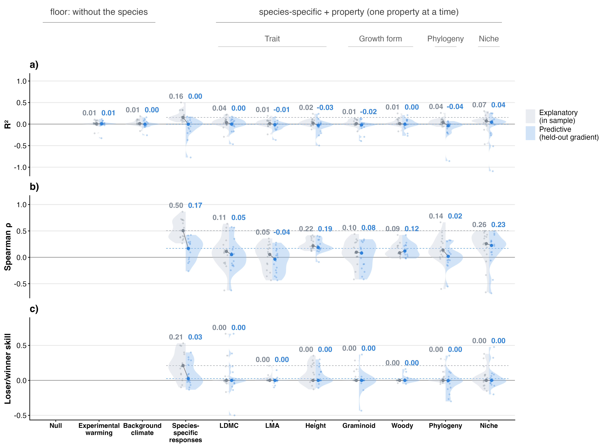
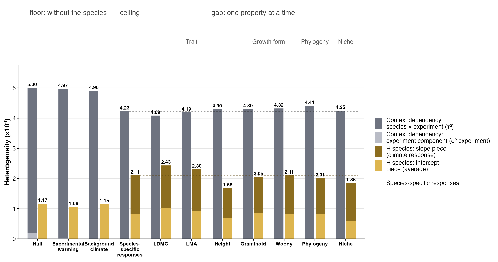
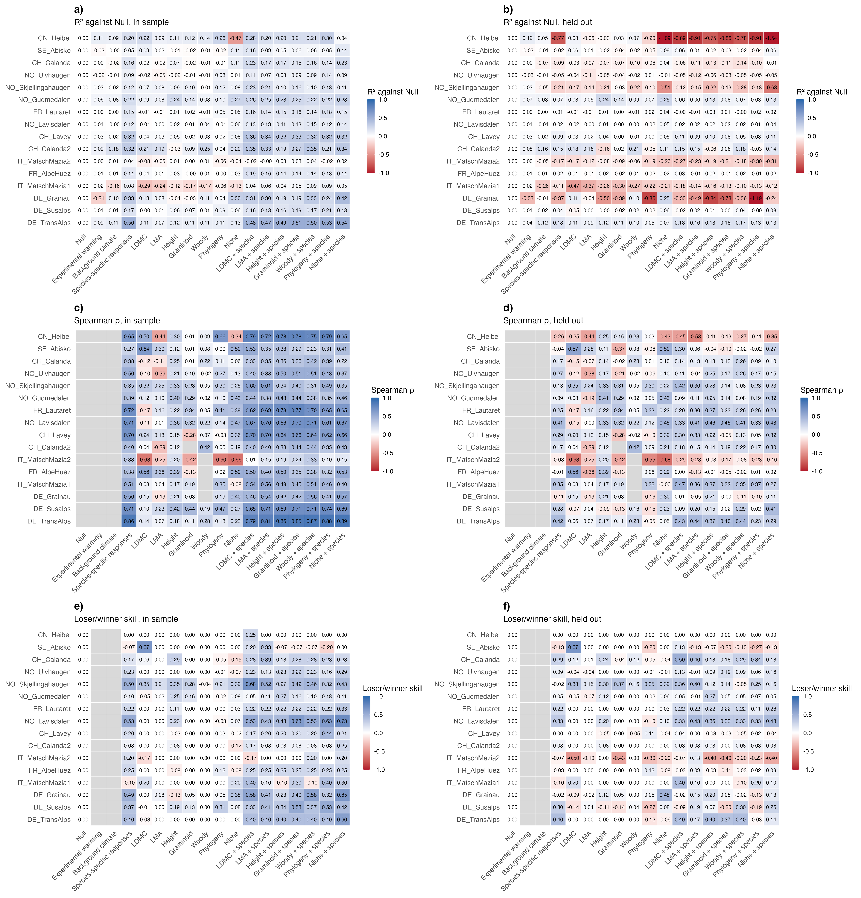

# Step 06: The ladder, predicted (Step D, route 2, residents)

Every level of the ladder was refitted 16 times on the 512 ladder rows of step 05, each time without one of the 16 gradients that have at least 5 effects, and asked to predict the strengths of the gradient left out: Null, Experimental warming, Background climate, Species-specific responses and one level per property (without abundance, Bills 7 Nov), 176 fold fits on 4 cores (70 fit-minutes). Predictions are fixed effects only, the experiment term at its expected value zero; Species-specific responses adds each species' intercept and slope deviations learnt from the training gradients (zero for a species not seen there), and the seven supplement levels add the same to each property model. Each level is scored per gradient by R² against the Null model on the same gradient (1 − its error / the Null's error, so Null is 0), Spearman ρ within the gradient and loser/winner skill, held out and in sample (step 05 full-data fits, the same rule), then summarised by the median over gradients (Bills, 2 Nov).

## Counts

20 gradients train; the 16 with at least 5 effects are held out and scored, each in one fold (Bills, 2 Nov). Effects and species per gradient:

| gradient_id | effects | species | held_out |
| --- | --- | --- | --- |
| CH_Calanda | 28 | 23 | yes |
| CH_Calanda2 | 22 | 22 | yes |
| CH_Lavey | 54 | 18 | yes |
| CN_Damxung | 1 | 1 | no (fewer than 5 effects; trains only) |
| CN_Gongga | 4 | 2 | no (fewer than 5 effects; trains only) |
| CN_Heibei | 11 | 5 | yes |
| DE_Grainau | 23 | 23 | yes |
| DE_Susalps | 94 | 23 | yes |
| DE_TransAlps | 37 | 35 | yes |
| FR_AlpeHuez | 18 | 18 | yes |
| FR_Lautaret | 22 | 22 | yes |
| IT_MatschMazia1 | 15 | 15 | yes |
| IT_MatschMazia2 | 11 | 11 | yes |
| NO_Gudmedalen | 38 | 28 | yes |
| NO_Lavisdalen | 39 | 34 | yes |
| NO_Skjellingahaugen | 36 | 24 | yes |
| NO_Ulvhaugen | 38 | 32 | yes |
| SE_Abisko | 18 | 10 | yes |
| US_Colorado | 2 | 2 | no (fewer than 5 effects; trains only) |
| US_Montana | 1 | 1 | no (fewer than 5 effects; trains only) |

## Fold fits

| level | folds | converged | warm start | fallback to nlminb | bobyqa retries | median minutes | max minutes |
| --- | --- | --- | --- | --- | --- | --- | --- |
| Null | 16 | 16 | 0 | 0 | 0 | 0.1 | 0.3 |
| Experimental warming | 16 | 16 | 0 | 0 | 0 | 0.2 | 0.4 |
| Background climate | 16 | 16 | 0 | 0 | 0 | 0.3 | 0.4 |
| Species-specific responses | 16 | 16 | 0 | 0 | 0 | 0.8 | 1.1 |
| LDMC | 16 | 16 | 16 | 0 | 0 | 0.6 | 0.7 |
| LMA | 16 | 16 | 16 | 0 | 0 | 0.3 | 0.6 |
| Height | 16 | 16 | 16 | 0 | 0 | 0.6 | 0.7 |
| Graminoid | 16 | 16 | 16 | 0 | 0 | 0.6 | 0.7 |
| Woody | 16 | 16 | 16 | 0 | 0 | 0.3 | 0.4 |
| Phylogeny | 16 | 16 | 16 | 0 | 0 | 0.3 | 0.5 |
| Niche | 16 | 16 | 16 | 0 | 0 | 0.3 | 0.6 |

Every fold fit converged.

## Prediction metrics, median over gradients

| level | metric | fit | pred | gradients (fit / pred) | held out better than Null |
| --- | --- | --- | --- | --- | --- |
| Null | R² against Null | 0.000 | 0.000 | 16 / 16 | 0 of 16 |
| Null | Spearman ρ |  |  | 0 / 0 |  |
| Null | loser/winner skill | 0.000 | 0.000 | 16 / 16 |  |
| Experimental warming | R² against Null | 0.008 | 0.008 | 16 / 16 | 13 of 16 |
| Experimental warming | Spearman ρ |  |  | 0 / 0 |  |
| Experimental warming | loser/winner skill |  |  | 0 / 0 |  |
| Background climate | R² against Null | 0.012 | -0.002 | 16 / 16 | 8 of 16 |
| Background climate | Spearman ρ |  |  | 0 / 0 |  |
| Background climate | loser/winner skill |  |  | 0 / 0 |  |
| Species-specific responses | R² against Null | 0.155 | -0.003 | 16 / 16 | 8 of 16 |
| Species-specific responses | Spearman ρ | 0.505 | 0.169 | 16 / 16 |  |
| Species-specific responses | loser/winner skill | 0.211 | 0.026 | 16 / 16 |  |
| LDMC | R² against Null | 0.036 | 0.000 | 16 / 16 | 8 of 16 |
| LDMC | Spearman ρ | 0.111 | 0.052 | 16 / 16 |  |
| LDMC | loser/winner skill | 0.000 | 0.000 | 16 / 16 |  |
| LMA | R² against Null | 0.013 | -0.012 | 16 / 16 | 6 of 16 |
| LMA | Spearman ρ | 0.055 | -0.035 | 16 / 16 |  |
| LMA | loser/winner skill | 0.000 | 0.000 | 16 / 16 |  |
| Height | R² against Null | 0.022 | -0.027 | 16 / 16 | 6 of 16 |
| Height | Spearman ρ | 0.218 | 0.186 | 16 / 16 |  |
| Height | loser/winner skill | 0.000 | 0.000 | 16 / 16 |  |
| Graminoid | R² against Null | 0.011 | -0.019 | 16 / 16 | 7 of 16 |
| Graminoid | Spearman ρ | 0.097 | 0.081 | 15 / 15 |  |
| Graminoid | loser/winner skill | 0.000 | 0.000 | 16 / 16 |  |
| Woody | R² against Null | 0.011 | -0.002 | 16 / 16 | 8 of 16 |
| Woody | Spearman ρ | 0.086 | 0.121 | 12 / 12 |  |
| Woody | loser/winner skill | 0.000 | 0.000 | 16 / 16 |  |
| Phylogeny | R² against Null | 0.040 | -0.038 | 16 / 16 | 5 of 16 |
| Phylogeny | Spearman ρ | 0.137 | 0.017 | 16 / 16 |  |
| Phylogeny | loser/winner skill | 0.000 | -0.004 | 16 / 16 |  |
| Niche | R² against Null | 0.072 | 0.045 | 16 / 16 | 11 of 16 |
| Niche | Spearman ρ | 0.258 | 0.225 | 16 / 16 |  |
| Niche | loser/winner skill | 0.000 | 0.000 | 16 / 16 |  |
| LDMC + species | R² against Null | 0.211 | -0.014 | 16 / 16 | 7 of 16 |
| LDMC + species | Spearman ρ | 0.533 | 0.161 | 16 / 16 |  |
| LDMC + species | loser/winner skill | 0.248 | 0.106 | 16 / 16 |  |
| LMA + species | R² against Null | 0.175 | -0.011 | 16 / 16 | 7 of 16 |
| LMA + species | Spearman ρ | 0.548 | 0.139 | 16 / 16 |  |
| LMA + species | loser/winner skill | 0.234 | 0.117 | 16 / 16 |  |
| Height + species | R² against Null | 0.157 | -0.039 | 16 / 16 | 7 of 16 |
| Height + species | Spearman ρ | 0.495 | 0.214 | 16 / 16 |  |
| Height + species | loser/winner skill | 0.225 | 0.088 | 16 / 16 |  |
| Graminoid + species | R² against Null | 0.157 | -0.017 | 16 / 16 | 7 of 16 |
| Graminoid + species | Spearman ρ | 0.448 | 0.132 | 16 / 16 |  |
| Graminoid + species | loser/winner skill | 0.263 | 0.026 | 16 / 16 |  |
| Woody + species | R² against Null | 0.156 | -0.008 | 16 / 16 | 7 of 16 |
| Woody + species | Spearman ρ | 0.507 | 0.179 | 16 / 16 |  |
| Woody + species | loser/winner skill | 0.225 | 0.026 | 16 / 16 |  |
| Phylogeny + species | R² against Null | 0.181 | -0.037 | 16 / 16 | 5 of 16 |
| Phylogeny + species | Spearman ρ | 0.470 | 0.128 | 16 / 16 |  |
| Phylogeny + species | loser/winner skill | 0.263 | 0.036 | 16 / 16 |  |
| Niche + species | R² against Null | 0.145 | 0.023 | 16 / 16 | 9 of 16 |
| Niche + species | Spearman ρ | 0.491 | 0.270 | 16 / 16 |  |
| Niche + species | loser/winner skill | 0.271 | 0.114 | 16 / 16 |  |

Gradients without a value, per level and metric:

| level | metric | reason | gradients | n |
| --- | --- | --- | --- | --- |
| Null | spearman | one prediction for every effect | CH_Calanda, CH_Calanda2, CH_Lavey, CN_Heibei, DE_Grainau, DE_Susalps, DE_TransAlps, FR_AlpeHuez, FR_Lautaret, IT_MatschMazia1, IT_MatschMazia2, NO_Gudmedalen, NO_Lavisdalen, NO_Skjellingahaugen, NO_Ulvhaugen, SE_Abisko | 16 |
| Experimental warming | skill | one prediction per experiment: undefined within a gradient | CH_Calanda, CH_Calanda2, CH_Lavey, CN_Heibei, DE_Grainau, DE_Susalps, DE_TransAlps, FR_AlpeHuez, FR_Lautaret, IT_MatschMazia1, IT_MatschMazia2, NO_Gudmedalen, NO_Lavisdalen, NO_Skjellingahaugen, NO_Ulvhaugen, SE_Abisko | 16 |
| Experimental warming | spearman | one prediction per experiment: undefined within a gradient | CH_Calanda, CH_Calanda2, CH_Lavey, CN_Heibei, DE_Grainau, DE_Susalps, DE_TransAlps, FR_AlpeHuez, FR_Lautaret, IT_MatschMazia1, IT_MatschMazia2, NO_Gudmedalen, NO_Lavisdalen, NO_Skjellingahaugen, NO_Ulvhaugen, SE_Abisko | 16 |
| Background climate | skill | one prediction per experiment: undefined within a gradient | CH_Calanda, CH_Calanda2, CH_Lavey, CN_Heibei, DE_Grainau, DE_Susalps, DE_TransAlps, FR_AlpeHuez, FR_Lautaret, IT_MatschMazia1, IT_MatschMazia2, NO_Gudmedalen, NO_Lavisdalen, NO_Skjellingahaugen, NO_Ulvhaugen, SE_Abisko | 16 |
| Background climate | spearman | one prediction per experiment: undefined within a gradient | CH_Calanda, CH_Calanda2, CH_Lavey, CN_Heibei, DE_Grainau, DE_Susalps, DE_TransAlps, FR_AlpeHuez, FR_Lautaret, IT_MatschMazia1, IT_MatschMazia2, NO_Gudmedalen, NO_Lavisdalen, NO_Skjellingahaugen, NO_Ulvhaugen, SE_Abisko | 16 |
| Graminoid | spearman | one prediction for every effect | CH_Calanda2 | 1 |
| Woody | spearman | one prediction for every effect | DE_Grainau, FR_AlpeHuez, IT_MatschMazia1, IT_MatschMazia2 | 4 |

Null's R² is 0 on every scored gradient, in sample and held out (checked): it is the reference of every R².

## Species deviations

metafor 5.0.1 gives no BLUPs for a GEN or GDIAG slope block, so the species deviations are computed by hand, jointly for every random term, as D Z′ M⁻¹ (y − Xβ) from each fit's variance components, V and β (`R/species_deviation.R`). On the step 05 all-rows Species-specific responses fit they equal `ranef()` for the species and experiment intercepts to 3.5e-17 and 5.8e-26 (checked to 1e-8). Standard deviation of the BLUPs across species on that fit: intercept 5.74e-03, W slope 2.38e-03, T slope 4.05e-03, P slope 2.78e-10, TP slope 1.78e-03. The P BLUPs are about zero because the P slope variance sits at the boundary (step 05): a BLUP is its variance times the species' weighted residual, so in practice the deviation is the species' intercept and its W, T and TP slopes.

Every held-out species had training data: each ladder species occurs in at least 3 gradients, so at least 2 remain in training (checked).

## Figures

Fig 6 a) and Fig S12. Each half violin is the 16 scored gradients (at least 5 effects); grey = explanatory (step 05 fit on all 20 gradients, the same 512 rows for every model), blue = predictive (the fold that left the gradient out); points and numbers = medians. R² = 1 − error(level) / error(Null) on that gradient, so Null is 0 and not drawn. Dashed lines from the Species-specific responses column on: its explanatory (grey) and predictive (blue) medians. Experimental warming and Background climate have no Spearman or skill: one prediction per experiment cannot order species within a gradient. Fig 6 b) is the raw heterogeneity of each model fitted in step 05 (×10⁻⁴); its change at each comparison is Fig S13 (step 05).

## Warnings captured

- metafor: "'struct' argument is disregaded since no ~ inner | outer term" (48 fold fits without slopes)

## Deviations from PLAN.md

- Species deviations from hand BLUPs (`R/species_deviation.R`), not `ranef(m)`: metafor 5.0.1 gives none for the GDIAG slope block (Bills, 2 Nov).
- Experimental warming's and Background climate's Spearman and skill are NA in every gradient (Bills, 2 and 7 Nov): with several experiments in a gradient they would rank experiments, not species.
- A fold that does not converge is refitted once with bobyqa, then NA for that level and gradient (Bills, 2 Nov); PLAN.md names no fallback.
- Property folds warm-started from the same fold's Species-specific responses fit and fitted with optim BFGS (Bills, 7 Nov, as step 05); a failing one falls back to the 2 Nov rule.
- Spearman is also NA where every prediction in the gradient is the same (MILESTONES), beside PLAN.md's fewer than 5 effects.
- Fig 6 (R², raw heterogeneity) is written to `figures/main/fig6.png`, Spearman and skill to `figures/appendix/figS12.png`, the per-gradient view to `figures/appendix/figS15.png`; the prediction rows widen their y range to the data.
