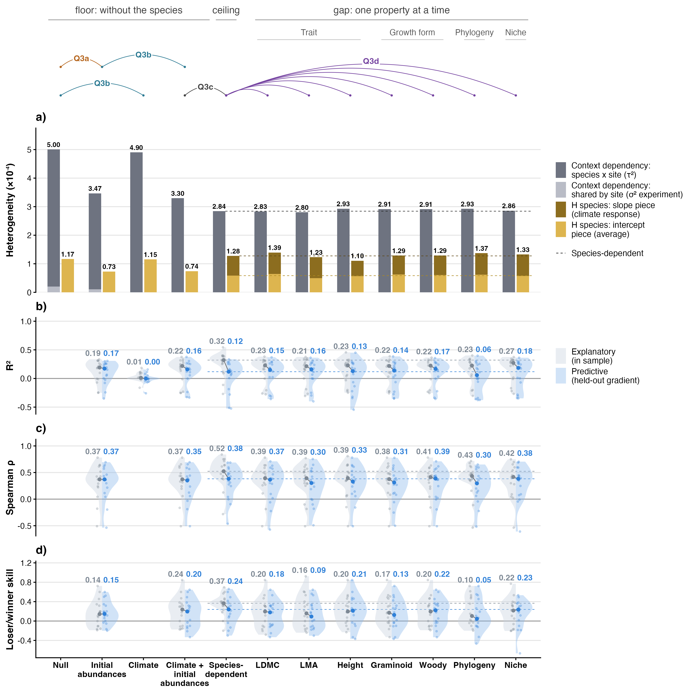
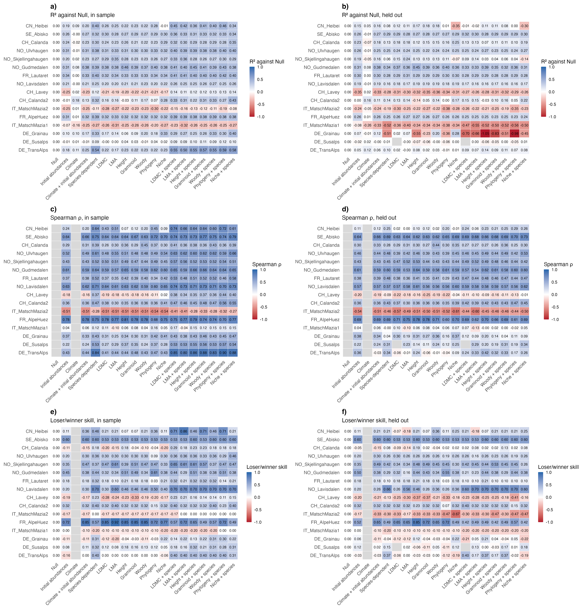

# Step 06: The ladder, predicted (Step D, route 2, residents)

Every level of the ladder was refitted 16 times on the 512 ladder rows of step 05, each time without one of the 16 gradients that have at least 5 effects, and asked to predict the strengths of the gradient left out: Null, Initial abundances, Climate, Climate + initial abundances, Species-dependent and one level per property, 192 fold fits on 7 cores (168 fit-minutes). Predictions are fixed effects only, the experiment term at its expected value zero; Species-dependent adds each species' intercept and slope deviations learnt from the training gradients (zero for a species not seen there), and the seven supplement levels add the same to each property model. Each level is scored per gradient by R² against the Null model on the same gradient (1 − its error / the Null's error, so Null is 0), Spearman ρ within the gradient and loser/winner skill, held out and in sample (step 05 full-data fits, the same rule), then summarised by the median over gradients (Bills, 2 Nov).

## Counts

20 gradients train; the 16 with at least 5 effects are held out and scored, each in one fold (Bills, 2 Nov). Effects and species per gradient:

| gradient_id | effects | species | held_out |
| --- | --- | --- | --- |
| CH_Calanda | 28 | 23 | yes |
| CH_Calanda2 | 22 | 22 | yes |
| CH_Lavey | 54 | 18 | yes |
| CN_Damxung | 1 | 1 | no (fewer than 5 effects; trains only) |
| CN_Gongga | 4 | 2 | no (fewer than 5 effects; trains only) |
| CN_Heibei | 11 | 5 | yes |
| DE_Grainau | 23 | 23 | yes |
| DE_Susalps | 94 | 23 | yes |
| DE_TransAlps | 37 | 35 | yes |
| FR_AlpeHuez | 18 | 18 | yes |
| FR_Lautaret | 22 | 22 | yes |
| IT_MatschMazia1 | 15 | 15 | yes |
| IT_MatschMazia2 | 11 | 11 | yes |
| NO_Gudmedalen | 38 | 28 | yes |
| NO_Lavisdalen | 39 | 34 | yes |
| NO_Skjellingahaugen | 36 | 24 | yes |
| NO_Ulvhaugen | 38 | 32 | yes |
| SE_Abisko | 18 | 10 | yes |
| US_Colorado | 2 | 2 | no (fewer than 5 effects; trains only) |
| US_Montana | 1 | 1 | no (fewer than 5 effects; trains only) |

## Fold fits

| level | folds | converged | bobyqa retries | median minutes | max minutes |
| --- | --- | --- | --- | --- | --- |
| Null | 16 | 16 | 0 | 0.2 | 0.4 |
| Initial abundances | 16 | 16 | 0 | 0.2 | 0.4 |
| Climate | 16 | 16 | 0 | 0.4 | 0.5 |
| Climate + initial abundances | 16 | 16 | 0 | 0.4 | 0.4 |
| Species-dependent | 16 | 16 | 0 | 1.1 | 1.3 |
| LDMC | 16 | 15 | 1 | 1.2 | 12.1 |
| LMA | 16 | 16 | 0 | 1.1 | 1.4 |
| Height | 16 | 16 | 0 | 1.1 | 1.4 |
| Graminoid | 16 | 16 | 0 | 1.1 | 1.5 |
| Woody | 16 | 16 | 0 | 1.1 | 1.2 |
| Phylogeny | 16 | 16 | 0 | 1.0 | 1.8 |
| Niche | 16 | 16 | 0 | 1.1 | 1.2 |

| level | gradient_id | nlminb error | bobyqa error |
| --- | --- | --- | --- |
| ldmc | DE_Susalps | Optimizer (nlminb) did not achieve convergence (convergence = 1). | Optimizer (minqa::bobyqa) did not achieve convergence (ierr = 1). |

Folds that needed the bobyqa retry:

| level | gradient_id | nlminb error | status |
| --- | --- | --- | --- |
| ldmc | DE_Susalps | Optimizer (nlminb) did not achieve convergence (convergence = 1). | Optimizer (minqa::bobyqa) did not achieve convergence (ierr = 1). |

## Prediction metrics, median over gradients

| level | metric | fit | pred | gradients (fit / pred) | held out better than Null |
| --- | --- | --- | --- | --- | --- |
| Null | R² against Null | 0.000 | 0.000 | 16 / 16 | 0 of 16 |
| Null | Spearman ρ |  |  | 0 / 0 |  |
| Null | loser/winner skill | 0.000 | 0.000 | 16 / 16 |  |
| Initial abundances | R² against Null | 0.192 | 0.172 | 16 / 16 | 12 of 16 |
| Initial abundances | Spearman ρ | 0.372 | 0.371 | 16 / 16 |  |
| Initial abundances | loser/winner skill | 0.143 | 0.147 | 16 / 16 |  |
| Climate | R² against Null | 0.012 | -0.002 | 16 / 16 | 8 of 16 |
| Climate | Spearman ρ |  |  | 0 / 0 |  |
| Climate | loser/winner skill |  |  | 0 / 0 |  |
| Climate + initial abundances | R² against Null | 0.219 | 0.158 | 16 / 16 | 12 of 16 |
| Climate + initial abundances | Spearman ρ | 0.372 | 0.353 | 16 / 16 |  |
| Climate + initial abundances | loser/winner skill | 0.238 | 0.197 | 16 / 16 |  |
| Species-dependent | R² against Null | 0.321 | 0.118 | 16 / 16 | 12 of 16 |
| Species-dependent | Spearman ρ | 0.524 | 0.382 | 16 / 16 |  |
| Species-dependent | loser/winner skill | 0.367 | 0.239 | 16 / 16 |  |
| LDMC | R² against Null | 0.229 | 0.150 | 16 / 15 | 12 of 15 |
| LDMC | Spearman ρ | 0.393 | 0.365 | 16 / 15 |  |
| LDMC | loser/winner skill | 0.197 | 0.179 | 16 / 15 |  |
| LMA | R² against Null | 0.214 | 0.158 | 16 / 16 | 11 of 16 |
| LMA | Spearman ρ | 0.393 | 0.303 | 16 / 16 |  |
| LMA | loser/winner skill | 0.158 | 0.093 | 16 / 16 |  |
| Height | R² against Null | 0.229 | 0.128 | 16 / 16 | 10 of 16 |
| Height | Spearman ρ | 0.394 | 0.332 | 16 / 16 |  |
| Height | loser/winner skill | 0.197 | 0.214 | 16 / 16 |  |
| Graminoid | R² against Null | 0.218 | 0.138 | 16 / 16 | 11 of 16 |
| Graminoid | Spearman ρ | 0.376 | 0.313 | 16 / 16 |  |
| Graminoid | loser/winner skill | 0.171 | 0.125 | 16 / 16 |  |
| Woody | R² against Null | 0.224 | 0.168 | 16 / 16 | 12 of 16 |
| Woody | Spearman ρ | 0.412 | 0.387 | 16 / 16 |  |
| Woody | loser/winner skill | 0.197 | 0.222 | 16 / 16 |  |
| Phylogeny | R² against Null | 0.226 | 0.058 | 16 / 16 | 10 of 16 |
| Phylogeny | Spearman ρ | 0.435 | 0.297 | 16 / 16 |  |
| Phylogeny | loser/winner skill | 0.104 | 0.046 | 16 / 16 |  |
| Niche | R² against Null | 0.272 | 0.184 | 16 / 16 | 11 of 16 |
| Niche | Spearman ρ | 0.417 | 0.383 | 16 / 16 |  |
| Niche | loser/winner skill | 0.217 | 0.235 | 16 / 16 |  |
| LDMC + species | R² against Null | 0.333 | 0.133 | 16 / 15 | 10 of 15 |
| LDMC + species | Spearman ρ | 0.553 | 0.421 | 16 / 15 |  |
| LDMC + species | loser/winner skill | 0.382 | 0.214 | 16 / 15 |  |
| LMA + species | R² against Null | 0.319 | 0.138 | 16 / 16 | 11 of 16 |
| LMA + species | Spearman ρ | 0.548 | 0.359 | 16 / 16 |  |
| LMA + species | loser/winner skill | 0.303 | 0.149 | 16 / 16 |  |
| Height + species | R² against Null | 0.286 | 0.091 | 16 / 16 | 10 of 16 |
| Height + species | Spearman ρ | 0.537 | 0.421 | 16 / 16 |  |
| Height + species | loser/winner skill | 0.345 | 0.239 | 16 / 16 |  |
| Graminoid + species | R² against Null | 0.291 | 0.104 | 16 / 16 | 11 of 16 |
| Graminoid + species | Spearman ρ | 0.548 | 0.378 | 16 / 16 |  |
| Graminoid + species | loser/winner skill | 0.327 | 0.192 | 16 / 16 |  |
| Woody + species | R² against Null | 0.326 | 0.106 | 16 / 16 | 12 of 16 |
| Woody + species | Spearman ρ | 0.527 | 0.392 | 16 / 16 |  |
| Woody + species | loser/winner skill | 0.367 | 0.239 | 16 / 16 |  |
| Phylogeny + species | R² against Null | 0.297 | 0.058 | 16 / 16 | 11 of 16 |
| Phylogeny + species | Spearman ρ | 0.566 | 0.356 | 16 / 16 |  |
| Phylogeny + species | loser/winner skill | 0.298 | 0.126 | 16 / 16 |  |
| Niche + species | R² against Null | 0.348 | 0.122 | 16 / 16 | 10 of 16 |
| Niche + species | Spearman ρ | 0.565 | 0.382 | 16 / 16 |  |
| Niche + species | loser/winner skill | 0.307 | 0.215 | 16 / 16 |  |

Gradients without a value, per level and metric:

| level | metric | reason | gradients | n |
| --- | --- | --- | --- | --- |
| Null | spearman | one prediction for every effect | CH_Calanda, CH_Calanda2, CH_Lavey, CN_Heibei, DE_Grainau, DE_Susalps, DE_TransAlps, FR_AlpeHuez, FR_Lautaret, IT_MatschMazia1, IT_MatschMazia2, NO_Gudmedalen, NO_Lavisdalen, NO_Skjellingahaugen, NO_Ulvhaugen, SE_Abisko | 16 |
| Climate | skill | Climate: undefined within a gradient | CH_Calanda, CH_Calanda2, CH_Lavey, CN_Heibei, DE_Grainau, DE_Susalps, DE_TransAlps, FR_AlpeHuez, FR_Lautaret, IT_MatschMazia1, IT_MatschMazia2, NO_Gudmedalen, NO_Lavisdalen, NO_Skjellingahaugen, NO_Ulvhaugen, SE_Abisko | 16 |
| Climate | spearman | Climate: undefined within a gradient | CH_Calanda, CH_Calanda2, CH_Lavey, CN_Heibei, DE_Grainau, DE_Susalps, DE_TransAlps, FR_AlpeHuez, FR_Lautaret, IT_MatschMazia1, IT_MatschMazia2, NO_Gudmedalen, NO_Lavisdalen, NO_Skjellingahaugen, NO_Ulvhaugen, SE_Abisko | 16 |
| LDMC | r2 | fold fit failed | DE_Susalps | 1 |
| LDMC | skill | fold fit failed | DE_Susalps | 1 |
| LDMC | spearman | fold fit failed | DE_Susalps | 1 |
| LDMC + species | r2 | fold fit failed | DE_Susalps | 1 |
| LDMC + species | skill | fold fit failed | DE_Susalps | 1 |
| LDMC + species | spearman | fold fit failed | DE_Susalps | 1 |

Null's R² is 0 on every scored gradient, in sample and held out (checked): it is the reference of every R².

## Species deviations

metafor 5.0.1 gives no BLUPs for a GEN or GDIAG slope block, so the species deviations are computed by hand, jointly for every random term, as D Z′ M⁻¹ (y − Xβ) from each fit's variance components, V and β (`R/species_deviation.R`). On the step 05 all-rows Species-dependent fit they equal `ranef()` for the species and experiment intercepts to 1.4e-17 and 1.0e-24 (checked to 1e-8). Standard deviation of the BLUPs across species on that fit: intercept 4.82e-03, W slope 2.94e-03, T slope 1.37e-03, P slope 3.11e-11, TP slope 1.32e-03. The P BLUPs are about zero because the P slope variance sits at the boundary (step 05): a BLUP is its variance times the species' weighted residual, so in practice the deviation is the species' intercept and its W, T and TP slopes.

Every held-out species had training data: each ladder species occurs in at least 3 gradients, so at least 2 remain in training (checked).

## Figures

Fig 6. Row a): step 05, every column on the same 512 rows; dashed lines carry Species-dependent across the property columns. Rows b) to d): each half violin is the 16 scored gradients (at least 5 effects); grey = explanatory (step 05 fit on all 20 gradients), blue = predictive (the fold that left the gradient out); points and numbers = medians. R² = 1 − error(level) / error(Null) on that gradient, so Null is 0 and not drawn. Dashed lines from the Species-dependent column on: its explanatory (grey) and predictive (blue) medians. Climate has no Spearman or skill: one climate per experiment cannot order species within a gradient.

## Warnings captured

- metafor: "'struct' argument is disregaded since no ~ inner | outer term" (64 fold fits without slopes)

## Deviations from PLAN.md

- Species deviations from hand BLUPs (`R/species_deviation.R`), not `ranef(m)`: metafor 5.0.1 gives none for the GDIAG slope block (Bills, 2 Nov).
- Climate's Spearman and skill are NA in every gradient (Bills, 2 Nov): with several experiments in a gradient they would rank experiments, not species.
- A fold that does not converge is refitted once with bobyqa, then NA for that level and gradient (Bills, 2 Nov); PLAN.md names no fallback.
- Spearman is also NA where every prediction in the gradient is the same (MILESTONES), beside PLAN.md's fewer than 5 effects.
- The ladder figure is written to `figures/main/fig6.png` (main Fig 6), the per-gradient view to `figures/appendix/`; the ladder's prediction rows widen their y range to the data.
