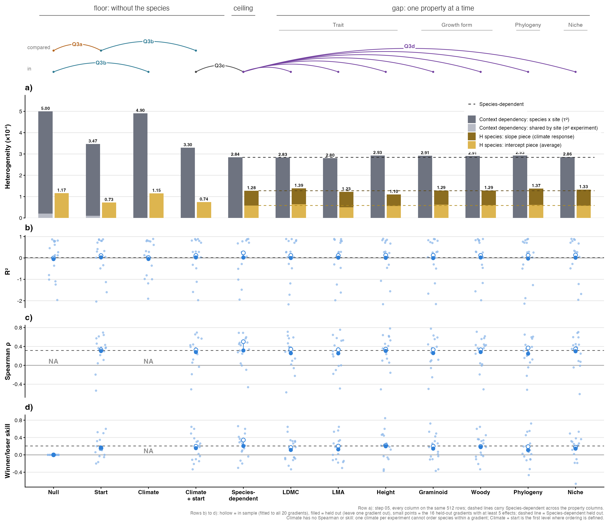
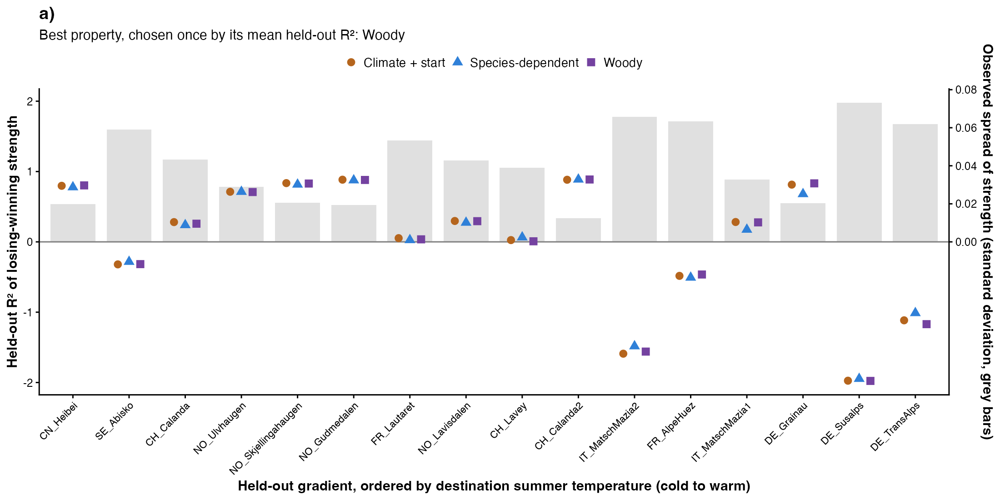
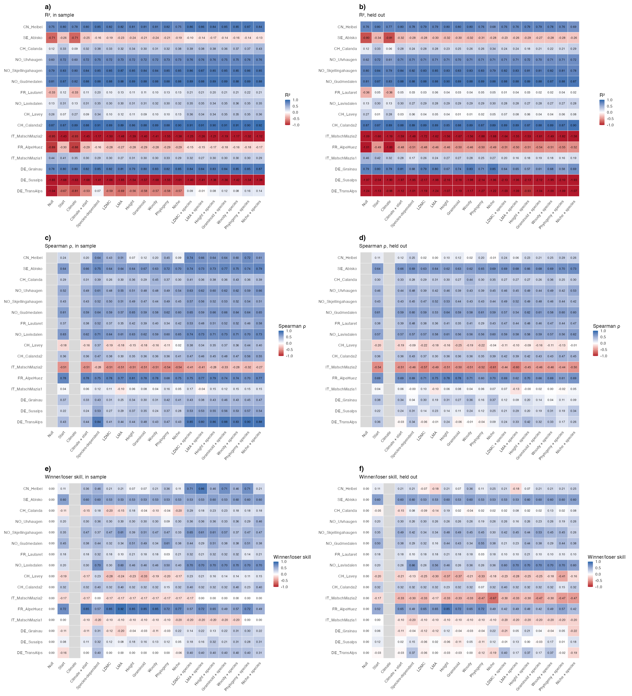

# Step 06: The ladder, predicted (Step D, route 2, residents)

Every level of the ladder was refitted 16 times on the 512 ladder rows of step 05, each time without one of the 16 gradients that have at least 5 effects, and asked to predict the strengths of the gradient left out: Null, Start, Climate, Climate + start, Species-dependent and one level per property, 192 fold fits on 7 cores (155 fit-minutes). Predictions are fixed effects only, the experiment term at its expected value zero; Species-dependent adds each species' intercept and slope deviations learnt from the training gradients (zero for a species not seen there), and the seven supplement levels add the same to each property model. Each level is scored per gradient by R² against the training yardstick, Spearman ρ within the gradient and winner/loser skill, held out and in sample (step 05 full-data fits, the same rule), then averaged over gradients with equal weight.

## Counts

20 gradients train; the 16 with at least 5 effects are held out and scored, each in one fold (Bills, 2 Nov). Effects and species per gradient:

| gradient_id | effects | species | held_out |
| --- | --- | --- | --- |
| CH_Calanda | 28 | 23 | yes |
| CH_Calanda2 | 22 | 22 | yes |
| CH_Lavey | 54 | 18 | yes |
| CN_Damxung | 1 | 1 | no (fewer than 5 effects; trains only) |
| CN_Gongga | 4 | 2 | no (fewer than 5 effects; trains only) |
| CN_Heibei | 11 | 5 | yes |
| DE_Grainau | 23 | 23 | yes |
| DE_Susalps | 94 | 23 | yes |
| DE_TransAlps | 37 | 35 | yes |
| FR_AlpeHuez | 18 | 18 | yes |
| FR_Lautaret | 22 | 22 | yes |
| IT_MatschMazia1 | 15 | 15 | yes |
| IT_MatschMazia2 | 11 | 11 | yes |
| NO_Gudmedalen | 38 | 28 | yes |
| NO_Lavisdalen | 39 | 34 | yes |
| NO_Skjellingahaugen | 36 | 24 | yes |
| NO_Ulvhaugen | 38 | 32 | yes |
| SE_Abisko | 18 | 10 | yes |
| US_Colorado | 2 | 2 | no (fewer than 5 effects; trains only) |
| US_Montana | 1 | 1 | no (fewer than 5 effects; trains only) |

## Fold fits

| level | folds | converged | bobyqa retries | median minutes | max minutes |
| --- | --- | --- | --- | --- | --- |
| Null | 16 | 16 | 0 | 0.2 | 0.4 |
| Start | 16 | 16 | 0 | 0.2 | 0.4 |
| Climate | 16 | 16 | 0 | 0.4 | 0.5 |
| Climate + start | 16 | 16 | 0 | 0.4 | 0.4 |
| Species-dependent | 16 | 16 | 0 | 1.1 | 1.2 |
| LDMC | 16 | 16 | 0 | 1.1 | 1.7 |
| LMA | 16 | 16 | 0 | 1.1 | 1.4 |
| Height | 16 | 16 | 0 | 1.1 | 1.6 |
| Graminoid | 16 | 16 | 0 | 1.1 | 1.5 |
| Woody | 16 | 16 | 0 | 1.1 | 1.2 |
| Phylogeny | 16 | 16 | 0 | 1.0 | 1.8 |
| Niche | 16 | 16 | 0 | 1.1 | 1.2 |

Every fold fit converged.

## Prediction metrics, mean over gradients

| level | metric | fit | pred | gradients (fit / pred) |
| --- | --- | --- | --- | --- |
| Null | R² | -0.002 | -0.052 | 16 / 16 |
| Null | Spearman ρ |  |  | 0 / 0 |
| Null | skill | 0.000 | 0.000 | 16 / 16 |
| Start | R² | 0.111 | 0.025 | 16 / 16 |
| Start | Spearman ρ | 0.329 | 0.302 | 16 / 16 |
| Start | skill | 0.155 | 0.168 | 16 / 16 |
| Climate | R² | 0.016 | -0.048 | 16 / 16 |
| Climate | Spearman ρ |  |  | 0 / 0 |
| Climate | skill |  |  | 0 / 0 |
| Climate + start | R² | 0.117 | 0.024 | 16 / 16 |
| Climate + start | Spearman ρ | 0.326 | 0.280 | 16 / 16 |
| Climate + start | skill | 0.197 | 0.155 | 16 / 16 |
| Species-dependent | R² | 0.239 | 0.019 | 16 / 16 |
| Species-dependent | Spearman ρ | 0.501 | 0.315 | 16 / 16 |
| Species-dependent | skill | 0.342 | 0.205 | 16 / 16 |
| LDMC | R² | 0.118 | -0.003 | 16 / 16 |
| LDMC | Spearman ρ | 0.341 | 0.257 | 16 / 16 |
| LDMC | skill | 0.170 | 0.113 | 16 / 16 |
| LMA | R² | 0.113 | 0.014 | 16 / 16 |
| LMA | Spearman ρ | 0.330 | 0.254 | 16 / 16 |
| LMA | skill | 0.202 | 0.126 | 16 / 16 |
| Height | R² | 0.131 | 0.004 | 16 / 16 |
| Height | Spearman ρ | 0.343 | 0.305 | 16 / 16 |
| Height | skill | 0.217 | 0.198 | 16 / 16 |
| Graminoid | R² | 0.125 | -0.007 | 16 / 16 |
| Graminoid | Spearman ρ | 0.332 | 0.259 | 16 / 16 |
| Graminoid | skill | 0.200 | 0.144 | 16 / 16 |
| Woody | R² | 0.120 | 0.020 | 16 / 16 |
| Woody | Spearman ρ | 0.329 | 0.281 | 16 / 16 |
| Woody | skill | 0.195 | 0.178 | 16 / 16 |
| Phylogeny | R² | 0.123 | -0.028 | 16 / 16 |
| Phylogeny | Spearman ρ | 0.368 | 0.247 | 16 / 16 |
| Phylogeny | skill | 0.190 | 0.111 | 16 / 16 |
| Niche | R² | 0.136 | 0.011 | 16 / 16 |
| Niche | Spearman ρ | 0.348 | 0.298 | 16 / 16 |
| Niche | skill | 0.176 | 0.143 | 16 / 16 |
| LDMC + species | R² | 0.247 | -0.003 | 16 / 16 |
| LDMC + species | Spearman ρ | 0.512 | 0.310 | 16 / 16 |
| LDMC + species | skill | 0.348 | 0.164 | 16 / 16 |
| LMA + species | R² | 0.231 | 0.008 | 16 / 16 |
| LMA + species | Spearman ρ | 0.473 | 0.277 | 16 / 16 |
| LMA + species | skill | 0.348 | 0.151 | 16 / 16 |
| Height + species | R² | 0.237 | -0.002 | 16 / 16 |
| Height + species | Spearman ρ | 0.502 | 0.326 | 16 / 16 |
| Height + species | skill | 0.349 | 0.212 | 16 / 16 |
| Graminoid + species | R² | 0.244 | -0.010 | 16 / 16 |
| Graminoid + species | Spearman ρ | 0.507 | 0.304 | 16 / 16 |
| Graminoid + species | skill | 0.335 | 0.173 | 16 / 16 |
| Woody + species | R² | 0.241 | 0.015 | 16 / 16 |
| Woody + species | Spearman ρ | 0.502 | 0.318 | 16 / 16 |
| Woody + species | skill | 0.332 | 0.211 | 16 / 16 |
| Phylogeny + species | R² | 0.244 | -0.030 | 16 / 16 |
| Phylogeny + species | Spearman ρ | 0.513 | 0.292 | 16 / 16 |
| Phylogeny + species | skill | 0.353 | 0.150 | 16 / 16 |
| Niche + species | R² | 0.257 | 0.009 | 16 / 16 |
| Niche + species | Spearman ρ | 0.526 | 0.332 | 16 / 16 |
| Niche + species | skill | 0.319 | 0.138 | 16 / 16 |

Gradients without a value, per level and metric:

| level | metric | reason | gradients | n |
| --- | --- | --- | --- | --- |
| Null | spearman | one prediction for every effect | CH_Calanda, CH_Calanda2, CH_Lavey, CN_Heibei, DE_Grainau, DE_Susalps, DE_TransAlps, FR_AlpeHuez, FR_Lautaret, IT_MatschMazia1, IT_MatschMazia2, NO_Gudmedalen, NO_Lavisdalen, NO_Skjellingahaugen, NO_Ulvhaugen, SE_Abisko | 16 |
| Climate | skill | Climate: undefined within a gradient | CH_Calanda, CH_Calanda2, CH_Lavey, CN_Heibei, DE_Grainau, DE_Susalps, DE_TransAlps, FR_AlpeHuez, FR_Lautaret, IT_MatschMazia1, IT_MatschMazia2, NO_Gudmedalen, NO_Lavisdalen, NO_Skjellingahaugen, NO_Ulvhaugen, SE_Abisko | 16 |
| Climate | spearman | Climate: undefined within a gradient | CH_Calanda, CH_Calanda2, CH_Lavey, CN_Heibei, DE_Grainau, DE_Susalps, DE_TransAlps, FR_AlpeHuez, FR_Lautaret, IT_MatschMazia1, IT_MatschMazia2, NO_Gudmedalen, NO_Lavisdalen, NO_Skjellingahaugen, NO_Ulvhaugen, SE_Abisko | 16 |

Null in sample: R² averaged over gradients is -1.88e-03, which is −(intercept − mean of gradient means)² / V; it is exactly zero only when the REML intercept equals the gradient-weighted mean, which PLAN.md assumes.

## Species deviations

metafor 5.0.1 gives no BLUPs for a GEN or GDIAG slope block, so the species deviations are computed by hand, jointly for every random term, as D Z′ M⁻¹ (y − Xβ) from each fit's variance components, V and β (`R/species_deviation.R`). On the step 05 all-rows Species-dependent fit they equal `ranef()` for the species and experiment intercepts to 1.4e-17 and 1.0e-24 (checked to 1e-8). Standard deviation of the BLUPs across species on that fit: intercept 4.82e-03, W slope 2.94e-03, T slope 1.37e-03, P slope 3.11e-11, TP slope 1.32e-03. The P and TP BLUPs are about zero because their variances sit at the boundary (step 05): a BLUP is its variance times the species' weighted residual, so in practice the deviation is the species' intercept, W slope and T slope.

Every held-out species had training data: each ladder species occurs in at least 3 gradients, so at least 2 remain in training (checked).

## Figures

The best property in Fig 5 is Woody, chosen once as the property level with the highest mean held-out R².

## Warnings captured

- Removed 2 rows containing missing values or values outside the scale range
(`geom_segment()`).
- Removed 2 rows containing missing values or values outside the scale range
(`geom_point()`).
- Removed 1 row containing missing values or values outside the scale range
(`geom_segment()`).
- Removed 1 row containing missing values or values outside the scale range
(`geom_point()`).

## Deviations from PLAN.md

- Species deviations from hand BLUPs (`R/species_deviation.R`), not `ranef(m)`: metafor 5.0.1 gives none for the GDIAG slope block (Bills, 2 Nov).
- Climate's Spearman and skill are NA in every gradient (Bills, 2 Nov): with several experiments in a gradient they would rank experiments, not species.
- A fold that does not converge is refitted once with bobyqa, then NA for that level and gradient (Bills, 2 Nov); PLAN.md names no fallback.
- Spearman is also NA where every prediction in the gradient is the same (MILESTONES), beside PLAN.md's fewer than 5 effects.
- Null R²fit is not exactly zero (see above); the check tests the identity instead.
- Held out and scored: only the gradients with at least 5 effects (16; Bills, 2 Nov); the other four train only. The R² yardstick V is built from scored gradients only, in sample and held out (Bills, 2 Nov): PLAN.md builds it from all training gradients, which let US_Colorado (2 effects, mean strength -0.097) inflate V by about 16% and lift every R² by about 0.14.
- Figures written to `figures/diagnostics/`; Fig 4's prediction rows widen their y range to the data.
