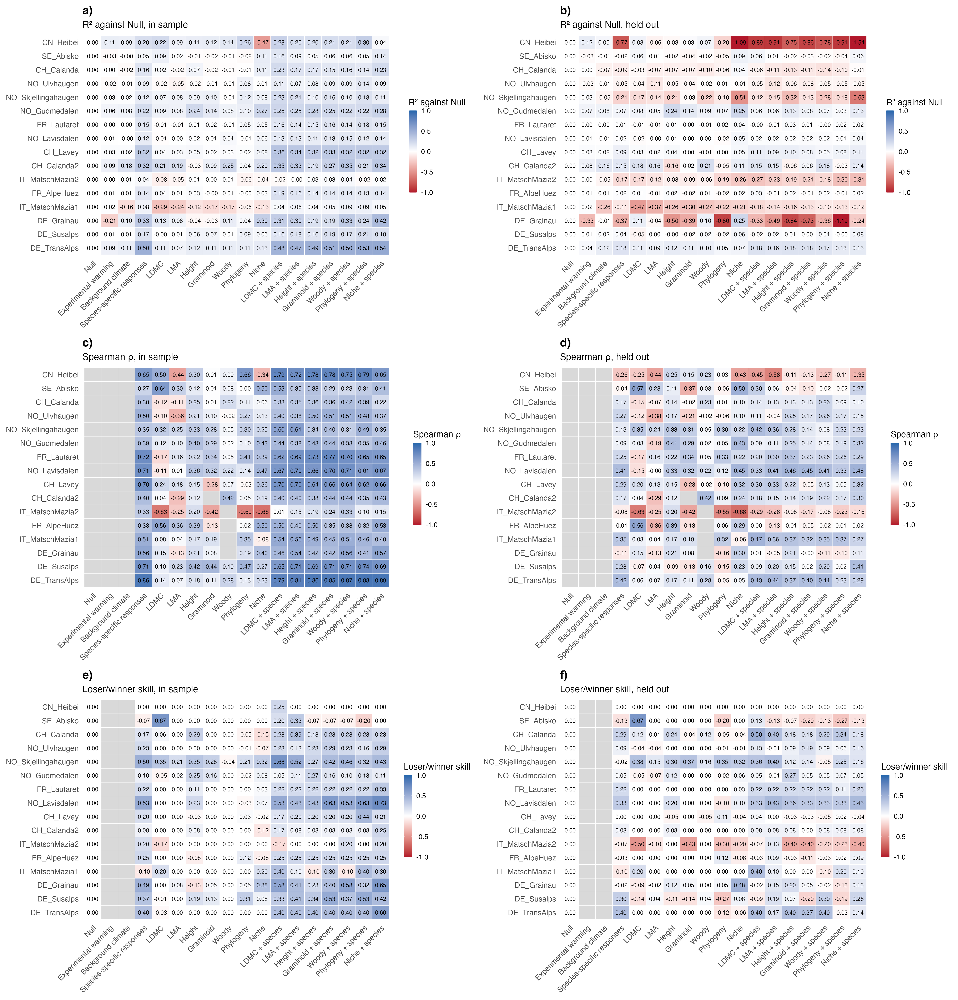

# Step 06b: Sensitivity, random forest (held out)

Every level of the ladder except Null was refitted as a random forest (ranger 0.18.0) on the 512 ladder rows of step 05, with the variables of the step 06 formulas as predictors (without abundance, Bills 7 Nov) and species as a factor in the Species-specific responses and the seven property + species forests. Each forest was fitted 16 times, once without each scored gradient, and asked to predict it, with 3000 trees, no case weights and one parameter set for every level and fold: minimum node size 40 and mtry the square root of the number of predictors, chosen from 10 settings as the one with the highest median out-of-bag R² over the 17 levels (Bills, 2 Nov). Only held-out predictions are read. They are scored as in step 06: R² against the metafor Null on the same gradient, Spearman ρ within the gradient and loser/winner skill, and set beside step 06's held-out values per gradient and as medians. The forest Null is the mean of the training effects.

## Counts

| rule | n |
| --- | --- |
| strength from year 3 (step 03b) | 1004 |
| ladder rows (step 05) | 512 |
| species | 71 |
| experiments | 39 |
| gradients training | 20 |
| gradients held out and scored (at least 5 effects) | 16 |
| forest levels | 17 |
| forests (levels x scored gradients) | 272 |

## Tuning: one parameter set for all forests

Each setting was fitted once per level on all 512 rows, and scored by its out-of-bag R² (each effect predicted by the trees that did not draw it). The setting with the highest median over the 17 levels (node40_sqrt) is used for every level and fold. Out-of-bag R² uses none of the held-out scores, so these stay unbiased; it measures prediction within known gradients (the other effects of a gradient stay in training), so its values say nothing about transfer: the forests with species score highest out of bag and lowest held out. In-sample R² would always pick the most flexible forest.

| setting | minimum node size | mtry | out-of-bag R², median over levels | lowest level | highest level | chosen |
| --- | --- | --- | --- | --- | --- | --- |
| node5_sqrt | 5 | √p | -0.030 | -0.136 | 0.070 |  |
| node5_half | 5 | p / 2 | -0.039 | -0.136 | 0.020 |  |
| node10_sqrt | 10 | √p | -0.008 | -0.114 | 0.091 |  |
| node10_half | 10 | p / 2 | -0.028 | -0.114 | 0.051 |  |
| node20_sqrt | 20 | √p | 0.009 | -0.110 | 0.117 |  |
| node20_half | 20 | p / 2 | -0.002 | -0.110 | 0.092 |  |
| node40_sqrt | 40 | √p | 0.017 | -0.098 | 0.131 | yes |
| node40_half | 40 | p / 2 | 0.005 | -0.098 | 0.118 |  |
| node80_sqrt | 80 | √p | 0.015 | -0.082 | 0.133 |  |
| node80_half | 80 | p / 2 | 0.009 | -0.082 | 0.135 |  |

## No case weights

PLAN.md's case weights 1 / SE² were dropped (Bills, 2 Nov). Precision is tied to effect size here (Spearman ρ between |strength| and SE 0.65): the most precise effects are the near-zero ones. On the 512 rows the 1 / SE² weights span a factor of 56,834, their effective number of rows, (Σw)² / Σw², is 20.5, the 5 most precise effects carry 40% of the weight and the single most precise one (Crocus vernus at DE_TransAlps) 16%; ranger draws bootstrap rows in proportion to case weights, so the weighted forests predicted about zero everywhere (first run, 2 Nov). The meta-regressions do not weight by 1 / SE² either: rma.mv, given the sampling variances only, weights by the inverse of SE² plus the random-effect variances it estimates in the same fit, which is far more even.

Spread of the forest predictions: within a held-out gradient their standard deviation is a median 31% of the observed one, and 77 of 272 forests predict one sign for every effect of the gradient (skill exactly 0 there).

## Forest beside meta-regression, held out, median over gradients

| level | metric | metafor | forest | median difference | forest higher |
| --- | --- | --- | --- | --- | --- |
| Null | R² against Null | 0.000 | 0.004 | 0.004 | 9 of 16 |
| Null | Spearman ρ |  |  |  |  |
| Null | loser/winner skill | 0.000 | 0.000 | 0.000 | 0 of 16 |
| Experimental warming | R² against Null | 0.008 | -0.048 | -0.036 | 5 of 16 |
| Experimental warming | Spearman ρ |  |  |  |  |
| Experimental warming | loser/winner skill |  |  |  |  |
| Background climate | R² against Null | -0.002 | 0.005 | 0.001 | 8 of 16 |
| Background climate | Spearman ρ |  |  |  |  |
| Background climate | loser/winner skill |  |  |  |  |
| Species-specific responses | R² against Null | -0.003 | -0.311 | -0.200 | 5 of 16 |
| Species-specific responses | Spearman ρ | 0.169 | 0.120 | -0.019 | 7 of 16 |
| Species-specific responses | loser/winner skill | 0.026 | 0.156 | 0.052 | 9 of 16 |
| LDMC | R² against Null | 0.000 | -0.005 | 0.028 | 10 of 16 |
| LDMC | Spearman ρ | 0.052 | 0.066 | 0.090 | 10 of 16 |
| LDMC | loser/winner skill | 0.000 | 0.000 | 0.000 | 6 of 16 |
| LMA | R² against Null | -0.012 | -0.028 | -0.013 | 7 of 16 |
| LMA | Spearman ρ | -0.035 | -0.031 | 0.095 | 13 of 16 |
| LMA | loser/winner skill | 0.000 | 0.000 | 0.000 | 4 of 16 |
| Height | R² against Null | -0.027 | 0.008 | 0.013 | 9 of 16 |
| Height | Spearman ρ | 0.186 | 0.187 | -0.043 | 4 of 16 |
| Height | loser/winner skill | 0.000 | 0.095 | 0.026 | 8 of 16 |
| Graminoid | R² against Null | -0.019 | -0.010 | 0.018 | 9 of 16 |
| Graminoid | Spearman ρ | 0.081 | -0.007 | 0.000 | 8 of 15 |
| Graminoid | loser/winner skill | 0.000 | 0.000 | 0.000 | 5 of 16 |
| Woody | R² against Null | -0.002 | 0.006 | 0.009 | 11 of 16 |
| Woody | Spearman ρ | 0.121 | 0.029 | -0.000 | 5 of 11 |
| Woody | loser/winner skill | 0.000 | 0.000 | 0.000 | 1 of 16 |
| Phylogeny | R² against Null | -0.038 | -0.025 | 0.017 | 9 of 16 |
| Phylogeny | Spearman ρ | 0.017 | 0.117 | 0.094 | 11 of 16 |
| Phylogeny | loser/winner skill | -0.004 | 0.121 | 0.173 | 12 of 16 |
| Niche | R² against Null | 0.045 | 0.040 | 0.016 | 9 of 16 |
| Niche | Spearman ρ | 0.225 | 0.280 | 0.031 | 9 of 16 |
| Niche | loser/winner skill | 0.000 | 0.179 | 0.108 | 11 of 16 |
| LDMC + species | R² against Null | -0.014 | -0.229 | -0.148 | 4 of 16 |
| LDMC + species | Spearman ρ | 0.161 | 0.157 | 0.028 | 9 of 16 |
| LDMC + species | loser/winner skill | 0.106 | 0.153 | -0.021 | 7 of 16 |
| LMA + species | R² against Null | -0.011 | -0.298 | -0.178 | 4 of 16 |
| LMA + species | Spearman ρ | 0.139 | 0.114 | 0.039 | 9 of 16 |
| LMA + species | loser/winner skill | 0.117 | 0.208 | 0.033 | 8 of 16 |
| Height + species | R² against Null | -0.039 | -0.250 | -0.144 | 5 of 16 |
| Height + species | Spearman ρ | 0.214 | 0.198 | -0.025 | 8 of 16 |
| Height + species | loser/winner skill | 0.088 | 0.178 | 0.073 | 11 of 16 |
| Graminoid + species | R² against Null | -0.017 | -0.253 | -0.150 | 4 of 16 |
| Graminoid + species | Spearman ρ | 0.132 | 0.161 | -0.001 | 8 of 16 |
| Graminoid + species | loser/winner skill | 0.026 | 0.068 | 0.064 | 9 of 16 |
| Woody + species | R² against Null | -0.008 | -0.270 | -0.147 | 5 of 16 |
| Woody + species | Spearman ρ | 0.179 | 0.143 | -0.017 | 5 of 16 |
| Woody + species | loser/winner skill | 0.026 | 0.182 | 0.019 | 9 of 16 |
| Phylogeny + species | R² against Null | -0.037 | -0.207 | -0.106 | 6 of 16 |
| Phylogeny + species | Spearman ρ | 0.128 | 0.209 | 0.036 | 10 of 16 |
| Phylogeny + species | loser/winner skill | 0.036 | 0.214 | 0.085 | 13 of 16 |
| Niche + species | R² against Null | 0.023 | -0.254 | -0.150 | 5 of 16 |
| Niche + species | Spearman ρ | 0.270 | 0.168 | -0.050 | 6 of 16 |
| Niche + species | loser/winner skill | 0.114 | 0.149 | 0.044 | 10 of 16 |

R² against Null, median held out: the forest is above the meta-regression at 7 of 17 levels.

## Seed check

Every forest refitted with a second seed: the largest change in a per-gradient value is 0.204 and the largest change in a median 0.089. Largest change in a median per metric: R² 0.014, Spearman ρ 0.025, skill 0.089; skill moves most because a prediction near zero can change sign between seeds.

## Figures

## Warnings captured

None.

## Deviations from PLAN.md

- No case weights, instead of 1 / SE² (Bills, 2 Nov; PLAN.md edited).
- Held-out values only, no fit values (Bills, 2 Nov; PLAN.md edited).
- No partial-dependence plots (Bills, 2 Nov; PLAN.md edited).
- Forests also for the seven property + species levels (Bills, 2 Nov).
- The figure is appendix Fig S15, written to `figures/appendix/figS15.png`.
