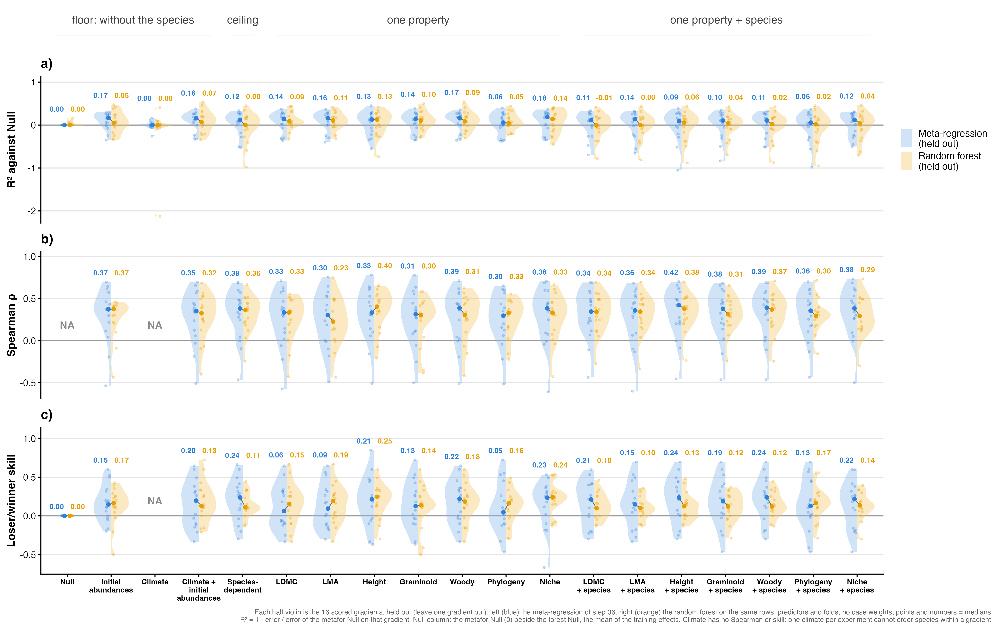

# Step 06b: Sensitivity, random forest (held out)

Every level of the ladder except Null was refitted as a random forest (ranger 0.18.0) on the 512 ladder rows of step 05, with the variables of the step 06 formulas as predictors and species as a factor in the Species-dependent and the seven property + species forests. Each forest was fitted 16 times, once without each scored gradient, and asked to predict it, with fixed settings (1000 trees, minimum node size 40, mtry the square root of the number of predictors, no case weights). Only held-out predictions are read. They are scored as in step 06: R² against the metafor Null on the same gradient, Spearman ρ within the gradient and loser/winner skill, and set beside step 06's held-out values per gradient and as medians. The forest Null is the mean of the training effects.

## Counts

| rule | n |
| --- | --- |
| strength from year 3 (step 03b) | 1004 |
| ladder rows (step 05) | 512 |
| species | 71 |
| experiments | 39 |
| gradients training | 20 |
| gradients held out and scored (at least 5 effects) | 16 |
| forest levels | 18 |
| forests (levels x scored gradients) | 288 |

## No case weights

PLAN.md's case weights 1 / SE² were dropped (Bills, 2 Nov). Precision is tied to effect size here (Spearman ρ between |strength| and SE 0.65): the most precise effects are the near-zero ones. On the 512 rows the 1 / SE² weights span a factor of 56,834, their effective number of rows, (Σw)² / Σw², is 20.5, the 5 most precise effects carry 40% of the weight and the single most precise one (Crocus vernus at DE_TransAlps) 16%; ranger draws bootstrap rows in proportion to case weights, so the weighted forests predicted about zero everywhere (first run, 2 Nov). The meta-regressions do not weight by 1 / SE² either: rma.mv, given the sampling variances only, weights by the inverse of SE² plus the random-effect variances it estimates in the same fit, which is far more even.

Spread of the forest predictions: within a held-out gradient their standard deviation is a median 38% of the observed one, and 24 of 288 forests predict one sign for every effect of the gradient (skill exactly 0 there).

## Forest beside meta-regression, held out, median over gradients

| level | metric | metafor | forest | median difference | forest higher |
| --- | --- | --- | --- | --- | --- |
| Null | R² against Null | 0.000 | 0.004 | 0.004 | 9 of 16 |
| Null | Spearman ρ |  |  |  |  |
| Null | loser/winner skill | 0.000 | 0.000 | 0.000 | 0 of 16 |
| Initial abundances | R² against Null | 0.172 | 0.052 | -0.021 | 6 of 16 |
| Initial abundances | Spearman ρ | 0.371 | 0.374 | 0.027 | 9 of 16 |
| Initial abundances | loser/winner skill | 0.147 | 0.165 | 0.004 | 9 of 16 |
| Climate | R² against Null | -0.002 | 0.003 | 0.004 | 9 of 16 |
| Climate | Spearman ρ |  |  |  |  |
| Climate | loser/winner skill |  |  |  |  |
| Climate + initial abundances | R² against Null | 0.158 | 0.073 | -0.033 | 6 of 16 |
| Climate + initial abundances | Spearman ρ | 0.353 | 0.324 | -0.014 | 8 of 16 |
| Climate + initial abundances | loser/winner skill | 0.197 | 0.129 | 0.028 | 9 of 16 |
| Species-dependent | R² against Null | 0.118 | -0.001 | -0.073 | 6 of 16 |
| Species-dependent | Spearman ρ | 0.382 | 0.363 | 0.005 | 8 of 16 |
| Species-dependent | loser/winner skill | 0.239 | 0.110 | -0.055 | 5 of 16 |
| LDMC | R² against Null | 0.140 | 0.088 | 0.027 | 10 of 16 |
| LDMC | Spearman ρ | 0.334 | 0.334 | -0.047 | 6 of 16 |
| LDMC | loser/winner skill | 0.061 | 0.155 | -0.000 | 7 of 16 |
| LMA | R² against Null | 0.158 | 0.106 | -0.017 | 7 of 16 |
| LMA | Spearman ρ | 0.303 | 0.225 | -0.023 | 7 of 16 |
| LMA | loser/winner skill | 0.093 | 0.192 | 0.067 | 9 of 16 |
| Height | R² against Null | 0.129 | 0.127 | 0.002 | 8 of 16 |
| Height | Spearman ρ | 0.332 | 0.403 | 0.025 | 11 of 16 |
| Height | loser/winner skill | 0.214 | 0.247 | 0.035 | 12 of 16 |
| Graminoid | R² against Null | 0.138 | 0.104 | 0.013 | 9 of 16 |
| Graminoid | Spearman ρ | 0.313 | 0.304 | -0.048 | 6 of 16 |
| Graminoid | loser/winner skill | 0.125 | 0.137 | -0.012 | 8 of 16 |
| Woody | R² against Null | 0.168 | 0.088 | -0.019 | 7 of 16 |
| Woody | Spearman ρ | 0.387 | 0.306 | -0.030 | 8 of 16 |
| Woody | loser/winner skill | 0.222 | 0.184 | -0.000 | 8 of 16 |
| Phylogeny | R² against Null | 0.058 | 0.048 | 0.040 | 9 of 16 |
| Phylogeny | Spearman ρ | 0.297 | 0.330 | 0.009 | 9 of 16 |
| Phylogeny | loser/winner skill | 0.046 | 0.162 | 0.121 | 10 of 16 |
| Niche | R² against Null | 0.184 | 0.142 | 0.051 | 10 of 16 |
| Niche | Spearman ρ | 0.383 | 0.331 | -0.004 | 8 of 16 |
| Niche | loser/winner skill | 0.235 | 0.239 | 0.019 | 9 of 16 |
| LDMC + species | R² against Null | 0.114 | -0.009 | -0.047 | 7 of 16 |
| LDMC + species | Spearman ρ | 0.345 | 0.344 | 0.048 | 9 of 16 |
| LDMC + species | loser/winner skill | 0.212 | 0.101 | -0.066 | 7 of 16 |
| LMA + species | R² against Null | 0.138 | 0.001 | -0.093 | 7 of 16 |
| LMA + species | Spearman ρ | 0.359 | 0.345 | 0.010 | 8 of 16 |
| LMA + species | loser/winner skill | 0.149 | 0.101 | -0.059 | 7 of 16 |
| Height + species | R² against Null | 0.091 | 0.057 | 0.005 | 8 of 16 |
| Height + species | Spearman ρ | 0.421 | 0.379 | 0.007 | 8 of 16 |
| Height + species | loser/winner skill | 0.239 | 0.127 | -0.106 | 6 of 16 |
| Graminoid + species | R² against Null | 0.104 | 0.039 | 0.017 | 8 of 16 |
| Graminoid + species | Spearman ρ | 0.378 | 0.313 | 0.035 | 8 of 16 |
| Graminoid + species | loser/winner skill | 0.192 | 0.124 | -0.068 | 7 of 16 |
| Woody + species | R² against Null | 0.106 | 0.022 | -0.073 | 7 of 16 |
| Woody + species | Spearman ρ | 0.392 | 0.370 | -0.014 | 7 of 16 |
| Woody + species | loser/winner skill | 0.239 | 0.122 | -0.049 | 5 of 16 |
| Phylogeny + species | R² against Null | 0.058 | 0.018 | -0.003 | 8 of 16 |
| Phylogeny + species | Spearman ρ | 0.356 | 0.295 | -0.003 | 8 of 16 |
| Phylogeny + species | loser/winner skill | 0.126 | 0.166 | 0.040 | 9 of 16 |
| Niche + species | R² against Null | 0.122 | 0.043 | -0.000 | 8 of 16 |
| Niche + species | Spearman ρ | 0.382 | 0.292 | -0.042 | 7 of 16 |
| Niche + species | loser/winner skill | 0.215 | 0.136 | -0.052 | 6 of 16 |

R² against Null, median held out: the forest is above the meta-regression at 8 of 18 levels.

## Seed check

Every forest refitted with a second seed: the largest change in a per-gradient value is 0.400 and the largest change in a median 0.114. Largest change in a median per metric: R² 0.026, Spearman ρ 0.048, skill 0.114; skill moves most because a prediction near zero can change sign between seeds.

## Figures

## Warnings captured

None.

## Deviations from PLAN.md

- No case weights, instead of 1 / SE² (Bills, 2 Nov; PLAN.md edited).
- Held-out values only, no fit values (Bills, 2 Nov; PLAN.md edited).
- No partial-dependence plots (Bills, 2 Nov; PLAN.md edited).
- Forests also for the seven property + species levels (Bills, 2 Nov).
- Fig S11 written to `figures/diagnostics/` so that the report can link it, as steps 05 and 06.
