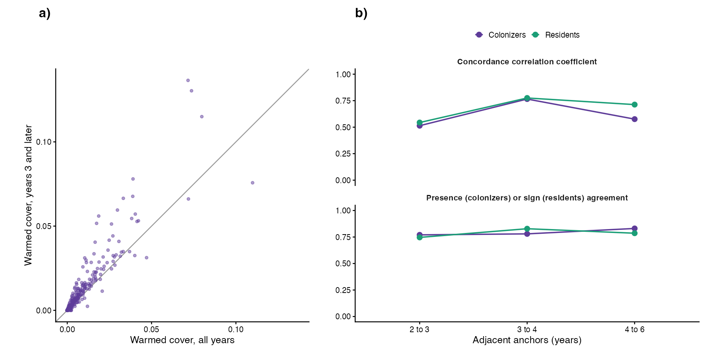
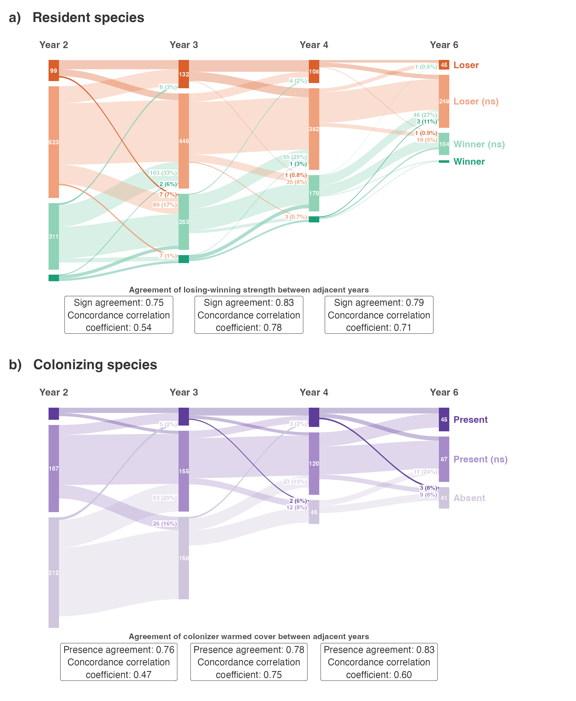

# Step 07a: Colonizer strength and presence flows (Steps A and B, colonizers)

Each of the 39 experiments with destination-pool species got one mixed model of relative cover on its destination-control and warmed plots, the residents' model (glmmTMB, one residual variance per species, plot x species random intercept; `R/fit_experiment.R`) with the destination control as reference. Colonizer strength is the warmed marginal mean, zeros kept, and A0_dest the destination-control marginal mean from the same fit, each averaged over all years and, separately, over years 3 and later; both are kept until the choice is made (Bills, 2 Nov). Each colonizer was classified at years 2, 3, 4 and 6 as absent (no cover in any warmed plot that year, from the raw data), present (warmed mean above zero at one-sided p < 0.05) or present (ns), and presence agreement and the concordance correlation of warmed cover were computed between adjacent anchors.

## Counts

| rule | n |
| --- | --- |
| colonizer effects (species x experiment) | 402 |
| species | 236 |
| experiments | 39 |
| gradients | 20 |
| effects with a strength from years 3 and later | 402 |
| species never present in a warmed plot (any gradient) | 47 |

0 effects have no strength from years 3 and later (their experiment has no survey in year 3 or later).

## Fits

| experiment_id | species | years | df_plots | warnings |
| --- | --- | --- | --- | --- |
| CH_Calanda::Cal::Nes | 0 | 1, 2, 3, 4, 5, 6 | 18 | 1 |
| CH_Calanda::Pea::Cal | 0 | 1, 2, 3, 4, 5, 6 | 18 | 1 |
| CH_Calanda2::Cal::Nes | 0 | 1, 2, 3 | 18 | 1 |
| CH_Lavey::RIO::CRE | 0 | 1, 2, 3 | 18 | 1 |
| CH_Lavey::RIO::MAR | 0 | 1, 2, 3 | 18 | 1 |
| CH_Lavey::RIO::PRA | 0 | 1, 2, 3 | 18 | 1 |
| CN_Damxung::HIGH::LOW | 0 | 1, 2, 4, 5 | 18 | 1 |
| CN_Gongga::A::M | 0 | 1, 2, 3, 4 | 12 | 1 |
| CN_Gongga::H::A | 0 | 1, 2, 3, 4 | 12 | 1 |
| CN_Gongga::H::L | 0 | 1, 2, 3, 4 | 12 | 1 |
| CN_Gongga::M::L | 0 | 1, 2, 3, 4 | 12 | 1 |
| CN_Heibei::3800::3200 | 0 | 1, 2, 3, 6, 7, 8, 9 | 4 | 1 |
| CN_Heibei::3800::3400 | 0 | 1, 2, 3, 6, 7, 8, 9 | 4 | 1 |
| DE_Grainau::HIGH::LOW | 0 | 1, 2, 3, 4 | 18 | 1 |
| DE_Susalps::EB::BT | 0 | 1, 2, 3, 4 | 16 | 1 |
| DE_Susalps::EB::FE | 0 | 1, 2, 3, 4 | 16 | 1 |
| DE_Susalps::EB::GW | 0 | 1, 2, 3, 4 | 16 | 1 |
| DE_Susalps::FE::BT | 0 | 1, 2, 3, 4 | 16 | 1 |
| DE_Susalps::GW::FE | 0 | 1, 2, 3, 4 | 16 | 1 |
| DE_TransAlps::FP::BT | 0 | 1, 2, 3, 4 | 16 | 1 |
| DE_TransAlps::SP::BT | 0 | 1, 2, 3, 4 | 16 | 1 |
| FR_AlpeHuez::HIGH::LOW | 0 | 1, 2, 3, 4, 5, 6, 7, 8, 9 | 18 | 1 |
| FR_Lautaret::G::L | 0 | 1, 2, 5, 6 | 18 | 1 |
| IT_MatschMazia1::High::Low | 0 | 1, 2, 3 | 4 | 1 |
| IT_MatschMazia2::High::Low | 0 | 1, 2, 3 | 16 | 1 |
| NO_Gudmedalen::Rambera::Arhelleren | 0 | 2, 3, 4, 6, 8 | 8 | 1 |
| NO_Lavisdalen::Hogsete::Vikesland | 0 | 2, 3, 4, 6, 8 | 8 | 1 |
| NO_Lavisdalen::Lavisdalen::Hogsete | 0 | 2, 3, 4, 6, 8 | 8 | 1 |
| NO_Skjellingahaugen::Skjellingahaugen::Veskre | 0 | 2, 3, 4, 6, 8 | 8 | 1 |
| NO_Skjellingahaugen::Veskre::Ovstedal | 0 | 2, 3, 4, 6, 8 | 8 | 1 |
| NO_Ulvhaugen::Alrust::Fauske | 0 | 2, 3, 4, 6, 8 | 8 | 1 |
| NO_Ulvhaugen::Ulvhaugen::Alrust | 0 | 2, 3, 4, 6, 8 | 8 | 1 |
| SE_Abisko::High::Low | 0 | 1, 2, 3 | 8 | 1 |
| SE_Abisko::High::Mid | 0 | 1, 2, 3 | 8 | 1 |
| SE_Abisko::Mid::Low | 0 | 1, 2, 3 | 8 | 1 |
| US_Colorado::mo::pf | 0 | 1, 2, 4, 5, 6 | 10 | 1 |
| US_Colorado::mo::um | 0 | 1, 2, 4, 5, 6 | 11 | 1 |
| US_Colorado::pf::um | 0 | 1, 2, 4, 5, 6 | 10 | 1 |
| US_Montana::High::Low | 0 | 1, 2, 5 | 18 | 1 |

## Presence classes per anchor

| year | combinations | Present | Present (ns) | Absent |
| --- | --- | --- | --- | --- |
| 2 | 402 | 23 | 167 | 212 |
| 3 | 347 | 34 | 155 | 158 |
| 4 | 203 | 37 | 120 | 46 |
| 6 | 173 | 45 | 87 | 41 |

## Stability between anchors (`stability.csv`)

| pair | n | presence_agreement | ccc |
| --- | --- | --- | --- |
| 2 to 3 | 347 | 0.758 | 0.474 |
| 3 to 4 | 181 | 0.779 | 0.748 |
| 4 to 6 | 137 | 0.832 | 0.602 |

Residents (step 03), for the year-3 read: 2 to 3 sign agreement 0.75, CCC 0.54; 3 to 4 sign agreement 0.83, CCC 0.78; 4 to 6 sign agreement 0.79, CCC 0.71.

All years against years 3 and later, on the 402 effects with both: Pearson r 0.904, concordance correlation 0.840.

## Fig 1

Panel a is step 03's, redrawn from its saved classes and flows with the same code; panel b the colonizers below it (Bills, 2 Nov). Ribbons between absent and present are labelled where they enter the next anchor, with their count and their share of the class they started from; those that start or end in Present are drawn darker.

## Never present

47 colonizer species never appear in a warmed plot of any experiment where they are in the pool; 45 of them occur in one gradient and none in three or more, so none enters Step C (`never_present.csv`).

## Warnings captured

- CH_Calanda::Cal::Nes: NOTE: Results may be misleading due to involvement in interactions
- CH_Calanda::Pea::Cal: NOTE: Results may be misleading due to involvement in interactions
- CH_Calanda2::Cal::Nes: NOTE: Results may be misleading due to involvement in interactions
- CH_Lavey::RIO::CRE: NOTE: Results may be misleading due to involvement in interactions
- CH_Lavey::RIO::MAR: NOTE: Results may be misleading due to involvement in interactions
- CH_Lavey::RIO::PRA: NOTE: Results may be misleading due to involvement in interactions
- CN_Damxung::HIGH::LOW: NOTE: Results may be misleading due to involvement in interactions
- CN_Gongga::A::M: NOTE: Results may be misleading due to involvement in interactions
- CN_Gongga::H::A: NOTE: Results may be misleading due to involvement in interactions
- CN_Gongga::H::L: NOTE: Results may be misleading due to involvement in interactions
- CN_Gongga::M::L: NOTE: Results may be misleading due to involvement in interactions
- CN_Heibei::3800::3200: NOTE: Results may be misleading due to involvement in interactions
- CN_Heibei::3800::3400: NOTE: Results may be misleading due to involvement in interactions
- DE_Grainau::HIGH::LOW: NOTE: Results may be misleading due to involvement in interactions
- DE_Susalps::EB::BT: NOTE: Results may be misleading due to involvement in interactions
- DE_Susalps::EB::FE: NOTE: Results may be misleading due to involvement in interactions
- DE_Susalps::EB::GW: NOTE: Results may be misleading due to involvement in interactions
- DE_Susalps::FE::BT: NOTE: Results may be misleading due to involvement in interactions
- DE_Susalps::GW::FE: NOTE: Results may be misleading due to involvement in interactions
- DE_TransAlps::FP::BT: NOTE: Results may be misleading due to involvement in interactions
- DE_TransAlps::SP::BT: NOTE: Results may be misleading due to involvement in interactions
- FR_AlpeHuez::HIGH::LOW: NOTE: Results may be misleading due to involvement in interactions
- FR_Lautaret::G::L: NOTE: Results may be misleading due to involvement in interactions
- IT_MatschMazia1::High::Low: NOTE: Results may be misleading due to involvement in interactions
- IT_MatschMazia2::High::Low: NOTE: Results may be misleading due to involvement in interactions
- NO_Gudmedalen::Rambera::Arhelleren: NOTE: Results may be misleading due to involvement in interactions
- NO_Lavisdalen::Hogsete::Vikesland: NOTE: Results may be misleading due to involvement in interactions
- NO_Lavisdalen::Lavisdalen::Hogsete: NOTE: Results may be misleading due to involvement in interactions
- NO_Skjellingahaugen::Skjellingahaugen::Veskre: NOTE: Results may be misleading due to involvement in interactions
- NO_Skjellingahaugen::Veskre::Ovstedal: NOTE: Results may be misleading due to involvement in interactions
- NO_Ulvhaugen::Alrust::Fauske: NOTE: Results may be misleading due to involvement in interactions
- NO_Ulvhaugen::Ulvhaugen::Alrust: NOTE: Results may be misleading due to involvement in interactions
- SE_Abisko::High::Low: NOTE: Results may be misleading due to involvement in interactions
- SE_Abisko::High::Mid: NOTE: Results may be misleading due to involvement in interactions
- SE_Abisko::Mid::Low: NOTE: Results may be misleading due to involvement in interactions
- US_Colorado::mo::pf: NOTE: Results may be misleading due to involvement in interactions
- US_Colorado::mo::um: NOTE: Results may be misleading due to involvement in interactions
- US_Colorado::pf::um: NOTE: Results may be misleading due to involvement in interactions
- US_Montana::High::Low: NOTE: Results may be misleading due to involvement in interactions
- NOTE: Results may be misleading due to involvement in interactions
- The `label.size` argument of `geom_label()` is deprecated as of ggplot2 3.5.0.
ℹ Please use the `linewidth` argument instead.

## Deviations from PLAN.md

- The residents' glmmTMB model with one residual variance per species, not PLAN.md's `lmer` for colonizers (Bills, 2 Nov).
- Strength kept twice, all years and years 3 and later, until the stability is read (Bills, 2 Nov).
- Presence is tested one-sided (warmed mean above zero); PLAN.md's `test()` call leaves the side open.
- Figures written to `figures/main/` and `figures/diagnostics/` so that the report can link them.
