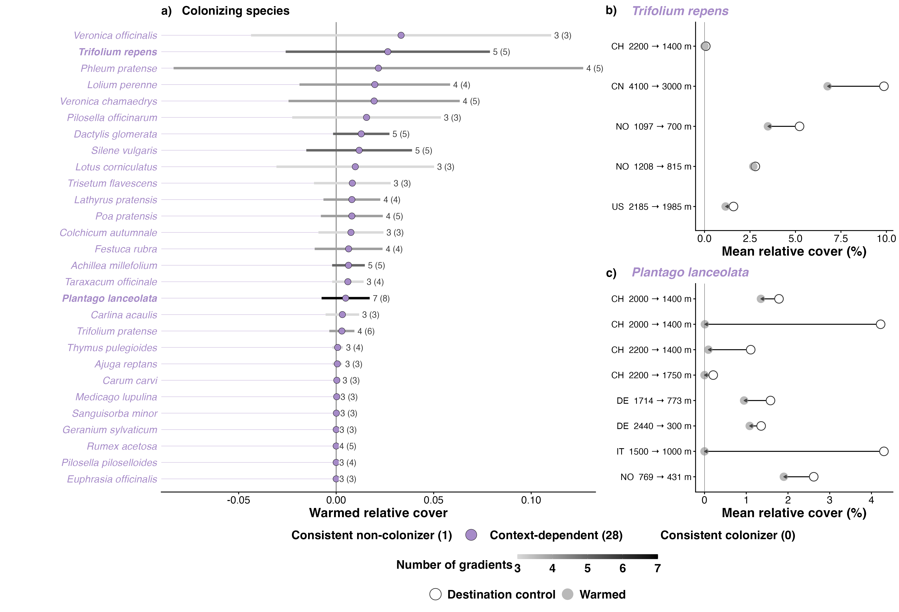

# Step 07b: Consistent colonizers (Step C, colonizers)

For the 29 colonizer species found in at least three gradients (117 effects in 24 experiments), on warmed cover from years 3 and later (step 07a): a species with no warmed cover in years 3 and later in any of its experiments is a consistent non-colonizer, read from the data and set aside; for the others one rma.mv per species estimated a pooled warmed cover and a species-specific among-experiment variance, as the residents' Step C (step 04). Each species' prediction interval for a new experiment places it as a consistent colonizer (interval above zero) or context-dependent. Measured absences (strength 0, SE 0) enter with their zero SE; their weight is set by the among-experiment variance.

## Counts

| rule | n |
| --- | --- |
| colonizer effects (step 07a, years 3 and later) | 379 |
| species in >= 3 gradients | 29 |
| their effects | 117 |
| experiments they occur in | 24 |
| of their effects, measured absences (SE 0) | 28 |
| consistent non-colonizers set aside | 1 |
| species modelled | 28 |
| species with tau2_s at about 0 (< 1e-8) | 6 |

## Classes

| class | species |
| --- | --- |
| Consistent non-colonizer | 1 |
| Context-dependent | 28 |
| Consistent colonizer | 0 |

Consistent non-colonizers: Ranunculus acris.

Every species, by pooled warmed cover:

| species | class | n_gradients | n_experiments | n_measured_absences | mu | se_mu | tau | lower | upper |
| --- | --- | --- | --- | --- | --- | --- | --- | --- | --- |
| Veronica officinalis | Context-dependent | 3 | 3 | 0 | 0.0333 | 0.0201 | 0.0337 | -0.0437 | 0.1102 |
| Trifolium repens | Context-dependent | 5 | 5 | 1 | 0.0265 | 0.0114 | 0.0242 | -0.0259 | 0.0789 |
| Phleum pratense | Context-dependent | 4 | 5 | 2 | 0.0216 | 0.0223 | 0.0487 | -0.0834 | 0.1267 |
| Lolium perenne | Context-dependent | 4 | 4 | 1 | 0.0198 | 0.0096 | 0.0172 | -0.0188 | 0.0584 |
| Veronica chamaedrys | Context-dependent | 4 | 5 | 2 | 0.0195 | 0.0096 | 0.0202 | -0.0244 | 0.0634 |
| Pilosella officinarum | Context-dependent | 3 | 3 | 1 | 0.0156 | 0.0102 | 0.0166 | -0.0225 | 0.0537 |
| Dactylis glomerata | Context-dependent | 5 | 5 | 0 | 0.0129 | 0.0035 | 0.0065 | -0.0016 | 0.0273 |
| Silene vulgaris | Context-dependent | 5 | 5 | 1 | 0.0118 | 0.0059 | 0.0125 | -0.0153 | 0.0389 |
| Lotus corniculatus | Context-dependent | 3 | 3 | 2 | 0.0098 | 0.0106 | 0.0177 | -0.0306 | 0.0502 |
| Trisetum flavescens | Context-dependent | 3 | 3 | 0 | 0.0083 | 0.0055 | 0.0084 | -0.0114 | 0.0279 |
| Lathyrus pratensis | Context-dependent | 4 | 4 | 1 | 0.0081 | 0.0037 | 0.0065 | -0.0065 | 0.0226 |
| Poa pratensis | Context-dependent | 4 | 5 | 1 | 0.0080 | 0.0042 | 0.0069 | -0.0078 | 0.0239 |
| Colchicum autumnale | Context-dependent | 3 | 3 | 0 | 0.0076 | 0.0043 | 0.0073 | -0.0091 | 0.0242 |
| Festuca rubra | Context-dependent | 4 | 4 | 1 | 0.0064 | 0.0049 | 0.0074 | -0.0110 | 0.0238 |
| Achillea millefolium | Context-dependent | 5 | 5 | 0 | 0.0063 | 0.0024 | 0.0035 | -0.0021 | 0.0147 |
| Taraxacum officinale | Context-dependent | 3 | 4 | 0 | 0.0060 | 0.0024 | 0.0033 | -0.0021 | 0.0141 |
| Plantago lanceolata | Context-dependent | 7 | 8 | 2 | 0.0049 | 0.0023 | 0.0059 | -0.0075 | 0.0172 |
| Carlina acaulis | Context-dependent | 3 | 3 | 1 | 0.0032 | 0.0025 | 0.0036 | -0.0054 | 0.0118 |
| Trifolium pratense | Context-dependent | 4 | 6 | 0 | 0.0029 | 0.0015 | 0.0029 | -0.0035 | 0.0094 |
| Thymus pulegioides | Context-dependent | 3 | 4 | 2 | 0.0007 | 0.0006 | 0.0012 | -0.0020 | 0.0035 |
| Ajuga reptans | Context-dependent | 3 | 3 | 1 | 0.0006 | 0.0007 | 0.0011 | -0.0019 | 0.0031 |
| Carum carvi | Context-dependent | 3 | 3 | 1 | 0.0003 | 0.0004 | 0.0006 | -0.0011 | 0.0017 |
| Medicago lupulina | Context-dependent | 3 | 3 | 0 | 0.0003 | 0.0002 | 0.0000 | -0.0002 | 0.0007 |
| Sanguisorba minor | Context-dependent | 3 | 3 | 0 | 0.0001 | 0.0002 | 0.0000 | -0.0003 | 0.0005 |
| Geranium sylvaticum | Context-dependent | 3 | 3 | 1 | 0.0000 | 0.0000 | 0.0000 | -0.0001 | 0.0001 |
| Rumex acetosa | Context-dependent | 4 | 5 | 1 | 0.0000 | 0.0000 | 0.0000 | -0.0000 | 0.0000 |
| Pilosella piloselloides | Context-dependent | 3 | 4 | 3 | 0.0000 | 0.0000 | 0.0000 | -0.0000 | 0.0000 |
| Euphrasia officinalis | Context-dependent | 3 | 3 | 1 | 0.0000 | 0.0000 | 0.0000 | -0.0000 | 0.0000 |
| Ranunculus acris | Consistent non-colonizer | 3 | 3 | 2 |  |  |  |  |  |

## Fig S2

Fig S2 mirrors Fig 2 (Bills, 2 Nov). a): point = pooled warmed cover, filled by class; line = 95% prediction interval for a new experiment, shaded by the number of gradients and labelled gradients (experiments); every modelled species is shown. b) and c): Trifolium repens and Plantago lanceolata, the highest and lowest pooled warmed cover among species in at least 5 gradients; one row per experiment, mean relative cover over years 3 and later in destination controls (hollow) and warmed plots (filled).

## Warnings captured

- Refitted with the bobyqa optimizer after nlminb did not declare convergence: Pilosella piloselloides, Sanguisorba minor.
- There are outcomes with non-positive sampling variances.
- 'V' appears to be not positive definite.
- The `label.size` argument of `geom_label()` is deprecated as of ggplot2 3.5.0.
ℹ Please use the `linewidth` argument instead.

## Deviations from PLAN.md

- Fig S2 mirrors the anchored Fig 2 (two corner panels by Fig 2's rule, destination control to warmed), not PLAN.md's mock with three panels (Bills, 2 Nov; PLAN.md updated).
- Consistent non-colonizers are read in the years 3 and later window used for strength (Bills, 2 Nov).
- Fig 2's rule hiding context-dependent species with |pooled strength| below 0.005 is not applied: almost every colonizer would be hidden.
