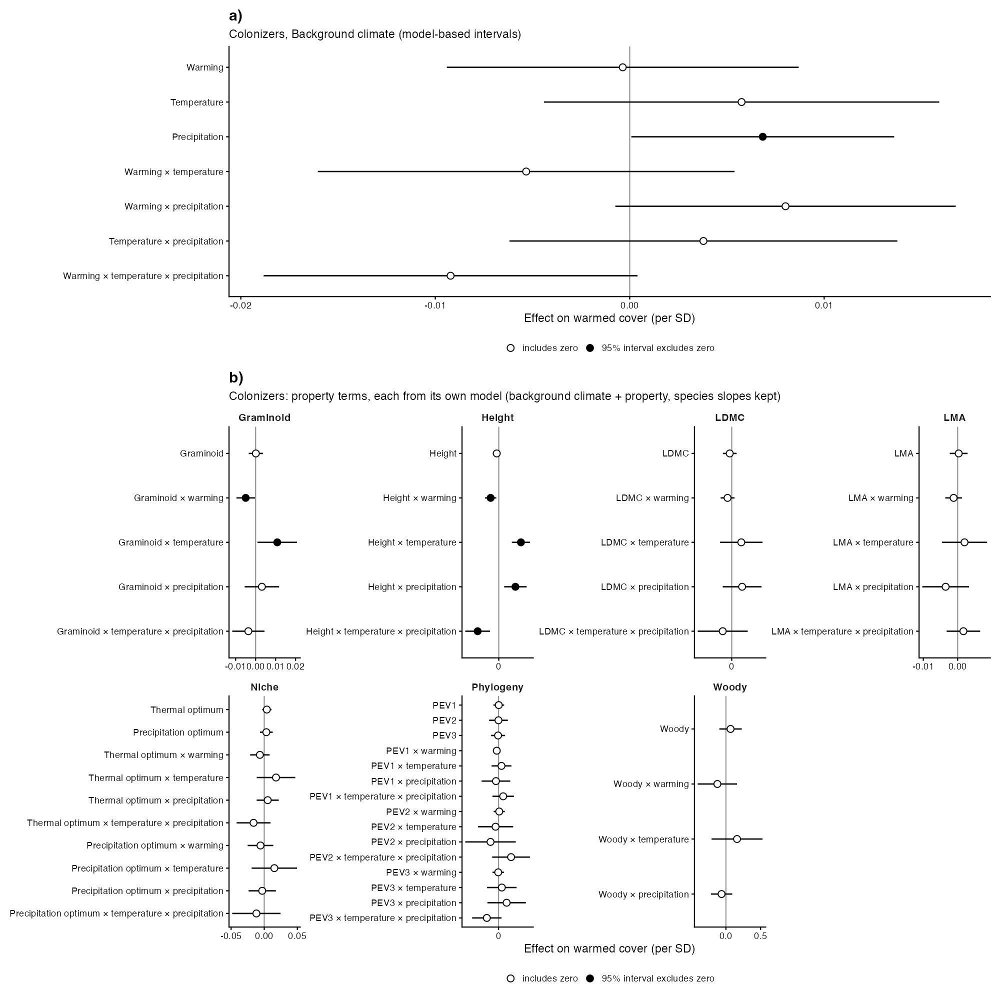
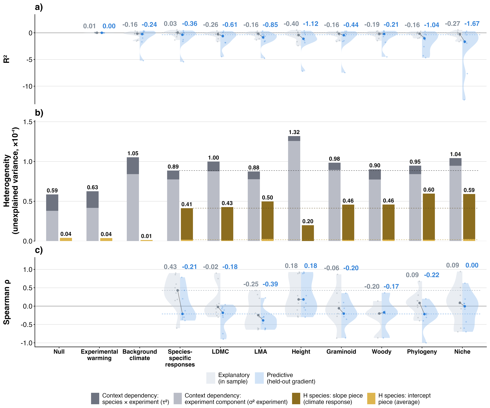
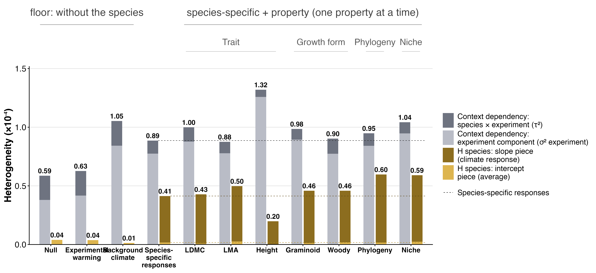

# Step 07c: The colonizer ladder, fitted (Step D route 1, colonizers)

The residents' ladder (step 05) was fitted to the colonizers (Bills, 2 Nov): warmed cover from years 3 and later (step 07a) for the 110 effects of the 27 colonizer species found in at least 3 gradients that carry every property (24 experiments, 18 gradients). The same 11 models, without abundance (Bills, 7 Nov): Null, Experimental warming, Background climate, Species-specific responses and one model per property. Properties are on the residents' step 02 scale (checked); A0_dest (log(100 x mean destination-control cover + 1)) is still standardised across all 379 colonizer effects of 07a but enters no model. 24 effects are measured absences (SE 0).

## Counts

| rule | n |
| --- | --- |
| colonizer effects (07a, years 3 and later) | 379 |
| species in >= 3 gradients | 29 |
| of which lacking a property | 2 |
| ladder effects | 110 |
| species | 27 |
| experiments | 24 |
| gradients | 18 |
| measured absences among them | 24 |

Species lacking a property: Euphrasia officinalis, Pilosella piloselloides.

Growth form on these rows: 1 woody and 6 graminoid species of 27; with one woody species metafor drops the redundant term TP:woody from the Woody model, which rests on that species alone.

## Heterogeneity per model (×10⁻⁴)

| model | τ² | σ²_experiment | H intercept | H slope | optimizer | minutes |
| --- | --- | --- | --- | --- | --- | --- |
| Null | 0.207 | 0.380 | 0.040 | 0.000 | nlminb | 0.0 |
| Experimental warming | 0.209 | 0.417 | 0.038 | 0.000 | nlminb | 0.0 |
| Background climate | 0.211 | 0.842 | 0.014 | 0.000 | nlminb | 0.0 |
| Species-specific responses | 0.111 | 0.775 | 0.017 | 0.396 | nlminb | 0.1 |
| LDMC | 0.122 | 0.878 | 0.008 | 0.420 | optim BFGS, warm start | 0.0 |
| LMA | 0.098 | 0.778 | 0.026 | 0.471 | optim BFGS, warm start | 0.0 |
| Height | 0.061 | 1.258 | 0.000 | 0.199 | optim BFGS, warm start | 0.0 |
| Graminoid | 0.091 | 0.894 | 0.012 | 0.446 | optim BFGS, warm start | 0.0 |
| Woody | 0.129 | 0.773 | 0.018 | 0.441 | optim BFGS, warm start | 0.0 |
| Phylogeny | 0.107 | 0.841 | 0.016 | 0.581 | optim BFGS, warm start | 0.0 |
| Niche | 0.096 | 0.947 | 0.024 | 0.567 | optim BFGS, warm start | 0.0 |

## Step 05's checks, reported

τ² against Null: Experimental warming +1.1%, Background climate +2.2% (step 05 stops beyond 5%).

Property moves against Species-specific responses, as a share of its τ² + σ²_experiment:

| property | τ² move | σ²_experiment move |
| --- | --- | --- |
| LDMC | +1.2% | +11.6% |
| LMA | -1.5% | +0.3% |
| Height | -5.6% | +54.5% |
| Graminoid | -2.3% | +13.4% |
| Woody | +2.0% | -0.2% |
| Phylogeny | -0.5% | +7.5% |
| Niche | -1.7% | +19.4% |

Moves beyond step 05's 5% limit: 6 of 14. On 110 effects the variance components are not pinned down well enough for that check to hold; they are reported, not enforced (Bills, 2 Nov).

## Coefficients whose 95% interval excludes zero

| model | term | estimate | ci |
| --- | --- | --- | --- |
| Background climate | P | 0.0068 | 0.0001 to 0.0136 |
| Height | W:height_z | -0.0032 | -0.0054 to -0.0010 |
| Height | T:height_z | 0.0087 | 0.0051 to 0.0122 |
| Height | P:height_z | 0.0065 | 0.0021 to 0.0109 |
| Height | height_z:TP | -0.0083 | -0.0131 to -0.0034 |
| Graminoid | W:graminoid | -0.0050 | -0.0096 to -0.0003 |
| Graminoid | T:graminoid | 0.0108 | 0.0009 to 0.0207 |

## Change in unexplained variation at each comparison (Fig S19)

| model | compared with | component | change (×10⁻⁴) | % |
| --- | --- | --- | --- | --- |
| Experimental warming | Null | total | +0.037 | +6.0 |
| Experimental warming | Null | sigma2_experiment | +0.037 | +9.8 |
| Experimental warming | Null | tau2 | +0.002 | +1.1 |
| Experimental warming | Null | H_intercept | -0.002 | -5.3 |
| Experimental warming | Null | H_slope | +0.000 | zero |
| Background climate | Experimental warming | total | +0.403 | +60.7 |
| Background climate | Experimental warming | sigma2_experiment | +0.425 | +101.9 |
| Background climate | Experimental warming | tau2 | +0.002 | +1.1 |
| Background climate | Experimental warming | H_intercept | -0.024 | -64.0 |
| Background climate | Experimental warming | H_slope | +0.000 | zero |
| Species-specific responses | Background climate | total | +0.233 | +21.8 |
| Species-specific responses | Background climate | sigma2_experiment | -0.067 | -8.0 |
| Species-specific responses | Background climate | tau2 | -0.100 | -47.3 |
| Species-specific responses | Background climate | H_intercept | +0.004 | +26.4 |
| Species-specific responses | Background climate | H_slope | +0.396 | new |
| LDMC | Species-specific responses | total | +0.127 | +9.8 |
| LDMC | Species-specific responses | sigma2_experiment | +0.103 | +13.2 |
| LDMC | Species-specific responses | tau2 | +0.010 | +9.3 |
| LDMC | Species-specific responses | H_intercept | -0.009 | -54.0 |
| LDMC | Species-specific responses | H_slope | +0.024 | +6.0 |
| LMA | Species-specific responses | total | +0.073 | +5.6 |
| LMA | Species-specific responses | sigma2_experiment | +0.003 | +0.3 |
| LMA | Species-specific responses | tau2 | -0.014 | -12.3 |
| LMA | Species-specific responses | H_intercept | +0.009 | +53.6 |
| LMA | Species-specific responses | H_slope | +0.075 | +19.0 |
| Height | Species-specific responses | total | +0.218 | +16.8 |
| Height | Species-specific responses | sigma2_experiment | +0.483 | +62.3 |
| Height | Species-specific responses | tau2 | -0.050 | -44.9 |
| Height | Species-specific responses | H_intercept | -0.017 | -99.4 |
| Height | Species-specific responses | H_slope | -0.198 | -49.9 |
| Graminoid | Species-specific responses | total | +0.144 | +11.1 |
| Graminoid | Species-specific responses | sigma2_experiment | +0.119 | +15.4 |
| Graminoid | Species-specific responses | tau2 | -0.021 | -18.5 |
| Graminoid | Species-specific responses | H_intercept | -0.005 | -27.9 |
| Graminoid | Species-specific responses | H_slope | +0.050 | +12.6 |
| Woody | Species-specific responses | total | +0.061 | +4.7 |
| Woody | Species-specific responses | sigma2_experiment | -0.002 | -0.2 |
| Woody | Species-specific responses | tau2 | +0.018 | +15.9 |
| Woody | Species-specific responses | H_intercept | +0.001 | +5.5 |
| Woody | Species-specific responses | H_slope | +0.045 | +11.2 |
| Phylogeny | Species-specific responses | total | +0.245 | +18.9 |
| Phylogeny | Species-specific responses | sigma2_experiment | +0.066 | +8.6 |
| Phylogeny | Species-specific responses | tau2 | -0.004 | -4.0 |
| Phylogeny | Species-specific responses | H_intercept | -0.001 | -6.5 |
| Phylogeny | Species-specific responses | H_slope | +0.184 | +46.5 |
| Niche | Species-specific responses | total | +0.334 | +25.7 |
| Niche | Species-specific responses | sigma2_experiment | +0.172 | +22.2 |
| Niche | Species-specific responses | tau2 | -0.015 | -13.8 |
| Niche | Species-specific responses | H_intercept | +0.007 | +41.4 |
| Niche | Species-specific responses | H_slope | +0.170 | +43.0 |

## Figures

## Warnings captured

- Null: Model does not contain an '~ inner | outer' term, so 'struct' argument is disregaded.
- Null: There are outcomes with non-positive sampling variances.
- Null: 'V' appears to be not positive definite.
- Experimental warming: Model does not contain an '~ inner | outer' term, so 'struct' argument is disregaded.
- Experimental warming: There are outcomes with non-positive sampling variances.
- Experimental warming: 'V' appears to be not positive definite.
- Background climate: Model does not contain an '~ inner | outer' term, so 'struct' argument is disregaded.
- Background climate: There are outcomes with non-positive sampling variances.
- Background climate: 'V' appears to be not positive definite.
- Species-specific responses: There are outcomes with non-positive sampling variances.
- Species-specific responses: 'V' appears to be not positive definite.
- LDMC: There are outcomes with non-positive sampling variances.
- LDMC: 'V' appears to be not positive definite.
- LMA: There are outcomes with non-positive sampling variances.
- LMA: 'V' appears to be not positive definite.
- Height: There are outcomes with non-positive sampling variances.
- Height: 'V' appears to be not positive definite.
- Graminoid: There are outcomes with non-positive sampling variances.
- Graminoid: 'V' appears to be not positive definite.
- Woody: There are outcomes with non-positive sampling variances.
- Woody: 'V' appears to be not positive definite.
- Woody: Redundant predictors dropped from the model.
- Phylogeny: There are outcomes with non-positive sampling variances.
- Phylogeny: 'V' appears to be not positive definite.
- Niche: There are outcomes with non-positive sampling variances.
- Niche: 'V' appears to be not positive definite.
- `geom_errorbarh()` was deprecated in ggplot2 4.0.0.
ℹ Please use the `orientation` argument of `geom_errorbar()` instead.

## Deviations from PLAN.md

- The colonizer ladder on the residents' reduction and models (Bills, 2 Nov); properties on the residents' scale.
- Property models warm-started from Species-specific responses with optim BFGS (Bills, 7 Nov, as step 05); the optimizer column above says which fits needed a fallback.
- Step 05's tau2 and property checks are reported, not enforced (Bills, 2 Nov: run without stopping).
- The colonizer coefficients are their own appendix figure (Fig S17), beside the residents' Fig S13; Figs S19 and S20 mirror Fig 7 and Fig S12 (Bills, 7 Nov).
