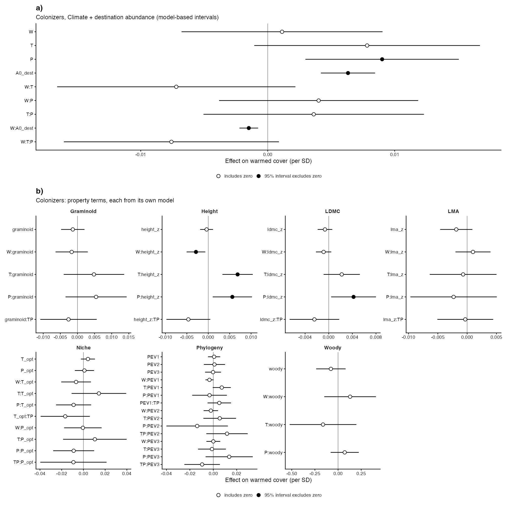

# Step 07c: The colonizer ladder, fitted (Step D route 1, colonizers)

The residents' ladder (step 05) was fitted to the colonizers (Bills, 2 Nov): warmed cover from years 3 and later (step 07a) for the 110 effects of the 27 colonizer species found in at least 3 gradients that carry every property (24 experiments, 18 gradients). The same 12 models, with A0_origin dropped (a colonizer has none) so that Start is the destination abundance A0_dest and its interaction with W. Properties are on the residents' step 02 scale (checked), A0_dest standardised across these effects. 24 effects are measured absences (SE 0).

## Counts

| rule | n |
| --- | --- |
| colonizer effects (07a, years 3 and later) | 379 |
| species in >= 3 gradients | 29 |
| of which lacking a property | 2 |
| ladder effects | 110 |
| species | 27 |
| experiments | 24 |
| gradients | 18 |
| measured absences among them | 24 |

Species lacking a property: Euphrasia officinalis, Pilosella piloselloides.

Growth form on these rows: 1 woody and 6 graminoid species of 27; with one woody species metafor drops the redundant term TP:woody from the Woody model, which rests on that species alone.

## Heterogeneity per model (×10⁻⁴)

| model | τ² | σ²_experiment | H intercept | H slope | optimizer | minutes |
| --- | --- | --- | --- | --- | --- | --- |
| Null | 0.207 | 0.380 | 0.040 | 0.000 | nlminb | 0.0 |
| Start | 0.185 | 0.402 | 0.025 | 0.000 | nlminb | 0.0 |
| Climate | 0.211 | 0.843 | 0.014 | 0.000 | nlminb | 0.0 |
| Climate + start | 0.186 | 0.616 | 0.007 | 0.000 | nlminb | 0.0 |
| Species-dependent | 0.107 | 0.669 | 0.003 | 0.292 | nlminb | 0.1 |
| LDMC | 0.099 | 0.836 | 0.000 | 0.230 | nlminb | 0.1 |
| LMA | 0.111 | 0.701 | 0.000 | 0.377 | nlminb | 0.1 |
| Height | 0.057 | 0.956 | 0.000 | 0.259 | nlminb | 0.1 |
| Graminoid | 0.101 | 0.838 | 0.001 | 0.348 | nlminb | 0.0 |
| Woody | 0.119 | 0.680 | 0.003 | 0.303 | nlminb | 0.1 |
| Phylogeny | 0.112 | 0.754 | 0.003 | 0.439 | nlminb | 0.1 |
| Niche | 0.097 | 0.814 | 0.013 | 0.327 | nlminb | 0.0 |

## Step 05's checks, reported

τ² at Climate against Null: +2.2% (step 05 stops beyond 5%).

| property | τ² move | σ²_experiment move |
| --- | --- | --- |
| LDMC | -0.9% | +21.5% |
| LMA | +0.5% | +4.1% |
| Height | -6.4% | +36.9% |
| Graminoid | -0.8% | +21.8% |
| Woody | +1.6% | +1.3% |
| Phylogeny | +0.7% | +10.8% |
| Niche | -1.3% | +18.7% |

Moves beyond step 05's 5% limit: 6 of 14. On 110 effects the variance components are not pinned down well enough for that check to hold; they are reported, not enforced (Bills, 2 Nov).

## Coefficients whose 95% interval excludes zero

| model | term | estimate | ci |
| --- | --- | --- | --- |
| Start | A0_dest | 0.0055 | 0.0035 to 0.0075 |
| Start | A0_dest:W | -0.0013 | -0.0020 to -0.0006 |
| Climate | P | 0.0068 | 0.0001 to 0.0136 |
| Climate + start | P | 0.0090 | 0.0030 to 0.0151 |
| Climate + start | A0_dest | 0.0063 | 0.0042 to 0.0085 |
| Climate + start | W:A0_dest | -0.0015 | -0.0022 to -0.0008 |
| Species-dependent | P | 0.0097 | 0.0029 to 0.0166 |
| Species-dependent | A0_dest | 0.0073 | 0.0051 to 0.0095 |
| Species-dependent | W:A0_dest | -0.0017 | -0.0025 to -0.0008 |
| LDMC | T | 0.0122 | 0.0018 to 0.0227 |
| LDMC | P | 0.0115 | 0.0041 to 0.0188 |
| LDMC | A0_dest | 0.0073 | 0.0051 to 0.0095 |
| LDMC | W:A0_dest | -0.0017 | -0.0026 to -0.0008 |
| LDMC | P:ldmc_z | 0.0042 | 0.0004 to 0.0080 |
| LMA | P | 0.0086 | 0.0006 to 0.0165 |
| LMA | A0_dest | 0.0077 | 0.0053 to 0.0101 |
| LMA | W:A0_dest | -0.0021 | -0.0033 to -0.0009 |
| Height | A0_dest | 0.0053 | 0.0033 to 0.0072 |
| Height | W:A0_dest | -0.0011 | -0.0018 to -0.0003 |
| Height | W:height_z | -0.0029 | -0.0051 to -0.0007 |
| Height | T:height_z | 0.0069 | 0.0033 to 0.0104 |
| Height | P:height_z | 0.0056 | 0.0010 to 0.0102 |
| Graminoid | P | 0.0084 | 0.0006 to 0.0162 |
| Graminoid | A0_dest | 0.0071 | 0.0048 to 0.0095 |
| Graminoid | W:A0_dest | -0.0015 | -0.0025 to -0.0006 |
| Woody | P | 0.0102 | 0.0032 to 0.0171 |
| Woody | A0_dest | 0.0079 | 0.0056 to 0.0102 |
| Woody | W:A0_dest | -0.0018 | -0.0027 to -0.0009 |
| Phylogeny | A0_dest | 0.0082 | 0.0057 to 0.0108 |
| Phylogeny | W:A0_dest | -0.0023 | -0.0040 to -0.0006 |
| Niche | A0_dest | 0.0077 | 0.0054 to 0.0100 |
| Niche | W:A0_dest | -0.0018 | -0.0028 to -0.0009 |

## Figures

## Warnings captured

- Null: Model does not contain an '~ inner | outer' term, so 'struct' argument is disregaded.
- Null: There are outcomes with non-positive sampling variances.
- Null: 'V' appears to be not positive definite.
- Start: Model does not contain an '~ inner | outer' term, so 'struct' argument is disregaded.
- Start: There are outcomes with non-positive sampling variances.
- Start: 'V' appears to be not positive definite.
- Climate: Model does not contain an '~ inner | outer' term, so 'struct' argument is disregaded.
- Climate: There are outcomes with non-positive sampling variances.
- Climate: 'V' appears to be not positive definite.
- Climate + start: Model does not contain an '~ inner | outer' term, so 'struct' argument is disregaded.
- Climate + start: There are outcomes with non-positive sampling variances.
- Climate + start: 'V' appears to be not positive definite.
- Species-dependent: There are outcomes with non-positive sampling variances.
- Species-dependent: 'V' appears to be not positive definite.
- LDMC: There are outcomes with non-positive sampling variances.
- LDMC: 'V' appears to be not positive definite.
- LMA: There are outcomes with non-positive sampling variances.
- LMA: 'V' appears to be not positive definite.
- Height: There are outcomes with non-positive sampling variances.
- Height: 'V' appears to be not positive definite.
- Graminoid: There are outcomes with non-positive sampling variances.
- Graminoid: 'V' appears to be not positive definite.
- Woody: There are outcomes with non-positive sampling variances.
- Woody: 'V' appears to be not positive definite.
- Woody: Redundant predictors dropped from the model.
- Phylogeny: There are outcomes with non-positive sampling variances.
- Phylogeny: 'V' appears to be not positive definite.
- Niche: There are outcomes with non-positive sampling variances.
- Niche: 'V' appears to be not positive definite.
- `geom_errorbarh()` was deprecated in ggplot2 4.0.0.
ℹ Please use the `orientation` argument of `geom_errorbar()` instead.

## Deviations from PLAN.md

- The colonizer ladder on the residents' reduction and models (Bills, 2 Nov); properties on the residents' scale.
- Step 05's tau2 and property checks are reported, not enforced (Bills, 2 Nov: run without stopping).
- The colonizer coefficients are their own appendix figure (Fig S15), beside the residents' Fig S11.
