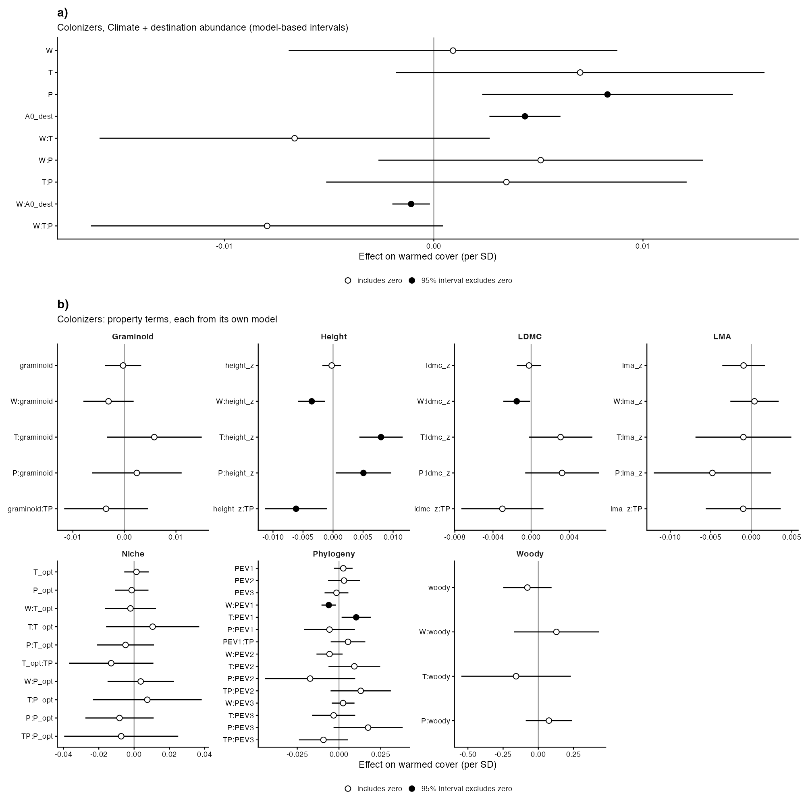
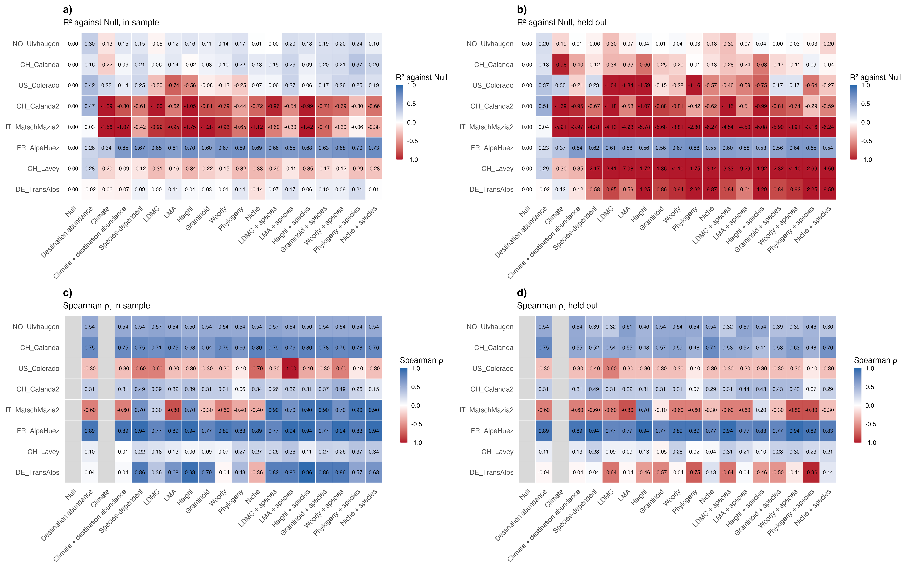

# Step 07d: The colonizer ladder, predicted (Step D route 2, colonizers)

Step 06 on the 110 colonizer ladder rows of step 07c: every level was refitted 8 times, each time without one of the 8 gradients with at least 5 effects, and asked to predict its warmed cover; fixed effects with the experiment term at zero, Species-dependent and the supplement levels adding the species' deviations learnt in training. Scored per gradient by R² against the Null on the same gradient and Spearman ρ, in sample and held out, summarised by medians; no loser/winner skill, since colonizers have no loser class. 96 fold fits, 0 needing the bobyqa retry, 0 failed.

## Counts

| gradient_id | effects | held_out |
| --- | --- | --- |
| CH_Calanda | 19 | yes |
| CH_Calanda2 | 9 | yes |
| CH_Lavey | 25 | yes |
| CN_Gongga | 1 | no (fewer than 5 effects; trains only) |
| DE_Grainau | 3 | no (fewer than 5 effects; trains only) |
| DE_Susalps | 4 | no (fewer than 5 effects; trains only) |
| DE_TransAlps | 7 | yes |
| FR_AlpeHuez | 6 | yes |
| FR_Lautaret | 2 | no (fewer than 5 effects; trains only) |
| IT_MatschMazia1 | 1 | no (fewer than 5 effects; trains only) |
| IT_MatschMazia2 | 5 | yes |
| NO_Gudmedalen | 3 | no (fewer than 5 effects; trains only) |
| NO_Lavisdalen | 4 | no (fewer than 5 effects; trains only) |
| NO_Skjellingahaugen | 2 | no (fewer than 5 effects; trains only) |
| NO_Ulvhaugen | 7 | yes |
| SE_Abisko | 3 | no (fewer than 5 effects; trains only) |
| US_Colorado | 5 | yes |
| US_Montana | 4 | no (fewer than 5 effects; trains only) |

## Prediction metrics, median over gradients

| level | metric | fit | pred | gradients (fit / pred) | held out better than Null |
| --- | --- | --- | --- | --- | --- |
| Null | R² against Null | 0.000 | 0.000 | 8 / 8 | 0 of 8 |
| Null | Spearman ρ |  |  | 0 / 0 |  |
| Destination abundance | R² against Null | 0.111 | 0.112 | 8 / 8 | 5 of 8 |
| Destination abundance | Spearman ρ | 0.243 | 0.243 | 8 / 8 |  |
| Climate | R² against Null | -0.162 | -0.242 | 8 / 8 | 3 of 8 |
| Climate | Spearman ρ |  |  | 0 / 0 |  |
| Climate + destination abundance | R² against Null | -0.069 | -0.311 | 8 / 8 | 3 of 8 |
| Climate + destination abundance | Spearman ρ | 0.175 | 0.243 | 8 / 8 |  |
| Species-dependent | R² against Null | 0.042 | -0.397 | 8 / 8 | 1 of 8 |
| Species-dependent | Spearman ρ | 0.468 | 0.267 | 8 / 8 |  |
| LDMC | R² against Null | -0.195 | -0.804 | 8 / 8 | 1 of 8 |
| LDMC | Spearman ρ | 0.273 | 0.237 | 8 / 8 |  |
| LMA | R² against Null | -0.088 | -0.462 | 8 / 8 | 1 of 8 |
| LMA | Spearman ρ | 0.433 | 0.289 | 8 / 8 |  |
| Height | R² against Null | -0.175 | -0.831 | 8 / 8 | 2 of 8 |
| Height | Spearman ρ | 0.496 | 0.337 | 8 / 8 |  |
| Graminoid | R² against Null | -0.157 | -0.733 | 8 / 8 | 2 of 8 |
| Graminoid | Spearman ρ | 0.244 | 0.122 | 8 / 8 |  |
| Woody | R² against Null | -0.076 | -0.290 | 8 / 7 | 2 of 7 |
| Woody | Spearman ρ | 0.213 | 0.274 | 8 / 8 |  |
| Phylogeny | R² against Null | -0.170 | -0.487 | 8 / 8 | 1 of 8 |
| Phylogeny | Spearman ρ | 0.178 | -0.046 | 8 / 8 |  |
| Niche | R² against Null | -0.130 | -0.898 | 8 / 8 | 1 of 8 |
| Niche | Spearman ρ | 0.393 | 0.209 | 8 / 8 |  |
| LDMC + species | R² against Null | -0.015 | -0.668 | 8 / 8 | 1 of 8 |
| LDMC + species | Spearman ρ | 0.589 | 0.269 | 8 / 8 |  |
| LMA + species | R² against Null | 0.117 | -0.378 | 8 / 8 | 1 of 8 |
| LMA + species | Spearman ρ | 0.609 | 0.219 | 8 / 8 |  |
| Height + species | R² against Null | 0.032 | -0.814 | 8 / 8 | 2 of 8 |
| Height + species | Spearman ρ | 0.618 | 0.240 | 8 / 8 |  |
| Graminoid + species | R² against Null | 0.072 | -0.664 | 8 / 8 | 2 of 8 |
| Graminoid + species | Spearman ρ | 0.554 | 0.157 | 8 / 8 |  |
| Woody + species | R² against Null | 0.056 | -0.330 | 8 / 7 | 2 of 7 |
| Woody + species | Spearman ρ | 0.348 | 0.300 | 8 / 8 |  |
| Phylogeny + species | R² against Null | 0.124 | -0.369 | 8 / 8 | 2 of 8 |
| Phylogeny + species | Spearman ρ | 0.571 | -0.081 | 8 / 8 |  |
| Niche + species | R² against Null | -0.027 | -0.683 | 8 / 8 | 1 of 8 |
| Niche + species | Spearman ρ | 0.414 | 0.250 | 8 / 8 |  |

Taken out of the R² row and the medians (R² below −100, Bills, 2 Nov): Woody, held out at CH_Lavey (-145.9); Woody + species, held out at CH_Lavey (-146.1).

Every held-out species had training data: TRUE.

## Figures

Fig S9 as Fig 4: row a) step 07c; rows b) c): half violins of the 8 scored gradients, explanatory (grey) beside predictive (blue), medians written in; R² against the Null on that gradient. No skill row.

## Warnings captured

- null / CH_Calanda: There are outcomes with non-positive sampling variances.
- null / CH_Calanda: 'V' appears to be not positive definite.
- null / CH_Calanda2: There are outcomes with non-positive sampling variances.
- null / CH_Calanda2: 'V' appears to be not positive definite.
- null / CH_Lavey: There are outcomes with non-positive sampling variances.
- null / CH_Lavey: 'V' appears to be not positive definite.
- null / DE_TransAlps: There are outcomes with non-positive sampling variances.
- null / DE_TransAlps: 'V' appears to be not positive definite.
- null / FR_AlpeHuez: There are outcomes with non-positive sampling variances.
- null / FR_AlpeHuez: 'V' appears to be not positive definite.
- null / IT_MatschMazia2: There are outcomes with non-positive sampling variances.
- null / IT_MatschMazia2: 'V' appears to be not positive definite.
- null / NO_Ulvhaugen: There are outcomes with non-positive sampling variances.
- null / NO_Ulvhaugen: 'V' appears to be not positive definite.
- null / US_Colorado: There are outcomes with non-positive sampling variances.
- null / US_Colorado: 'V' appears to be not positive definite.
- start / CH_Calanda: There are outcomes with non-positive sampling variances.
- start / CH_Calanda: 'V' appears to be not positive definite.
- start / CH_Calanda2: There are outcomes with non-positive sampling variances.
- start / CH_Calanda2: 'V' appears to be not positive definite.
- start / CH_Lavey: There are outcomes with non-positive sampling variances.
- start / CH_Lavey: 'V' appears to be not positive definite.
- start / DE_TransAlps: There are outcomes with non-positive sampling variances.
- start / DE_TransAlps: 'V' appears to be not positive definite.
- start / FR_AlpeHuez: There are outcomes with non-positive sampling variances.
- start / FR_AlpeHuez: 'V' appears to be not positive definite.
- start / IT_MatschMazia2: There are outcomes with non-positive sampling variances.
- start / IT_MatschMazia2: 'V' appears to be not positive definite.
- start / NO_Ulvhaugen: There are outcomes with non-positive sampling variances.
- start / NO_Ulvhaugen: 'V' appears to be not positive definite.
- start / US_Colorado: There are outcomes with non-positive sampling variances.
- start / US_Colorado: 'V' appears to be not positive definite.
- climate / CH_Calanda: There are outcomes with non-positive sampling variances.
- climate / CH_Calanda: 'V' appears to be not positive definite.
- climate / CH_Calanda2: There are outcomes with non-positive sampling variances.
- climate / CH_Calanda2: 'V' appears to be not positive definite.
- climate / CH_Lavey: There are outcomes with non-positive sampling variances.
- climate / CH_Lavey: 'V' appears to be not positive definite.
- climate / DE_TransAlps: There are outcomes with non-positive sampling variances.
- climate / DE_TransAlps: 'V' appears to be not positive definite.
- climate / FR_AlpeHuez: There are outcomes with non-positive sampling variances.
- climate / FR_AlpeHuez: 'V' appears to be not positive definite.
- climate / IT_MatschMazia2: There are outcomes with non-positive sampling variances.
- climate / IT_MatschMazia2: 'V' appears to be not positive definite.
- climate / NO_Ulvhaugen: There are outcomes with non-positive sampling variances.
- climate / NO_Ulvhaugen: 'V' appears to be not positive definite.
- climate / US_Colorado: There are outcomes with non-positive sampling variances.
- climate / US_Colorado: 'V' appears to be not positive definite.
- climate_start / CH_Calanda: There are outcomes with non-positive sampling variances.
- climate_start / CH_Calanda: 'V' appears to be not positive definite.
- climate_start / CH_Calanda2: There are outcomes with non-positive sampling variances.
- climate_start / CH_Calanda2: 'V' appears to be not positive definite.
- climate_start / CH_Lavey: There are outcomes with non-positive sampling variances.
- climate_start / CH_Lavey: 'V' appears to be not positive definite.
- climate_start / DE_TransAlps: There are outcomes with non-positive sampling variances.
- climate_start / DE_TransAlps: 'V' appears to be not positive definite.
- climate_start / FR_AlpeHuez: There are outcomes with non-positive sampling variances.
- climate_start / FR_AlpeHuez: 'V' appears to be not positive definite.
- climate_start / IT_MatschMazia2: There are outcomes with non-positive sampling variances.
- climate_start / IT_MatschMazia2: 'V' appears to be not positive definite.
- climate_start / NO_Ulvhaugen: There are outcomes with non-positive sampling variances.
- climate_start / NO_Ulvhaugen: 'V' appears to be not positive definite.
- climate_start / US_Colorado: There are outcomes with non-positive sampling variances.
- climate_start / US_Colorado: 'V' appears to be not positive definite.
- species / CH_Calanda: There are outcomes with non-positive sampling variances.
- species / CH_Calanda: 'V' appears to be not positive definite.
- species / CH_Calanda2: There are outcomes with non-positive sampling variances.
- species / CH_Calanda2: 'V' appears to be not positive definite.
- species / CH_Lavey: There are outcomes with non-positive sampling variances.
- species / CH_Lavey: 'V' appears to be not positive definite.
- species / DE_TransAlps: There are outcomes with non-positive sampling variances.
- species / DE_TransAlps: 'V' appears to be not positive definite.
- species / FR_AlpeHuez: There are outcomes with non-positive sampling variances.
- species / FR_AlpeHuez: 'V' appears to be not positive definite.
- species / IT_MatschMazia2: There are outcomes with non-positive sampling variances.
- species / IT_MatschMazia2: 'V' appears to be not positive definite.
- species / NO_Ulvhaugen: There are outcomes with non-positive sampling variances.
- species / NO_Ulvhaugen: 'V' appears to be not positive definite.
- species / US_Colorado: There are outcomes with non-positive sampling variances.
- species / US_Colorado: 'V' appears to be not positive definite.
- ldmc / CH_Calanda: There are outcomes with non-positive sampling variances.
- ldmc / CH_Calanda: 'V' appears to be not positive definite.
- ldmc / CH_Calanda2: There are outcomes with non-positive sampling variances.
- ldmc / CH_Calanda2: 'V' appears to be not positive definite.
- ldmc / CH_Lavey: There are outcomes with non-positive sampling variances.
- ldmc / CH_Lavey: 'V' appears to be not positive definite.
- ldmc / DE_TransAlps: There are outcomes with non-positive sampling variances.
- ldmc / DE_TransAlps: 'V' appears to be not positive definite.
- ldmc / FR_AlpeHuez: There are outcomes with non-positive sampling variances.
- ldmc / FR_AlpeHuez: 'V' appears to be not positive definite.
- ldmc / IT_MatschMazia2: There are outcomes with non-positive sampling variances.
- ldmc / IT_MatschMazia2: 'V' appears to be not positive definite.
- ldmc / NO_Ulvhaugen: There are outcomes with non-positive sampling variances.
- ldmc / NO_Ulvhaugen: 'V' appears to be not positive definite.
- ldmc / US_Colorado: There are outcomes with non-positive sampling variances.
- ldmc / US_Colorado: 'V' appears to be not positive definite.
- lma / CH_Calanda: There are outcomes with non-positive sampling variances.
- lma / CH_Calanda: 'V' appears to be not positive definite.
- lma / CH_Calanda2: There are outcomes with non-positive sampling variances.
- lma / CH_Calanda2: 'V' appears to be not positive definite.
- lma / CH_Lavey: There are outcomes with non-positive sampling variances.
- lma / CH_Lavey: 'V' appears to be not positive definite.
- lma / DE_TransAlps: There are outcomes with non-positive sampling variances.
- lma / DE_TransAlps: 'V' appears to be not positive definite.
- lma / FR_AlpeHuez: There are outcomes with non-positive sampling variances.
- lma / FR_AlpeHuez: 'V' appears to be not positive definite.
- lma / IT_MatschMazia2: There are outcomes with non-positive sampling variances.
- lma / IT_MatschMazia2: 'V' appears to be not positive definite.
- lma / NO_Ulvhaugen: There are outcomes with non-positive sampling variances.
- lma / NO_Ulvhaugen: 'V' appears to be not positive definite.
- lma / US_Colorado: There are outcomes with non-positive sampling variances.
- lma / US_Colorado: 'V' appears to be not positive definite.
- height / CH_Calanda: There are outcomes with non-positive sampling variances.
- height / CH_Calanda: 'V' appears to be not positive definite.
- height / CH_Calanda2: There are outcomes with non-positive sampling variances.
- height / CH_Calanda2: 'V' appears to be not positive definite.
- height / CH_Lavey: There are outcomes with non-positive sampling variances.
- height / CH_Lavey: 'V' appears to be not positive definite.
- height / DE_TransAlps: There are outcomes with non-positive sampling variances.
- height / DE_TransAlps: 'V' appears to be not positive definite.
- height / FR_AlpeHuez: There are outcomes with non-positive sampling variances.
- height / FR_AlpeHuez: 'V' appears to be not positive definite.
- height / IT_MatschMazia2: There are outcomes with non-positive sampling variances.
- height / IT_MatschMazia2: 'V' appears to be not positive definite.
- height / NO_Ulvhaugen: There are outcomes with non-positive sampling variances.
- height / NO_Ulvhaugen: 'V' appears to be not positive definite.
- height / US_Colorado: There are outcomes with non-positive sampling variances.
- height / US_Colorado: 'V' appears to be not positive definite.
- graminoid / CH_Calanda: There are outcomes with non-positive sampling variances.
- graminoid / CH_Calanda: 'V' appears to be not positive definite.
- graminoid / CH_Calanda2: There are outcomes with non-positive sampling variances.
- graminoid / CH_Calanda2: 'V' appears to be not positive definite.
- graminoid / CH_Lavey: There are outcomes with non-positive sampling variances.
- graminoid / CH_Lavey: 'V' appears to be not positive definite.
- graminoid / DE_TransAlps: There are outcomes with non-positive sampling variances.
- graminoid / DE_TransAlps: 'V' appears to be not positive definite.
- graminoid / FR_AlpeHuez: There are outcomes with non-positive sampling variances.
- graminoid / FR_AlpeHuez: 'V' appears to be not positive definite.
- graminoid / IT_MatschMazia2: There are outcomes with non-positive sampling variances.
- graminoid / IT_MatschMazia2: 'V' appears to be not positive definite.
- graminoid / NO_Ulvhaugen: There are outcomes with non-positive sampling variances.
- graminoid / NO_Ulvhaugen: 'V' appears to be not positive definite.
- graminoid / US_Colorado: There are outcomes with non-positive sampling variances.
- graminoid / US_Colorado: 'V' appears to be not positive definite.
- woody / CH_Calanda: There are outcomes with non-positive sampling variances.
- woody / CH_Calanda: 'V' appears to be not positive definite.
- woody / CH_Calanda: Redundant predictors dropped from the model.
- woody / CH_Calanda2: There are outcomes with non-positive sampling variances.
- woody / CH_Calanda2: 'V' appears to be not positive definite.
- woody / CH_Calanda2: Redundant predictors dropped from the model.
- woody / CH_Lavey: There are outcomes with non-positive sampling variances.
- woody / CH_Lavey: 'V' appears to be not positive definite.
- woody / CH_Lavey: Redundant predictors dropped from the model.
- woody / DE_TransAlps: There are outcomes with non-positive sampling variances.
- woody / DE_TransAlps: 'V' appears to be not positive definite.
- woody / DE_TransAlps: Redundant predictors dropped from the model.
- woody / FR_AlpeHuez: There are outcomes with non-positive sampling variances.
- woody / FR_AlpeHuez: 'V' appears to be not positive definite.
- woody / FR_AlpeHuez: Redundant predictors dropped from the model.
- woody / IT_MatschMazia2: There are outcomes with non-positive sampling variances.
- woody / IT_MatschMazia2: 'V' appears to be not positive definite.
- woody / IT_MatschMazia2: Redundant predictors dropped from the model.
- woody / NO_Ulvhaugen: There are outcomes with non-positive sampling variances.
- woody / NO_Ulvhaugen: 'V' appears to be not positive definite.
- woody / NO_Ulvhaugen: Redundant predictors dropped from the model.
- woody / US_Colorado: There are outcomes with non-positive sampling variances.
- woody / US_Colorado: 'V' appears to be not positive definite.
- woody / US_Colorado: Redundant predictors dropped from the model.
- phylogeny / CH_Calanda: There are outcomes with non-positive sampling variances.
- phylogeny / CH_Calanda: 'V' appears to be not positive definite.
- phylogeny / CH_Calanda2: There are outcomes with non-positive sampling variances.
- phylogeny / CH_Calanda2: 'V' appears to be not positive definite.
- phylogeny / CH_Lavey: There are outcomes with non-positive sampling variances.
- phylogeny / CH_Lavey: 'V' appears to be not positive definite.
- phylogeny / DE_TransAlps: There are outcomes with non-positive sampling variances.
- phylogeny / DE_TransAlps: 'V' appears to be not positive definite.
- phylogeny / FR_AlpeHuez: There are outcomes with non-positive sampling variances.
- phylogeny / FR_AlpeHuez: 'V' appears to be not positive definite.
- phylogeny / IT_MatschMazia2: There are outcomes with non-positive sampling variances.
- phylogeny / IT_MatschMazia2: 'V' appears to be not positive definite.
- phylogeny / NO_Ulvhaugen: There are outcomes with non-positive sampling variances.
- phylogeny / NO_Ulvhaugen: 'V' appears to be not positive definite.
- phylogeny / US_Colorado: There are outcomes with non-positive sampling variances.
- phylogeny / US_Colorado: 'V' appears to be not positive definite.
- niche / CH_Calanda: There are outcomes with non-positive sampling variances.
- niche / CH_Calanda: 'V' appears to be not positive definite.
- niche / CH_Calanda2: There are outcomes with non-positive sampling variances.
- niche / CH_Calanda2: 'V' appears to be not positive definite.
- niche / CH_Lavey: There are outcomes with non-positive sampling variances.
- niche / CH_Lavey: 'V' appears to be not positive definite.
- niche / DE_TransAlps: There are outcomes with non-positive sampling variances.
- niche / DE_TransAlps: 'V' appears to be not positive definite.
- niche / FR_AlpeHuez: There are outcomes with non-positive sampling variances.
- niche / FR_AlpeHuez: 'V' appears to be not positive definite.
- niche / IT_MatschMazia2: There are outcomes with non-positive sampling variances.
- niche / IT_MatschMazia2: 'V' appears to be not positive definite.
- niche / NO_Ulvhaugen: There are outcomes with non-positive sampling variances.
- niche / NO_Ulvhaugen: 'V' appears to be not positive definite.
- niche / US_Colorado: There are outcomes with non-positive sampling variances.
- niche / US_Colorado: 'V' appears to be not positive definite.

## Deviations from PLAN.md

- The colonizer ladder predicted on the residents' reduction (Bills, 2 Nov).
- An R² below −100 is taken out of the R² row and the medians and listed (Bills, 2 Nov).
- `R/fig4_ladder.R` gained two optional arguments (column labels; the skill row), its defaults leave step 06's Fig 4 byte-identical (checked).
