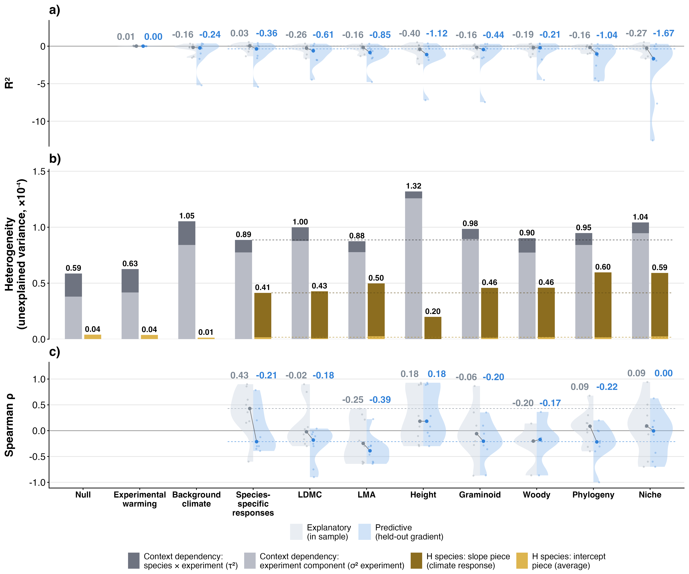
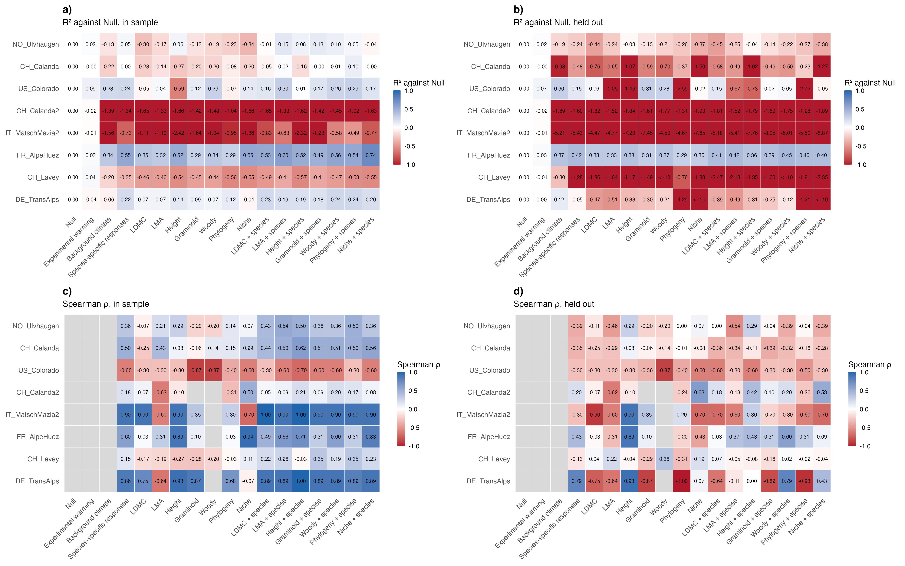

# Step 07d: The colonizer ladder, predicted (Step D route 2, colonizers)

Step 06 on the 110 colonizer ladder rows of step 07c: every level was refitted 8 times, each time without one of the 8 gradients with at least 5 effects, and asked to predict its warmed cover; fixed effects with the experiment term at zero, Species-specific responses and the supplement levels adding the species' deviations learnt in training. Scored per gradient by R² against the Null on the same gradient and Spearman ρ, in sample and held out, summarised by medians; no loser/winner skill, since colonizers have no loser class. 88 fold fits (56 property folds warm-started), 0 needing the bobyqa retry, 0 failed.

Every fold fit converged.

## Counts

| gradient_id | effects | held_out |
| --- | --- | --- |
| CH_Calanda | 19 | yes |
| CH_Calanda2 | 9 | yes |
| CH_Lavey | 25 | yes |
| CN_Gongga | 1 | no (fewer than 5 effects; trains only) |
| DE_Grainau | 3 | no (fewer than 5 effects; trains only) |
| DE_Susalps | 4 | no (fewer than 5 effects; trains only) |
| DE_TransAlps | 7 | yes |
| FR_AlpeHuez | 6 | yes |
| FR_Lautaret | 2 | no (fewer than 5 effects; trains only) |
| IT_MatschMazia1 | 1 | no (fewer than 5 effects; trains only) |
| IT_MatschMazia2 | 5 | yes |
| NO_Gudmedalen | 3 | no (fewer than 5 effects; trains only) |
| NO_Lavisdalen | 4 | no (fewer than 5 effects; trains only) |
| NO_Skjellingahaugen | 2 | no (fewer than 5 effects; trains only) |
| NO_Ulvhaugen | 7 | yes |
| SE_Abisko | 3 | no (fewer than 5 effects; trains only) |
| US_Colorado | 5 | yes |
| US_Montana | 4 | no (fewer than 5 effects; trains only) |

## Prediction metrics, median over gradients

| level | metric | fit | pred | gradients (fit / pred) | held out better than Null |
| --- | --- | --- | --- | --- | --- |
| Null | R² against Null | 0.000 | 0.000 | 8 / 8 | 0 of 8 |
| Null | Spearman ρ |  |  | 0 / 0 |  |
| Experimental warming | R² against Null | 0.010 | 0.001 | 8 / 8 | 4 of 8 |
| Experimental warming | Spearman ρ |  |  | 0 / 0 |  |
| Background climate | R² against Null | -0.162 | -0.242 | 8 / 8 | 3 of 8 |
| Background climate | Spearman ρ |  |  | 0 / 0 |  |
| Species-specific responses | R² against Null | 0.028 | -0.359 | 8 / 8 | 2 of 8 |
| Species-specific responses | Spearman ρ | 0.429 | -0.213 | 8 / 8 |  |
| LDMC | R² against Null | -0.263 | -0.615 | 8 / 8 | 2 of 8 |
| LDMC | Spearman ρ | -0.021 | -0.181 | 8 / 8 |  |
| LMA | R² against Null | -0.157 | -0.849 | 8 / 8 | 1 of 8 |
| LMA | Spearman ρ | -0.246 | -0.389 | 8 / 8 |  |
| Height | R² against Null | -0.404 | -1.121 | 8 / 8 | 1 of 8 |
| Height | Spearman ρ | 0.183 | 0.183 | 8 / 8 |  |
| Graminoid | R² against Null | -0.164 | -0.444 | 8 / 8 | 2 of 8 |
| Graminoid | Spearman ρ | -0.058 | -0.204 | 7 / 7 |  |
| Woody | R² against Null | -0.194 | -0.214 | 8 / 7 | 2 of 7 |
| Woody | Spearman ρ | -0.201 | -0.172 | 4 / 4 |  |
| Phylogeny | R² against Null | -0.156 | -1.038 | 8 / 8 | 1 of 8 |
| Phylogeny | Spearman ρ | 0.086 | -0.218 | 8 / 8 |  |
| Niche | R² against Null | -0.273 | -1.666 | 8 / 8 | 1 of 8 |
| Niche | Spearman ρ | 0.091 | -0.005 | 8 / 8 |  |
| LDMC + species | R² against Null | -0.033 | -0.518 | 8 / 8 | 2 of 8 |
| LDMC + species | Spearman ρ | 0.433 | -0.180 | 8 / 8 |  |
| LMA + species | R² against Null | 0.084 | -0.578 | 8 / 8 | 1 of 8 |
| LMA + species | Spearman ρ | 0.517 | -0.215 | 8 / 8 |  |
| Height + species | R² against Null | -0.075 | -0.874 | 8 / 8 | 1 of 8 |
| Height + species | Spearman ρ | 0.558 | 0.143 | 8 / 8 |  |
| Graminoid + species | R² against Null | 0.062 | -0.358 | 8 / 8 | 2 of 8 |
| Graminoid + species | Spearman ρ | 0.354 | -0.178 | 8 / 8 |  |
| Woody + species | R² against Null | 0.054 | -0.218 | 8 / 7 | 2 of 7 |
| Woody + species | Spearman ρ | 0.434 | -0.138 | 8 / 8 |  |
| Phylogeny + species | R² against Null | 0.077 | -1.542 | 8 / 8 | 1 of 8 |
| Phylogeny + species | Spearman ρ | 0.423 | -0.212 | 8 / 8 |  |
| Niche + species | R² against Null | -0.021 | -1.581 | 8 / 8 | 1 of 8 |
| Niche + species | Spearman ρ | 0.461 | -0.161 | 8 / 8 |  |

Taken out of the R² row and the medians (R² below −100, Bills, 2 Nov): Woody, held out at CH_Lavey (-140.8); Woody + species, held out at CH_Lavey (-141.3).

Every held-out species had training data: TRUE.

## Figures

Fig S19 a) as Fig 6 a): half violins of the 8 scored gradients, explanatory (grey) beside predictive (blue), medians written in; R² against the Null on that gradient. No Spearman row (Bills, 13 Nov; the colonizers' Spearman is in Fig S21 and the table above) and no skill row. Fig S19 b) is the raw heterogeneity of each model fitted in step 07c (×10⁻⁴), as Fig 6 b).

## Warnings captured

- null / CH_Calanda: There are outcomes with non-positive sampling variances.
- null / CH_Calanda: 'V' appears to be not positive definite.
- null / CH_Calanda2: There are outcomes with non-positive sampling variances.
- null / CH_Calanda2: 'V' appears to be not positive definite.
- null / CH_Lavey: There are outcomes with non-positive sampling variances.
- null / CH_Lavey: 'V' appears to be not positive definite.
- null / DE_TransAlps: There are outcomes with non-positive sampling variances.
- null / DE_TransAlps: 'V' appears to be not positive definite.
- null / FR_AlpeHuez: There are outcomes with non-positive sampling variances.
- null / FR_AlpeHuez: 'V' appears to be not positive definite.
- null / IT_MatschMazia2: There are outcomes with non-positive sampling variances.
- null / IT_MatschMazia2: 'V' appears to be not positive definite.
- null / NO_Ulvhaugen: There are outcomes with non-positive sampling variances.
- null / NO_Ulvhaugen: 'V' appears to be not positive definite.
- null / US_Colorado: There are outcomes with non-positive sampling variances.
- null / US_Colorado: 'V' appears to be not positive definite.
- warming / CH_Calanda: There are outcomes with non-positive sampling variances.
- warming / CH_Calanda: 'V' appears to be not positive definite.
- warming / CH_Calanda2: There are outcomes with non-positive sampling variances.
- warming / CH_Calanda2: 'V' appears to be not positive definite.
- warming / CH_Lavey: There are outcomes with non-positive sampling variances.
- warming / CH_Lavey: 'V' appears to be not positive definite.
- warming / DE_TransAlps: There are outcomes with non-positive sampling variances.
- warming / DE_TransAlps: 'V' appears to be not positive definite.
- warming / FR_AlpeHuez: There are outcomes with non-positive sampling variances.
- warming / FR_AlpeHuez: 'V' appears to be not positive definite.
- warming / IT_MatschMazia2: There are outcomes with non-positive sampling variances.
- warming / IT_MatschMazia2: 'V' appears to be not positive definite.
- warming / NO_Ulvhaugen: There are outcomes with non-positive sampling variances.
- warming / NO_Ulvhaugen: 'V' appears to be not positive definite.
- warming / US_Colorado: There are outcomes with non-positive sampling variances.
- warming / US_Colorado: 'V' appears to be not positive definite.
- climate / CH_Calanda: There are outcomes with non-positive sampling variances.
- climate / CH_Calanda: 'V' appears to be not positive definite.
- climate / CH_Calanda2: There are outcomes with non-positive sampling variances.
- climate / CH_Calanda2: 'V' appears to be not positive definite.
- climate / CH_Lavey: There are outcomes with non-positive sampling variances.
- climate / CH_Lavey: 'V' appears to be not positive definite.
- climate / DE_TransAlps: There are outcomes with non-positive sampling variances.
- climate / DE_TransAlps: 'V' appears to be not positive definite.
- climate / FR_AlpeHuez: There are outcomes with non-positive sampling variances.
- climate / FR_AlpeHuez: 'V' appears to be not positive definite.
- climate / IT_MatschMazia2: There are outcomes with non-positive sampling variances.
- climate / IT_MatschMazia2: 'V' appears to be not positive definite.
- climate / NO_Ulvhaugen: There are outcomes with non-positive sampling variances.
- climate / NO_Ulvhaugen: 'V' appears to be not positive definite.
- climate / US_Colorado: There are outcomes with non-positive sampling variances.
- climate / US_Colorado: 'V' appears to be not positive definite.
- species / CH_Calanda: There are outcomes with non-positive sampling variances.
- species / CH_Calanda: 'V' appears to be not positive definite.
- species / CH_Calanda2: There are outcomes with non-positive sampling variances.
- species / CH_Calanda2: 'V' appears to be not positive definite.
- species / CH_Lavey: There are outcomes with non-positive sampling variances.
- species / CH_Lavey: 'V' appears to be not positive definite.
- species / DE_TransAlps: There are outcomes with non-positive sampling variances.
- species / DE_TransAlps: 'V' appears to be not positive definite.
- species / FR_AlpeHuez: There are outcomes with non-positive sampling variances.
- species / FR_AlpeHuez: 'V' appears to be not positive definite.
- species / IT_MatschMazia2: There are outcomes with non-positive sampling variances.
- species / IT_MatschMazia2: 'V' appears to be not positive definite.
- species / NO_Ulvhaugen: There are outcomes with non-positive sampling variances.
- species / NO_Ulvhaugen: 'V' appears to be not positive definite.
- species / US_Colorado: There are outcomes with non-positive sampling variances.
- species / US_Colorado: 'V' appears to be not positive definite.
- ldmc / CH_Calanda: There are outcomes with non-positive sampling variances.
- ldmc / CH_Calanda: 'V' appears to be not positive definite.
- ldmc / CH_Calanda2: There are outcomes with non-positive sampling variances.
- ldmc / CH_Calanda2: 'V' appears to be not positive definite.
- ldmc / CH_Lavey: There are outcomes with non-positive sampling variances.
- ldmc / CH_Lavey: 'V' appears to be not positive definite.
- ldmc / DE_TransAlps: There are outcomes with non-positive sampling variances.
- ldmc / DE_TransAlps: 'V' appears to be not positive definite.
- ldmc / FR_AlpeHuez: There are outcomes with non-positive sampling variances.
- ldmc / FR_AlpeHuez: 'V' appears to be not positive definite.
- ldmc / IT_MatschMazia2: There are outcomes with non-positive sampling variances.
- ldmc / IT_MatschMazia2: 'V' appears to be not positive definite.
- ldmc / NO_Ulvhaugen: There are outcomes with non-positive sampling variances.
- ldmc / NO_Ulvhaugen: 'V' appears to be not positive definite.
- ldmc / US_Colorado: There are outcomes with non-positive sampling variances.
- ldmc / US_Colorado: 'V' appears to be not positive definite.
- lma / CH_Calanda: There are outcomes with non-positive sampling variances.
- lma / CH_Calanda: 'V' appears to be not positive definite.
- lma / CH_Calanda2: There are outcomes with non-positive sampling variances.
- lma / CH_Calanda2: 'V' appears to be not positive definite.
- lma / CH_Lavey: There are outcomes with non-positive sampling variances.
- lma / CH_Lavey: 'V' appears to be not positive definite.
- lma / DE_TransAlps: There are outcomes with non-positive sampling variances.
- lma / DE_TransAlps: 'V' appears to be not positive definite.
- lma / FR_AlpeHuez: There are outcomes with non-positive sampling variances.
- lma / FR_AlpeHuez: 'V' appears to be not positive definite.
- lma / IT_MatschMazia2: There are outcomes with non-positive sampling variances.
- lma / IT_MatschMazia2: 'V' appears to be not positive definite.
- lma / NO_Ulvhaugen: There are outcomes with non-positive sampling variances.
- lma / NO_Ulvhaugen: 'V' appears to be not positive definite.
- lma / US_Colorado: There are outcomes with non-positive sampling variances.
- lma / US_Colorado: 'V' appears to be not positive definite.
- height / CH_Calanda: There are outcomes with non-positive sampling variances.
- height / CH_Calanda: 'V' appears to be not positive definite.
- height / CH_Calanda2: There are outcomes with non-positive sampling variances.
- height / CH_Calanda2: 'V' appears to be not positive definite.
- height / CH_Lavey: There are outcomes with non-positive sampling variances.
- height / CH_Lavey: 'V' appears to be not positive definite.
- height / DE_TransAlps: There are outcomes with non-positive sampling variances.
- height / DE_TransAlps: 'V' appears to be not positive definite.
- height / FR_AlpeHuez: There are outcomes with non-positive sampling variances.
- height / FR_AlpeHuez: 'V' appears to be not positive definite.
- height / IT_MatschMazia2: There are outcomes with non-positive sampling variances.
- height / IT_MatschMazia2: 'V' appears to be not positive definite.
- height / NO_Ulvhaugen: There are outcomes with non-positive sampling variances.
- height / NO_Ulvhaugen: 'V' appears to be not positive definite.
- height / US_Colorado: There are outcomes with non-positive sampling variances.
- height / US_Colorado: 'V' appears to be not positive definite.
- graminoid / CH_Calanda: There are outcomes with non-positive sampling variances.
- graminoid / CH_Calanda: 'V' appears to be not positive definite.
- graminoid / CH_Calanda2: There are outcomes with non-positive sampling variances.
- graminoid / CH_Calanda2: 'V' appears to be not positive definite.
- graminoid / CH_Lavey: There are outcomes with non-positive sampling variances.
- graminoid / CH_Lavey: 'V' appears to be not positive definite.
- graminoid / DE_TransAlps: There are outcomes with non-positive sampling variances.
- graminoid / DE_TransAlps: 'V' appears to be not positive definite.
- graminoid / FR_AlpeHuez: There are outcomes with non-positive sampling variances.
- graminoid / FR_AlpeHuez: 'V' appears to be not positive definite.
- graminoid / IT_MatschMazia2: There are outcomes with non-positive sampling variances.
- graminoid / IT_MatschMazia2: 'V' appears to be not positive definite.
- graminoid / NO_Ulvhaugen: There are outcomes with non-positive sampling variances.
- graminoid / NO_Ulvhaugen: 'V' appears to be not positive definite.
- graminoid / US_Colorado: There are outcomes with non-positive sampling variances.
- graminoid / US_Colorado: 'V' appears to be not positive definite.
- woody / CH_Calanda: There are outcomes with non-positive sampling variances.
- woody / CH_Calanda: 'V' appears to be not positive definite.
- woody / CH_Calanda: Redundant predictors dropped from the model.
- woody / CH_Calanda2: There are outcomes with non-positive sampling variances.
- woody / CH_Calanda2: 'V' appears to be not positive definite.
- woody / CH_Calanda2: Redundant predictors dropped from the model.
- woody / CH_Lavey: There are outcomes with non-positive sampling variances.
- woody / CH_Lavey: 'V' appears to be not positive definite.
- woody / CH_Lavey: Redundant predictors dropped from the model.
- woody / DE_TransAlps: There are outcomes with non-positive sampling variances.
- woody / DE_TransAlps: 'V' appears to be not positive definite.
- woody / DE_TransAlps: Redundant predictors dropped from the model.
- woody / FR_AlpeHuez: There are outcomes with non-positive sampling variances.
- woody / FR_AlpeHuez: 'V' appears to be not positive definite.
- woody / FR_AlpeHuez: Redundant predictors dropped from the model.
- woody / IT_MatschMazia2: There are outcomes with non-positive sampling variances.
- woody / IT_MatschMazia2: 'V' appears to be not positive definite.
- woody / IT_MatschMazia2: Redundant predictors dropped from the model.
- woody / NO_Ulvhaugen: There are outcomes with non-positive sampling variances.
- woody / NO_Ulvhaugen: 'V' appears to be not positive definite.
- woody / NO_Ulvhaugen: Redundant predictors dropped from the model.
- woody / US_Colorado: There are outcomes with non-positive sampling variances.
- woody / US_Colorado: 'V' appears to be not positive definite.
- woody / US_Colorado: Redundant predictors dropped from the model.
- phylogeny / CH_Calanda: There are outcomes with non-positive sampling variances.
- phylogeny / CH_Calanda: 'V' appears to be not positive definite.
- phylogeny / CH_Calanda2: There are outcomes with non-positive sampling variances.
- phylogeny / CH_Calanda2: 'V' appears to be not positive definite.
- phylogeny / CH_Lavey: There are outcomes with non-positive sampling variances.
- phylogeny / CH_Lavey: 'V' appears to be not positive definite.
- phylogeny / DE_TransAlps: There are outcomes with non-positive sampling variances.
- phylogeny / DE_TransAlps: 'V' appears to be not positive definite.
- phylogeny / FR_AlpeHuez: There are outcomes with non-positive sampling variances.
- phylogeny / FR_AlpeHuez: 'V' appears to be not positive definite.
- phylogeny / IT_MatschMazia2: There are outcomes with non-positive sampling variances.
- phylogeny / IT_MatschMazia2: 'V' appears to be not positive definite.
- phylogeny / NO_Ulvhaugen: There are outcomes with non-positive sampling variances.
- phylogeny / NO_Ulvhaugen: 'V' appears to be not positive definite.
- phylogeny / US_Colorado: There are outcomes with non-positive sampling variances.
- phylogeny / US_Colorado: 'V' appears to be not positive definite.
- niche / CH_Calanda: There are outcomes with non-positive sampling variances.
- niche / CH_Calanda: 'V' appears to be not positive definite.
- niche / CH_Calanda2: There are outcomes with non-positive sampling variances.
- niche / CH_Calanda2: 'V' appears to be not positive definite.
- niche / CH_Lavey: There are outcomes with non-positive sampling variances.
- niche / CH_Lavey: 'V' appears to be not positive definite.
- niche / DE_TransAlps: There are outcomes with non-positive sampling variances.
- niche / DE_TransAlps: 'V' appears to be not positive definite.
- niche / FR_AlpeHuez: There are outcomes with non-positive sampling variances.
- niche / FR_AlpeHuez: 'V' appears to be not positive definite.
- niche / IT_MatschMazia2: There are outcomes with non-positive sampling variances.
- niche / IT_MatschMazia2: 'V' appears to be not positive definite.
- niche / NO_Ulvhaugen: There are outcomes with non-positive sampling variances.
- niche / NO_Ulvhaugen: 'V' appears to be not positive definite.
- niche / US_Colorado: There are outcomes with non-positive sampling variances.
- niche / US_Colorado: 'V' appears to be not positive definite.
- metafor: "'struct' argument is disregaded since no ~ inner | outer term" (24 fold fits without slopes)

## Deviations from PLAN.md

- The colonizer ladder predicted on the residents' reduction (Bills, 2 Nov).
- Property folds warm-started from the same fold's Species-specific responses fit with optim BFGS (Bills, 7 Nov, as steps 05 and 06).
- An R² below −100 is taken out of the R² row and the medians and listed (Bills, 2 Nov).
- Without abundance (Bills, 7, 8 and 13 Nov): Fig S19 shows R² and the raw heterogeneity of step 07c, as Fig 6, without Spearman; the change in unexplained variation is Fig S20 (step 07c).
