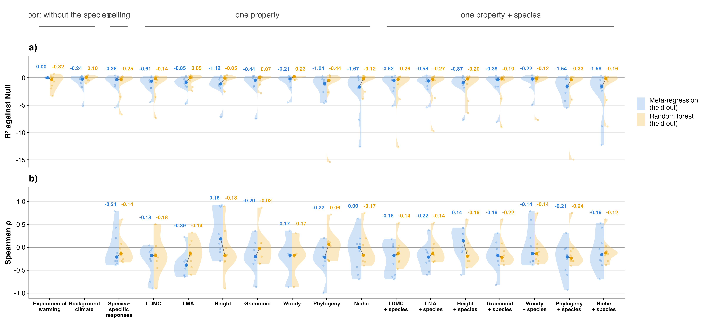

# Step 07e: Sensitivity, random forest, colonizers (held out)

Every level of the ladder except Null was refitted as a random forest (ranger 0.18.0) on the 110 colonizer ladder rows of step 07c, with the variables of the step 07d formulas (without abundance, Bills 7 Nov) as predictors and species as a factor in the Species-specific responses and the seven property + species forests. Each forest was fitted 8 times, once without each scored gradient, and asked to predict it, with 3000 trees, no case weights and one parameter set for every level and fold: minimum node size 5 and mtry half the number of predictors, chosen from 10 settings as the one with the highest median out-of-bag R² over the 17 levels (Bills, 2 Nov). Only held-out predictions are read. They are scored as in step 07d: R² against the metafor Null on the same gradient and Spearman ρ within the gradient (no skill: colonizers have no loser class), and set beside 07d's held-out values per gradient and as medians. The forest Null is the mean of the training effects.

## Counts

| rule | n |
| --- | --- |
| colonizer ladder rows (step 07c) | 110 |
| species | 27 |
| experiments | 24 |
| gradients training | 18 |
| gradients held out and scored (at least 5 effects) | 8 |
| forest levels | 17 |
| forests (levels x scored gradients) | 136 |

## Tuning: one parameter set for all forests

Each setting was fitted once per level on all 110 rows, and scored by its out-of-bag R² (each effect predicted by the trees that did not draw it). The setting with the highest median over the 17 levels (node5_half) is used for every level and fold. Out-of-bag R² uses none of the held-out scores, so these stay unbiased; it measures prediction within known gradients (the other effects of a gradient stay in training), so its values say nothing about transfer: the forests with species score highest out of bag and lowest held out. In-sample R² would always pick the most flexible forest.

| setting | minimum node size | mtry | out-of-bag R², median over levels | lowest level | highest level | chosen |
| --- | --- | --- | --- | --- | --- | --- |
| node5_sqrt | 5 | √p | 0.157 | -0.069 | 0.268 |  |
| node5_half | 5 | p / 2 | 0.164 | -0.080 | 0.256 | yes |
| node10_sqrt | 10 | √p | 0.145 | -0.028 | 0.236 |  |
| node10_half | 10 | p / 2 | 0.153 | -0.028 | 0.233 |  |
| node20_sqrt | 20 | √p | 0.112 | -0.005 | 0.199 |  |
| node20_half | 20 | p / 2 | 0.112 | -0.005 | 0.213 |  |
| node40_sqrt | 40 | √p | 0.064 | 0.012 | 0.154 |  |
| node40_half | 40 | p / 2 | 0.064 | 0.012 | 0.154 |  |
| node80_sqrt | 80 | √p | 0.039 | -0.009 | 0.115 |  |
| node80_half | 80 | p / 2 | 0.039 | -0.009 | 0.115 |  |

Spread of the forest predictions: within a held-out gradient their standard deviation is a median 77% of the observed one, and 136 of 136 forests predict one sign for every effect of the gradient.

## Forest beside meta-regression, held out, median over gradients

| level | metric | metafor | forest | median difference | forest higher |
| --- | --- | --- | --- | --- | --- |
| Null | R² against Null | 0.000 | 0.193 | 0.193 | 5 of 8 |
| Null | Spearman ρ |  |  |  |  |
| Experimental warming | R² against Null | 0.001 | -0.321 | -0.327 | 4 of 8 |
| Experimental warming | Spearman ρ |  |  |  |  |
| Background climate | R² against Null | -0.242 | 0.097 | 0.210 | 4 of 8 |
| Background climate | Spearman ρ |  |  |  |  |
| Species-specific responses | R² against Null | -0.359 | -0.254 | 0.110 | 5 of 8 |
| Species-specific responses | Spearman ρ | -0.213 | -0.139 | -0.089 | 4 of 8 |
| LDMC | R² against Null | -0.615 | -0.137 | 0.478 | 5 of 8 |
| LDMC | Spearman ρ | -0.181 | -0.180 | 0.016 | 6 of 8 |
| LMA | R² against Null | -0.849 | 0.046 | 0.362 | 5 of 8 |
| LMA | Spearman ρ | -0.389 | -0.136 | 0.188 | 7 of 8 |
| Height | R² against Null | -1.121 | -0.050 | 0.623 | 6 of 8 |
| Height | Spearman ρ | 0.183 | -0.183 | -0.079 | 2 of 8 |
| Graminoid | R² against Null | -0.444 | 0.070 | 0.316 | 6 of 8 |
| Graminoid | Spearman ρ | -0.204 | -0.024 | 0.000 | 6 of 7 |
| Woody | R² against Null | -0.214 | 0.225 | 0.276 | 5 of 7 |
| Woody | Spearman ρ | -0.172 | -0.172 | 0.000 | 2 of 4 |
| Phylogeny | R² against Null | -1.038 | -0.441 | 0.315 | 4 of 8 |
| Phylogeny | Spearman ρ | -0.218 | 0.065 | 0.110 | 7 of 8 |
| Niche | R² against Null | -1.666 | -0.115 | 0.932 | 5 of 8 |
| Niche | Spearman ρ | -0.005 | -0.174 | 0.195 | 5 of 8 |
| LDMC + species | R² against Null | -0.518 | -0.263 | 0.320 | 5 of 8 |
| LDMC + species | Spearman ρ | -0.180 | -0.139 | 0.121 | 4 of 8 |
| LMA + species | R² against Null | -0.578 | -0.266 | 0.254 | 5 of 8 |
| LMA + species | Spearman ρ | -0.215 | -0.139 | 0.179 | 5 of 8 |
| Height + species | R² against Null | -0.874 | -0.202 | 0.366 | 5 of 8 |
| Height + species | Spearman ρ | 0.143 | -0.194 | -0.416 | 3 of 8 |
| Graminoid + species | R² against Null | -0.358 | -0.191 | 0.217 | 5 of 8 |
| Graminoid + species | Spearman ρ | -0.178 | -0.220 | -0.121 | 3 of 8 |
| Woody + species | R² against Null | -0.218 | -0.118 | 0.254 | 5 of 7 |
| Woody + species | Spearman ρ | -0.138 | -0.139 | -0.018 | 4 of 8 |
| Phylogeny + species | R² against Null | -1.542 | -0.330 | 0.171 | 4 of 8 |
| Phylogeny + species | Spearman ρ | -0.212 | -0.237 | 0.050 | 4 of 8 |
| Niche + species | R² against Null | -1.581 | -0.164 | 0.756 | 5 of 8 |
| Niche + species | Spearman ρ | -0.161 | -0.124 | 0.089 | 5 of 8 |

Taken out of the R² row and the medians (R² below −100): meta-regression, Woody at CH_Lavey (-140.8); meta-regression, Woody + species at CH_Lavey (-141.3).

R² against Null, median held out: the forest is above the meta-regression at 16 of 17 levels.

## Seed check

Every forest refitted with a second seed: the largest change in a per-gradient value is 1.084 and the largest change in a median 0.095. Largest change in a median per metric: R² 0.030, Spearman ρ 0.095.

## Figures

## Warnings captured

None.

## Deviations from PLAN.md

- Step 06b on the colonizer ladder rows (Bills, 2 Nov): no case weights, held-out values only, out-of-bag tuning, property + species forests, as step 06b.
- No loser/winner skill (no loser class); R² below −100 taken out and listed (Bills, 2 Nov), from both meta-regression and forest for that level and gradient (3 Nov).
