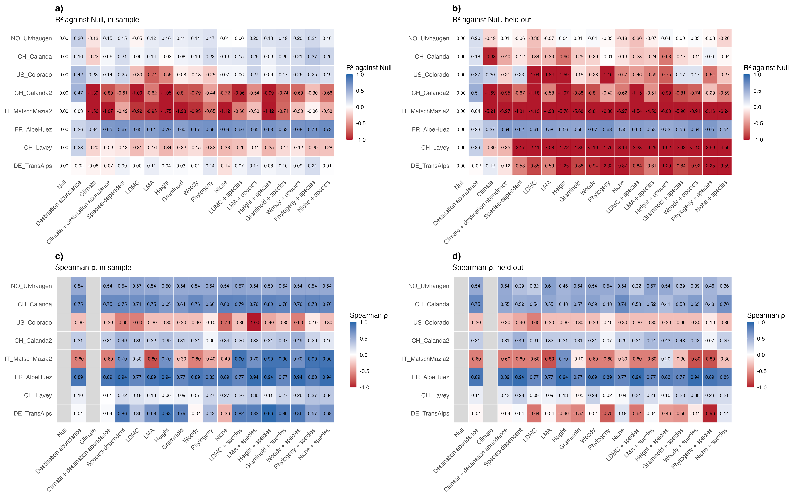

# Step 07e: Sensitivity, random forest, colonizers (held out)

Every level of the ladder except Null was refitted as a random forest (ranger 0.18.0) on the 110 colonizer ladder rows of step 07c, with the variables of the step 07d formulas (A0_origin dropped) as predictors and species as a factor in the Species-dependent and the seven property + species forests. Each forest was fitted 8 times, once without each scored gradient, and asked to predict it, with 3000 trees, no case weights and one parameter set for every level and fold: minimum node size 5 and mtry the square root of the number of predictors, chosen from 10 settings as the one with the highest median out-of-bag R² over the 18 levels (Bills, 2 Nov). Only held-out predictions are read. They are scored as in step 07d: R² against the metafor Null on the same gradient and Spearman ρ within the gradient (no skill: colonizers have no loser class), and set beside 07d's held-out values per gradient and as medians. The forest Null is the mean of the training effects.

## Counts

| rule | n |
| --- | --- |
| colonizer ladder rows (step 07c) | 110 |
| species | 27 |
| experiments | 24 |
| gradients training | 18 |
| gradients held out and scored (at least 5 effects) | 8 |
| forest levels | 18 |
| forests (levels x scored gradients) | 144 |

## Tuning: one parameter set for all forests

Each setting was fitted once per level on all 110 rows, and scored by its out-of-bag R² (each effect predicted by the trees that did not draw it). The setting with the highest median over the 18 levels (node5_sqrt) is used for every level and fold. Out-of-bag R² uses none of the held-out scores, so these stay unbiased; it measures prediction within known gradients (the other effects of a gradient stay in training), so its values say nothing about transfer: the forests with species score highest out of bag and lowest held out. In-sample R² would always pick the most flexible forest.

| setting | minimum node size | mtry | out-of-bag R², median over levels | lowest level | highest level | chosen |
| --- | --- | --- | --- | --- | --- | --- |
| node5_sqrt | 5 | √p | 0.216 | -0.019 | 0.329 | yes |
| node5_half | 5 | p / 2 | 0.194 | -0.022 | 0.331 |  |
| node10_sqrt | 10 | √p | 0.163 | 0.007 | 0.282 |  |
| node10_half | 10 | p / 2 | 0.124 | 0.004 | 0.290 |  |
| node20_sqrt | 20 | √p | 0.127 | 0.033 | 0.242 |  |
| node20_half | 20 | p / 2 | 0.092 | 0.023 | 0.244 |  |
| node40_sqrt | 40 | √p | 0.100 | 0.048 | 0.181 |  |
| node40_half | 40 | p / 2 | 0.080 | 0.040 | 0.175 |  |
| node80_sqrt | 80 | √p | 0.071 | 0.028 | 0.134 |  |
| node80_half | 80 | p / 2 | 0.053 | 0.015 | 0.131 |  |

Spread of the forest predictions: within a held-out gradient their standard deviation is a median 53% of the observed one, and 144 of 144 forests predict one sign for every effect of the gradient.

## Forest beside meta-regression, held out, median over gradients

| level | metric | metafor | forest | median difference | forest higher |
| --- | --- | --- | --- | --- | --- |
| Null | R² against Null | 0.000 | 0.193 | 0.193 | 5 of 8 |
| Null | Spearman ρ |  |  |  |  |
| Destination abundance | R² against Null | 0.112 | -0.029 | -0.222 | 1 of 8 |
| Destination abundance | Spearman ρ | 0.243 | 0.225 | 0.000 | 5 of 8 |
| Climate | R² against Null | -0.242 | 0.092 | 0.170 | 4 of 8 |
| Climate | Spearman ρ |  |  |  |  |
| Climate + destination abundance | R² against Null | -0.311 | -0.070 | 0.219 | 5 of 8 |
| Climate + destination abundance | Spearman ρ | 0.243 | 0.372 | 0.029 | 5 of 8 |
| Species-dependent | R² against Null | -0.397 | 0.012 | 0.142 | 5 of 8 |
| Species-dependent | Spearman ρ | 0.267 | 0.044 | -0.262 | 3 of 8 |
| LDMC | R² against Null | -0.804 | -0.024 | 0.318 | 5 of 8 |
| LDMC | Spearman ρ | 0.237 | 0.116 | -0.021 | 4 of 8 |
| LMA | R² against Null | -0.462 | -0.014 | 0.775 | 7 of 8 |
| LMA | Spearman ρ | 0.289 | 0.065 | 0.000 | 5 of 8 |
| Height | R² against Null | -0.831 | -0.017 | 0.533 | 7 of 8 |
| Height | Spearman ρ | 0.337 | 0.205 | -0.000 | 4 of 8 |
| Graminoid | R² against Null | -0.733 | -0.014 | 0.211 | 7 of 8 |
| Graminoid | Spearman ρ | 0.122 | 0.351 | -0.086 | 4 of 8 |
| Woody | R² against Null | -0.290 | -0.041 | 0.261 | 6 of 7 |
| Woody | Spearman ρ | 0.274 | 0.319 | 0.024 | 6 of 8 |
| Phylogeny | R² against Null | -0.487 | -0.036 | 0.219 | 4 of 8 |
| Phylogeny | Spearman ρ | -0.046 | 0.176 | -0.058 | 4 of 8 |
| Niche | R² against Null | -0.898 | 0.020 | 0.749 | 6 of 8 |
| Niche | Spearman ρ | 0.209 | 0.251 | -0.083 | 3 of 8 |
| LDMC + species | R² against Null | -0.668 | 0.032 | 0.353 | 5 of 8 |
| LDMC + species | Spearman ρ | 0.269 | 0.044 | -0.272 | 3 of 8 |
| LMA + species | R² against Null | -0.378 | 0.058 | 0.353 | 6 of 8 |
| LMA + species | Spearman ρ | 0.219 | -0.026 | -0.246 | 3 of 8 |
| Height + species | R² against Null | -0.814 | 0.040 | 0.410 | 5 of 8 |
| Height + species | Spearman ρ | 0.240 | -0.044 | -0.431 | 2 of 8 |
| Graminoid + species | R² against Null | -0.664 | 0.024 | 0.191 | 5 of 8 |
| Graminoid + species | Spearman ρ | 0.157 | 0.044 | -0.251 | 3 of 8 |
| Woody + species | R² against Null | -0.330 | 0.019 | 0.281 | 5 of 7 |
| Woody + species | Spearman ρ | 0.300 | 0.044 | -0.259 | 3 of 8 |
| Phylogeny + species | R² against Null | -0.369 | -0.016 | 0.158 | 4 of 8 |
| Phylogeny + species | Spearman ρ | -0.081 | 0.022 | -0.133 | 3 of 8 |
| Niche + species | R² against Null | -0.683 | 0.033 | 0.550 | 6 of 8 |
| Niche + species | Spearman ρ | 0.250 | 0.030 | -0.258 | 3 of 8 |

Taken out of the R² row and the medians (R² below −100): meta-regression, Woody at CH_Lavey (-145.9); meta-regression, Woody + species at CH_Lavey (-146.1).

R² against Null, median held out: the forest is above the meta-regression at 17 of 18 levels.

## Seed check

Every forest refitted with a second seed: the largest change in a per-gradient value is 0.312 and the largest change in a median 0.098. Largest change in a median per metric: R² 0.024, Spearman ρ 0.098.

## Figures

## Warnings captured

None.

## Deviations from PLAN.md

- Step 06b on the colonizer ladder rows (Bills, 2 Nov): no case weights, held-out values only, out-of-bag tuning, property + species forests, as step 06b.
- No loser/winner skill (no loser class); R² below −100 taken out and listed (Bills, 2 Nov).
