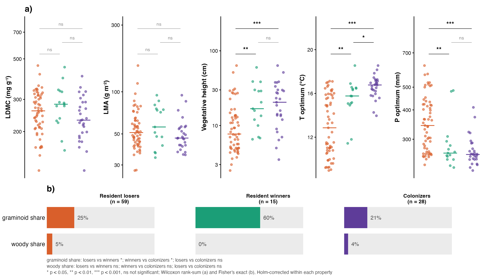

# Step 07f: The pathways (Q4), Fig 5

PLAN.md's fallback for the pathways figure (decided 2 Nov), since Step C found almost nothing consistent: resident species grouped by the sign of their pooled net strength from step 04 (Fig 2), losers below zero and winners above, against colonizer species whose pooled net warmed cover from 07b (Fig S2) is above zero; one point per species. As the agreed mock: LDMC, LMA, vegetative height, and the thermal and precipitation optima in their units (log axes except the thermal optimum) as dot strips with the group median, and the share of graminoids and woody species per group. 15 species are residents at some sites and colonizers at others, and appear in both pools. Descriptive; no model.

## Groups

| rule | n |
| --- | --- |
| resident species (step 04) | 74 |
| net strength below zero | 59 |
| net strength above zero | 15 |
| colonizer species (07b) | 29 |
| net warmed cover above zero | 28 |
| in both pools | 15 |

## Group medians and shares

| group | species | graminoid share | woody share | LDMC (mg g⁻¹) | LMA (g m⁻²) | Vegetative height (cm) | T optimum (°C) | P optimum (mm) |
| --- | --- | --- | --- | --- | --- | --- | --- | --- |
| Resident losers | 59 | 25% | 5% | 260 (57) | 51.1 (59) | 7.7 (57) | 12.9 (59) | 343 (59) |
| Resident winners | 15 | 60% | 0% | 282 (15) | 56.1 (15) | 16.8 (15) | 15.8 (15) | 262 (15) |
| Colonizers | 28 | 21% | 4% | 231 (28) | 46.7 (27) | 20.5 (27) | 16.8 (28) | 258 (28) |

Medians with the number of species that have the property in brackets.

## Group comparisons (decided 7 Nov)

Each pair of groups, for each property: Wilcoxon rank-sum test (`wilcox.test`, R's defaults) for the five continuous properties and Fisher's exact test for the graminoid and woody shares; p-values Holm-corrected over the three pairs of each property. Estimate: ratio of the second group's median to the first's (continuous) or difference in share (second minus first). Read with two cautions: the 15 species in both pools are counted in a resident group and among the colonizers, so the resident-colonizer comparisons are not between independent sets; and related species are counted as independent (no phylogenetic correction).

| property | pair | n | test | estimate | p | p (Holm) |
| --- | --- | --- | --- | --- | --- | --- |
| LDMC (mg g⁻¹) | Resident losers vs Resident winners | 57 / 15 | Wilcoxon rank-sum | 1.09 | 0.3249 | 0.4591 |
| LDMC (mg g⁻¹) | Resident winners vs Colonizers | 15 / 28 | Wilcoxon rank-sum | 0.82 | 0.0774 | 0.2323 |
| LDMC (mg g⁻¹) | Resident losers vs Colonizers | 57 / 28 | Wilcoxon rank-sum | 0.89 | 0.2295 | 0.4591 |
| LMA (g m⁻²) | Resident losers vs Resident winners | 59 / 15 | Wilcoxon rank-sum | 1.10 | 0.4434 | 0.5548 |
| LMA (g m⁻²) | Resident winners vs Colonizers | 15 / 27 | Wilcoxon rank-sum | 0.83 | 0.1849 | 0.5548 |
| LMA (g m⁻²) | Resident losers vs Colonizers | 59 / 27 | Wilcoxon rank-sum | 0.91 | 0.2373 | 0.5548 |
| Vegetative height (cm) | Resident losers vs Resident winners | 57 / 15 | Wilcoxon rank-sum | 2.18 | 0.0021 | 0.0043 |
| Vegetative height (cm) | Resident winners vs Colonizers | 15 / 27 | Wilcoxon rank-sum | 1.22 | 0.9225 | 0.9225 |
| Vegetative height (cm) | Resident losers vs Colonizers | 57 / 27 | Wilcoxon rank-sum | 2.66 | 0.0002 | 0.0005 |
| T optimum (°C) | Resident losers vs Resident winners | 59 / 15 | Wilcoxon rank-sum | 1.23 | 0.0019 | 0.0038 |
| T optimum (°C) | Resident winners vs Colonizers | 15 / 28 | Wilcoxon rank-sum | 1.06 | 0.0140 | 0.0140 |
| T optimum (°C) | Resident losers vs Colonizers | 59 / 28 | Wilcoxon rank-sum | 1.30 | 0.0000 | 0.0000 |
| P optimum (mm) | Resident losers vs Resident winners | 59 / 15 | Wilcoxon rank-sum | 0.76 | 0.0028 | 0.0057 |
| P optimum (mm) | Resident winners vs Colonizers | 15 / 28 | Wilcoxon rank-sum | 0.99 | 0.6097 | 0.6097 |
| P optimum (mm) | Resident losers vs Colonizers | 59 / 28 | Wilcoxon rank-sum | 0.75 | 0.0000 | 0.0000 |
| graminoid share | Resident losers vs Resident winners | 59 / 15 | Fisher's exact | +35% | 0.0152 | 0.0457 |
| graminoid share | Resident winners vs Colonizers | 15 / 28 | Fisher's exact | -39% | 0.0188 | 0.0457 |
| graminoid share | Resident losers vs Colonizers | 59 / 28 | Fisher's exact | -4% | 0.7922 | 0.7922 |
| woody share | Resident losers vs Resident winners | 59 / 15 | Fisher's exact | -5% | 1.0000 | 1.0000 |
| woody share | Resident winners vs Colonizers | 15 / 28 | Fisher's exact | +4% | 1.0000 | 1.0000 |
| woody share | Resident losers vs Colonizers | 59 / 28 | Fisher's exact | -2% | 1.0000 | 1.0000 |

Below 0.05 after correction: 9 of 21 comparisons.

In both pools: Achillea millefolium, Carum carvi, Dactylis glomerata, Festuca rubra, Lolium perenne, Lotus corniculatus, Phleum pratense, Poa pratensis, Rumex acetosa, Taraxacum officinale, Trifolium pratense, Trifolium repens, Trisetum flavescens, Veronica chamaedrys, Veronica officinalis.

## Figure

## Warnings captured

None.

## Deviations from PLAN.md

- PLAN.md's fallback, with resident losers added beside the winners (decided 2 Nov): groups by the sign of the net effect, not Step C classes.
- The figure is main Fig 5 (final numbering, decided 2 Nov); written to `figures/main/fig5.png`.
- Group comparisons added to the descriptive figure (decided 7 Nov): pairwise Wilcoxon and Fisher tests, Holm within each property.
