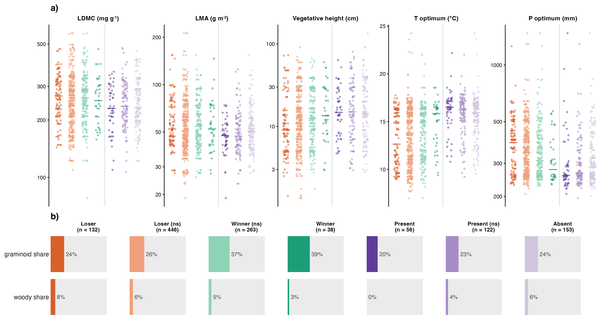

# Step 07f: The pathways (Q4), after Fig 1

Species properties for Fig 1's year-specific classes at year 3 (Bills, 2 Nov), with Fig 1's colours: residents as Loser, Loser (ns), Winner (ns) and Winner (step 03), colonizers as Present, Present (ns) and Absent (step 07a). A class belongs to a species x experiment, so each point is one species in one experiment, as Fig 1 counts them. As the agreed mock: LDMC, LMA and vegetative height, and the thermal and precipitation optima in their units (log axes except the thermal optimum) as dot strips with the group median, and the share of graminoids and woody species per group. Descriptive; no model.

## Groups (year 3)

| group | species x experiment | species |
| --- | --- | --- |
| Loser | 132 | 82 |
| Loser (ns) | 446 | 224 |
| Winner (ns) | 263 | 149 |
| Winner | 38 | 32 |
| Present | 56 | 46 |
| Present (ns) | 122 | 101 |
| Absent | 153 | 116 |

## Group medians and shares

| group | graminoid share | woody share | T optimum (°C) | P optimum (mm) | LDMC (mg g⁻¹) | LMA (g m⁻²) | Vegetative height (cm) |
| --- | --- | --- | --- | --- | --- | --- | --- |
| Loser | 24% | 8% | 12.6 (131) | 386 (131) | 267 (119) | 52.2 (117) | 9 (116) |
| Loser (ns) | 26% | 6% | 13.8 (440) | 342 (440) | 252 (386) | 50.8 (390) | 10.9 (377) |
| Winner (ns) | 37% | 5% | 14.9 (256) | 309 (256) | 261 (224) | 54.2 (231) | 12.5 (220) |
| Winner | 39% | 3% | 15.8 (38) | 278 (38) | 253 (37) | 52.2 (38) | 13.5 (35) |
| Present | 20% | 0% | 16.5 (55) | 259 (55) | 230 (49) | 47.4 (49) | 14.8 (49) |
| Present (ns) | 23% | 4% | 16.2 (119) | 266 (119) | 236 (109) | 47 (108) | 15 (101) |
| Absent | 24% | 6% | 15.9 (152) | 286 (152) | 232 (127) | 50.4 (134) | 14.2 (129) |

Medians with the number of species x experiment that have the property in brackets; shares over species x experiment.

## Figure

## Warnings captured

None.

## Deviations from PLAN.md

- Groups are Fig 1's year-3 classes, not Step C's consistent classes, which were nearly empty (Bills, 2 Nov); points are species x experiment.
- The figure follows Fig 1 (`figures/main/fig1_pathways.png`); final numbering in step 10.
