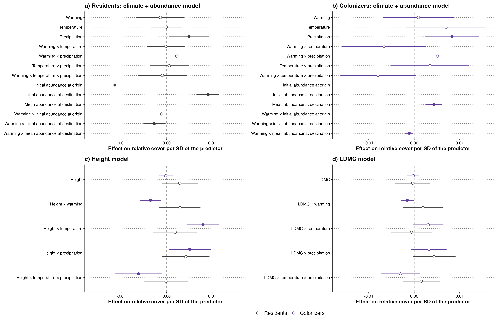
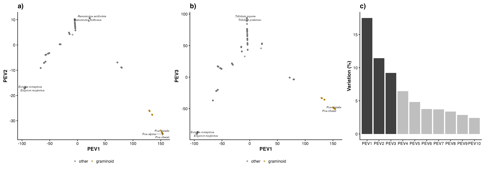

# Step 10: Figures, appendix and report

Draws what no earlier step produced: Fig 4, the 42 experiments in climate space with one pie per experiment splitting the warmed turf's relative cover, years 3 and later, among resident losers and winners (by the sign of their net strength from year 3 on), colonizers (net warmed cover above zero) and what was not analysed (species outside the pools, unidentified and genus-level records) (Bills, 2 Nov); Fig S10 the same map with the pies counting species; Fig S1 the data flow; Fig S3 and Table S3 the phylogenetic axes; Fig S4 the predictors before standardisation with the niche checks; Tables S1, S2, S4 and S5. Copies the reviewed figures of steps 03 to 07f under their final numbers (seven main figures, Bills 2 Nov; Fig 7 the coefficients of the climate + abundance, Height and LDMC models, residents beside colonizers). Pies are drawn to one radius at their destination climate; the 15 experiments that share a destination climate (6 points) fan out around a black dot at that climate on short lines; no two pies overlap (0 pies of different climates had to be pushed apart). Each pie is named by its gradient (with a letter where a gradient has several experiments), coloured by warming; the key beside the figure gives each one's origin and destination elevation.

## Counts

| item | n |
| --- | --- |
| experiments | 42 |
| resident effects (03b) | 1004 |
| net strength below zero | 703 |
| net strength above zero | 301 |
| colonizer effects (07a) | 379 |
| net warmed cover above zero | 264 |
| experiments with colonizers | 28 |
| experiments without purple | 14 |
| species analysed (residents or colonizers) | 426 |

## Fig 4 and Fig S10 pies

Cover shares (Fig 4) in per cent of the warmed turf; species counts (Fig S10) in brackets.

| experiment_id | name | elevations | T (°C) | P (mm) | W (°C) | Resident losers | Resident winners | Colonizers | Not analysed |
| --- | --- | --- | --- | --- | --- | --- | --- | --- | --- |
| CH_Calanda::Pea::Cal | CH Calanda a | 2600 → 2000 m | 10 | 540 | 3.8 | 29% (20) | 44% (8) | 21% (30) | 6% |
| CH_Calanda::Cal::Nes | CH Calanda b | 2000 → 1400 m | 13.2 | 456 | 3.2 | 28% (35) | 35% (14) | 27% (23) | 10% |
| CH_Calanda2::Cal::Nes | CH Calanda2 | 2000 → 1400 m | 13.7 | 423 | 3.2 | 14% (27) | 53% (18) | 0% (9) | 32% |
| CH_Lavey::RIO::CRE | CH Lavey a | 2200 → 1950 m | 11.9 | 431 | 2.1 | 35% (25) | 56% (17) | 0% (2) | 9% |
| CH_Lavey::RIO::MAR | CH Lavey b | 2200 → 1750 m | 12.9 | 429 | 3 | 17% (27) | 68% (15) | 2% (9) | 13% |
| CH_Lavey::RIO::PRA | CH Lavey c | 2200 → 1400 m | 15.9 | 353 | 6 | 23% (34) | 60% (8) | 11% (13) | 7% |
| CN_Damxung::HIGH::LOW | CN Damxung | 4800 → 4313 m | 9.9 | 370 | 1.7 | 9% (19) | 22% (1) | 0% (0) | 69% |
| CN_Gongga::H::A | CN Gongga a | 4100 → 3850 m | 9.6 | 1008 | 1.2 | 24% (13) | 22% (3) | 3% (7) | 50% |
| CN_Gongga::H::L | CN Gongga b | 4100 → 3000 m | 12.3 | 1046 | 3.9 | 6% (16) | 0% (0) | 20% (7) | 74% |
| CN_Gongga::A::M | CN Gongga c | 3850 → 3500 m | 10.7 | 1073 | 1.1 | 31% (15) | 23% (10) | 4% (7) | 42% |
| CN_Gongga::M::L | CN Gongga d | 3500 → 3000 m | 12.3 | 1046 | 1.6 | 18% (14) | 13% (5) | 0% (0) | 68% |
| CN_Heibei::3800::3400 | CN Heibei a | 3800 → 3400 m | 8.8 | 441 | 2.6 | 23% (7) | 42% (8) | 17% (10) | 18% |
| CN_Heibei::3800::3200 | CN Heibei b | 3800 → 3200 m | 9.6 | 376 | 3.4 | 46% (9) | 25% (6) | 5% (8) | 24% |
| CN_Heibei::3400::3200 | CN Heibei c | 3400 → 3200 m | 9.6 | 376 | 0.8 | 34% (20) | 55% (10) | 0% (0) | 12% |
| DE_Grainau::HIGH::LOW | DE Grainau | 1714 → 773 m | 17.3 | 543 | 6.4 | 23% (23) | 42% (15) | 13% (9) | 22% |
| DE_Susalps::EB::GW | DE Susalps a | 1260 → 860 m | 17.1 | 497 | 3.6 | 18% (17) | 66% (9) | 0% (0) | 16% |
| DE_Susalps::EB::FE | DE Susalps b | 1260 → 600 m | 18.8 | 393 | 5.2 | 14% (21) | 52% (5) | 0% (0) | 33% |
| DE_Susalps::EB::BT | DE Susalps c | 1260 → 350 m | 19.4 | 197 | 5.8 | 20% (22) | 17% (4) | 0% (0) | 63% |
| DE_Susalps::GW::FE | DE Susalps d | 860 → 600 m | 18.8 | 393 | 1.7 | 4% (18) | 87% (9) | 0% (0) | 8% |
| DE_Susalps::GW::BT | DE Susalps e | 860 → 350 m | 19.4 | 197 | 2.2 | 17% (22) | 56% (5) | 0% (0) | 28% |
| DE_Susalps::FE::BT | DE Susalps f | 600 → 350 m | 19.4 | 197 | 0.6 | 23% (5) | 46% (3) | 8% (4) | 22% |
| DE_TransAlps::FP::BT | DE TransAlps a | 2440 → 300 m | 19.4 | 197 | 11.1 | 1% (18) | 26% (1) | 36% (8) | 37% |
| DE_TransAlps::SP::BT | DE TransAlps b | 1850 → 300 m | 19.4 | 197 | 7.4 | 8% (22) | 48% (7) | 0% (0) | 44% |
| FR_AlpeHuez::HIGH::LOW | FR AlpeHuez | 2072 → 1481 m | 14.5 | 398 | 2.4 | 17% (27) | 52% (8) | 19% (13) | 12% |
| FR_Lautaret::G::L | FR Lautaret | 2450 → 1950 m | 12.6 | 363 | 3.2 | 22% (23) | 57% (12) | 3% (9) | 18% |
| IT_MatschMazia1::High::Low | IT MatschMazia1 | 1500 → 1000 m | 17.1 | 177 | 3.4 | 26% (19) | 61% (9) | 9% (3) | 4% |
| IT_MatschMazia2::High::Low | IT MatschMazia2 | 1950 → 1500 m | 13.8 | 206 | 4.1 | 18% (8) | 49% (5) | 19% (15) | 14% |
| NO_Gudmedalen::Gudmedalen::Rambera | NO Gudmedalen a | 1213 → 769 m | 11.6 | 389 | 2.1 | 36% (14) | 27% (11) | 0% (0) | 37% |
| NO_Gudmedalen::Rambera::Arhelleren | NO Gudmedalen b | 769 → 431 m | 13.5 | 590 | 1.9 | 27% (13) | 45% (8) | 13% (8) | 16% |
| NO_Lavisdalen::Lavisdalen::Hogsete | NO Lavisdalen a | 1097 → 700 m | 12.2 | 389 | 3.3 | 20% (22) | 13% (5) | 18% (7) | 48% |
| NO_Lavisdalen::Hogsete::Vikesland | NO Lavisdalen b | 700 → 474 m | 13.7 | 363 | 1.5 | 37% (11) | 47% (6) | 0% (0) | 16% |
| NO_Skjellingahaugen::Skjellingahaugen::Veskre | NO Skjellingahaugen a | 1088 → 797 m | 11.2 | 574 | 2.3 | 29% (14) | 30% (4) | 6% (7) | 36% |
| NO_Skjellingahaugen::Veskre::Ovstedal | NO Skjellingahaugen b | 797 → 346 m | 13.4 | 810 | 2.3 | 21% (18) | 65% (10) | 0% (0) | 14% |
| NO_Ulvhaugen::Ulvhaugen::Alrust | NO Ulvhaugen a | 1208 → 815 m | 11.8 | 339 | 2.6 | 28% (18) | 36% (9) | 23% (12) | 14% |
| NO_Ulvhaugen::Alrust::Fauske | NO Ulvhaugen b | 815 → 589 m | 13.3 | 352 | 1.4 | 42% (16) | 21% (6) | 8% (6) | 28% |
| SE_Abisko::High::Mid | SE Abisko a | 1000 → 690 m | 10.1 | 328 | 1.6 | 18% (6) | 31% (3) | 1% (3) | 49% |
| SE_Abisko::High::Low | SE Abisko b | 1000 → 500 m | 11.2 | 302 | 2.7 | 26% (6) | 34% (3) | 5% (3) | 35% |
| SE_Abisko::Mid::Low | SE Abisko c | 690 → 500 m | 11.2 | 302 | 1.1 | 31% (8) | 41% (3) | 0% (0) | 28% |
| US_Colorado::mo::pf | US Colorado a | 3300 → 3200 m | 12.6 | 168 | 0.4 | 31% (6) | 21% (5) | 0% (0) | 49% |
| US_Colorado::mo::um | US Colorado b | 3300 → 2900 m | 13.5 | 158 | 1.2 | 29% (9) | 17% (2) | 13% (10) | 41% |
| US_Colorado::pf::um | US Colorado c | 3200 → 2900 m | 13.5 | 158 | 0.8 | 30% (7) | 38% (7) | 4% (5) | 28% |
| US_Montana::High::Low | US Montana | 2185 → 1985 m | 14.3 | 245 | 0.7 | 15% (9) | 17% (4) | 43% (17) | 26% |

Mean over experiments, per cent of the warmed turf: resident losers 23, resident winners 39, colonizers 8, not analysed 29.

## Figures

| figure | file | content | from |
| --- | --- | --- | --- |
| Fig 1 | figures/main/fig1.png | Sankey of year-specific classes, residents and colonizers | steps 03, 07a |
| Fig 2 | figures/main/fig2.png | Residents' classification (Step C) | step 04 |
| Fig 3 | figures/main/fig3.png | Colonizers' classification (Step C) | step 07b |
| Fig 4 | figures/main/fig4.png | The experiments in climate space, pies of warmed-turf cover | this step |
| Fig 5 | figures/main/fig5.png | Traits of losers, winners and colonizers (pathways) | step 07f |
| Fig 6 | figures/main/fig6.png | The residents' ladder | step 06 |
| Fig 7 | figures/main/fig7.png | Coefficients of the climate + abundance, Height and LDMC models, residents beside colonizers | this step |
| Fig S1 | figures/appendix/figS1.png | Data flow | this step |
| Fig S2 | figures/appendix/figS2.png | TRY trait screening | prep P2 |
| Fig S3 | figures/appendix/figS3.png | Phylogenetic axes (with Table S3) | this step (prep P3) |
| Fig S4 | figures/appendix/figS4.png | Predictors before standardisation, niche checks | this step (prep P4, P6) |
| Fig S5 | figures/appendix/figS5.png | The pool rule | step 01 |
| Fig S6 | figures/appendix/figS6.png | Resident pool sizes | step 01 |
| Fig S7 | figures/appendix/figS7.png | Losing-winning strength, all years | step 02 |
| Fig S8 | figures/appendix/figS8.png | Year-specific classes, residents in at least 3 gradients | step 03 |
| Fig S9 | figures/appendix/figS9.png | Strength from year 3 against all years | step 03b |
| Fig S10 | figures/appendix/figS10.png | Fig 4 with species counts in the pies | this step |
| Fig S11 | figures/appendix/figS11.png | Where each variance component of the ladder comes from (toy table) | drawn by hand |
| Fig S12 | figures/appendix/figS12.png | Coefficients, residents | step 05 |
| Fig S13 | figures/appendix/figS13.png | Metrics per gradient, residents | step 06 |
| Fig S14 | figures/appendix/figS14.png | Random forest beside metafor, residents | step 06b |
| Fig S15 | figures/appendix/figS15.png | Colonizer strength from year 3 against all years | step 07a |
| Fig S16 | figures/appendix/figS16.png | Coefficients, colonizers | step 07c |
| Fig S17 | figures/appendix/figS17.png | The colonizers' ladder | step 07d |
| Fig S18 | figures/appendix/figS18.png | Metrics per gradient, colonizers | step 07d |
| Fig S19 | figures/appendix/figS19.png | Random forest beside metafor, colonizers | step 07e |

## Tables

| table | file | content | rows |
| --- | --- | --- | --- |
| Table S1 | tables/tableS1.csv | Experiments | 42 |
| Table S2 | tables/tableS2.csv | Species list | 426 |
| Table S3 | tables/tableS3.csv | Phylogenetic axes | 3 |
| Table S4 | tables/tableS4.csv | Variance components per model | 24 |
| Table S5 | tables/tableS5.csv | Fixed-effect coefficients per model | 321 |

## Table S3, phylogenetic axes

| axis | variation (%) | most common families of the 15 most extreme species, negative | most common families of the 15 most extreme species, positive |
| --- | --- | --- | --- |
| PEV1 | 17.5 | Asteraceae (15) | Poaceae (15) |
| PEV2 | 11.4 | Poaceae (15) | Ranunculaceae (15) |
| PEV3 | 9.2 | Asteraceae (15) | Fabaceae (15) |

0 analysed species have no phylogenetic scores.

## Warnings captured

None.

## Deviations from PLAN.md

- One script for the whole step (Bills, 2 Nov).
- Seven main figures (Bills, 2 Nov): the colonizers' classification becomes Fig 3, the climate space Fig 4, the pathways Fig 5, the ladder Fig 6, the coefficients of three models Fig 7 (abundance terms drawn per pool, not comparable); the results-dependent Fig 6 and the old Fig S8 dropped; appendix S1 to S19 in the order of the analysis (Bills, 2 Nov); the main figures are written by their own steps.
- Fig 4's pies split the warmed turf's relative cover (years 3 and later) among Fig 5's classes per experiment, not counts of last-year significance classes; the counts are Fig S10; no purple in the experiments below the colonizer pool-size rule (Bills, 2 Nov).
- Coefficients, per-gradient metrics and the random forest stay as residents (a) and colonizers (b) files.
- `REPORT.html` not rendered: Quarto is not installed.
