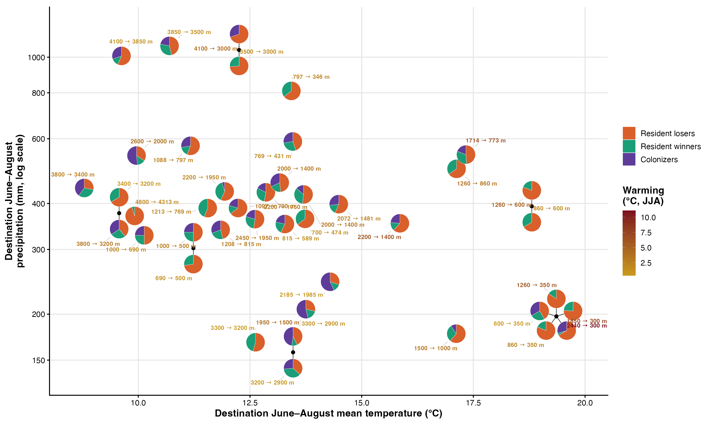
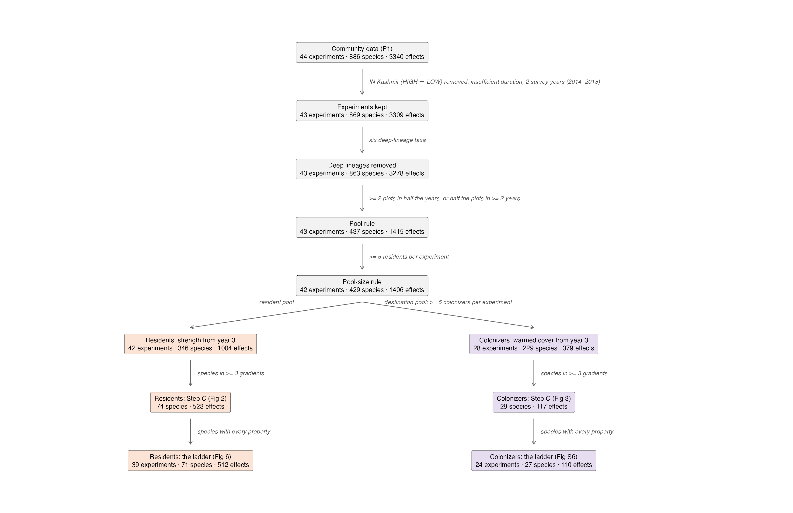
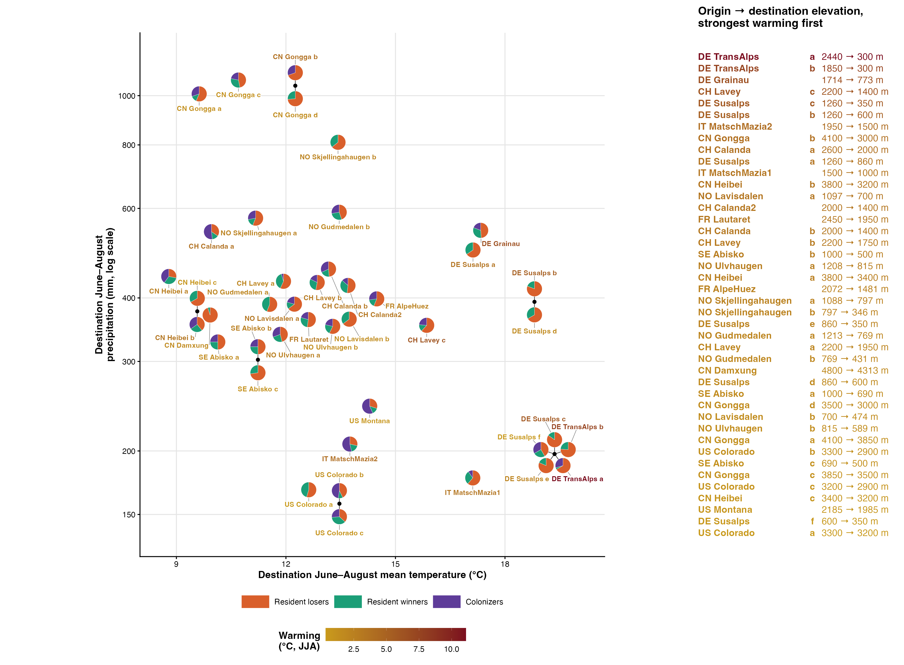
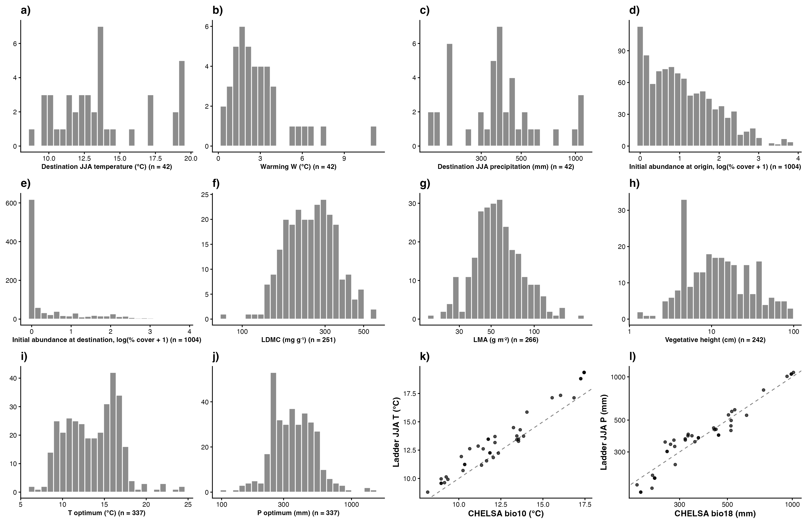

# Step 10: Figures, appendix and report

Draws what no earlier step produced: Fig 4, the 42 experiments in climate space with one pie per experiment counting resident losers and winners by the sign of their net strength from year 3 on and colonizers with net warmed cover above zero (Fig 5's classes, Bills 2 Nov); Fig S1 the data flow; Fig S2 and Table S3 the phylogenetic axes; Fig S4 the predictors before standardisation with the niche checks; Tables S1, S2, S4 and S5. Copies the reviewed figures of steps 03 to 07f under their final numbers (six main figures, Bills 2 Nov). Pies are drawn to one radius at their destination climate; the 15 experiments that share a destination climate (6 points) fan out around a black dot at that climate on short lines. 2 pairs of pies at different climates still touch.

## Counts

| item | n |
| --- | --- |
| experiments | 42 |
| resident effects (03b) | 1004 |
| net strength below zero | 703 |
| net strength above zero | 301 |
| colonizer effects (07a) | 379 |
| net warmed cover above zero | 262 |
| experiments with colonizers | 28 |
| experiments without purple | 14 |
| species analysed (residents or colonizers) | 426 |

## Fig 4 pies

| experiment_id | elevations | T (°C) | P (mm) | W (°C) | Resident losers | Resident winners | Colonizers |
| --- | --- | --- | --- | --- | --- | --- | --- |
| CH_Calanda::Cal::Nes | 2000 → 1400 m | 13.2 | 456 | 3.2 | 35 | 14 | 23 |
| CH_Calanda::Pea::Cal | 2600 → 2000 m | 10 | 540 | 3.8 | 20 | 8 | 30 |
| CH_Calanda2::Cal::Nes | 2000 → 1400 m | 13.7 | 423 | 3.2 | 27 | 18 | 7 |
| CH_Lavey::RIO::CRE | 2200 → 1950 m | 11.9 | 431 | 2.1 | 25 | 17 | 2 |
| CH_Lavey::RIO::MAR | 2200 → 1750 m | 12.9 | 429 | 3 | 27 | 15 | 9 |
| CH_Lavey::RIO::PRA | 2200 → 1400 m | 15.9 | 353 | 6 | 34 | 8 | 13 |
| CN_Damxung::HIGH::LOW | 4800 → 4313 m | 9.9 | 370 | 1.7 | 19 | 1 | 0 |
| CN_Gongga::A::M | 3850 → 3500 m | 10.7 | 1073 | 1.1 | 15 | 10 | 7 |
| CN_Gongga::H::A | 4100 → 3850 m | 9.6 | 1008 | 1.2 | 13 | 3 | 7 |
| CN_Gongga::H::L | 4100 → 3000 m | 12.3 | 1046 | 3.9 | 16 | 0 | 7 |
| CN_Gongga::M::L | 3500 → 3000 m | 12.3 | 1046 | 1.6 | 14 | 5 | 0 |
| CN_Heibei::3400::3200 | 3400 → 3200 m | 9.6 | 376 | 0.8 | 20 | 10 | 0 |
| CN_Heibei::3800::3200 | 3800 → 3200 m | 9.6 | 376 | 3.4 | 9 | 6 | 8 |
| CN_Heibei::3800::3400 | 3800 → 3400 m | 8.8 | 441 | 2.6 | 7 | 8 | 10 |
| DE_Grainau::HIGH::LOW | 1714 → 773 m | 17.3 | 543 | 6.4 | 23 | 15 | 9 |
| DE_Susalps::EB::BT | 1260 → 350 m | 19.4 | 197 | 5.8 | 22 | 4 | 0 |
| DE_Susalps::EB::FE | 1260 → 600 m | 18.8 | 393 | 5.2 | 21 | 5 | 0 |
| DE_Susalps::EB::GW | 1260 → 860 m | 17.1 | 497 | 3.6 | 17 | 9 | 0 |
| DE_Susalps::FE::BT | 600 → 350 m | 19.4 | 197 | 0.6 | 5 | 3 | 4 |
| DE_Susalps::GW::BT | 860 → 350 m | 19.4 | 197 | 2.2 | 22 | 5 | 0 |
| DE_Susalps::GW::FE | 860 → 600 m | 18.8 | 393 | 1.7 | 18 | 9 | 0 |
| DE_TransAlps::FP::BT | 2440 → 300 m | 19.4 | 197 | 11.1 | 18 | 1 | 8 |
| DE_TransAlps::SP::BT | 1850 → 300 m | 19.4 | 197 | 7.4 | 22 | 7 | 0 |
| FR_AlpeHuez::HIGH::LOW | 2072 → 1481 m | 14.5 | 398 | 2.4 | 27 | 8 | 13 |
| FR_Lautaret::G::L | 2450 → 1950 m | 12.6 | 363 | 3.2 | 23 | 12 | 9 |
| IT_MatschMazia1::High::Low | 1500 → 1000 m | 17.1 | 177 | 3.4 | 19 | 9 | 3 |
| IT_MatschMazia2::High::Low | 1950 → 1500 m | 13.8 | 206 | 4.1 | 8 | 5 | 15 |
| NO_Gudmedalen::Gudmedalen::Rambera | 1213 → 769 m | 11.6 | 389 | 2.1 | 14 | 11 | 0 |
| NO_Gudmedalen::Rambera::Arhelleren | 769 → 431 m | 13.5 | 590 | 1.9 | 13 | 8 | 8 |
| NO_Lavisdalen::Hogsete::Vikesland | 700 → 474 m | 13.7 | 363 | 1.5 | 11 | 6 | 0 |
| NO_Lavisdalen::Lavisdalen::Hogsete | 1097 → 700 m | 12.2 | 389 | 3.3 | 22 | 5 | 7 |
| NO_Skjellingahaugen::Skjellingahaugen::Veskre | 1088 → 797 m | 11.2 | 574 | 2.3 | 14 | 4 | 7 |
| NO_Skjellingahaugen::Veskre::Ovstedal | 797 → 346 m | 13.4 | 810 | 2.3 | 18 | 10 | 0 |
| NO_Ulvhaugen::Alrust::Fauske | 815 → 589 m | 13.3 | 352 | 1.4 | 16 | 6 | 6 |
| NO_Ulvhaugen::Ulvhaugen::Alrust | 1208 → 815 m | 11.8 | 339 | 2.6 | 18 | 9 | 12 |
| SE_Abisko::High::Low | 1000 → 500 m | 11.2 | 302 | 2.7 | 6 | 3 | 3 |
| SE_Abisko::High::Mid | 1000 → 690 m | 10.1 | 328 | 1.6 | 6 | 3 | 3 |
| SE_Abisko::Mid::Low | 690 → 500 m | 11.2 | 302 | 1.1 | 8 | 3 | 0 |
| US_Colorado::mo::pf | 3300 → 3200 m | 12.6 | 168 | 0.4 | 6 | 5 | 0 |
| US_Colorado::mo::um | 3300 → 2900 m | 13.5 | 158 | 1.2 | 9 | 2 | 10 |
| US_Colorado::pf::um | 3200 → 2900 m | 13.5 | 158 | 0.8 | 7 | 7 | 5 |
| US_Montana::High::Low | 2185 → 1985 m | 14.3 | 245 | 0.7 | 9 | 4 | 17 |

## Figures

| figure | file | content | from |
| --- | --- | --- | --- |
| Fig 1 | figures/main/fig1.png | Sankey of year-specific classes, residents and colonizers | steps 03, 07a |
| Fig 2 | figures/main/fig2.png | Residents' classification (Step C) | step 04 |
| Fig 3 | figures/main/fig3.png | Colonizers' classification (Step C) | step 07b |
| Fig 4 | figures/main/fig4.png | The experiments in climate space, count pies | this step |
| Fig 5 | figures/main/fig5.png | Traits of losers, winners and colonizers (pathways) | step 07f |
| Fig 6 | figures/main/fig6.png | The residents' ladder | step 06 |
| Fig S1 | figures/appendix/figS1.png | Data flow | this step |
| Fig S2 | figures/appendix/figS2.png | Phylogenetic axes (with Table S3) | this step |
| Fig S3a, b | figures/appendix/figS3a.png | Coefficients, residents (a) and colonizers (b) | steps 05, 07c |
| Fig S4 | figures/appendix/figS4.png | Predictors before standardisation, niche checks | this step |
| Fig S5a, b | figures/appendix/figS5a.png | Held-out metrics per gradient, residents (a) and colonizers (b) | steps 06, 07d |
| Fig S6 | figures/appendix/figS6.png | The colonizers' ladder | step 07d |
| Fig S7a, b | figures/appendix/figS7a.png | Random forest beside metafor, residents (a) and colonizers (b) | steps 06b, 07e |

## Tables

| table | file | content | rows |
| --- | --- | --- | --- |
| Table S1 | tables/tableS1.csv | Experiments | 42 |
| Table S2 | tables/tableS2.csv | Species list | 426 |
| Table S3 | tables/tableS3.csv | Phylogenetic axes | 3 |
| Table S4 | tables/tableS4.csv | Variance components per model | 54 |
| Table S5 | tables/tableS5.csv | Fixed-effect coefficients per model | 321 |

## Table S3, phylogenetic axes

| axis | variation (%) | most common families of the 15 most extreme species, negative | most common families of the 15 most extreme species, positive |
| --- | --- | --- | --- |
| PEV1 | 17.5 | Asteraceae (15) | Poaceae (15) |
| PEV2 | 11.4 | Poaceae (15) | Ranunculaceae (15) |
| PEV3 | 9.2 | Asteraceae (15) | Fabaceae (15) |

0 analysed species have no phylogenetic scores.

## Warnings captured

None.

## Deviations from PLAN.md

- One script for the whole step (Bills, 2 Nov).
- Six main figures (Bills, 2 Nov): the colonizers' classification becomes Fig 3, the climate space Fig 4, the pathways Fig 5, the ladder Fig 6; the results-dependent Fig 6 and Fig S8 dropped; the appendix closes up.
- Fig 4's pies count Fig 5's classes per experiment (sign of the net effect from year 3 on), not last-year significance classes; no purple in the experiments below the colonizer pool-size rule (Bills, 2 Nov).
- Coefficients, per-gradient metrics and the random forest stay as residents (a) and colonizers (b) files.
- `REPORT.html` not rendered: Quarto is not installed.
