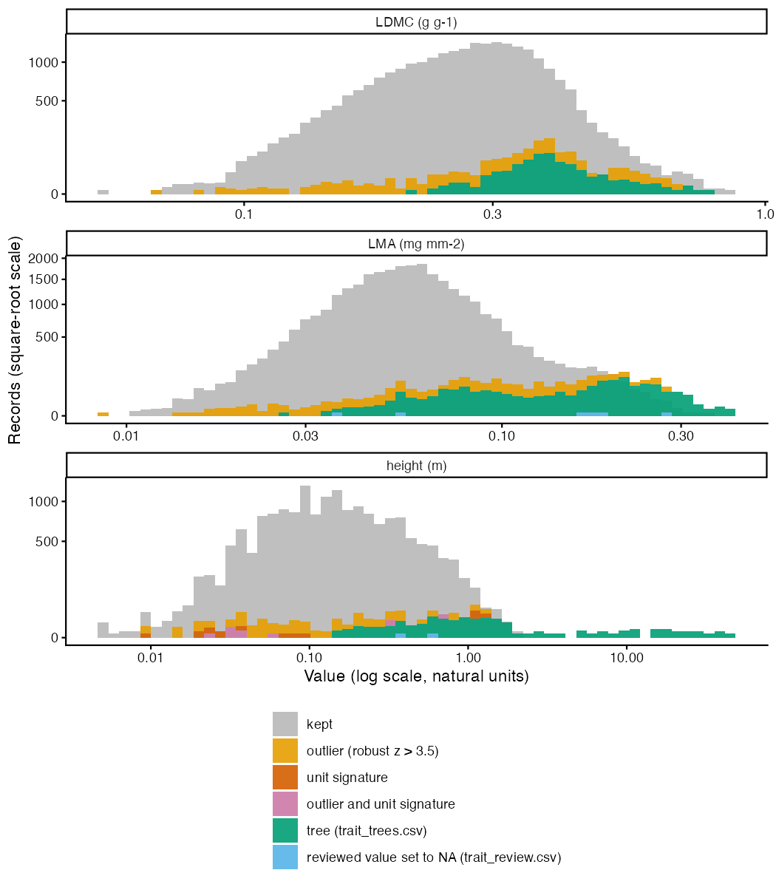

# P2: TRY traits

TRY records were read by TRY species ID (1339 IDs whose contributor or TRY name resolves to a study species in P1) and each record was attached to a species through its own resolved name (the contributor's `SpeciesName` first, TRY's `AccSpeciesName` only as fallback). Observations under experimental or ambiguous treatment values were removed, then duplicates, ErrorRisk >= 4, observations without coordinates and those in arid and tropical climate zones, as in the legacy pipeline. 666 of 903 study species have at least one trait. LDMC in g/g, LMA in mg mm-2 (1 / SLA per observation), height in m.

## Counts

| stage | rows | observations |
| --- | --- | --- |
| read by TRY species ID (1339 IDs) | 2877332 | 179926 |
| rows of study species (by our name or TRY's) | 2831526 | 176993 |
| experimental observations removed | 2516264 | 156149 |
| TRY duplicates removed | 2456403 | 154254 |
| quantitative, ErrorRisk < 3 | 145842 | 96728 |
| LDMC, SLA and vegetative height | 89203 | 61229 |
| with coordinates and a climate zone | 77846 | 50091 |
| outside the excluded zones Af, Am, Aw, BWh, BWk, BSh, BSk | 77362 | 49679 |

## Treatment values

Counted as natural (`prep/config/try_natural_values.csv`, compared after lower-casing and dropping trailing punctuation): "none", "no", "no treatment", "untreated", "natural", "natural environment", "natural env", "nat env", "natural conditions", "natural vegetation", "natural habitat", "natural forest environment", "natural grassland", "field", "field conditions", "in situ", "wild", "natural envireonment", "Natural environment (sun leaves)", "natural environment, sun exposed".

Every other value marks the observation as experimental: 437 distinct values on 44891 rows. The 40 most frequent:

| value | n_rows |
| --- | --- |
| natural environment (biodiversity experiment | 7927 |
| greenhouse | 1245 |
| low | 1019 |
| intermediate | 880 |
| high | 678 |
| meadows (m) and pastures (p) on south east to south west exposed slopes | 669 |
| 16 | 668 |
| common garden in growth containers with soil corresponding to seed origin | 597 |
| growth chamber | 585 |
| 1 | 561 |
| glasshouse | 536 |
| control | 526 |
| pm | 511 |
| outdoor cultivation in 30x30cm pots, standardized substrate | 486 |
| open-top chamber | 457 |
| 350 | 452 |
| 300 | 446 |
| 09/28/2016 | 400 |
| 2 | 372 |
| 1.12.2008 | 363 |
| 180 | 363 |
| 360 | 363 |
| 941 | 363 |
| well watered | 363 |
| glasshouse with ambient condition (retractable roof | 344 |
| natural_environment | 343 |
| 33209 | 331 |
| n | 331 |
| 25 | 321 |
| 0 | 314 |
| 65 | 310 |
| pot | 303 |
| conspecific | 302 |
| non-limiting | 300 |
| semi-controlled | 300 |
| growth chambers | 297 |
| heterospecific | 295 |
| sand | 269 |
| mesocosm | 263 |
| rehydr | 246 |

## Values not used

Non-positive values dropped before the medians (decided 26 Oct): 17 observations.

| trait | DatasetID | Dataset | observations |
| --- | --- | --- | --- |
| LDMC | 291 | MARGINS - leaf traits database | 1 |
| SLA | 291 | MARGINS - leaf traits database | 3 |
| vegetative_height | 186 | Growth and Herbivory of Juvenil Trees | 5 |
| vegetative_height | 247 | Traits of Halohytic Species in North-West-Germany | 6 |
| vegetative_height | 468 | Tundra Trait Team | 2 |

Text fields repaired from windows-1252 to UTF-8 after reading: LastName (50126 values), FirstName (116245 values), Dataset (22097 values), SpeciesName (2376 values), DataName (370 values), OriglName (8131 values), OrigValueStr (37703 values), OrigUnitStr (13190 values), Reference (431767 values), Comment (7852 values), StdValueStr (70 values).

## Screening (decided 29-30 Oct after the P7 checks)

Before the medians: the seven real trees (`prep/config/trait_trees.csv`; seedlings in the turfs, while TRY measures adult trees) carry no traits; species x trait values reviewed by name and set to NA (`prep/config/trait_review.csv`) are dropped; then records more than 3.5 robust SD from their species median (log scale, species x trait with at least 5 records) or at a 10, 100 or 1000x unit slip (at least 3 records) are dropped. No dataset is removed as a whole. Every removed record is in `data/derived/prep/trait_screen_removed.csv`.

| reason | records | species_x_trait |
| --- | --- | --- |
| outlier (robust z > 3.5) | 685 | 326 |
| outlier and unit signature | 14 | 9 |
| reviewed value set to NA (trait_review.csv) | 8 | 3 |
| tree (trait_trees.csv) | 2423 | 21 |
| unit signature | 15 | 8 |

Kept records in grey, removed records as coloured bars, each counted from zero; log value axis in natural units, square-root count axis so the few removed records are visible. Outliers are judged against their own species, so they lie across the whole range of a trait, not only in its tails; the trees are the long right tail of height.

Species x trait values lost: 24 (Acer pseudoplatanus LDMC; Acer pseudoplatanus LMA; Acer pseudoplatanus height; Betula pubescens LDMC; Betula pubescens LMA; Betula pubescens height; Euphrasia officinalis LMA; Euphrasia salisburgensis LMA; Larix decidua LDMC; Larix decidua LMA; Larix decidua height; Picea abies LDMC; Picea abies LMA; Picea abies height; Pilosella piloselloides height; Pinus sylvestris LDMC; Pinus sylvestris LMA; Pinus sylvestris height; Quercus robur LDMC; Quercus robur LMA; Quercus robur height; Sorbus aucuparia LDMC; Sorbus aucuparia LMA; Sorbus aucuparia height).

Species x trait medians moving by more than 10% (5):

| species | trait | median_before | median_after | change_pct |
| --- | --- | --- | --- | --- |
| Sonchus oleraceus | height | 0.8 | 1.15 | 43.7 |
| Trollius europaeus | height | 0.528 | 0.597 | 13.3 |
| Prunella vulgaris | height | 0.115 | 0.13 | 13 |
| Silene nutans | height | 0.4 | 0.45 | 12.5 |
| Plantago alpina | height | 0.0995 | 0.11 | 10.1 |

## Species with traits

| trait | species |
| --- | --- |
| LDMC | 559 |
| LMA | 619 |
| height | 559 |
| any of the three | 666 |

Study species without any of the three traits (237): Acer pseudoplatanus, Agastache urticifolia, Agrostis nervosa, Ajania przewalskii, Alchemilla alpigena, Alchemilla conjuncta, Alchemilla flabellata, Aletris pauciflora, Allium beesianum, Allium brevistylum, Allium prattii, Alopecurus aequalis, Anaphalis aureopunctata, Anaphalis flavescens, Anaphalis xylorhiza, Androsace graminifolia, Androsace mariae, Androsace minor, Androsace occidentalis, Androsace tapete, Anemonastrum demissum, Antennaria microphylla, Antennaria racemosa, Argentina leuconota, Argentina stenophylla, Arisaema parvum, Artemisia fulgens, Artemisia hedinii, Aster asteroides, Aster diplostephioides, Aster tataricus, Astragalus australis, Astragalus mongholicus, Athyrium spinulosum, Atriplex argentea, Berberis jamesiana, Betula pubescens, Boechera stricta, Bromus porteri, Calamagrostis rubescens, Calamagrostis tripilifera, Cardamine tangutorum, Carex cercostachys, Carex flava, Carex foetida, Carex kansuensis, Carex lehmannii, Carex nubigena, Carex phaeocephala, Carex sargentiana, Carex scabrirostris, Carex thibetica, Carpesium humile, Cerastium szechuense, Chamaesium viridiflorum, Chamorchis alpina, Chenopodium atrovirens, Chenopodium leptophyllum, Chrysosplenium pilosum, Claytonia lanceolata, Clinopodium polycephalum, Codonopsis foetens, Collomia linearis, Coluria longifolia, Comastoma pulmonarium, Comastoma tenellum, Corydalis pallida, Crepis pontana, Cryptogramma crispa, Cyananthus hookeri, Cyananthus incanus, Delphinium occidentale, Delphinium trichophorum, Draba spectabilis, Drymocallis glandulosa, Elsholtzia ciliata, Elsholtzia densa, Elymus bakeri, Epilobium fangii, Eremogone roborowskii, Erigeron coulteri, Erigeron elatior, Erigeron neglectus, Eritrichium hemisphaericum, Euphorbia pekinensis, Euphorbia prolifera, Euphorbia serrula, Euphorbia stracheyi, Euphrasia pectinata, Euphrasia regelii, Eurybia conspicua, Eurybia integrifolia, Fargesia spathacea, Fragaria nubicola, Galearis spathulata, Galium bifolium, Gentiana aristata, Gentiana crassuloides, Gentiana grumii, Gentiana parryi, Gentiana prostrata, Gentiana scabra, Gentiana squarrosa, Gentiana trichotoma, Gentianella azurea, Geranium pylzowianum, Goodyera oblongifolia, Hackelia micrantha, Halenia corniculata, Halerpestes tricuspis, Hansenia forbesii, Hansenia weberbaueriana, Hedysarum algidum, Helianthella uniflora, Helianthus petiolaris, Helictotrichon parlatorei, Helictotrichon tibeticum, Hemiphragma heterophyllum, Heterotheca pumila, Hypericum wightianum, Iliamna rivularis, Iris potaninii, Juncus allioides, Juncus himalensis, Juncus leucanthus, Juncus prismatocarpus, Juncus setchuensis, Koenigia cyanandra, Lappula occidentalis, Larix decidua, Leontodon hyoseroides, Leontopodium japonicum, Ligularia pleurocaulis, Ligularia sagitta, Ligusticopsis scapiformis, Lithophragma glabrum, Lithophragma parviflorum, Lomatogonium macranthum, Lomatogonium rotatum, Luzula alpina, Lycoris radiata, Maianthemum henryi, Maianthemum japonicum, Malaxis monophyllos, Meconopsis horridula, Melica spectabilis, Micranthes atrata, Micranthes occidentalis, Microsteris gracilis, Microula sikkimensis, Morina chinensis, Morina kokonorica, Morina nepalensis, Myosotis decumbens, Myriactis nepalensis, Nemophila breviflora, Notholirion bulbuliferum, Orobanche fasciculata, Osmorhiza berteroi, Oxytropis deflexa, Oxytropis densa, Oxytropis humifusa, Oxytropis yunnanensis, Packera cymbalaria, Parasenecio latipes, Pedicularis davidii, Pedicularis mussotii, Pedicularis rhynchodonta, Pedicularis sima, Perideridia gairdneri, Persicaria runcinata, Picea abies, Pinus sylvestris, Poa interior, Poa reflexa, Polygonatum cirrhifolium, Polypogon viridis, Pomatosace filicula, Potentilla brauneana, Potentilla clandestina, Potentilla pulcherrima, Primula deflexa, Primula malacoides, Primula serratifolia, Quercus robur, Ranunculus acriformis, Ranunculus inamoenus, Ranunculus japonicus, Rheum pumilum, Rhodiola fastigiata, Rhodiola quadrifida, Rhodiola yunnanensis, Rhododendron websterianum, Rudbeckia occidentalis, Rumex nepalensis, Sagina glabra, Sagina japonica, Salix serpillifolia, Saussurea ceterach, Saussurea globosa, Saussurea graminea, Saussurea katochaete, Saussurea pachyneura, Saussurea pulchra, Saussurea stella, Saxifraga cespitosa, Sedum triactina, Sibbaldia cuneata, Solidago multiradiata, Sorbus aucuparia, Soroseris hookeriana, Sphaeralcea ambigua, Stellaria arenarioides, Stellaria irrigua, Stellaria longifolia, Stipa capillacea, Swertia macrosperma, Symphyotrichum campestre, Tanacetum tatsienense, Thalictrum javanicum, Thalictrum occidentale, Thermopsis lanceolata, Thesium alpinum, Townsendia smithii, Vaccinium membranaceum, Vaccinium scoparium, Valeriana excelsa, Veronica allionii, Veronica ciliata, Veronica praecox, Veronica szechuanica, Viola nuttallii, Viola orbiculata, Viola philippica, Viola szetschwanensis, Youngia racemifera, Youngia simulatrix.

## Trusting TRY's accepted name against attaching by the record's own name

Records of species x trait whose count or median differs between the two (median differing by more than 5%): 151 of 1775 species x trait combinations. Festuca ovina now holds 0 records submitted as Festuca pratensis.

| species | trait | n_ours | median_ours | n_trusting_try | median_trusting_try | relative_difference |
| --- | --- | --- | --- | --- | --- | --- |
| Festuca ovina | LMA | 115 | 0.086095566078347 | 146 | 0.0788982259570495 | -0.084 |
| Festuca ovina | height | 91 | 0.07 | 116 | 0.0915 | 0.307 |
| Lolium pratense | LDMC | 245 | 0.27 | 228 | 0.269615384615384 | -0.001 |
| Lolium pratense | LMA | 188 | 0.0521770260927943 | 157 | 0.0535045478865704 | 0.025 |
| Lolium pratense | height | 258 | 0.31 | 233 | 0.28 | -0.097 |
| Festuca ovina | LDMC | 88 | 0.450356911 | 105 | 0.438461538 | -0.026 |

The 30 largest differences:

| species | trait | n_ours | median_ours | n_trusting_try | median_trusting_try | relative_difference |
| --- | --- | --- | --- | --- | --- | --- |
| Taraxacum officinale | LMA | 295 | 0.0369763729103778 |  |  |  |
| Taraxacum officinale | height | 178 | 0.205 |  |  |  |
| Taraxacum officinale | LDMC | 211 | 0.17674517293 |  |  |  |
| Anthoxanthum nipponicum | height | 17 | 0.093 |  |  |  |
| Anthoxanthum nipponicum | LDMC | 29 | 0.31958 |  |  |  |
| Aster bellidiastrum | LDMC | 15 | 0.134859011033919 |  |  |  |
| Trichophorum cespitosum | LDMC | 5 | 0.28929 |  |  |  |
| Anthoxanthum nipponicum | LMA | 32 | 0.051138333107998 |  |  |  |
| Aster bellidiastrum | LMA | 19 | 0.0355346634296281 |  |  |  |
| Centaurea montana | height | 2 | 0.41 |  |  |  |
| Centaurea montana | LMA | 3 | 0.0435016884812633 |  |  |  |
| Ranunculus tuberosus | height | 1 | 0.4325 |  |  |  |
| Ranunculus tuberosus | LMA | 4 | 0.0529513801683058 |  |  |  |
| Aster bellidiastrum | height | 13 | 0.08 |  |  |  |
| Aquilegia coerulea | LMA | 16 | 0.0511165599954287 |  |  |  |
| Euphorbia serpillifolia | LMA | 36 | 0.0320482168089139 |  |  |  |
| Dysphania incisa | height | 15 | 0.17 |  |  |  |
| Dysphania incisa | LMA | 29 | 0.0301617768028517 |  |  |  |
| Euphrasia minima | LDMC | 21 | 0.1809066221 |  |  |  |
| Knorringia sibirica | height | 1 | 0.25 |  |  |  |
| Aquilegia coerulea | height | 7 | 0.3072 |  |  |  |
| Hieracium triste | height | 7 | 0.1535 |  |  |  |
| Hieracium triste | LMA | 13 | 0.0462247341533242 |  |  |  |
| Cynoglossum officinale | height | 1 | 0.4 |  |  |  |
| Myosotis arvensis | height | 1 | 0.2 |  |  |  |
| Lappula squarrosa | height | 1 | 0.4 |  |  |  |
| Saussurea superba | LMA | 2 | 0.105225030902826 |  |  |  |
| Poa alberti | LMA | 9 | 0.0633457830369215 |  |  |  |
| Poa alberti | LDMC | 10 | 0.4825 |  |  |  |
| Trichophorum distigmaticum | LDMC | 12 | 0.419797096 |  |  |  |

The comparison with the frozen legacy traits of step 00 is in `reports/P5_compare_to_frozen.md`.

## Flagged TRY names of study species

A flagged TRY name is used when its accepted species is a study species and the matched name has the submitted genus and epithet (decided 26 Oct).

| used | reason | names |
| --- | --- | --- |
| FALSE | fallback source wfo | 3 |
| FALSE | fuzzy match | 11 |
| TRUE | fallback source wfo | 167 |
| TRUE | fallback source wfo; fuzzy match | 30 |
| TRUE | fuzzy match | 368 |

## Warnings captured

None.

## Deviations from the plan

(1) Community name decisions (e.g. Thlaspi montanum -> Noccaea fendleri for US_Montana) are not carried over to TRY names, because they concern the study records; TRY names are resolved by the rule alone, with the accepted-name renames of P1 (Taraxacum officinale) applied. (2) ErrorRisk < 3 instead of the legacy < 4 (decided 26 Oct): with experiments removed per observation, datasets that legacy dropped wholesale now contribute, and some of their records 3 to 4 SD from TRY's species mean gave implausible medians (Viola canina height 1.16 m, Euphrasia officinalis LMA 0.43 mg mm-2). (3) Non-positive values dropped (decided 26 Oct). (4) TRY text fields repaired to UTF-8 after reading (legacy repaired names only).
