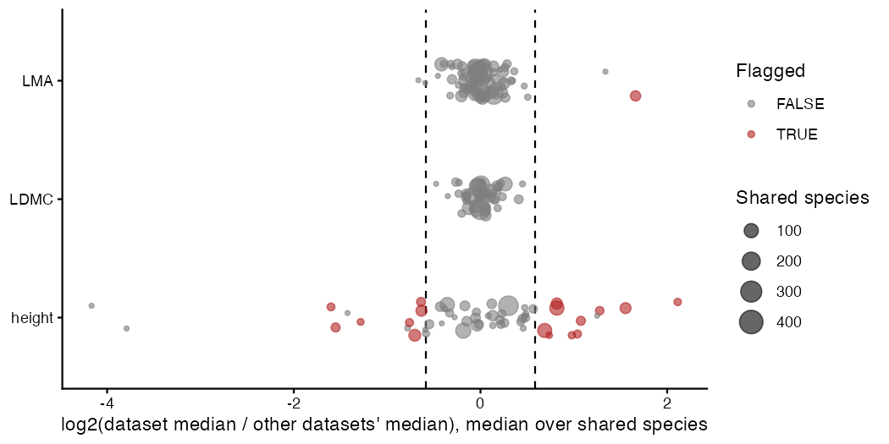

# P7: Trait checks

Checks of the 76,954 TRY records behind P2's medians (673 species; LDMC, LMA, height), within TRY only and on the log scale. Nothing is changed: the rules Bills accepts become P2 cleaning targets (decided 29 Oct). Thresholds: robust z 3.5; datasets off by 1.5x on at least 3 shared species; unit signatures at 10, 100 and 1000x within 15%. Full lists in `reports/P7_trait_checks/`.

## Counts

| check | n |
| --- | --- |
| records: outlier (|z| > 3.5) | 743 |
| records: unit signature | 32 |
| species x trait medians moving > 10% without flagged records | 5 |
| datasets off by >= 1.5x | 18 |
| species flagged against relatives or plausibility | 45 |
| fragile medians (< 3 records or one dataset) | 511 |

Species x trait groups with at least 5 records and zero spread (z undefined): 6.
Species check: spread = the larger of the relatives' own spread and the typical within-genus spread (log scale; LMA 0.18, LDMC 0.13, height 0.40).

Known case (P2 notes): Euphrasia officinalis LMA from dataset 524 flagged at record level: FALSE; dataset level: TRUE; species level: TRUE.

## Datasets off by 1.5x or more against the other datasets

| trait | dataset_id | offset | shared_species | records | species_fed | species_mostly_this_dataset |
| --- | --- | --- | --- | --- | --- | --- |
| height | 158 | 4.33 | 8 | 21 | 8 | 0 |
| LMA | 524 | 3.16 | 34 | 109 | 34 | 1 |
| height | 474 | 0.33 | 11 | 11 | 11 | 1 |
| height | 115 | 2.94 | 42 | 42 | 43 | 6 |
| height | 428 | 0.341 | 20 | 2413 | 20 | 16 |
| height | 272 | 0.411 | 5 | 5 | 5 | 1 |
| height | 65 | 2.42 | 15 | 28 | 15 | 1 |
| height | 192 | 2.11 | 20 | 20 | 21 | 2 |
| height | 90 | 2.05 | 12 | 29 | 12 | 2 |
| height | 273 | 1.97 | 7 | 7 | 7 | 0 |
| height | 76 | 1.76 | 99 | 170 | 105 | 21 |
| height | 50 | 1.76 | 44 | 264 | 45 | 7 |
| height | 544 | 0.59 | 12 | 12 | 12 | 3 |
| height | 247 | 1.67 | 3 | 38 | 3 | 2 |
| height | 25 | 0.614 | 55 | 184 | 58 | 11 |
| height | 86 | 1.61 | 96 | 110 | 101 | 13 |
| height | 547 | 0.643 | 19 | 20 | 22 | 5 |
| height | 320 | 0.645 | 43 | 615 | 46 | 17 |

## Records: the 20 largest departures from their species median

| species | trait | dataset_id | observation_id | SpeciesName | value | species_median | ratio | z | reason |
| --- | --- | --- | --- | --- | --- | --- | --- | --- | --- |
| Quercus robur | height | 90 | 957991 | Quercus robur L. | 40.5 | 0.99 | 40.9 | 6.12 | outlier |
| Quercus robur | height | 90 | 957935 | Quercus robur L. | 37.26 | 0.99 | 37.6 | 5.99 | outlier |
| Hypericum perforatum | height | 320 | 2474939 | Hypericum perforatum | 0.015 | 0.481 | 0.0312 | -10.42 | outlier |
| Hypericum perforatum | height | 320 | 2475028 | Hypericum perforatum | 0.015 | 0.481 | 0.0312 | -10.42 | outlier |
| Quercus robur | height | 90 | 957929 | Quercus robur L. | 30.7 | 0.99 | 31 | 5.67 | outlier |
| Quercus robur | height | 90 | 957965 | Quercus robur L. | 27.92 | 0.99 | 28.2 | 5.51 | outlier |
| Silene nutans | height | 320 | 2474880 | Silene nutans | 0.015 | 0.4 | 0.0375 | -9.92 | outlier |
| Quercus robur | height | 88 | 943617 | Quercus robur | 25.6 | 0.99 | 25.9 | 5.37 | outlier |
| Quercus robur | height | 158 | 1322258 | Quercus robur | 25 | 0.99 | 25.3 | 5.33 | outlier |
| Betula pubescens | height | 88 | 943718 | Betula pubescens | 5.27 | 0.27 | 19.5 | 6.68 | outlier |
| Quercus robur | height | 90 | 957995 | Quercus robur L. | 19 | 0.99 | 19.2 | 4.87 | outlier |
| Quercus robur | height | 88 | 943641 | Quercus robur | 18.8 | 0.99 | 19 | 4.86 | outlier |
| Quercus robur | height | 200 | 1434376 | Quercus robur | 17 | 0.99 | 17.2 | 4.69 | outlier |
| Quercus robur | height | 88 | 943725 | Quercus robur | 16.4 | 0.99 | 16.6 | 4.63 | outlier |
| Quercus robur | height | 88 | 943713 | Quercus robur | 15.6 | 0.99 | 15.8 | 4.55 | outlier |
| Rumex acetosa | height | 158 | 1322289 | Rumex acetosa acetosa | 1.1 | 0.07 | 15.7 | 4.69 | outlier |
| Rumex acetosa | height | 88 | 943677 | Rumex acetosa | 1.09 | 0.07 | 15.6 | 4.68 | outlier |
| Quercus robur | height | 200 | 1434378 | Quercus robur | 15 | 0.99 | 15.2 | 4.48 | outlier |
| Quercus robur | height | 88 | 943702 | Quercus robur | 14.7 | 0.99 | 14.8 | 4.45 | outlier |
| Plantago lanceolata | height | 320 | 2475008 | Plantago lanceolata | 0.01 | 0.14 | 0.0714 | -4.31 | outlier |

## Species medians that move most without their flagged records

| species | trait | median_all | median_without | n_flagged | shift_pct |
| --- | --- | --- | --- | --- | --- |
| Sonchus oleraceus | height | 0.8 | 1.15 | 1 | 43.7 |
| Trollius europaeus | height | 0.528 | 0.597 | 4 | 13.3 |
| Prunella vulgaris | height | 0.115 | 0.13 | 1 | 13 |
| Silene nutans | height | 0.4 | 0.45 | 2 | 12.5 |
| Plantago alpina | height | 0.0995 | 0.11 | 2 | 10.1 |
| Pulsatilla vernalis | height | 0.05 | 0.045 | 1 | -10 |
| Rhinanthus major | height | 0.375 | 0.41 | 3 | 9.3 |
| Potentilla argentea | height | 0.22 | 0.24 | 1 | 9.1 |
| Pulsatilla alpina | LMA | 0.0618 | 0.0563 | 2 | -8.9 |
| Carex norvegica | LMA | 0.0673 | 0.0728 | 1 | 8.3 |
| Botrychium lunaria | height | 0.03 | 0.0275 | 1 | -8.3 |
| Lupinus argenteus | height | 0.37 | 0.4 | 5 | 8.1 |
| Lotus corniculatus | height | 0.25 | 0.27 | 4 | 8 |
| Tofieldia pusilla | height | 0.0465 | 0.05 | 1 | 7.5 |
| Cerastium fontanum | height | 0.25 | 0.265 | 2 | 6 |
| Quercus robur | height | 0.99 | 0.931 | 17 | -5.9 |
| Silene vulgaris | height | 0.365 | 0.386 | 4 | 5.6 |
| Lolium arundinaceum | height | 0.524 | 0.553 | 1 | 5.6 |
| Sonchus arvensis | LMA | 0.0237 | 0.0224 | 2 | -5.5 |
| Frasera speciosa | height | 0.134 | 0.127 | 2 | -5.4 |

## Species flagged against their relatives or by plausibility rules

| species | trait | median | reason |
| --- | --- | --- | --- |
| Bromus inermis | height | 0.72 | far from its genus (robust z 3.6, 3 relatives) |
| Campanula rapunculoides | LDMC | 0.142 | far from its genus (robust z -4.3, 3 relatives) |
| Campanula rapunculoides | LMA | 0.0223 | far from its genus (robust z -4.6, 4 relatives) |
| Cirsium acaule | height | 0.085 | far from its genus (robust z -5.8, 4 relatives) |
| Cirsium oleraceum | LMA | 0.0303 | far from its genus (robust z -3.6, 4 relatives) |
| Crepis aurea | height | 0.08 | far from its genus (robust z -4.9, 4 relatives) |
| Draba aizoides | LDMC | 0.28 | far from its family (robust z 4.8, 8 relatives) |
| Drymaria molluginea | LDMC | 0.135 | LMA and LDMC at opposite extremes |
| Drymaria molluginea | LMA | 0.121 | LMA and LDMC at opposite extremes |
| Epilobium anagallidifolium | height | 0.05 | far from its genus (robust z -7, 3 relatives) |
| Epilobium angustifolium | height | 0.855 | far from its genus (robust z 7.2, 3 relatives) |
| Epilobium lactiflorum | height | 0.05 | far from its genus (robust z -7, 3 relatives) |
| Epilobium obscurum | height | 0.8 | far from its genus (robust z 7, 3 relatives) |
| Erigeron uniflorus | height | 0.0325 | far from its genus (robust z -4.2, 6 relatives) |
| Euphrasia officinalis | LMA | 0.173 | far from its genus (robust z 5.4, 4 relatives) |
| Festuca thurberi | height | 0.56 | far from its genus (robust z 3.9, 6 relatives) |
| Galium aparine | LMA | 0.0204 | far from its genus (robust z -3.9, 9 relatives) |
| Gentiana nivalis | LDMC | 0.146 | far from its genus (robust z -3.7, 9 relatives) |
| Geum aleppicum | LDMC | 0.165 | far from its genus (robust z -4, 4 relatives) |
| Geum montanum | height | 0.049 | far from its genus (robust z -4.9, 4 relatives) |
| Hieracium umbellatum | height | 1.03 | far from its genus (robust z 4.5, 4 relatives) |
| Holcus lanatus | LDMC | 0.21 | graminoid LDMC below the herb median |
| Juncus alpinoarticulatus | LMA | 0.111 | far from its family (robust z 4.9, 12 relatives) |
| Kalmia procumbens | height | 0.0135 | far from its family (robust z -3.9, 9 relatives) |
| Kalmia procumbens | height | 0.0135 | woody, shorter than 95% of herbs |
| Lolium multiflorum | LDMC | 0.188 | graminoid LDMC below the herb median |
| Luzula pilosa | LDMC | 0.196 | graminoid LDMC below the herb median |
| Luzula sudetica | LDMC | 0.195 | graminoid LDMC below the herb median |
| Mutellina purpurea | height | 0.044 | far from its family (robust z -3.7, 23 relatives) |
| Myosotis alpestris | LMA | 0.046 | far from its genus (robust z 4.4, 3 relatives) |
| Neogaya simplex | height | 0.035 | far from its family (robust z -4.1, 23 relatives) |
| Noccaea montana | height | 0.0335 | far from its family (robust z -4.3, 15 relatives) |
| Pedicularis resupinata | height | 0.4 | far from its genus (robust z 3.9, 3 relatives) |
| Phyteuma hemisphaericum | LMA | 0.0781 | far from its genus (robust z 3.7, 3 relatives) |
| Phyteuma orbiculare | height | 0.283 | far from its genus (robust z 4.4, 3 relatives) |
| Pilosella piloselloides | height | 0.5 | far from its genus (robust z 6.5, 4 relatives) |
| Poa alberti | LDMC | 0.482 | far from its genus (robust z 4, 7 relatives) |
| Poa annua | LDMC | 0.189 | far from its genus (robust z -3.7, 7 relatives) |
| Poa annua | LDMC | 0.189 | graminoid LDMC below the herb median |
| Poa supina | LDMC | 0.187 | far from its genus (robust z -3.8, 7 relatives) |
... 8 more in `flagged_species.csv`.

## What to decide

1. Datasets: exclude a flagged dataset for that trait if its offset reflects a unit or protocol difference (the table above lists how many species medians it feeds and for how many it is the main source).
2. Records: drop outliers and unit-signature records as a rule, or only those that move a species median by more than 10%.
3. Species: species flagged against their relatives are inspected by name; the plausibility flags are soft and not exclusions by themselves.

## Warnings captured

None.

## Deviations from PLAN.md

None; a check of P2's inputs, requested 29 Oct.
